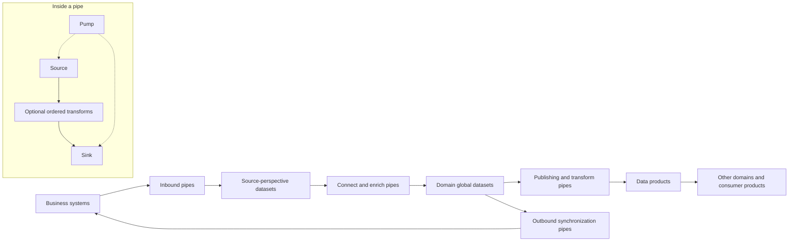
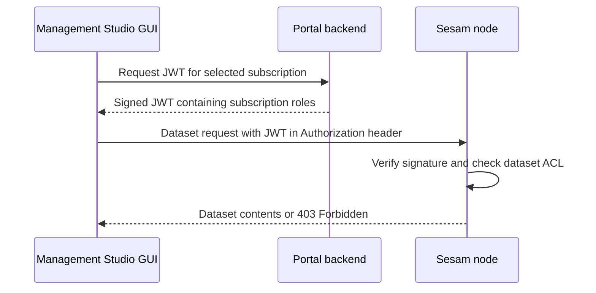

# Hub architecture, building blocks, and ownership boundaries

Sesam Hub is documented as a semantic data hub for master data synchronization and management. Its core model is **entities stored in datasets and moved by configured pipes**, not a collection of synchronous application endpoints. The architecture documentation relates this to data fabric and data mesh; those are product-model descriptions, not proofs of runtime performance or consistency guarantees. This page is a product reference, not a backend or UI implementation analysis.

Primary sources: [Data architecture](../../hub/data-architecture.rst#L1-L32) and [Building blocks](../../hub/documentation/building-blocks/index-building-blocks.rst#L1-L61) (`building_blocks`, `concepts-config`).

## Declarative model and retained perspectives

Configuration is data: JSON definitions of systems and pipes describe collection, connection, enrichment, and sharing. Configuration can be imported through the Service API or edited in Management Studio; component `_id` values must be unique across the solution, including multiple configuration files. DTL, the Data Transformation Language, declares how to construct output entities rather than hiding those mappings in application code. This does **not** mean the product contains no implementation code or cannot call custom services.

Sources: [General configuration](../../hub/documentation/service-configuration/general/configuration-general.rst#L1-L32) (`configuration-general`); [Core principles](../../hub/core-principles.rst#L210-L242) (`core_principles`); [DTL](../../hub/data-transformation-language.rst#L18-L38) (`DTL`); [Extension points](../../hub/extension-points.rst#L1-L19) (`developer_extension_points`).

The documented modeling approach retains different source-system representations instead of forcing every source into one fixed canonical model. Source properties can be namespaced to preserve their origin, then connected into a composite object in a global dataset. Namespaces are configurable, not an unconditional property of every entity: settings can be applied globally and overridden per pipe. Use `y:x` for property `x` in namespace `y:`; a property namespace is distinct from a typed namespaced identifier (NI) used as a reference.

Sources: [Parallel data models](../../hub/core-principles.rst#L40-L90) (`dynamic_data_model`); [Namespaces](../../hub/features/namespaces.rst#L8-L45) (`namespaces-feature`); [namespace versus NI](../../hub/concepts.rst#L38-L53) (`whatis-namespaces`).

A **datatype** is a business concept within a source system, such as CRM customers—not a primitive value type such as integer or datetime. A **global** groups datatypes in a domain; its global properties can express MDM-selected values, described as the equivalent of golden records. The **global model** is the collection of globals and their global properties. Global datasets can collect records without merging, merge them unchanged, or selectively merge properties. Business knowledge and appropriate cardinality are essential: a many-to-one ingestion can overwrite information rather than preserve all related records.

Sources: [Global, global model, datatype](../../hub/concepts.rst#L55-L95) (`whatis-global`, `whatis-global-model`, `whatis-datatype`); [Global datasets](../../hub/features/global-datasets.rst#L1-L16) (`global_datasets`). See [Master data management](../workflows/master-data-management.md).

### Domains and data products

The architecture guidance allows multiple organizational domains in a subscription, using permissions and config groups for autonomy and isolation. It recommends data products for cross-domain synchronization; synchronization inside a domain need not create one. A product is typically derived from a domain's globals. Publishing a global as-is exposes its underlying data and source-driven structural changes; transformed globals or other models can provide a more purpose-specific consumer representation. Do not equate a config-group name alone with an enforced security boundary.

Sources: [Domain ownership and data products](../../hub/data-architecture.rst#L8-L16); [role and resource permissions](../../hub/documentation/operations/security.rst#L23-L63) (`security_subscriptions_users_roles_and_permissions`); [Config groups](../../hub/features/api-config-groups.rst#L29-L46) (`api_config_groups`).

## Relationship model

*Conceptual relationships: pipes connect source perspectives, domain globals, and consumer-specific products; inside each pipe the pump drives source-to-sink processing. Globals and products are modeling choices, not mandatory stages for every integration.*

Diagram grounding: [Pipe composition](../../hub/documentation/building-blocks/pipes.rst#L1-L82) (`concepts-pipes` through `concepts-pumps`); [stream processing](../../hub/documentation/building-blocks/streams-of-entities.rst#L26-L31) (`concepts-streaming`); [global population and raw inputs](../../hub/features/global-datasets.rst#L8-L16), [L94–L98](../../hub/features/global-datasets.rst#L94-L98); [products](../../hub/data-architecture.rst#L11-L16); [return synchronization](../../hub/core-principles.rst#L132-L174).

## Primary concise glossary

These definitions are product vocabulary. Source links identify the authored primary reference, its RST label, and relevant lines; wiki links lead to usage detail.

| Term and synonyms | Meaning | Primary authored reference | Wiki detail |
| --- | --- | --- | --- |
| **Entity** — data entity | Dictionary of string keys and literal, list, or dictionary values, with typed values and reserved fields. `_id` is its required string primary key. | [Entity Data Model](../../hub/documentation/data-management/entity-data-model.rst#L1-L64), `entity-data-model` | [Entities and identifiers](../concepts/entities-datasets-and-identifiers.md) |
| **Dataset** | Internal entity log with primary and secondary indexes; dataset sinks write it and dataset sources expose it. | [Datasets](../../hub/documentation/building-blocks/datasets.rst#L1-L10), `concepts-datasets` | [Entities and datasets](../concepts/entities-datasets-and-identifiers.md) |
| **Pipe** | Atomic source-to-sink processing unit comprising source, optional transforms, sink, and pump; the configured way entities move between datasets. “Atomic unit” is not a claim of an all-or-nothing transaction across systems. | [Pipes](../../hub/documentation/building-blocks/pipes.rst#L1-L6), `concepts-pipes`; [configuration](../../hub/documentation/service-configuration/pipes/configuration-pipes.rst#L6-L13), `pipe_section` | [Pipes and systems](../configuration/pipes-and-systems.md) |
| **Source** | Exposes an entity stream from a dataset or external data, such as SQL rows, CSV, or API JSON. Continuation support varies. | [Sources](../../hub/documentation/building-blocks/pipes.rst#L13-L31), `concepts-sources` | [Pipes and systems](../configuration/pipes-and-systems.md) |
| **Transform / DTL** — Data Transformation Language | A transform converts an input entity stream to an output stream. DTL is the principal transform language for joining and reshaping data. | [Transforms](../../hub/documentation/building-blocks/pipes.rst#L35-L53), `concepts-transforms`, `concepts-dtl`; [DTL reference entry](../../hub/data-transformation-language.rst#L1-L24), `DTL` | [Build an integration](../workflows/build-an-integration.md) |
| **Sink** | Consumes entities supplied by a pump and writes to the target; owns target transaction boundaries and supported batching. Targets can be datasets or external systems. | [Sinks](../../hub/documentation/building-blocks/pipes.rst#L55-L71), `concepts-sinks` | [Pipes and systems](../configuration/pipes-and-systems.md) |
| **Pump** | Active execution part of a pipe: scheduled reading and writing, rescans, and configured failure handling. | [Pumps](../../hub/documentation/building-blocks/pipes.rst#L73-L82), `concepts-pumps`; [Scheduling](../../hub/features/scheduling-and-signalling.rst#L1-L10), `scheduling_and_signalling` | [Build an integration](../workflows/build-an-integration.md) |
| **System** — system component | Represents a connected database or API, centralizes connection configuration, and can provide introspection, pooling, and rate limiting. | [Systems](../../hub/documentation/building-blocks/systems.rst#L1-L14), `concepts-systems` | [Pipes and systems](../configuration/pipes-and-systems.md) |
| **Flow** — dataflow | Directed graph of chained pipes, with fan-out to downstream pipes; special cases can contain cycles. Studio can visualize and inspect it. | [Flows](../../hub/documentation/building-blocks/flows.rst#L1-L6), `concepts-flows` | [Build an integration](../workflows/build-an-integration.md) |
| **Global** — global dataset; **global model** | Domain grouping of source datatypes, potentially merged. Global properties express selected MDM values; the global model collects these globals and properties. | [Global concepts](../../hub/concepts.rst#L55-L83), `whatis-global`, `whatis-global-model`; [Global datasets](../../hub/features/global-datasets.rst#L1-L16), `global_datasets` | [Master data management](../workflows/master-data-management.md) |
| **Datatype** | Source-system business concept, such as customer, user, or employee; not the type of an individual value. | [Datatype](../../hub/concepts.rst#L84-L95), `whatis-datatype` | [Master data management](../workflows/master-data-management.md) |
| **Dependency** — dependency tracking | A relationship detected in DTL joins so a referenced-dataset change can cause affected source entities to be reprocessed. Supported for `dataset` sources, with join-expression caveats. | [Dependency Tracking](../../hub/features/dependency-tracking.rst#L1-L17), `dependency_tracking`; [Caveats](../../hub/dtl/caveats.rst#L1-L17), `caveats` | [Pipes and systems](../configuration/pipes-and-systems.md) |
| **Synchronization** — incremental processing; bidirectional synchronization | Keeping connected data updated through pipes. `since` continuation resumes a stream; change tracking avoids unchanged dataset writes. Bidirectional synchronization additionally returns data to source systems. | [Continuation](../../hub/features/continuation-support.rst#L1-L8), `continuation_support_feature`; [Change Tracking](../../hub/features/change-tracking.rst#L3-L20), `change_tracking`; [Bidirectional synchronization](../../hub/bidirectional-synchronization.rst#L1-L15), `bidirectional-synchronization` | [Build an integration](../workflows/build-an-integration.md) |
| **Lineage** — property lineage | Best-effort upstream/downstream property-dependency graph, derived from static pipe configuration analysis and inferred schemas. Not a complete execution audit. | [Property lineage](../../hub/features/property-lineage.rst#L3-L23), `property_lineage` | [Master data management](../workflows/master-data-management.md) |
| **Connector** | Collection of components needed to synchronize one or more datatypes with a system, inbound or outbound—not just the system definition. | [Connector](../../hub/concepts.rst#L97-L104), `whatis-connector` | [API and repository handoffs](../integrations/apis-and-repository-handoffs.md) |

Other names worth recognizing: **node** means the Sesam service instance; **Service API / Instance API** operates on that service and its data; **Management Studio** is its configuration and administration UI. Sources: [runtime components](../../hub/documentation/operations/behind-the-scenes.rst#L29-L35), [API](../../hub/api.rst#L1-L20), [Studio](../../hub/management-studio.rst#L1-L16).

## Processing, state, and safe-change constraints

- **Composition and defaults.** A pipe requires a source. `transform` accepts zero or more components, applied in order; omitting `sink` selects a dataset sink whose dataset ID equals the pipe `_id`. A flow is built by allowing downstream pipes to read the output datasets—not by embedding the whole integration in one pipe. [Pipe properties](../../hub/documentation/service-configuration/pipes/configuration-pipes.rst#L165-L190) (`pipe_properties`); [Flows](../../hub/documentation/building-blocks/flows.rst#L1-L6).
- **Progress versus change detection.** `since` is an opaque source-interpreted continuation token, not a universal timestamp. Dataset content hashing appends a new version only for a new or changed entity; dataset `_updated` values are incremental sequence counters used to record progress. These are separate mechanisms: rescanning input need not rewrite unchanged output. [Sources](../../hub/documentation/building-blocks/pipes.rst#L29-L31); [Change Tracking](../../hub/features/change-tracking.rst#L8-L28) (`change_tracking`).
- **Scheduling is asynchronous.** Pumps run at intervals or cron schedules and can rescan. Signalling schedules downstream execution on upstream changes; it does not interrupt an already-running pipe. The dataset-source reference qualifies the general “enabled by default” description: unless explicitly enabled on the source, signalling is automatically disabled for intervals under an hour or cron schedules. [Scheduling](../../hub/features/scheduling-and-signalling.rst#L8-L10); [dataset-source signalling](../../hub/documentation/service-configuration/pipes/configuration-sources-dataset.rst#L108-L121) (`dataset_source_property_supports_signalling`).
- **Deletion needs a complete view.** With dataset-sink `deletion_tracking` enabled (default `true`), a full run/rescan can mark previously stored entities absent from the new output as `_deleted: true`. Do not infer disappearance from a partial incremental response. [Deletion Tracking](../../hub/features/deletion-tracking.rst#L1-L8) (`deletion_tracking`); [sink setting](../../hub/documentation/service-configuration/pipes/configuration-sinks-dataset.rst#L140-L148) (`dataset_sink`).
- **Join dependencies have limits.** Dependency tracking uses inverse traversal to find source entities needing reprocessing. A `merge` source does not support DTL hop dependency tracking; split into a merge pipe and a downstream `dataset`-source transform pipe when needed. Earlier transforms must not change the join criteria relative to the source entity. Treat the narrative about moving entities to the log head as an explanation of reprocessing, not a current storage algorithm: `_tracked` is documented as belonging to an old implementation. [DTL caveats](../../hub/dtl/caveats.rst#L6-L17); [historical `_tracked`](../../hub/documentation/data-management/entity-data-model.rst#L124-L134).
- **Retries and recovery are configured.** Reading/writing errors are logged; failed writes can be retried, with configured terminal handling potentially using a dead-letter dataset. Configuration changes, restored or recreated datasets, and truncated sources can leave pipes out of sync. Automatic reprocessing can reset/rescan or rewind when enabled, but `reprocessing_policy` defaults to `continue`, not `automatic`. [Pumps](../../hub/documentation/building-blocks/pipes.rst#L78-L82); [Automatic Reprocessing](../../hub/features/automatic-reprocessing.rst#L8-L52) (`automatic_reprocessing`).
- **Two-way flow adds obligations.** Do not read the core-principles “multi-master replication” description as a promise that arbitrary cyclic integrations are safe. The bidirectional guide requires duplicate management, preservation of not-yet-observed source data, and completeness before propagating downstream updates. [Bidirectional requirements](../../hub/bidirectional-synchronization.rst#L26-L56).

## Ownership and API boundaries

The owner names below are the knowledge-network routing map supplied for this page, not names inferred from sibling code. Local authored product references establish the documented responsibilities and interfaces; no sibling implementation was inspected.

| Owner | Responsibility and boundary |
| --- | --- |
| `docs` — this reference repository | Authored product semantics, configuration references, API specifications, and operational guidance. Change documentation here; do not expect a prose change to change runtime behavior. |
| `lake` | Data-processing runtime and related services. Implementation questions about pipes, datasets, pumps, or service execution belong here. Locally, the single-machine node hosts the Service API; in the clustered model the aggregator hosts it, storage node holds configuration/topology, provisioner allocates processing pipes, and service nodes run pipes. |
| `portal` | Account/subscription management. The local Portal API specification documents listing, creating, updating, and deleting subscriptions, plus subscription JWT issuance. This is distinct from dataset processing. |
| `webconsole` | Management Studio UI. Users enter it by selecting a subscription in the portal; the UI configures, manages, and administers the subscription. Route UI implementation changes to this owner, rather than to the product reference. |
| `counting-semaphore` | Assigned owner for the semaphore service. The product references cited here do not establish its caller protocol or runtime interactions; this page asserts no dependency between it and pumps, provisioning, or scheduling. |

Runtime evidence: [Behind the scenes](../../hub/documentation/operations/behind-the-scenes.rst#L29-L41), [clustered roles L60–L76](../../hub/documentation/operations/behind-the-scenes.rst#L60-L76) (`multi_arch`). Portal evidence: [JWT and public-key endpoints](../../hub/swagger_portal.yaml#L300-L326), [subscription operations](../../hub/swagger_portal.yaml#L353-L449). UI evidence: [Management Studio introduction](../../hub/management-studio.rst#L9-L16) (`sesam-management-studio`).

### Documented user-to-node control boundary

*Documented authorization handoff: portal supplies subscription-scoped identity and roles; the node verifies the token and enforces resource permissions.* Source: [Security](../../hub/documentation/operations/security.rst#L26-L63) (`security_subscriptions_users_roles_and_permissions`). This shows product responsibilities, not an inspected backend call graph.

The Service API controls the service and its data, with `/api/pipes` and `/api/datasets` as central entrypoints. Supported pump operations are reported by `runtime["supported-operations"]` and submitted to `/api/pipes/{pipeID}/pump`. Configuration-group uploads through `/api/config` or `/api/config/{config-group}` **replace all configuration in the selected group**; they are not additive patches.

Sources: [Service API](../../hub/api.rst#L10-L20), [entrypoints and pump operations](../../hub/api.rst#L60-L123) (`api-top`); [config-group replacement](../../hub/features/api-config-groups.rst#L19-L46) (`api_config_groups`).

Two important API limits:

1. Do not write production data directly through the dataset API; use an HTTP endpoint source or JSON Push Protocol. [API warning](../../hub/api.rst#L150-L156).
2. The Service API is not intended for low-latency, high-throughput user-facing applications or large numbers of concurrent clients. Stream data into a dedicated publishing system for that requirement. [Streams of entities warning](../../hub/documentation/building-blocks/streams-of-entities.rst#L29-L31).

Custom sources, transforms, and sinks extend the model through external endpoints using URL systems or hosted microservices using microservice systems. For exact API/authentication contracts, connector protocols, and implementation questions—including semaphore interactions—continue to [APIs and repository handoffs](../integrations/apis-and-repository-handoffs.md). [Extension reference](../../hub/extension-points.rst#L7-L19) (`developer_extension_points`).

## Operations and validation routes

The deployment reference documents single-machine and clustered container-based variants and persistence using RocksDB with MessagePack storage. Do not confuse the logical JSON-based entity representation with that physical storage format. Subscription types and deployment details need their own operational checks; see [Deployment and durability](../operations/deployment-and-durability.md), grounded in [Behind the scenes](../../hub/documentation/operations/behind-the-scenes.rst#L8-L19).

For integration changes, the documented local test workflow drains non-output pipe queues and compares endpoint-pipe output with expected results under `expected/`, using paired `<name_of_pipe>.json` and `<name_of_pipe>.test.json` files. Run `sesam -vv test` only against an appropriate test instance. Output pipes must be disabled or unable to send data to external systems. Shared CI-node tests must be serialized because testing overwrites configuration. These are documented integration tests, not runtime tests executed for this page.

Sources: [Local tests](../../hub/documentation/operations/testing-locally.rst#L7-L21), [test command](../../hub/documentation/operations/testing-locally.rst#L178-L186) (`setup-local-tests`); [CI isolation](../../hub/documentation/operations/continuous-integration.rst#L7-L22) (`setup-ci`).

Next steps: [Quickstart](../quickstart.md) for the learning path; [Build an integration](../workflows/build-an-integration.md) for end-to-end work; [Pipes and systems](../configuration/pipes-and-systems.md) for exact configuration; [Entities, datasets, and identifiers](../concepts/entities-datasets-and-identifiers.md) for typed data contracts.
