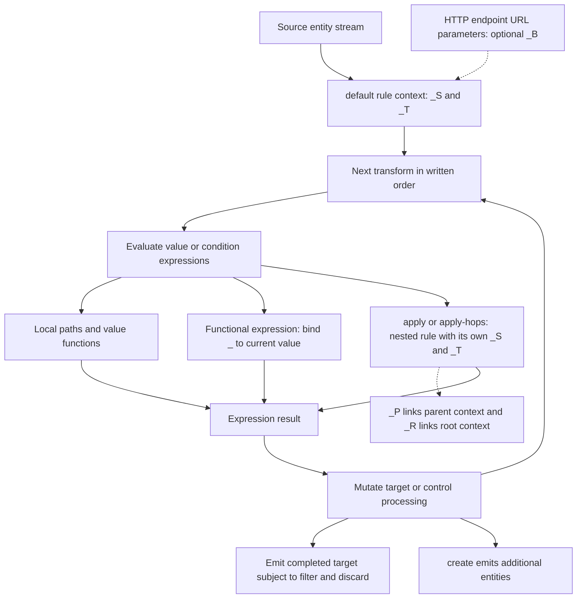

# DTL evaluation, paths, typing, and operator lookup

DTL (Data Transformation Language) is Sesam's JSON-based language for reshaping an entity stream. A pipe's DTL transform consumes source entities and constructs new target entities; it can also join other datasets and emit additional entities. This page describes documented evaluation semantics rather than interpreter internals.

For entity identity and storage semantics, see [Entities, datasets, and identifiers](entities-datasets-and-identifiers.md). For pipe configuration, see [Pipes and systems](../configuration/pipes-and-systems.md). For complete join patterns, continue to [DTL joins and transformation patterns](../workflows/dtl-joins-and-transformation-patterns.md).

## 1. Execution starts at `rules.default`

A DTL transform is configured as a pipe transform with `"type": "dtl"` and a `rules` object. **The named rule `default` is mandatory** and is applied to each source entity. Other named rules are reusable transformations invoked through `apply` or `apply-hops`. A pipe can have one transform configuration or a chain of them between its source and sink. The `default` rule name is distinct from the `default` transform operator, which adds a property only if it does not already exist on the target.

The distinction between the two kinds of DTL function is important:

- **Expressions return values**, without side effects: for example, `["upper", "_S.name"]`.
- **Transform functions have side effects and no return value**: for example, `["add", "name", ["upper", "_S.name"]]` modifies the target entity.

Transform functions in a rule run **in the order written**. Later functions can read properties that earlier functions added to `_T`. Constructing a target does not imply copying all source properties: copy or add the fields you need explicitly.


*Evaluation sketch: ordered transforms consume expression results, while nested rules have distinct source/target pairs. The output exceptions are detailed below.*

### Output validity and configuration gates

The [DTL transform configuration](../../hub/documentation/service-configuration/pipes/configuration-transforms-dtl.rst) defines two particularly useful checks:

- `id_required` defaults to `true`. A missing or non-string target `_id` fails the transform. Invalid values passed to `create` or `create-child`—not a dictionary, missing `_id`, or non-string `_id`—also fail under this setting. With `false`, invalid values are ignored instead. Do not infer permissive behavior solely from the shorter function-reference descriptions.
- `trigger_on` can restrict transformation by a property path and a matching value, with `*` wildcard matching. A missing key or nonmatching value passes the entity through unchanged. This option is explicitly **experimental**.

DTL's target-mutation side effects are not the same concept as the pipe transform configuration's `side_effects` flag. That flag concerns changes to an external system and protects features such as preview from making inadvertent external changes; see [transform configuration](../../hub/documentation/service-configuration/pipes/configuration-transforms.rst#transform_properties).

## 2. Variables are evaluation contexts, not interchangeable aliases

The [built-in variable reference](../../hub/dtl/variables.rst#variables) defines exactly six variables:

| Variable | Meaning and scope | Example access |
| --- | --- | --- |
| `_S` | Source entity of the currently applied rule. Each value passed into a nested `apply` becomes that nested rule's source. | `_S.name` |
| `_T` | Primary target entity of that rule, including fields built so far. `_S` and `_T` occur as a pair in each applied transform. | `_T.orders` |
| `_P` | Parent context inside `apply`: a dictionary with `_S`, `_T`, and optionally another `_P`. It does **not** contain `_R`. | `_P._S._id`, `_P._P._T.description` |
| `_R` | Root context containing `_S` and `_T`; in practice, the outermost `default` rule's context. | `_R._T.name` |
| `_B` | Dictionary of URL-parameter bindings supplied by an HTTP endpoint sink. | `_B.foo` |
| `_` | Current value in functions accepting a functional expression, such as list `filter`, `sorted`, `min`, `max`, and `coalesce`. It is not a universally available source alias. | `_.amount`, `_.` |

An [HTTP endpoint sink](../../hub/documentation/service-configuration/pipes/configuration-sinks-http.rst#http_endpoint_sink) has no ordinary pump: entities flow when the endpoint is requested. Its URL parameters become `_B` bindings available to DTL transforms on that pipe. For example, `?foo=bar` supplies a `foo` binding with the string value `"bar"`.

### Small nested construction example

The examples here are synthetic, reference-derived expectations, **not recorded execution results**. Assume namespace processing is disabled and the source is:

```json
{"_id": "p1", "name": "Ada", "orders": [{"_id": "o1", "amount": 12}]}
```

The DTL transform fragment is:

```json
{
  "type": "dtl",
  "rules": {
    "default": [
      ["copy", "_id"],
      ["add", "name", ["upper", "_S.name"]],
      ["add", "orders", ["apply", "order", "_S.orders"]],
      ["add", "order_count", ["count", "_T.orders"]]
    ],
    "order": [
      ["copy", "_id"],
      ["add", "amount", "_S.amount"],
      ["add", "owner", "_P._S._id"]
    ]
  }
}
```

Expected primary target:

```json
{
  "_id": "p1",
  "name": "ADA",
  "orders": [{"_id": "o1", "amount": 12, "owner": "p1"}],
  "order_count": 1
}
```

Inside `order`, `_S._id` is `"o1"`, while `_P._S._id` and `_R._S._id` identify the outer source `"p1"`. The count uses the already-constructed `_T.orders`. `apply` returns transformed values; it does not by itself make those orders standalone output entities. Use [`create`](../../hub/dtl/dtl-functions-transforms.rst#dtl_transform-create) for additional output entities, or [`create-child`](../../hub/dtl/dtl-functions-transforms.rst#dtl_transform-create-child) to add entities to the target's special `$children` property. Both require string entity IDs under normal validation.

### Three meanings to keep separate: selection, stream filtering, and discard

| Form | Effect |
| --- | --- |
| `["filter", ["gt", "_.amount", 100], "_S.orders"]` | **List expression**: returns orders whose amount is strictly greater than 100. Does not filter out the enclosing source entity. |
| `["filter", ["gt", "_T.order_count", 0]]` | **Transform**: continues only when the condition is true. False stops further transformations and suppresses the ordinary primary target. `["filter"]` stops unconditionally. |
| `["discard", ["gt", "_T.order_count", 0]]` | **Transform**: drops the primary target when the condition is false, without arranging deletion of a previous sink entity. `["discard"]` drops unconditionally. |

With a dataset sink, a failed transform `filter` uses `_filtered: true` emission so the sink can delete an existing, not-already-deleted entity on incremental synchronization. Handle `_filtered` carefully in later transforms. `discard` lacks that deletion behavior and is unsafe for an ID previously sent to the sink. Neither transform cancels entities **already emitted by `create`**; put the gate before creation if it must govern all output.

Exact references: [list `filter` / `filter_dtl_function`](../../hub/dtl/dtl-functions-lists.rst#filter_dtl_function), [transform `filter` / `dtl_transform-filter`](../../hub/dtl/dtl-functions-transforms.rst#dtl_transform-filter), [transform `discard` / `dtl_transform-discard`](../../hub/dtl/dtl-functions-transforms.rst#dtl_transform-discard).

## 3. Property paths stay inside values; hops cross datasets

### Property-path strings and quoting

`"_S.orders.amount"` starts at `_S`, visits `orders`, then `amount`; traversal through a collection can produce a list of amounts. These strings access only the current entity and its nested values, not arbitrary entities in other datasets.

The trailing dot is significant when referring to a whole variable value: `"_S."` is the source entity, `"_T."` the target, and `"_."` the current functional value.

Quote a path element with single quotes if it contains periods. Double a single quote within a quoted element:

```json
"_S.foo.'john.doe''s'.bar"
```

This selects the literal property name `john.doe's`, not several path steps. Its corrected explicit equivalent is:

```json
["path", ["list", "foo", "john.doe's", "bar"], "_S."]
```

### The explicit `path` expression

[`path` / `path_dtl_function`](../../hub/dtl/dtl-functions-dictionaries.rst#path_dtl_function) takes `PROPERTY_PATH` followed by `VALUES`. The latter expression is evaluated before traversal. The path expression resolves to a string or list of strings; those resulting strings are **literal property names**, not variable references. Non-string path items are ignored. The result can be a scalar or list; a missing property yields `null`.

| Expression | Expected value and type, with namespace processing disabled |
| --- | --- |
| `["path", "age", {"age": 24}]` | `24` — integer scalar |
| `["path", "age", ["list", {"age": 23}, {"age": 24}]]` | `[23, 24]` — list of integers |
| `["path", "age", {"name": "Ada"}]` | `null` |
| `["path", ["list"], {"age": 24}]` | `{"age": 24}` — dictionary, because the path is empty |

`["path", "placed_by", ["sorted", "_.amount", "_S.orders"]]` first sorts the order values, then projects their `placed_by` properties. This is local projection, not a join.

### Dataset traversal

Use [`hops` / `hops_dtl_function`](../../hub/dtl/dtl-functions-hops.rst#hops_dtl_function) to navigate beyond the current entity:

```json
["hops", {
  "datasets": ["orders o"],
  "where": [
    ["eq", "_S._id", "o.cust_id"],
    ["eq", "o.type", "BILLING"]
  ]
}]
```

Here `o` is a dataset alias. The first `eq` connects two dataset contexts; the second compares an alias property with a literal and acts as a filter. Only eligible `eq` expressions are joins: each argument must reference exactly one unique dataset alias, with the two sides connecting different datasets. All declared aliases must be joined and reachable from the source, or compilation fails. A list of `where` expressions is combined with `and`.

**Join `eq` means overlap; ordinary comparison `eq` means exact equality.** Joins succeed when any values overlap, including scalar-to-list and list-to-list joins. `null` values and deleted entities are not indexed for traversal. For overlap outside a join, use `intersects`, not ordinary `eq`.

By default, hops returns values from the last dataset alias. Its order is deterministic for the same input entities, based on entity `_id`, **not a requested business sort order**. Wrap the result in `sorted` or `sorted-descending` when ordering matters.

[`apply-hops` / `apply_hops_dtl_function`](../../hub/dtl/dtl-functions-dictionaries.rst#apply_hops_dtl_function) evaluates hops and then applies a named rule to the results. The reference specifically prohibits calling `apply` on a rule containing `hops` or `apply-hops`; use `apply-hops` for that case so dependency tracking can work.

For direct ID lookup, [`lookup-entity`](../../hub/dtl/dtl-functions-hops.rst#lookup_entity_dtl_function) returns an entity or `null` if absent. The dataset must be populated before the transform runs. Unlike hops, this operator **does not support dependency tracking**; changes in the looked-up entity do not automatically refresh dependent output.

See [the complete hops reference](../../hub/dtl/dtl-functions-hops.rst) for `return`, chained specifications, recursion, `max_depth`, `exclude_root`, `subsets`, `track-dependencies`, and `trace`. In particular, `subsets` replaces the deprecated `prefilters` property.

## 4. Read the signature, then check type and shape

### Argument notation

In the [argument-type reference](../../hub/dtl/argument-types.rst), `CONDITION(boolean-expression{1})` names a logical argument, its type, and its cardinality. `{1}` means exactly one, `{2}` exactly two, `{0|1}` optional, `{>=0}` zero or more, and `{>=1}` one or more. These logical names are not keywords to insert into JSON calls.

- `value-expression` may return `null`, a scalar, or a list.
- `function-expression` runs against individual values with `_` bound to the current value.
- `string` and `wildcard-string` describe constant literals; wildcard patterns support `*` and `?`.
- `transforms` accepts a transform or a list of transforms. For example, the transform variant of `if` takes transform branches; the expression variant takes value branches.

Boolean-expression truthiness is not Python or JavaScript truthiness: **only `false`, `null`, and `[]` evaluate to false; all other values evaluate to true**. In particular, do not treat `0` or `""` as false by assumption.

Use [`literal`](../../hub/dtl/dtl-functions-misc.rst#literal_dtl_function) to suppress interpretation: `["literal", "_S.foo"]` returns the string `"_S.foo"`, and `["literal", ["upper", "hello"]]` returns the array as data instead of executing `upper`.

### There is no universal list/scalar rule

A list-valued argument does not necessarily cause an operator to map. These small cases illustrate the contracts:

| Expression | Expected output | Contract |
| --- | --- | --- |
| `["list", 1, ["list", 2]]` | `[1, [2]]` | Constructs a list without flattening nested values. |
| `["combine", 1, ["list", 2, 3]]` | `[1, 2, 3]` | Combines argument values into one list; `combine` of `null` gives `[]`. |
| `["flatten", ["list", 1, ["list", 2, ["list", 3]]]]` | `[1, 2, [3]]` | Flattens one level, not recursively. |
| `["count", 123]` / `["count", null]` | `1` / `0` — integers | A scalar counts as one value; null as none. |
| `["first", 123]` / `["first", ["list"]]` | `123` / `null` | A scalar passes through; an empty sequence has no first value. |
| `["+", 10, ["list", 1, 2, 3]]` | `11` — integer scalar | Symbolic math uses the first list value. |
| `["plus", 10, ["list", 1, 2, 3]]` | `[11, 12, 13]` — list of integers | Named math maps the increment over the values. |
| `["gt", ["list", 5, 0], 3]` | `true` — boolean | Ordered comparisons use the first value of each argument. |
| `["eq", ["list", 1, 2], ["list", 2, 1]]` | `false` — boolean | Ordinary equality coerces to lists and compares exactly, including order. |
| `["concat", "A", 12, "B"]` | `"AB"` — string | Non-string inputs are ignored, not implicitly formatted. |

The named `plus`, `minus`, `multiply`, `divide`, `mod`, and `pow` functions are map-style; their symbolic equivalents `+`, `-`, `*`, `/`, `%`, and `^` use natural operand order and single values. Symbolic math returns `null` when either argument evaluates to `null`; `/` also returns `null` for a zero divisor. Use the [math reference](../../hub/dtl/dtl-functions-math.rst) rather than substituting a named function as if it were merely a spelling alias.

Many type predicates, such as `is-string`, `is-ni`, `is-dict`, and `is-decimal`, inspect only the first list item. They are **not whole-list validation**. Use per-item logic when every value must satisfy a condition.

### Typed values are not just formatted strings

The entity model supports JSON-like values plus Transit extension types. Extension values are represented as tagged strings in serialized JSON, but retain their type in DTL. For example:

| Expression | Expected typed result |
| --- | --- |
| `["integer", "12"]` | `12` — integer |
| `["decimal", "1.23"]` | Decimal `1.23`, represented with Transit as `"~f1.23"` |
| `["is-decimal", 1.23]` | `false` — an ordinary fractional JSON literal is a float, not a decimal |
| `["ni", "person", "p1"]` | NI, serialized as `"~:person:p1"` |
| `["is-ni", "person:p1"]` | `false` — a colon-containing ordinary string is not an NI literal |
| `["datetime", "2015-07-28T09:46:00.12345Z"]` | Datetime, serialized as `"~t2015-07-28T09:46:00.12345Z"` |

Decimals have arbitrary precision; floats use IEEE 754 binary64 and can lose precision when converted from decimals. Casts such as `integer`, `decimal`, `float`, and `datetime` process non-null values, silently ignore unparseable values by default, and support an optional default expression to replace failures. A default can introduce a different type—returning `"n/a"` on a numeric parse failure makes the output heterogeneous.

`json`/`json-parse` do not Transit-encode/decode; `json-transit`/`json-transit-parse` do. A JSON string containing `"~r..."` remains a string under ordinary `json-parse`, but can become a URI under Transit parsing. See [entity standard and extension types](../../hub/documentation/data-management/entity-data-model.rst#entity_data_types) and [JSON operators](../../hub/dtl/dtl-functions-json.rst).

### Null, empty list, and a list beginning with null

These are deliberately different contracts, not interchangeable fallback operators:

- [`coalesce`](../../hub/dtl/dtl-functions-nulls.rst#coalesce_dtl_function) selects the first non-null value **within VALUES**, or the first value satisfying an optional functional predicate.
- [`coalesce-args`](../../hub/dtl/dtl-functions-nulls.rst#coalesce_args_dtl_function) evaluates arguments in order, short-circuiting on the first **non-null argument**. `[]` is non-null: `["coalesce-args", null, ["list"], 7]` returns `[]`.
- [`is-null`](../../hub/dtl/dtl-functions-nulls.rst#is_null_dtl_function) returns true for `null`, `[]`, or a list whose first item is `null`. `is-not-null` is the opposite. Thus `["is-null", ["list", null, 7]]` returns `true`, even though a later item is non-null.
- [`if-null`](../../hub/dtl/dtl-functions-nulls.rst#if_null_dtl_function) uses that `is-null` test. `["if-null", ["list", null, 7], 9]` returns the integer `9`.
- [`add-if`](../../hub/dtl/dtl-functions-transforms.rst#dtl_transform-add-if) binds `_` to the **entire result** of VALUES when evaluating its condition. Its default condition is `["neq", "_.", null]`: it skips `null`, but adds `[]` and `[null]`. It is not equivalent to an `is-not-null` gate.

## 5. Namespace-aware lookup changes which fields match

Namespace behavior can be configured in service metadata and overridden per pipe. `namespaces.identity` and `namespaces.property` default to the pipe ID. When enabled, `add_namespaces` rewrites input before the first transform; `remove_namespaces` strips namespaces after the last transform. See [namespace configuration](../../hub/features/namespaces.rst#namespace_features) and [master data management](../workflows/master-data-management.md).

The [namespace-aware function reference](../../hub/dtl/namespaces.rst#namespace_aware_functions) identifies `add`, `add-if`, `default`, `make-ni`, `remove`, `copy`, `rename`, and `path`. Wildcards respect the boundary between namespace and identifier. Unqualified references generally match the same property identifier in all namespaces, but construction has its own rules: `add` prefixes new ordinary property names with the current property namespace, and `_id` string values with the identity namespace.

For example, with namespace-aware behavior enabled and current property namespace `bar`:

| Operation | Meaning |
| --- | --- |
| `["add", "age", 26]` | Adds `"bar:age": 26`. |
| `["add", "::age", 26]` | Adds the unqualified `"age": 26` as-is. |
| `["copy", "age"]` | Copies matching `age` properties from all namespaces, preserving their keys. |
| `["path", "age", {"age": 1, "foo:age": 2, "bar:age": [3, 4]}]` | Returns `[1, 2, 3, 4]`. |
| `["path", "foo:age", {"age": 1, "foo:age": 2, "bar:age": [3, 4]}]` | Returns integer `2`. |
| `["path", "::age", {"age": 1, "foo:age": 2, "bar:age": [3, 4]}]` | Returns integer `1`. |
| `["path", ":age", {"age": 1, "foo:age": 2, "bar:age": [3, 4]}]` | Returns `[3, 4]` from the current namespace. |

[`ni_escape_syntax`](../../hub/dtl/namespaces.rst#ni_escape_syntax) distinguishes `::` (interpret as-is) from `:` (relative to the current identity/property namespace). These prefixes are separate from single-quote escaping in path elements.

The expression `ni` casts strings and URIs to typed NIs without escaping strings. Omitting its namespace uses the global namespace for strings; URI input is accepted only when no explicit namespace is supplied. URI prefixes collapse to declared namespaces, or generated namespaces if necessary. Do not confuse this expression with the target-mutating `make-ni` transform.

## 6. Find operators by task, then follow the exact reference

This is a route to the catalog, not a replacement for it. Links with fragments identify **explicit RST labels** (shown in link text where useful); the full-file links provide signatures, defaults, examples, and edge cases. The [quick reference](../../hub/quick-reference.rst) separates [transform functions / `quickref_dtl_transform_functions`](../../hub/quick-reference.rst#quickref_dtl_transform_functions) from [expression functions / `quickref_dtl_expression_functions`](../../hub/quick-reference.rst#quickref_dtl_expression_functions).

### Entity construction

- Start with `add`, `add-if`, `copy`, `default`, `remove`, `rename`, `merge`, and `merge-union` in the [full transform reference](../../hub/dtl/dtl-functions-transforms.rst). Useful entry labels: [`dtl_transform-add`](../../hub/dtl/dtl-functions-transforms.rst#dtl_transform-add), [`dtl_transform-copy`](../../hub/dtl/dtl-functions-transforms.rst#dtl_transform-copy), [`dtl_transform-create`](../../hub/dtl/dtl-functions-transforms.rst#dtl_transform-create), and [`dtl_transform-create-child`](../../hub/dtl/dtl-functions-transforms.rst#dtl_transform-create-child).
- Nested shaping and dictionary assembly: [full dictionary reference](../../hub/dtl/dtl-functions-dictionaries.rst), especially [`apply_dtl_function`](../../hub/dtl/dtl-functions-dictionaries.rst#apply_dtl_function), [`dict_dtl_function`](../../hub/dtl/dtl-functions-dictionaries.rst#dict_dtl_function), and [`apply_hops_dtl_function`](../../hub/dtl/dtl-functions-dictionaries.rst#apply_hops_dtl_function). It also covers `items`, `keys`, `values`, `apply-ns`, and `strip-ns`.

### Selection and collection processing

- Projection, mapping, sorting, deduplication, grouping, slicing, and aggregation: [full list reference](../../hub/dtl/dtl-functions-lists.rst). Entry labels: [`map_dtl_function`](../../hub/dtl/dtl-functions-lists.rst#map_dtl_function), [`sorted_dtl_function`](../../hub/dtl/dtl-functions-lists.rst#sorted_dtl_function), [`group_by_dtl_function`](../../hub/dtl/dtl-functions-lists.rst#group_by_dtl_function), and [`distinct_dtl_function`](../../hub/dtl/dtl-functions-lists.rst#distinct_dtl_function).
- Local traversal: [`path_dtl_function`](../../hub/dtl/dtl-functions-dictionaries.rst#path_dtl_function). Cross-dataset selection: [full hops reference](../../hub/dtl/dtl-functions-hops.rst). Union, intersection, and difference: [full set reference](../../hub/dtl/dtl-functions-sets.rst), including [`intersects_dtl_function`](../../hub/dtl/dtl-functions-sets.rst#intersects_dtl_function).

### Comparisons and conditions

- Exact versus ordered comparison: [full comparisons reference](../../hub/dtl/dtl-functions-comparisons.rst), especially [`eq_dtl_function`](../../hub/dtl/dtl-functions-comparisons.rst#eq_dtl_function) and [`gt_dtl_function`](../../hub/dtl/dtl-functions-comparisons.rst#gt_dtl_function).
- Combinations and per-value predicates: [boolean logic](../../hub/dtl/dtl-functions-boolean-logic.rst); boolean casts/tests: [booleans](../../hub/dtl/dtl-functions-booleans.rst); fallback and missing-value tests: [nulls](../../hub/dtl/dtl-functions-nulls.rst).
- Returning a branch value: [expression conditionals](../../hub/dtl/dtl-functions-conditionals.rst), e.g. [`if_dtl_function`](../../hub/dtl/dtl-functions-conditionals.rst#if_dtl_function). Applying a branch of transforms: [`dtl_transform-if`](../../hub/dtl/dtl-functions-transforms.rst#dtl_transform-if), `case`, and `case-eq` in the transform reference.

### Strings and numbers

- Case, joining, splitting, replacement, patterns, padding, and substring operations: [full strings reference](../../hub/dtl/dtl-functions-strings.rst), starting at [`concat_dtl_function`](../../hub/dtl/dtl-functions-strings.rst#concat_dtl_function) or [`string_dtl_function`](../../hub/dtl/dtl-functions-strings.rst#string_dtl_function) when explicit casting is needed.
- Numeric parsing and type checks: [numbers](../../hub/dtl/dtl-functions-numbers.rst), especially [`integer_dtl_function`](../../hub/dtl/dtl-functions-numbers.rst#integer_dtl_function) and [`decimal_dtl_function`](../../hub/dtl/dtl-functions-numbers.rst#decimal_dtl_function). Arithmetic and rounding: [math](../../hub/dtl/dtl-functions-math.rst), with [`plus_symbol_dtl_function`](../../hub/dtl/dtl-functions-math.rst#plus_symbol_dtl_function) versus [`plus_dtl_function`](../../hub/dtl/dtl-functions-math.rst#plus_dtl_function).
- Specialized parsing/formatting: [phone numbers](../../hub/dtl/dtl-functions-phonenumbers.rst).

### Dates and timezones

- Parsing, formatting, differences, arithmetic, and shifts: [full date/time reference](../../hub/dtl/dtl-functions-date-and-time.rst), particularly [`datetime_parse_dtl_function`](../../hub/dtl/dtl-functions-date-and-time.rst#datetime_parse_dtl_function), [`datetime_format_dtl_function`](../../hub/dtl/dtl-functions-date-and-time.rst#datetime_format_dtl_function), and [`datetime_shift_dtl_function`](../../hub/dtl/dtl-functions-date-and-time.rst#datetime_shift_dtl_function). Timezone names: [supported timezones / `supported_timezones`](../../hub/dtl/timezones.rst#supported_timezones).
- `datetime` integer input means **nanoseconds since the Unix epoch**. Stored datetime values are UTC. `datetime-parse` interprets strings in its timezone (default UTC); `datetime-format` converts to its requested timezone (default UTC) and returns strings. Internal datetime precision is nanoseconds, but `%f` formatting supports microseconds, so formatting can lose precision.
- Timezone conversions use historical daylight-saving tables that can be corrected over time. Fixed conversion expectations should therefore be reviewed when timezone data changes.

### Identifiers and encoding

- Typed NIs and extraction: [namespaced identifiers](../../hub/dtl/dtl-functions-namespaced-identifiers.rst), starting with [`ni_dtl_function`](../../hub/dtl/dtl-functions-namespaced-identifiers.rst#ni_dtl_function). Also follow [URIs and URL quoting](../../hub/dtl/dtl-functions-uris.rst) and [UUIDs](../../hub/dtl/dtl-functions-uuids.rst).
- Binary values and Base64: [bytes](../../hub/dtl/dtl-functions-bytes.rst), including [`base64_encode_dtl_function`](../../hub/dtl/dtl-functions-bytes.rst#base64_encode_dtl_function). Serialization: [JSON and Transit](../../hub/dtl/dtl-functions-json.rst).
- Long-tail utilities: [miscellaneous functions](../../hub/dtl/dtl-functions-misc.rst), including `literal`, `tuples` for composite join keys, `hash128`, `completeness`, and [`is_changed_dtl_function`](../../hub/dtl/dtl-functions-misc.rst#is_changed_dtl_function). Read the state-tracking warning before using `is-changed` to reason about sink changes.

### Encryption

- Exact signatures and formats: [full encryption reference](../../hub/dtl/dtl-functions-encryption.rst), with [`encrypt_dtl_function`](../../hub/dtl/dtl-functions-encryption.rst#encrypt_dtl_function), [`encrypt_pgp_dtl_function`](../../hub/dtl/dtl-functions-encryption.rst#encrypt_pgp_dtl_function), and [`encrypt_pki_dtl_function`](../../hub/dtl/dtl-functions-encryption.rst#encrypt_pki_dtl_function); matching decryption operators are in the same file.
- `encrypt` uses symmetric Fernet encryption and returns encrypted bytes. The reference explicitly warns it is **not an end-to-end secure encryption system**, because the key is stored alongside the encrypted data, even with `$SECRET(...)`.
- OpenPGP encryption takes strings or lists of strings and produces ASCII OpenPGP messages. RSA/PKI encryption takes strings and produces bytes; it is intended for short passphrases/identifiers, not large payloads. Serialize non-string data first, and parse or cast decrypted strings back to the required type. Use OpenPGP rather than PKI for larger blocks, as the reference recommends.

### Deprecation check

The current [deprecations document](../../hub/deprecations.rst) places `curie`, `uri-expand`, `lookup`, `reference`, `ni-collapse`, and `ni-expand` in deprecated DTL material and says not to use those features. Their presence in older examples does not make them current recommendations. Use the active NI/URI/hops references to design new transformations; they are not guaranteed drop-in substitutes for legacy RDF behavior. Separately, hops' `prefilters` is deprecated in favor of `subsets`. See [History and policies](../references/history-and-policies.md) for broader compatibility context.

## 7. Reprocessing and focused validation

DTL edits affect what happens when input is processed; do not assume already-seen entities are refreshed solely because the JSON changed. The annotated example describes clearing the pipe's `last-seen` value with `update-last-seen` to reprocess input. The [automatic reprocessing policy](../../hub/features/automatic-reprocessing.rst) adds the current configuration context: `continue` is the default, while `automatic` resets a pipe when it detects out-of-sync factors, including configuration changes. Choose and verify the reprocessing policy or explicit reset/rewind procedure; see [Configuration change lifecycle](../testing/configuration-change-lifecycle.md).

[Dependency tracking](../../hub/features/dependency-tracking.rst) finds source entities affected by changes in joined datasets. It works by reversing `hops`/`apply-hops` traversal and is supported only with a `dataset` source, not a `merge` source. Preserve source join keys through preceding transforms: inverse traversal checks original source-dataset entities, not rewritten transform inputs. Namespace insertion and the dynamic `_S.$ids` value can also alter join keys; consult [DTL caveats](../../hub/dtl/caveats.rst) before relying on automatic join refresh.

The documented [local test workflow](../../hub/documentation/operations/testing-locally.rst) uses endpoint expected-output files under `expected/`, paired `<name_of_pipe>.json` and `<name_of_pipe>.test.json` files, and `sesam -vv test`. Tests can choose a pipe stage, and published-endpoint tests can supply bound `parameters`. Run against an isolated node with external output pipes disabled or unable to send data. These are configuration-level tests; the examples above have not been executed here.

Recommended focused fixtures:

1. **Ordering and contexts:** read a just-added `_T` field; apply a nested rule and distinguish `_S`, `_P._S`, and `_R._S`.
2. **Shape and nulls:** scalar, missing field, `[]`, `[null]`, and `[null, 7]`; compare `coalesce-args`, `if-null`, and default `add-if`.
3. **Paths and namespaces:** dotted and apostrophe-containing keys; unqualified, fully qualified, `:`, and `::` paths; namespace processing both enabled and disabled.
4. **Output gates:** true and false transform filters with a previously stored sink ID; verify incremental deletion and that an earlier `create` is not canceled. Check invalid/missing IDs under `id_required`.
5. **Joins and refresh:** list overlap versus ordinary equality, missing/deleted join targets, deterministic versus explicitly sorted output, joined-entity updates, and lookup without dependency tracking.
6. **Typed boundaries:** decimal versus float, invalid cast fallback, Transit versus ordinary JSON, explicit UTC/timezone parsing, and `_B` parameter variations on a published endpoint.

## 8. Read the published examples critically

The references are useful explanations, but some displayed examples are internally inconsistent. They should not be treated as evidence of a successful run:

- In the [annotated example](../../hub/dtl/annotated-example.rst), `order_count` is `2` in the proposed output, yet the final transform is `["filter", ["gt", "_T.order_count", 10]]`. That condition is false for two orders, so this entity would not survive as the ordinary primary output. With its dataset sink, the `_filtered` behavior applies instead. The explanation also says “Stop processing ... evaluates to true,” reversing the authoritative transform-filter contract.
- That example's proposed target uses numeric nested IDs `100` and `200`, but its joined and transformed order lists use strings `"100"` and `"200"`, and the `order` rule copies `_id` rather than converting it. Do not use that proposed target to infer an ID cast.
- The [path overview](../../hub/dtl/paths.rst) shows an extra comma in the explicit equivalent of the quoted path: `..., , "_S."]`. The corrected three-part call appears above. The [dictionary path examples](../../hub/dtl/dtl-functions-dictionaries.rst#path_dtl_function) also contain a malformed `1, "age" None` argument list: it is missing a comma and uses `None`, not JSON `null`. The description that non-string path items are ignored does not make the displayed JSON executable.

Resolve such discrepancies using the function contract and configuration validation, then retain a small regression fixture for the behavior you depend on. Start further reading at the [DTL introduction](../../hub/dtl/introduction.rst), [path overview](../../hub/dtl/paths.rst#path_expressions_and_hops), and [full quick reference](../../hub/quick-reference.rst).
