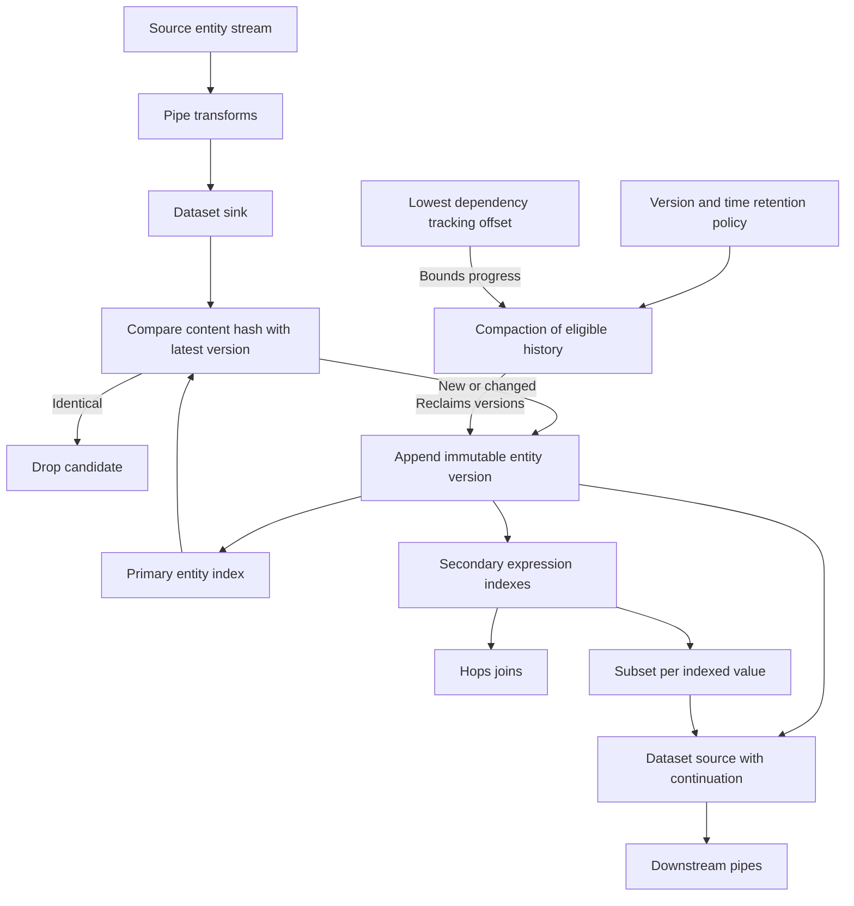

# Entities, dataset logs, typed values, and namespaces

An **entity** is Sesam's core data representation: a dictionary with string keys and values that can be literals, lists, or nested dictionaries. An entity must have a string `_id`. A **dataset** is a storage log of entity versions, supported by primary and secondary indexes—not just a mutable collection of current JSON objects.

Keep three identities separate:

- **Dataset id:** names the storage container.
- **Entity `_id`:** the string primary key within that dataset. A namespaced primary key is still a string, such as `demo-item:item-001`.
- **NI value:** a typed namespaced identifier used as a reference or alternative identity, serialized as `"~:demo-item:item-001"`. A string that merely contains a colon is not automatically an NI.

See [Hub model and boundaries](../architecture/hub-model-and-boundaries.md) for the system boundary, [Pipes and systems](../configuration/pipes-and-systems.md) for configuration, and [DTL evaluation and operators](dtl-evaluation-and-operators.md) for expression semantics.

## Dataset writes, indexes, reads, and retention

Sesam is primarily an asynchronous batching and stream-processing system. Its Service API is not designed or guaranteed for large numbers of concurrent, low-latency, high-throughput user-facing clients; publish into a dedicated serving system when that is required.

A pipe's pump pulls a stream from a source, applies transforms, and delivers the result to a sink. A normal `dataset` sink appends a version only if its `_id` is new or its content differs from the most recent version for that `_id`. It compares content hashes; an identical candidate is dropped rather than generating another log entry. Ordinary writes do not mutate earlier versions.


*The dataset log is the stored history; indexes provide identity lookup, joins, and subset views, while retention is constrained by dependency-tracking progress.*

The diagram's append-only contract describes normal writes. **Compaction can remove history**: append-only does not mean permanent archival retention.

### Write and read entrypoints

| Boundary | Contract that matters |
|---|---|
| Normal dataset sink | `sink.type: "dataset"`; `sink.dataset` defaults to the pipe id and is created on first write if absent. Its dataset id cannot contain `/` or target a `system:` dataset. |
| Dataset source | `source.type: "dataset"` with a required dataset id. `include_previous_versions` defaults to `false`: only the latest version per unique `_id` is returned. Enabling it exposes retained history, not history already compacted away. |
| Continuation | Dataset sources have fixed `supports_since: true`, `is_since_comparable: true`, and `is_chronological: true`. Pass continuation tokens back to the producer; do not decode them into application dates or identities. |
| Population | A sink dataset is considered populated when its initial offset is set. The default `set_initial_offset: "if-source-populated"` waits until the source is populated and all source entities have been consumed, propagating readiness downstream. `require_populated_input: true` on a dataset source prevents runs before the input is populated; its default is `false`. |
| Concurrent updates | Optional `enable_optimistic_locking: true` compares each candidate's `_updated` with the previous version. If at least one token does not match, an error is raised and no entities are written to the target dataset. This is a write precondition, not preservation of the supplied sequence token. |
| Sequence-preserving copy | A `replicated_dataset` sink, unlike the normal sink, preserves upstream entity sequence order and offsets. It does **not** support deletion tracking, entity re-posting, or circuit breakers. Use its dedicated contract for a faithful copy or rename, not assumptions from the normal writer. |

Normal dataset versions receive a dataset-local `_updated` sequence. After a successful pump run, the pipe saves the newest processed `_updated` as its `since` position. The public field contract still requires consumers to treat this token as opaque. Detailed checkpoint, reset, and reprocessing behavior belongs in [Synchronization and state](../configuration/synchronization-and-state.md).

The JSON Pull protocol returns a JSON **array**, even for one entity. `since` starts after the supplied offset, and `limit` caps the number of entities. Filtered publisher streams need special care: `X-Dataset-Filtered: true` means the consumer is not guaranteed to see an entity at `X-Dataset-Max-Updated`. Dataset recreation changes `X-Dataset-Generation`; backup restoration supplies restore UUID/offset headers. Do not equate an empty page with a new dataset or a timestamp checkpoint. See [Extensions and JSON protocols](../integrations/extensions-and-json-protocols.md).

### Secondary indexes and subsets

Secondary indexes are maintained automatically. They are declared implicitly by join expressions in `hops` and by subset definitions, or explicitly through dataset sink `indexes`. Orphaned indexes currently require removal through the UI or API.

A subset is an indexed view that behaves like a dataset in dataset sources and hops. It is a **functional index**, not necessarily a single-property index: almost all deterministic DTL expressions that do not reference other datasets are supported. One index provides a subset per indexed value/key.

For a dataset source, `subset` is an `eq` expression whose left side is the index expression and whose right side is a **literal**, not another expression:

```json
{
  "type": "dataset",
  "dataset": "demo-items",
  "subset": ["eq", "_S.category", "demo-category"]
}
```

This is a newly authored synthetic source fragment. For an NI subset key, use a literal such as `"~:demo-category:sample"`, not `["ni", "demo-category", "sample"]`. Use **version 2 indexes** for subsets because version 1 does not support deletes. Subset equality follows join equality: any overlapping value suffices, including scalar/list joins. `null` values and deleted entities are not indexed for joins and are not traversed by them; subset delete support must not be confused with joining tombstones as live entities.

`sink.indexes: "$ids"` maintains an alternative-identity index that the dataset browser uses for lookup through `_id` and `$ids`. `global_defaults.always_index_ids: true` enables this by default for dataset sinks; the service default is `false`.

### Retention is part of the dependency contract

The default compaction policy retains **two unique versions per entity**. Fewer than two makes dependency tracking best-effort: some reprocessable entities may be missed, especially in hops involving the sink dataset. Full or partial rescans are the documented countermeasure. `compaction.keep_versions: 0` requires a time threshold; it is not a standalone instruction to erase everything.

Compaction cannot proceed beyond the lowest tracking offset of pipes doing dependency tracking on the dataset. **Disabled pipes also hold back compaction.** Dependency tracking itself is supported only for pipes using a dataset source: tracked entities must be looked up by id before a specific point in time and fed through the pipe again. A remaining `_previous` pointer therefore does not guarantee its target is still retained.

Administer compaction schedules, disk usage, TTL settings, backups, and high-durability storage through [Deployment and durability](../operations/deployment-and-durability.md). Retention and durability solve different problems: keeping selected history does not protect writes from infrastructure loss.

References: [Datasets](../../hub/documentation/building-blocks/datasets.rst), [Streams of entities](../../hub/documentation/building-blocks/streams-of-entities.rst), [Dataset sink](../../hub/documentation/service-configuration/pipes/configuration-sinks-dataset.rst), [Dataset source](../../hub/documentation/service-configuration/pipes/configuration-sources-dataset.rst), [Replicated dataset sink](../../hub/documentation/service-configuration/pipes/configuration-sinks-replicated-dataset.rst), [Change tracking](../../hub/features/change-tracking.rst), [Compaction](../../hub/features/compaction-feature.rst), [Dependency tracking](../../hub/features/dependency-tracking.rst), [JSON Pull](../../hub/json-pull.rst).

## Reserved and semi-reserved fields

Root-level fields beginning with `_` are reserved. When writing an entity to a **normal dataset**, such fields are ignored except `_id` and `_deleted`; generated metadata belongs to the dataset writer, not the submitted content. This restriction is root-level only: nested dictionaries/child entities can contain underscore fields. The optimistic-locking precondition above is a deliberate use of incoming `_updated` before writing.

| Field | Exact meaning |
|---|---|
| `_id` | Required string primary key. Do not substitute an Integer, URI, or typed NI for the string. |
| `_deleted` | Only `true` marks deletion; every other value is interpreted as not deleted. Its state contributes to content hashing. |
| `_updated` | Sequence/order token, string or integer. Opaque to anyone other than the source that produced it; may be passed as HTTP `since`. |
| `_hash` | Generated string hash of content. Among root reserved fields, **only `_id` and `_deleted` contribute**. Ordinary fields, including `$` fields, are hashed. |
| `_previous` | Generated pointer to the previous version's `_updated`. Missing or `null` means no previous version. A non-null pointer can refer to a version reclaimed by compaction. |
| `_ts` | Generated real-world time when the entity was added to the dataset: an Integer of **microseconds since 1970-01-01 UTC**. Informal metadata, not an application modification date or continuation token. |
| `_filtered` | Boolean signal added by DTL `filter` for sink deletion handling; see below. It is not an ordinary stored content flag. |
| `_tracked` | Legacy dependency-tracking marker. `true` indicates materialization by the old implementation; newer tracking does not require modifying entities. Do not use it as a current tracking-status API. |

Fields beginning with `$` are **semi-reserved**: built-in components may produce or consume them, but they are normal fields for storage and hashing.

| Field | Producer/consumer and purpose |
|---|---|
| `$ids` | Holds additional identities as NI values. The merge source collects merged identities here; these are not replacements for the required string `_id`. |
| `$children` | `create-child` puts child entities here; `emit_children` can later expand them into standalone entities. Dataset sink `track_children` compares with the previous version and produces a delta to detect deleted children during incremental syncs; it is inferred `true` when transforms use `create-child`, unless explicitly overridden `false`. |
| `$replaced` | Merge source sets it `true` on an old output identity superseded by another entity id. It identifies a replacement, not an ordinary business deletion. |
| `$retract` | With `compaction.retract` enabled, `true` permanently removes earlier versions from that pipe's sink dataset while retaining the current version. Without enabling that feature, the field alone does not request pruning. |

The field prototype and Entity example in the authored [Entity Data Model](../../hub/documentation/data-management/entity-data-model.rst) contain malformed syntax. They are descriptive prototypes, not executable JSON. Examples on this page are independently authored synthetic examples, not silent corrections of those prototypes.

### Updates, tombstones, filtering, replacement, and erasure

| Operation | Effect and safety boundary |
|---|---|
| Ordinary update | Same `_id`, changed hashed content: append a new version. An unchanged candidate is dropped. Changing the deletion state is also a content change. |
| Tombstone | Write `_deleted: true` for an identity. This is a deleted **version**, not physical removal of all versions. |
| Disappearance from a full run | Dataset sink `deletion_tracking` defaults to `true`. At the end of a full run/rescan, identities present before the run but not seen in it receive deleted versions. Absence from one incremental batch is not this full-run disappearance test. |
| DTL filtering | A failed `filter` stops remaining DTL transforms. For a dataset sink it emits `_filtered: true` so an existing, not-already-deleted sink entity can be deleted even during incremental sync. Other sinks do not support this signal and the entity is discarded instead of passed to them. |
| Merge replacement | When merge membership/identity precedence changes the resulting id, the merge source emits a delete for the old id with `$replaced: true`. Do not treat this as removal of the represented object from every target system. Dataset source `include_replaced: false` suppresses such entities; default is `true`. |
| Delete TTL | `compaction.ttl_deletes_hours` makes a deleted entity eligible after the configured hours. When reclaimed, **all its versions** are removed. This is physical reclamation, not another update. |
| Retraction | `compaction.retract` defaults to `false`. With it enabled and `$retract: true` in output, all earlier versions are irreversibly removed; current version and deletion state are retained. It is idempotent and overrides `keep_versions` per entity. |

**Retraction is sink-local, not end-to-end erasure.** It does not alter upstream datasets or external consumers. `$retract` travels like any other field but may be dropped by a merge source or `emit_children`. Every downstream pipe that must honor it needs the field explicitly in its output and `compaction.retract` enabled. Retained current content may still contain personal data: use placeholders in experiments, and do not infer a compliance guarantee from this operation alone.

For explicit deletion-content control, set `_deleted` rather than relying on `filter`. A filter does not stop entities already emitted by `create`, and subsequent pipe transforms must handle `_filtered` carefully. The sink's `suppress_filtered` early-suppression optimization should only be used when output has exactly one version per `_id`; consult its reference before enabling it.

There is also an empty-input safety choice: dataset source `if_source_empty` defaults to `"accept"`, which allows previously synchronized entities to be deleted. `"fail"` fails the run and avoids those deletes. Use population and empty-source policies deliberately, especially while changing transforms or subset membership.

Merge identity is governed by equality rules, not merely similar-looking ids. Equality is transitive; `null` or empty equality results do not cause merging. New equality rules do not retroactively merge already-processed entities without reset/rescan. See [Master data management](../workflows/master-data-management.md) for merge design rather than collapsing alternative identities by hand.

References: [Entity Data Model](../../hub/documentation/data-management/entity-data-model.rst), [DTL filter](../../hub/dtl/dtl-functions-transforms.rst#dtl_transform-filter), [Deletion tracking](../../hub/features/deletion-tracking.rst), [Merge source](../../hub/documentation/service-configuration/pipes/configuration-sources-merge.rst), [Connector contract](../../hub/documentation/connectors/connector-contract.rst), [Compaction and retract](../../hub/features/compaction-feature.rst).

## Typed values and JSON/Transit encoding

JSON object shape is not the whole type contract. Sesam supports Dict, Entity, List, String, Integer, Decimal, Float, Boolean, and Null, plus the extension types below.

- Dict keys are strings. An Entity is a Dict with a string `_id`. Lists can mix types and nest dictionaries/lists.
- Integer has an unlimited positive/negative range. Decimal has arbitrary precision; prefer it where retaining precision matters. Float is IEEE 754 binary64 double precision and may lose precision.
- String's documented maximum length is `4294967296` bytes. This is **not** the dataset entity-size limit: dataset sink `max_entity_bytes_size` defaults to `104857600` bytes (100 MB), also configurable globally.
- Boolean is `true`/`false`; Null commonly represents a missing value. Latest changelog behavior serializes NaN and positive/negative infinity as `null`, not invalid JSON.

Supported Transit extension literals are JSON strings with `~` followed by a type tag:

| Type | Tag and synthetic example | Constraints |
|---|---|---|
| NI | `~:` — `"~:demo-item:item-001"` | Typed namespaced identifier, distinct from String and URI. |
| URI | `~r` — `"~rhttps://example.org/items/item-001"` | Typed Uniform Resource Identifier. |
| Date | `~t` — `"~t2024-01-02"` | Range `"~t0001-01-01"` to `"~t9999-12-31"`. |
| Datetime | `~t` — `"~t2024-01-02T03:04:05.123456789Z"` | Up to nanosecond precision; both date and time mandatory, optional fractional second, **UTC with mandatory `Z`**. Documented range `"~t0001-01-01T00:00:00Z"` to `"~t9999-12-31T23:59:59.123456789Z"`. |
| Bytes | `~b` — `"~bAAECAwQF"` | Base64-encoded binary. |
| UUID | `~u` — `"~u00000000-0000-4000-8000-000000000001"` | UUID as hexadecimal text. |
| Decimal | `~f` — `"~f12345678901234567890.1234567890"` | Arbitrary precision, unlike binary64 Float. |

Only these Transit extension types are supported; unrecognized Transit types are treated as strings. There is currently **no escaping support for literal strings starting with `~`**. Do not assume a general Transit implementation's escape or tag support applies to Sesam.

A synthetic entity illustrating the three identity representations and typed values:

```json
{
  "_id": "demo-item:item-001",
  "demo-item:label": "[personal-data placeholder]",
  "demo-item:related": "~:demo-item:item-002",
  "demo-item:link": "~rhttps://example.org/items/item-001",
  "demo-item:observed": "~t2024-01-02T03:04:05Z",
  "demo-item:amount": "~f12.3400",
  "$ids": ["~:demo-item:item-001"]
}
```

### Mixed-type ordering

The documented order from lowest to highest rank is:

1. Null
2. Boolean
3. Integer, Float, Decimal
4. Date, Datetime
5. UUID
6. Namespaced identifier (NI)
7. URI
8. String
9. Dict
10. Tuple
11. Bytes

Types sharing a rank are compatible and ordered together by value. Incompatible types are ordered by type rank, not lexical resemblance. For example, `["sorted", ["list", 1.5, "b", 1, "a", 2]]` returns `[1, 1.5, 2, "a", "b"]`.

**Source inconsistency:** the Standard types table calls Dict, List, and Null “not orderable”, while the Mixed type ordering section ranks Null and Dict and explicitly says Dict values are ordered by sorting keys then comparing key/value pairs. The ranking above follows that focused ordering section. It lists **Tuple**, not List; do not invent a List rank or equate arbitrary list comparison with tuple/composite-key ordering. Test the exact comparison context if relying on these edge cases.

Reference: [Entity types, extension tags, and ordering](../../hub/documentation/data-management/entity-data-model.rst), [serialization changelog](../../hub/changelog.rst).

## Source datatype mapping: normalize after knowing the import type

External types must be mapped into the entity model. For SQL sources, an unsupported column type must be blacklisted or coerced to a supported type by a custom query. **A native type name does not imply the same Sesam type across drivers.** These are the mappings documented in [Source datatype mappings](../../hub/source-datatype-mapping.rst), grouped without changing the native type names:

| Source | Native types | Sesam type |
|---|---|---|
| SQL Server | `INT`, `TINYINT` | Integer |
| SQL Server | `BIGINT`, `NUMERIC`, `DECIMAL` | Decimal |
| SQL Server | `FLOAT`, `REAL` | Float |
| SQL Server | `BIT` | Boolean (`0` is `false`, `1` is `true`) |
| SQL Server | `CHAR`, `VARCHAR`, `NVARCHAR`, `DATETIME2`, `TIME`, `XML` | String |
| SQL Server | `DATE`, `DATETIME` | Datetime |
| SQL Server | `UNIQUEIDENTIFIER` | UUID |
| Oracle | `INTEGER` | Integer |
| Oracle | `NUMBER` | Float, depending on column definition |
| Oracle | `BINARY_FLOAT`, `BINARY_DOUBLE` | Float |
| Oracle | `CHAR`, `VARCHAR`, `VARCHAR2`, `CLOB`, `NCLOB`, `XMLType` | String |
| Oracle | `DATE`, `TIMESTAMP` | Datetime |
| Oracle | `BLOB`, `RAW`, `LONG RAW` | Bytes |
| MySQL | `INT`, `TINYINT`, `BIGINT`, `BIT`, `BOOLEAN`, `YEAR` | Integer; `BIT`/`BOOLEAN` are `0` or `1`, and documented `YEAR` range is `1901` to `2155` |
| MySQL | `NUMERIC`, `REAL`, `DOUBLE`, `DECIMAL` | Decimal |
| MySQL | `FLOAT` | Float |
| MySQL | `CHAR`, `VARCHAR`, `TEXT`, `TINYTEXT`, `TIME` | String |
| MySQL | `BINARY`, `VARBINARY`, `TINYBLOB`, `MEDIUMBLOB`, `BLOB`, `LONGBLOB` | Bytes |
| MySQL | `DATETIME`, `DATE`, `TIMESTAMP` | Datetime |
| MySQL | `ENUM`, `SET` | Varying by enum/set type; `SET` is a list of values |
| PostgreSQL | `INTEGER`, `SMALLINT`, `BIGINT` | Integer |
| PostgreSQL | `NUMERIC`, `DECIMAL` | Decimal |
| PostgreSQL | `REAL`, `DOUBLE` | Float |
| PostgreSQL | `BOOLEAN` | Boolean |
| PostgreSQL | `CHAR`, `VARCHAR`, `TEXT`, `DATE`, `TIME`, `UUID`, `XML` | String |
| PostgreSQL | `TIMESTAMP` | Datetime |
| PostgreSQL | `BYTEA` | Bytes |
| PostgreSQL | `ENUM` | Varying by enum type |

Important temporal details:

- SQL Server `DATETIME2` is driver-formatted String, documented as `YYYY-MM-DD hh:mm:ss[.nnnnnnn] [+|-]tz:offset`; DTL `datetime-parse` can convert it. SQL Server and MySQL `TIME` strings use `hh:mm:ss[.nnnnnnn]`.
- PostgreSQL `DATE` is a `YYYY-MM-DD` String, not Date or Datetime. Its `TIME` is a String documented as `hh:mm:ss[.nnnnnnn][+|-tz:offset]`, with fractional seconds and timezone-offset components. PostgreSQL `UUID` is String, unlike SQL Server `UNIQUEIDENTIFIER`.
- MySQL `DATE` becomes Datetime at midnight, documented as `00:00:00.00000`.
- The mapping reference says timezone-bearing SQL Server `DATE`/`DATETIME`, Oracle `DATE`/`TIMESTAMP`, MySQL `DATETIME`, and PostgreSQL `TIMESTAMP` values are shifted to UTC on import.

The mapping document contains legacy tested-version statements and calls several native temporal ranges “unlimited to nanosecond precision”; the entity wire-type reference instead gives the bounded Date/Datetime ranges above. Do not treat the native-range wording as permission to emit an out-of-range Transit Datetime. Verify driver output and boundary values for the deployed source before writing precision-sensitive transforms.

## Namespaces: placement, inheritance, and typed references

Namespaces preserve attribute origin when combining sources and support late schema binding. The correct placement is **`namespace:identifier`**: an attribute `x` first created in pipe `y` normally becomes `y:x`, using that pipe's property namespace. Namespaces already carried by copied properties preserve their origin rather than being reassigned to every downstream pipe.

**Explicit inconsistency in the overview:** [concepts.rst](../../hub/concepts.rst) says `x` in pipe `y` becomes `x:y`, but its own examples put the pipe first. The focused [Namespaces feature](../../hub/features/namespaces.rst) explicitly specifies `y:x`, and [DTL namespace syntax](../../hub/dtl/namespaces.rst) agrees. **Use `y:x`; the `x:y` sentence is inconsistent, not an alternate namespace convention.**

Placement differs by role:

- A property name is a string such as `demo-item:label`.
- `_id` keeps its reserved property name; the **value** can be the string `demo-item:item-001`.
- A reference value is NI-typed, for example `"~:demo-item:item-002"`. It is not the same type as either of the strings above or `"~rhttps://example.org/items/item-002"`.

### Where namespace configuration acts

| Setting | Scope/default and execution point |
|---|---|
| `namespaced_identifiers` | Service metadata default `false`; pipes inherit it unless explicitly overridden. It enables namespace-aware behavior and defaults for addition/removal; it is not itself an instruction to strip every outbound value. |
| `namespaces.identity` | Pipe identifier namespace; defaults to the pipe id. |
| `namespaces.property` | Pipe property namespace; defaults to the pipe id. It can differ from the identity namespace. |
| `add_namespaces` | If `true`, adds current identity namespace to `_id` and current property namespace to properties **before the first transform**. Normally an inbound-pipe setting. |
| `remove_namespaces` | If `true`, removes namespaces from `_id`, properties, and NI values **after the last transform**. Normally an outbound-pipe setting. |
| `namespaces.default` | Service metadata Dict of namespace-to-URI expansions, used by RDF-capable components. This is a URI expansion registry, not the pipe's identity/property namespace selection. |

When namespace support is enabled in service metadata, the focused feature reference lists these source defaults for `add_namespaces: true`: `csv`, `kafka`, `ldap`, `sql`, `embedded`, `http_endpoint`, `json`. It lists these sink defaults for `remove_namespaces: true`: `csv_endpoint`, `elasticsearch`, `mail`, `rest`, `sms`, `solr`, `kafka`, `sql`, `http_endpoint`, `json`. Do not assume the same defaults for dataset-to-dataset pipes; inspect effective configuration and override deliberately.

Service metadata is the special configuration entity `_id: "node"`, `type: "metadata"`, editable as configuration, through the UI, or through the Service API. For example, this independently authored synthetic fragment enables support and registers a URI expansion:

```json
{
  "_id": "node",
  "type": "metadata",
  "namespaced_identifiers": true,
  "namespaces": {
    "default": {
      "demo-item": "https://example.org/items/"
    }
  }
}
```

Built-in expansions are available unless explicitly overridden: `_`, `rdf`, `rdfs`, `owl`, `foaf`, `wgs84`, `xsd`, `dc`, `skos`, `dcterms`, and `gs`. In particular, `_` maps to `http://example.org/`. The metadata reference lists their exact URIs. `global_defaults.symmetric_namespace_collapse` defaults to `false`; setting it `true` changes RDF/SPARQL URI/NI collapse and expansion to be symmetrical. The old `ni-collapse` and `ni-expand` DTL functions are **deprecated**, even though metadata documentation still mentions them.

### Namespace-aware DTL is not plain string matching

`add`, `add-if`, `default`, `make-ni`, `remove`, `copy`, `rename`, and `path` are namespace-aware. Wildcards respect the namespace/identifier boundary; `copy` and `remove` patterns use the **last colon** as the separator. Unqualified property references generally match that property in all namespaces. Consult each function rather than treating every unqualified argument identically:

- `add` of an unqualified property uses the current property namespace; for `_id`, string values use the identity namespace. A fully qualified property is preserved.
- `copy` of `label` can copy `label` in all namespaces. `rename` to an unqualified new name preserves each original namespace; renaming to one fully qualified property collects the values into that property.
- `":label"` is relative to the current property namespace. `"::label"` means the unqualified value as-is; `"::demo-item:label"` is equivalent to `"demo-item:label"`. Identity contexts use the current identity namespace for the single-colon form. These are **DTL argument escapes**, not Transit `~` escapes.

To construct a typed reference, `["ni", "demo-item", "item-001"]` produces `"~:demo-item:item-001"`. Without a `NAMESPACE` argument, `ni` uses the global namespace. URI values are accepted only without that argument: their prefixes collapse to declared namespaces, or to generated namespaces for undeclared prefixes. `ni` does not escape strings. `uri` casts strings to URIs without URI escaping; use deliberate URL quoting where required. Do not use colon detection as a substitute for `is-ni`/`is-uri` type checks.

References: [Namespaces feature](../../hub/features/namespaces.rst), [Service metadata](../../hub/documentation/service-configuration/configuration-metadata.rst), [Namespace-aware DTL and escapes](../../hub/dtl/namespaces.rst), [Transform functions](../../hub/dtl/dtl-functions-transforms.rst), [NI functions](../../hub/dtl/dtl-functions-namespaced-identifiers.rst), [URI functions](../../hub/dtl/dtl-functions-uris.rst), [Deprecation changelog](../../hub/changelog.rst).

## RDF boundary

RDF triples map subjects to entity identities, predicates to properties, and literal/URI objects to values. The RDF source turns blank nodes into child entities. On RDF output, nested entities become blank nodes, lists repeat the predicate for each entry, and RDF datatypes are assigned from property types. RDF language tags are not supported. Verify the receiver accepts blank nodes; otherwise flatten nested data with DTL before publishing. URI expansion configuration and the NI/URI distinction therefore affect interoperability, not just display labels.

See [Working with RDF](../../hub/rdf-support.rst) and [RDF source](../../hub/documentation/service-configuration/pipes/configuration-sources-rdf.rst) for format and endpoint details.

## Focused verification before changing a data flow

These are recommended contract checks, not a claim that tests were executed here:

1. **Hash stability:** submit the same synthetic `_id` and content twice; verify no new version. Change an ordinary or `$` field and verify a new version. Change only submitted `_ts`/`_hash` and verify they are not accepted as content overrides.
2. **Deletion lifecycle:** test an explicit tombstone, disappearance from a full rescan, and failure of a filter during an incremental run. Confirm downstream handling distinguishes `$replaced` from a real deletion. Test `if_source_empty` and population gating before enabling destructive full-run behavior.
3. **History and continuation:** compare latest-only reads with `include_previous_versions: true`, pass `_updated` back unchanged, and verify filtered publisher/header behavior. Check history after compaction rather than assuming `_previous` is dereferenceable.
4. **Type fidelity:** round-trip NI, URI, Decimal, Bytes, Date, and UTC nanosecond Datetime values. Test source-specific `DATE`, `UUID`, `BOOLEAN`, and large-number mappings and the mixed-type ordering your joins/transforms actually use.
5. **Namespace boundaries:** inspect before-first-transform and after-last-transform stages; verify string `_id`, NI references, explicit property/identity namespaces, copy/rename origin preservation, and colon escapes. Test URI expansion separately from namespace stripping.
6. **Retraction:** in a disposable dataset, create several versions, enable retract, and verify only the current version remains with unchanged deletion state. Check that upstream data is unchanged and downstream output deliberately carries `$retract`. Never test irreversible pruning on real personal data.

The documented local-testing workflow uses Sesam client `sesam -vv test`, an `expected` directory, and paired `<name_of_pipe>.json` / `<name_of_pipe>.test.json` files. It can compare stages or published endpoints and blacklist output properties. Because internal fields other than `_id` and `_deleted` are removed from test output, supplement fixture comparison with direct dataset/API inspection for hash, timestamp, offset, and retention checks. See [Testing locally](../../hub/documentation/operations/testing-locally.rst).
