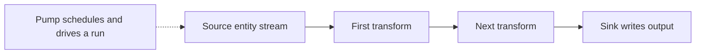

# Configuration structure, pipes, systems, and defaults

Use this page to choose where a setting belongs and which reference defines its contract. The repository supplies documentation and an API specification, not the Hub runtime implementation; the behavior below is the documented contract, and the examples are **synthetic illustrations**, not deployment templates or a list of defaults.

For the broader model see [Hub model and boundaries](../architecture/hub-model-and-boundaries.md). For a guided implementation see [Build an integration](../workflows/build-an-integration.md). Offset handling, rescans, completeness, and reset policy belong in [Synchronization and state](synchronization-and-state.md); authentication, ACLs, and secret handling belong in [Security and secrets](../operations/security-and-secrets.md).

## 1. Configuration entity boundary

The service accepts one or more JSON configuration files, imported through the Service API or created/edited in Sesam Management Studio. Conceptually the configuration is a **JSON array of objects**, primarily systems and pipes, with an optional special service-metadata entity.

- Every component `_id` must be unique **across the solution**, including across files in a multi-file configuration. A pipe and a system cannot share a component id.
- Pipe and system `_id` values are strings and must not contain `/`.
- A system's `type` identifies its family, for example `system:rest`, `system:url`, or a database-specific system type. A pipe's `type` must be `pipe`.
- A source or sink using a system has a `system` string matching that system's `_id`; supported transforms can also reference systems. This is a component reference, not a URL or a dataset id.
- Entity `_id` values carried through a flow are a different identity domain: the source contract requires an id unique to each logical entity within that flow, while allowing multiple versions. See [Entities, datasets, and identifiers](../concepts/entities-datasets-and-identifiers.md).

Sources: [General configuration](../../hub/documentation/service-configuration/general/configuration-general.rst), [Pipes](../../hub/documentation/service-configuration/pipes/configuration-pipes.rst), [Systems](../../hub/documentation/service-configuration/systems/configuration-systems.rst), and [Sources](../../hub/documentation/service-configuration/pipes/configuration-sources.rst).

### Pipe envelope

| Property | Type | Required? | Contract when omitted or supplied |
| --- | --- | --- | --- |
| `_id` | String | Yes | Service-wide unique component id; no `/`. |
| `type` | String | Yes | Only `pipe`. |
| `source` | Object | Yes in the property reference | Selects the source component. Explicitly configure it; see the publisher-example discrepancy below. |
| `transform` | Object or List | No | No transformation when omitted. A list is chained in its given order: each output becomes the next input. |
| `sink` | Object | No | Defaults to a `dataset` sink whose `dataset` is the pipe `_id`. Omission does **not** discard output. |
| `pump` | Object | No | Scheduling/retry configuration for pumped pipes; endpoint pipes are request-driven exceptions. |
| `name` | String | No | Human-readable name. Missing source, sink, and pump names are generated by postfixing the pipe name with `source`, `sink`, or `pump`. |
| `description`, `comment` | String or list of strings | No | Human-readable documentation. |

For configured sources, sinks, and transforms, `type` is a required string. Other required properties depend on that component's reference; an object containing only `type` is not a universal valid connector configuration.


*An ordinary pumped pipe applies transforms in configuration order before writing to its sink; the chain may also be absent.*

Sources stream entities; transforms can reshape, filter, or construct entities; sinks write to an internal dataset or an external target. The pump drives reading/writing and owns execution logging and failed-write retries. See the [pump reference](../../hub/documentation/service-configuration/pipes/configuration-pump.rst) for the operational contract rather than treating it as another transform.

### System envelope

A system centralizes reusable connection services and properties such as connection pooling, authentication, and protocol settings. Its optional `worker_threads` is an **Integer**, default `10`, limiting the number of concurrent pipes using that system; it is not the same as a SQL connection-pool size. Optional `name` is a String; `description` and `comment` accept a String or list of strings.

A system's optional `metadata` is an object with string keys and JSON-valued entries. Do not confuse this component annotation with the optional **service metadata entity**, illustrated as `{"_id":"node","type":"metadata",...}`. Service metadata configures installation-wide behavior and defaults, and can be added as a configuration entity, edited in the UI, or updated through the Service API.

Sources: [Systems common properties](../../hub/documentation/service-configuration/systems/configuration-systems.rst), [Service metadata](../../hub/documentation/service-configuration/configuration-metadata.rst).

## 2. Defaults are scoped, not one generic merge

First read the component property table, including dynamic defaults and exceptions. Then check whether it explicitly inherits from service metadata, a system, or a REST operation. Do not infer that every identically named property inherits, or that every object is deep-merged.

The API distinguishes `config.original` (raw user configuration) from `config.effective` (what runtime components use after environment-variable and shorthand expansion). Inspect the latter when diagnosing a surprising default or substitution; see the [API Pipe definition](../../hub/swagger_public.yaml).

### Representative inherited settings

All entries below are optional. The value column gives the documented baseline **when no override is supplied**, not a recommended production policy.

| Setting in service metadata | Type and baseline | Component scope / override |
| --- | --- | --- |
| `namespaced_identifiers` | Boolean, `false` | Pipes inherit it unless explicitly overridden on the pipe. |
| `global_defaults.infer_pipe_entity_types` | Boolean, `true`; `false` for developer subscriptions | Pipe-level `infer_pipe_entity_types` can configure schema inference locally. |
| `global_defaults.verify_ssl` | Boolean, `false` | Default for URL-system `verify_ssl`, and thus also applicable to REST systems which extend URL systems. Explicitly setting `true` in an example is an override, not the documented default. |
| `global_defaults.if_source_empty` | Enum<String>, `"fail"` or `"accept"`; metadata table leaves the default blank | Supporting sources override it with `if_source_empty`; SQL, REST, and dataset references list `"accept"`. `"fail"` fails an empty-source run and preserves previously synced dataset entities; `"accept"` permits deletion tracking to remove unseen entities. |
| `global_defaults.require_populated_input` | Boolean, `false` | Dataset-reading sources can override with `require_populated_input`; `true` prevents a run until the input dataset(s) are populated. |
| `global_defaults.use_signalling_internally` | Boolean, `true` | Applies to internal dataset-to-dataset flows. Supporting sources use `supports_signalling` for explicit overrides; see the schedule caveat below. |
| `dependency_tracking.dependency_warning_threshold` / `dependency_error_threshold` | Integer counts, `10000` / `50000` entities | Same pipe-level properties inherit these limits. Exceeding the warning threshold logs a warning; exceeding the error threshold fails the pump. |
| `dependency_tracking.dependency_warning_threshold_total_bytes` / `dependency_error_threshold_total_bytes` | Integer bytes, `33554432` / `134217728` | Same pipe-level properties inherit memory-size warning/error limits. Raising them can cause excessive memory use. |

The dataset-source table lists `supports_signalling` as `false`, but its prose describes effective global inheritance: implicit signalling is disabled when the interval is **less than one hour** or a cron expression is used, unless explicitly enabled on the source. An explicit `supports_signalling` setting applies regardless of schedule. Signals are best-effort and not persisted; retain a scheduled backup. This is a scoped/dynamic default, not a universal `false`.

Sources: [Service metadata](../../hub/documentation/service-configuration/configuration-metadata.rst), [Pipe properties](../../hub/documentation/service-configuration/pipes/configuration-pipes.rst), [Dataset source](../../hub/documentation/service-configuration/pipes/configuration-sources-dataset.rst).

### Component-specific defaults and precedence worth checking

- **Scheduling:** `pump.schedule_interval` is an optional Number in **seconds**; `pump.cron_expression` is an optional String evaluated in UTC. They are mutually exclusive, with cron taking precedence if both are supplied. With neither supplied, the documented default is `30` seconds ± `1.5` for dataset-source **and** dataset-sink pipes, and `900` seconds ± `45` for other pumped pipes. Endpoint components do not use this scheduling model.
- **Batching:** pipe `batch_size` is an optional Integer ≥ `1`, usually `100`, but depends on other settings; a REST sink makes the pipe default `1`. Buffering trades memory for throughput and only bulks writes if the sink supports batches. A sink may have its own `batch_size`, useful when transforms expand the input. Batch failure can fall back to individual retries; optional Boolean pump `fallback_to_single_entities_on_batch_fail` controls this behavior and defaults to `true`.
- **Preview safety:** common transform `side_effects` is an optional Boolean defaulting to `false`, but **HTTP and REST transforms default it to `true`**. A transform that changes a remote system must be marked as side-effecting to protect against inadvertent changes through features such as preview. Do not copy the generic default onto a write-capable transform.
- **URL transport:** optional Integer `connect_timeout` and `read_timeout` default to `60` and `1800` **seconds** respectively. Required String `url_pattern` inserts the relative URL at `%s`, or appends it if the token is absent. Deprecated `base_url` instead uses URL joining; the reference says exactly one of the two must be supplied.
- **HTTP retries:** optional Object `retry_strategy` on a URL system supplies status-code-specific pump retry defaults, including a `default` key. A retry property explicitly set on the pump takes priority over that strategy. Detailed retry and checkpoint behavior is covered by [Synchronization and state](synchronization-and-state.md).

Sources: [Pumps](../../hub/documentation/service-configuration/pipes/configuration-pump.rst), [Cron expressions](../../hub/cron-expressions.rst), [Pipe batching](../../hub/documentation/service-configuration/pipes/configuration-pipes.rst), [Transforms](../../hub/documentation/service-configuration/pipes/configuration-transforms.rst), [HTTP transform](../../hub/documentation/service-configuration/pipes/configuration-transforms-http.rst), [REST transform](../../hub/documentation/service-configuration/pipes/configuration-transforms-rest.rst), [URL system](../../hub/documentation/service-configuration/systems/configuration-systems-url.rst).

## 3. Representative building blocks

### REST system plus a collecting pipe

Illustrative configuration array, assuming a remote response shaped like `{"results":[{"id":"c1",...}]}` and an environment variable `catalog-host` supplied separately:

```json
[
  {
    "_id": "catalog-api",
    "type": "system:rest",
    "url_pattern": "https://$ENV(catalog-host)/api/%s",
    "verify_ssl": true,
    "operations": {
      "list-companies": {
        "method": "GET",
        "url": "companies",
        "payload_property": "results",
        "id_expression": "{{ id }}"
      }
    }
  },
  {
    "_id": "catalog-company-collect",
    "type": "pipe",
    "source": {
      "type": "rest",
      "system": "catalog-api",
      "operation": "list-companies"
    },
    "pump": {"cron_expression": "0/15 * * * *"}
  }
]
```

The REST system extends the URL system. The source requires String `system` and `operation`. Named operations require String `url` and case-sensitive String `method` (`GET`, `POST`, `PUT`, `DELETE`, `PATCH`, `OPTIONS`, or `HEAD`). Here the operation parses `results` and derives entity ids using Jinja `id_expression`; the omitted sink writes to dataset `catalog-company-collect`.

An `operations` Object must exist on the REST system or the referencing REST component. If defined in both places, the component's version takes precedence; store shared operations on the system. For a REST source, optional String `payload_property` and `id_expression` may be specified locally or in the operation, with the source taking precedence. Operation `headers` is an optional Dict<String,String>: keys override system header defaults, but cannot discard inherited keys. Secrets in source-operation definitions are restricted to operations defined on the system; consult the security page before moving such definitions into a pipe.

Sources: [REST system and Operation properties (`rest_operations`)](../../hub/documentation/service-configuration/systems/configuration-systems-rest.rst), [REST source](../../hub/documentation/service-configuration/pipes/configuration-sources-rest.rst).

### Dataset source and an ordered validation chain

Illustrative pipe reading the preceding dataset:

```json
{
  "_id": "catalog-company-checked",
  "type": "pipe",
  "source": {"type": "dataset", "dataset": "catalog-company-collect"},
  "transform": [
    {"type": "dtl", "rules": {"default": [["copy", "*"]]}},
    {
      "type": "json_schema",
      "schema": {
        "type": "object",
        "properties": {"_id": {"type": "string"}},
        "required": ["_id"]
      }
    }
  ]
}
```

The dataset source requires String `dataset`, returns only the latest version per entity by default (`include_previous_versions: false`), and needs no external system reference. The DTL transform requires an Object `rules` with a `default` named rule; optional Boolean `id_required` defaults to `true` and fails for missing/non-string target ids. DTL details belong in [DTL evaluation and operators](../concepts/dtl-evaluation-and-operators.md).

`json_schema` **annotates validation results rather than inherently rejecting invalid entities**: optional String `key_valid` defaults to `"valid"` (Boolean result), and `key_errors` defaults to `"errors"` (list of messages, added only when invalid). It requires Object `schema` unless String `schema_url` is supplied; external schemas also require String `system` referencing a URL system, and the fetched schema is stored under `schema` in the effective pipe configuration. Add explicit downstream policy if invalid records must not reach a target.

The omitted dataset sink writes to `catalog-company-checked`, creating the dataset on first write if absent. Dataset-sink ids cannot contain `/` or reference a `system:` dataset. Optional Boolean `deletion_tracking` defaults to `true`: after a full run, previously existing entities not seen during that run are deleted. This makes empty-source policy a consequential choice, not just a diagnostic preference.

Sources: [Dataset source](../../hub/documentation/service-configuration/pipes/configuration-sources-dataset.rst), [DTL transform](../../hub/documentation/service-configuration/pipes/configuration-transforms-dtl.rst), [JSON Schema validation](../../hub/documentation/service-configuration/pipes/configuration-transforms-json-schema-validation.rst), [Dataset sink](../../hub/documentation/service-configuration/pipes/configuration-sinks-dataset.rst).

### SQL source: table versus query

Illustrative **source fragment**, not a complete pipe; `warehouse-db` must be a configured SQL system:

```json
{
  "type": "sql",
  "system": "warehouse-db",
  "query": "select customer_id, modified_at, name from customers",
  "primary_key": "customer_id",
  "updated_column": "modified_at",
  "updated_query": "select customer_id, modified_at, name from customers where modified_at >= :since"
}
```

| SQL-source property | Type / requirement | Contract |
| --- | --- | --- |
| `system` | String, required | References a SQL system which supplies connection pooling/authentication. Source transactions are deliberately read-only. |
| `table` / `query` | `table`: String; `query`: String or List<String> | Alternative relation selectors. `table` takes precedence if both are supplied; schema belongs in optional String `schema`, not in `table`. Query string lists are joined with newlines. See the required-status inconsistency below. |
| `primary_key` | String or List<String> | A table may infer keys from metadata; a query requires an explicit key or compound-key list. |
| `updated_column` | String, optional | Enables `since` support dynamically. In the table case its type must support `>=` tests. |
| `updated_query` | String or List<String>, needed for query-based continuation | Full incremental query with a `:since` binding; lists are joined with newlines. |
| `fetch_size` | Integer, optional, default `1000` | Rows per cursor fetch; not pipe `batch_size`. |
| `preserve_null_values` | Boolean, optional, default `false` | Null-valued columns are omitted unless enabled. |
| `whitelist` / `blacklist` | List<String>, optional | Include/exclude columns; when both exist, the blacklist filters the whitelist. |

The full and incremental queries must cover the same identity population. The reference warns that a failed full run resumed incrementally can otherwise delete ids never seen; it mentions `is_chronological_full: false` as a mitigation. Do not assert chronological behavior for a custom query without proving its ordering. Unsupported column types must be excluded or coerced to supported types.

SQL systems separately define pool settings: optional Integer `pool_size` defaults to `10`, `pool_max_overflow` to `10` (hard connection limit is their sum), and `pool_timeout` to `30` **seconds**. These limits are separate from system `worker_threads` and source `fetch_size`.

Sources: [SQL source](../../hub/documentation/service-configuration/pipes/configuration-sources-sql.rst), [SQL systems](../../hub/documentation/service-configuration/systems/configuration-systems-sql.rst), [Column type mapping](../../hub/source-datatype-mapping.rst). Continuation strategies belong in [Synchronization and state](synchronization-and-state.md).

## 4. Environment substitution and conditional selection

`$ENV(variable)` inserts environment values into System, Pipe, and service-metadata property values. Variables are managed separately through the Environment Manager API. Composition such as `"https://$ENV(host):$ENV(port)/%s"` is supported; values containing multiple environment variables always resolve to a String. Environment references cannot be nested, and environment and secret references can be combined but cannot nest inside one another.

Two mechanisms serve different purposes:

1. **`$conditional_properties`** selects properties to replace at the level containing the block. Its `condition` commonly uses `$ENV(...)`, and its `alternatives` maps condition values to property objects. Replacement is **not an object merge**. Put a conditional block inside an object when only some of that object's properties should vary. Blocks can nest, but cannot set root `_id` or root `type`, and are not supported in transforms or embedded data.
2. **A component with `type: "conditional"`** selects an entire source, sink, or transform when the parent pipe is created. Required String `condition` looks up a key in required Object `alternatives`; every possible condition value must have an alternative. This is environment/component selection, not an entity-by-entity DTL branch. A conditional transform is supported even though `$conditional_properties` inside transforms is not.

Illustrative URL system with a local timeout override when `environment` is `test`:

```json
{
  "_id": "file-server",
  "type": "system:url",
  "url_pattern": "https://$ENV(file-host)/%s",
  "verify_ssl": true,
  "connect_timeout": 60,
  "$conditional_properties": {
    "condition": "$ENV(environment)",
    "alternatives": {"test": {"connect_timeout": 120}}
  }
}
```

Sources: [Environment variables and conditional properties](../../hub/documentation/service-configuration/environment-variables/environment-variables.rst), [Conditional source](../../hub/documentation/service-configuration/pipes/configuration-sources-conditional.rst), [Conditional sink](../../hub/documentation/service-configuration/pipes/configuration-sinks-conditional.rst), [Conditional transform](../../hub/documentation/service-configuration/pipes/configuration-transforms-conditional.rst).

## 5. Task-to-reference map

The [Service Configuration Guide toctree](../../hub/index-service-configuration.rst) routes through General, Environment variables, Service metadata, Pipes, and Systems. Within Pipes, follow the **Sources**, **Transforms**, **Sinks**, and **Pumps** toctrees. The map below points to those actual references instead of creating a wiki page for every option.

| Task | Start here | Important distinction |
| --- | --- | --- |
| Call a remote HTTP/REST API | [REST system](../../hub/documentation/service-configuration/systems/configuration-systems-rest.rst) (`rest_system`, `rest_operations`), [REST source](../../hub/documentation/service-configuration/pipes/configuration-sources-rest.rst), [REST sink](../../hub/documentation/service-configuration/pipes/configuration-sinks-rest.rst), [REST transform](../../hub/documentation/service-configuration/pipes/configuration-transforms-rest.rst) | Operations, payload/entity shape, pagination, and response extraction belong to these contracts; transport properties are inherited from [URL system](../../hub/documentation/service-configuration/systems/configuration-systems-url.rst). |
| Read or write database relations | [SQL source](../../hub/documentation/service-configuration/pipes/configuration-sources-sql.rst), [SQL sink](../../hub/documentation/service-configuration/pipes/configuration-sinks-sql.rst), [SQL systems](../../hub/documentation/service-configuration/systems/configuration-systems-sql.rst) plus the [Systems toctree](../../hub/documentation/service-configuration/systems/configuration-systems.rst) | Choose the database-specific system, including the separately listed Legacy Microsoft SQL Server family; do not treat `system:sql` as a generic database configuration. |
| Read/store internal datasets or combine inputs | [Dataset source](../../hub/documentation/service-configuration/pipes/configuration-sources-dataset.rst), [Dataset sink](../../hub/documentation/service-configuration/pipes/configuration-sinks-dataset.rst), [Sources toctree](../../hub/documentation/service-configuration/pipes/configuration-sources.rst) | Follow its Merge, Merge datasets, and Union datasets entries for their distinct combination contracts. Embedded/Empty sources are also listed there; embedded data is for small static datasets, not bulk storage. |
| Receive posted entities or publish entities on demand | [HTTP endpoint source](../../hub/documentation/service-configuration/pipes/configuration-sources-http.rst) (`http_endpoint_source`), [HTTP endpoint sink](../../hub/documentation/service-configuration/pipes/configuration-sinks-http.rst) (`http_endpoint_sink`) | Both use `type: "http_endpoint"`, **not** `rest`, and do not pump on a schedule. The receiver flows only on POST; the publisher flows only on retrieval. Receiver JSON supports an object or an array with `application/json`. Publisher URL parameters are bound to DTL variable `_B`. |
| Select environment-specific building blocks | [Conditional source](../../hub/documentation/service-configuration/pipes/configuration-sources-conditional.rst), [Conditional sink](../../hub/documentation/service-configuration/pipes/configuration-sinks-conditional.rst), [Conditional transform](../../hub/documentation/service-configuration/pipes/configuration-transforms-conditional.rst) | Use full-component alternatives, not `$conditional_properties`, to select a transform. |
| Reuse REST-oriented transform templates | [Template transform](../../hub/documentation/service-configuration/pipes/configuration-transforms-template.rst) (`template_transform`) | Required `template` is String or Object; required `properties` is Object. Follow `template_transform_collect_rest`, `template_transform_defaults_rest`, and `template_transform_share_rest` for the bundled templates. These are not arbitrary Jinja text templates; an Object template body can override the built-in version for development. |
| Validate or serialize an entity | [JSON Schema validation](../../hub/documentation/service-configuration/pipes/configuration-transforms-json-schema-validation.rst) (`json_schema_transform`), [XML transform](../../hub/documentation/service-configuration/pipes/configuration-transforms-xml.rst) (`xml_transform`), [XML endpoint sink](../../hub/documentation/service-configuration/pipes/configuration-sinks-xml.rst) | XML transform renders the XML-sink entity shape into required String `xml-property` and continues the chain. Optional Boolean `include-xml-decl` defaults to `false`; `skip-deleted-entities` defaults to `true`. Publishing XML is a sink concern. |
| Delegate custom processing | [HTTP transform](../../hub/documentation/service-configuration/pipes/configuration-transforms-http.rst), [Extension points](../../hub/extension-points.rst), [Microservice system](../../hub/documentation/service-configuration/systems/configuration-systems-microservice.rst) | HTTP transform POSTs and receives JSON arrays with `application/json`; non-2xx responses raise an exception. Its reference recommends the more flexible REST transform for most uses. URL systems connect external endpoints; microservice systems host Docker services in Sesam. |
| Use other connector families | [Sources toctree](../../hub/documentation/service-configuration/pipes/configuration-sources.rst), [Sinks toctree](../../hub/documentation/service-configuration/pipes/configuration-sinks.rst), [Systems toctree](../../hub/documentation/service-configuration/systems/configuration-systems.rst), [Transforms toctree](../../hub/documentation/service-configuration/pipes/configuration-transforms.rst) | Find Binary/CSV/JSON, Kafka/LDAP, RDF/SDShare/SPARQL inputs; CSV/XML endpoints, JSON push, search, email/SMS, Null, and replicated-dataset outputs; matching systems and RDF/Emit children transforms. These families do not all share the same properties. See [Connectors and contracts](../integrations/connectors-and-contracts.md). |

For an illustrative endpoint pair, explicitly specify the publisher input rather than relying on an abbreviated source example:

```json
[
  {"_id": "incoming", "type": "pipe", "source": {"type": "http_endpoint"}},
  {"_id": "incoming-publish", "type": "pipe", "source": {"type": "dataset", "dataset": "incoming"}, "sink": {"type": "http_endpoint"}}
]
```

The documented local URL forms are `http://localhost:9042/api/receivers/incoming/entities` for POST and `http://localhost:9042/api/publishers/incoming-publish/entities` for retrieval. These illustrate routing, not externally deployed hostnames or an authorization policy.

## 6. Reference caveats and focused checks

Do not copy prototypes blindly:

- The environment-variable examples use unprefixed system types such as `oracle` and `url`, whereas the system prototypes use `system:...`. They also demonstrate `base_url`, which the URL-system table explicitly deprecates in favor of `url_pattern`.
- The SQL-source table marks `table` required while its prose and query examples explicitly permit `query` instead. Interpret this as a table/query choice and configure query keys explicitly; do not add both merely to satisfy the table marker.
- The dataset-sink table marks `dataset` required but also states it defaults to the pipe id, agreeing with the pipe's omitted-sink rule.
- The HTTP-publisher example omits `source` and describes reading a same-named dataset, while the pipe property table marks `source` required. The examples on this page always set it explicitly.
- The dataset-sink table calls `max_entity_bytes_size` an Enum<String>, but describes a byte limit with numeric default `104857600`; service metadata defines `global_defaults.max_entity_bytes_size` as Integer with the same default. This is a documented type inconsistency: check node validation rather than assuming the enum label is authoritative.
- Prototypes contain placeholders, and some reference examples are not valid standalone JSON. A prototype is a shape sketch, not proof of defaults; for example, REST-system `rate_limiting_delay` is `60` in its prototype but `1` in its default column.

These caveats are visible in the linked component references, not implementation corrections made by this wiki.

Before promoting a change, use these **recommended checks**, with the full procedure in [Configuration change lifecycle](../testing/configuration-change-lifecycle.md):

1. Parse the JSON; check solution-wide component-id uniqueness, slash restrictions, supported component `type`, and system/dataset references.
2. Compare original and effective configuration for every environment choice. Check whole-object replacement, conditional alternative coverage, schedule/transport overrides, and inherited metadata settings.
3. Exercise a small fixture through the transform chain. Include missing/non-string ids, invalid schema input, null SQL columns, and empty-source results. Verify final dataset names when sinks are omitted; verify deletion expectations in an isolated node.
4. Keep test output pipes disabled or unable to write to real systems, and preserve side-effect protection for remote transforms. The documented Sesam-client test workflow drains queues and compares endpoint output using `expected/<pipe>.json` and `expected/<pipe>.test.json`; `sesam -vv test` runs the tests. Tests can select `source`, `before-transform`, `after-transform`, or `sink` stages and publisher parameters for targeted checks.

Testing reference: [Testing a Sesam configuration locally](../../hub/documentation/operations/testing-locally.rst). These are integration/configuration checks against a service instance, not runtime unit tests present in this documentation repository.
