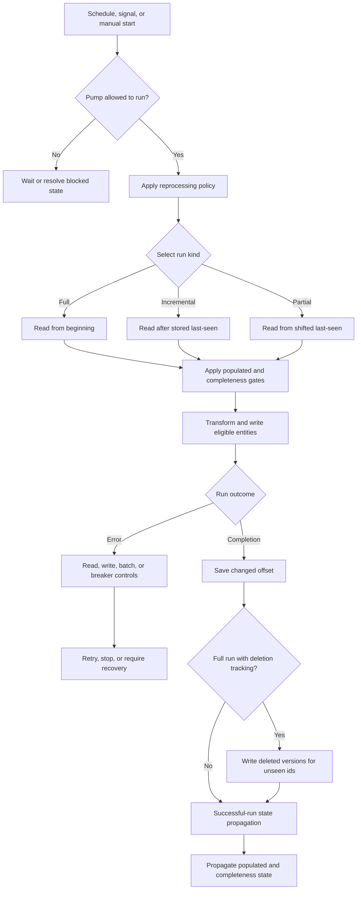

# Synchronization, scheduling, completeness, and recovery state

A pipe's **pump** reads source entities, passes them through the configured transforms, and writes them to the sink. It also handles failed writes and execution logging. Safe incremental processing depends on more than a schedule: the source must honor its continuation contract, the pump must preserve progress, and the sink must distinguish a changed entity from a replayed one.

This page describes the repository's documented behavior, not undocumented runtime internals. For the component configuration structure, see [Pipes and systems](pipes-and-systems.md); for reserved fields and dataset versions, see [Entities, datasets, and identifiers](../concepts/entities-datasets-and-identifiers.md).

## State that must not be confused

| State | Owner and meaning | What it does **not** establish |
| --- | --- | --- |
| `_updated` and `since` | The source supplies an entity's continuation token in `_updated` and interprets the returned `since` token. Stored dataset versions receive a dataset-local incremental `_updated` counter. | A token is not universally a timestamp or portable between datasets. |
| `pipe_offset` / last-seen | The pump stores the continuation marker that determines where subsequent reads resume. The Service API exposes and can update it. | Having an offset does not mean every related dataset has caught up. |
| Populated / initial offset | The dataset sink's initial offset marks its dataset populated. This can propagate downstream. | Populated does not mean nonempty or continually up to date. |
| Completeness timestamp | Successful runs propagate a time boundary from source and related datasets to the sink dataset. A source can use it to hold back recent entities. | Completeness is not the pump's resume offset. |
| Dependency tracking offset | A pipe tracks how far it has examined changes in a referenced dataset. Compaction respects these offsets. | This is not content hashing or a property-lineage graph. |

Sources: [Continuation support](../../hub/documentation/service-configuration/pipes/configuration-sources.rst), [Change tracking](../../hub/features/change-tracking.rst), [Dataset sink](../../hub/documentation/service-configuration/pipes/configuration-sinks-dataset.rst), [Completeness](../../hub/features/completeness-feature.rst), and [Compaction](../../hub/features/compaction-feature.rst).

## Documented run control flow



*Logical control flow derived from the pump, source, sink, and feature documentation; it summarizes decisions rather than prescribing an internal call order, and background-rescan concurrency is explained below.*

“Read from beginning” is subject to the source contract: `initial_since_value`, when configured on a since-capable source, is used when no offset exists or after reset and can deliberately omit older data. Do not assume that clearing the pump offset necessarily retrieves the entire external history. [Source reference](../../hub/documentation/service-configuration/pipes/configuration-sources.rst)

## Scheduling and signalling

Settings in this section belong under `pump` unless stated otherwise.

- **Normal schedule:** `schedule_interval` is seconds between runs; `cron_expression` specifies times. They are mutually exclusive, but if both are supplied, **`cron_expression` takes precedence**. Without either, dataset-source-to-dataset-sink pipes default to 30 seconds ±1.5 seconds; other pipes default to 900 seconds ±45 seconds. The documentation recommends explicitly choosing cron for pipes that read or write external systems.
- **Cron syntax:** five fields are minutes, hours, day of month, month, and day of week; a sixth optional field is year. Evaluation uses **UTC**, not local time. `W` and `#` are unsupported despite a `#` example appearing in the examples table; follow the explicit restriction. For example, `"0 0 * * *"` schedules midnight UTC.
- **Missed runs:** the planned start time is persisted for cron schedules and intervals **longer than one hour**. If the service cannot run at that time, it tries as soon as it can.
- **Startup:** `run_at_startup` and `run_at_startup_if_not_populated` both default to `false`; they request startup runs in addition to the normal schedule, with the latter conditional on the dataset not being populated.
- **Mode:** `mode: "scheduled"` is the default. `"manual"` permits only manual Service API starts; `"off"` cannot be started. Runtime `disable` stops automatic scheduling but does not prevent a manual `start`; Management Studio documents that an already-running pipe finishes unless stopped.

**Signalling is an accelerator, not durable scheduling.** `global_defaults.use_signalling_internally` defaults to `true` for internal dataset-to-dataset flows. A change to an input dataset schedules a run immediately; it does not interrupt a running pipe. Per-source `supports_signalling` overrides this behavior, including on non-internal flows. The dataset-source reference says that an interval below one hour or a cron expression disables implicit signalling unless it is explicitly enabled on the source. Explicit `supports_signalling: true` works regardless of the pump schedule. Signals are best-effort and **not persisted**, so retain a scheduled backup even when signalling is enabled.

References: [Pump scheduling and mode](../../hub/documentation/service-configuration/pipes/configuration-pump.rst), [Cron expressions](../../hub/cron-expressions.rst), [Global signalling defaults](../../hub/documentation/service-configuration/configuration-metadata.rst), [Dataset-source signalling](../../hub/documentation/service-configuration/pipes/configuration-sources-dataset.rst), and [Management Studio controls](../../hub/management-studio.rst).

## Continuation and checkpoint persistence

A source's continuation flags are promises about its actual output, not optimization switches to enable indiscriminately. The pump selects its strategy in this order:

| Conditions | Strategy | Recovery consequence |
| --- | --- | --- |
| `supports_since: true` and `is_chronological: true` | **Chronological**: accept `_updated` values in stream order. | The marker can advance during the run and be saved periodically, allowing resume after an incomplete run. This wins even if tokens are also comparable. |
| `supports_since: true` and `is_since_comparable: true`, without chronological ordering | **Maximum**: collect the maximum `_updated` value seen. | The new marker is known only at the end of the run; an interrupted unordered request must be reread rather than resumed at the last received entity. |
| Neither combination applies | **None** | No `since` tracking, even if `supports_since` alone is true. |

Comparable means lexical/bytewise comparison can order the tokens. Chronological means the source emits increasing order. Declaring either falsely can prevent correct change tracking. A `dataset` source fixes all three flags to `true`, so uses chronological continuation. By default it returns only the latest version for each `_id`; `include_previous_versions: true` changes that selection.

**Checkpoint persistence:** the pipe-level `checkpoint_interval` counts **batches**, not entities or seconds. The documented default is `10000 / batch_size` (100 batches at the usual batch size of 100), except that `batch_size: 1` defaults to `checkpoint_interval: 1`. A changed offset is always saved at the end of the sync. This setting controls saving progress; it does not make an unordered source chronological. Larger checkpoint intervals leave more processed work to reread if a run stops before saving progress.

For custom sources, expose meaningful `_updated` tokens and honor `since`, with only truthful flags enabled. The JSON Pull protocol defines `since` as the offset **after** which streaming starts, and no `since` as reading from the beginning. See [Extensions and JSON protocols](../integrations/extensions-and-json-protocols.md) for the integration boundary.

References: [Source strategies and stored `pipe_offset`](../../hub/documentation/service-configuration/pipes/configuration-sources.rst), [Pipe checkpoint settings](../../hub/documentation/service-configuration/pipes/configuration-pipes.rst), [Dataset-source continuation](../../hub/documentation/service-configuration/pipes/configuration-sources-dataset.rst), and [JSON Pull](../../hub/json-pull.rst).

## Full, incremental, partial, and background runs

| Run | Read boundary and intended use | Deletion effect |
| --- | --- | --- |
| **Incremental** | Starts with a nonempty stored last-seen marker and processes entities after it. | Missing entities in a delta cannot establish disappearance from the whole source. |
| **Reset / full** | An explicit reset reprocesses all source entities, subject to source configuration such as `initial_since_value`. | On completion, a dataset sink with deletion tracking deletes previously present ids not seen during the run. |
| **Partial rescan** | Rewinds the current since value by `partial_rescan_delta` on runs selected by `partial_rescan_run_count`. | A bounded reread is not evidence of absence from the entire source. |
| **Background rescan** | Reprocesses all source entities while allowing incremental work, when background rescans are enabled. | Performs deletion tracking on completion, with protections against concurrent incremental output. |

`rescan_run_count` selects a complete rescan every N runs: `2` gives incremental, rescan, incremental, rescan. `rescan_cron_expression` schedules full rescans by time and is mutually exclusive with that count. `partial_rescan_run_count` requires `partial_rescan_delta` and is also documented as mutually exclusive with `rescan_cron_expression`; complete rescans take precedence when both count-based choices apply. An integer since value is reduced by the delta; a timestamp is shifted back by that many seconds—for example, 3600 means one hour. Configure these under `pump`.

**Background-rescan prerequisites:** only a `dataset` sink supports the protection needed to avoid overwriting newer incremental results. Background rescans default to disabled; enable the pipe-level `enable_background_rescan` or `global_defaults.enable_background_rescan`. Scheduled rescan settings and the manual `start-rescan` operation can initiate them. Only one incremental run is active at a time, but successive incremental runs may overlap an unfinished rescan, and a rescan can start during an incremental run.

The documentation distinguishes two concurrency cases:

1. **Incremental output is correct**, such as after a DTL change. If incremental work starts during the rescan, the rescan stops processing at the first incremental run's last-seen boundary. It does not overwrite or deletion-track away that incremental output. Without incremental work, the rescan can pass the stored offset and begin advancing it; incremental starts are then prohibited. Ordering can differ from a reset, and older versions may be suppressed even with `include_previous_versions: true`.
2. **Incremental output may be temporarily incorrect**, such as after merge-source configuration changes. Incremental work uses the old merge source, does not overwrite rescan output, and is not put in the sink's seen tracker. At completion, the rescan stops any active incremental run, catches up changes since its start, and deletion-tracks away erroneous incremental output.

In this concurrent-rescan context, incremental runs **do not perform retries**, because the rescan reprocesses failures; they **do perform dependency tracking**. An interrupted rescan normally resumes; `reset-rescan` makes the next rescan start from the beginning instead.

References: [Run definitions and rescan concurrency](../../hub/documentation/service-configuration/pipes/configuration-pump.rst), [Background-rescan enablement](../../hub/documentation/service-configuration/pipes/configuration-pipes.rst), and [Pump operations](../../hub/swagger_public.yaml).

## Populated-input and completeness gating

### Populated is an initialization condition

A dataset becomes populated when its initial offset is set. Dataset-source `require_populated_input: true` prevents a run until the input dataset is populated; its default is `false`, with a service-wide `global_defaults.require_populated_input` override available.

Dataset-sink `set_initial_offset` controls propagation:

- `"if-source-populated"` (default): set it when the source is populated and all source entities have been consumed.
- `"always"`: set it after successful completion.
- `"never"`: never set it.
- `"initially"`: set it at the start of the pump run.
- `"onload"`: set it when the pipe is loaded/configured.

The default propagates initialization downstream; the early-setting alternatives should not be interpreted as proof that a successful import has finished. [Dataset source](../../hub/documentation/service-configuration/pipes/configuration-sources-dataset.rst) · [Dataset sink](../../hub/documentation/service-configuration/pipes/configuration-sinks-dataset.rst)

### Completeness is a processing time boundary

On a **successful run**, the sink dataset inherits the smallest completeness timestamp of the source and related datasets. Inbound pipes use current time; an `http_endpoint` source can instead receive `X-Dataset-Completeness` in the POST request. That header must be a positive integer; microseconds since epoch is the recommended representation.

At pipe level, `include_completeness` selects contributing datasets; without it, contributors default to datasets in sources and transforms except those in `exclude_completeness`. Exclusion wins if an id is in both lists. If all datasets are excluded, the pipe generates a new completeness timestamp.

At the **dataset source**, select the gate:

| Setting | Gate |
| --- | --- |
| `completeness: true` | Return only entities whose `_ts` is older than or equal to the source dataset's completeness timestamp. Default is `false`. |
| `completeness: ["dataset-a", "dataset-b"]` | Use the minimum completeness timestamp of the named upstream datasets. |
| `completeness: {"expression": ...}` | Evaluate a DTL expression before each start; it must return a datetime. A non-datetime falls back to `"~t1970-01-01T00:00:00Z"`, usually holding back all entities. |
| `initial_completeness: ["dataset-a"]` | Return entities only once the listed datasets have a completeness value, irrespective of its value. |

This reduces transmission of intermediate versions while dependent pipelines catch up. It does not imply that a full run sees every latest entity.

> **Deletion hazard — completeness plus full rescan:** completeness filtering may hide latest entities during a full rescan. With the dataset sink's default `deletion_tracking: true`, hidden ids count as unseen and can be deleted from the sink dataset. Before any reset or full rescan, verify that the filtered stream is intended to be authoritative for deletion. If it is not, set sink `deletion_tracking: false` or redesign the flow; completeness alone is not a deletion-safety guarantee.

References: [Completeness propagation and warning](../../hub/features/completeness-feature.rst), [Dataset-source gates](../../hub/documentation/service-configuration/pipes/configuration-sources-dataset.rst), and [HTTP endpoint completeness](../../hub/documentation/service-configuration/pipes/configuration-sources-http.rst).

## Content changes, dependencies, and lineage are different mechanisms

**Content change tracking** compares a prospective dataset entity's `_hash` with its previous version. Identical content is dropped rather than generating a new dataset version. New identity, changed non-reserved content, or a changed `_deleted` status can produce a write. Of reserved fields, only `_id` and `_deleted` contribute to the hash, so a changed continuation token alone is not a content change. Reprocessing input therefore need not generate new downstream versions. This protection applies to dataset writes; it is not a general promise that repeating writes to an external system is harmless.

**Dependency tracking** answers a different question: which source entities need transforming again because a joined dataset changed? For customers joined to addresses, changing an address must cause the corresponding customer to be reprocessed even if the customer's own content is unchanged. DTL `hops` and `apply-hops` expressions are analyzed and their traversal is inverted—from the changed referenced entity back toward the pipe's source dataset.

**Restriction and join invariant:** dependency tracking is supported only for a pipe with a `dataset` source, because tracked source entities must be looked up by id before a particular point in time. A merge-source pipe does not gain dependency tracking for its DTL hops; split merging and the joined transform into separate pipes if this is required. With chained transforms, joins in later transforms must still evaluate to the same values as on the original source entity. Rewriting join properties, adding namespaces, or dynamic `_S.$ids` wrapping can break inverse matching. See [DTL joins and transformation patterns](../workflows/dtl-joins-and-transformation-patterns.md).

**Reconcile the older description:** the dependency feature article describes putting the customer at the front of the dataset log again. Read that as the intended reprocessing effect, not as a current implementation guarantee. The entity model explicitly says `_tracked` belongs to an older materializing implementation and has been superseded by dependency tracking that does not require modifying entities. Do not depend on `_tracked` or assert that current tracking rewrites the source log.

**History and memory constraints:** `compaction.keep_versions` defaults to `2`; below two, dependency tracking becomes best-effort and can miss reprocessable entities. Full or partial rescans are documented countermeasures. Tracking offsets hold off compaction, including for disabled pipes. Pipe-level `dependency_tracking` thresholds warn at 10,000 entities or 33,554,432 bytes, and fail at 50,000 entities or 134,217,728 bytes by default. The exact settings are `dependency_warning_threshold`, `dependency_error_threshold`, `dependency_warning_threshold_total_bytes`, and `dependency_error_threshold_total_bytes`. `enable_hops_thresholds: true` extends these controls to regular hops and is recommended in development; it defaults to `false`.

**Property lineage** is a best-effort graph of property dependencies built from static pipe analysis and schema-inference data. It aids navigation and explanation; it is distinct from runtime entity reprocessing.

References: [Change tracking](../../hub/features/change-tracking.rst), [Entity reserved fields and superseded `_tracked`](../../hub/documentation/data-management/entity-data-model.rst), [Dependency tracking](../../hub/features/dependency-tracking.rst), [DTL caveats](../../hub/dtl/caveats.rst), [Compaction](../../hub/features/compaction-feature.rst), [Dependency thresholds](../../hub/documentation/service-configuration/pipes/configuration-pipes.rst), and [Property lineage](../../hub/features/property-lineage.rst).

## Deletion and administrative progress changes

**Deletion effects:** a dataset sink defaults to `deletion_tracking: true`. After a full run, previously existing ids not seen in the run get a new version with `_deleted: true`; this is not physical history removal. `mark_deletion_tracked: true` adds `"$deletion_tracked": true` to deletions produced by full-run/rescan tracking; it defaults to `false`. Continuation alone cannot infer deletions from absent delta entries. Import explicit deleted entities or arrange regular full synchronization when the source does not report deletions.

Two other deletion mechanisms matter during incremental work. DTL `_filtered: true` signals a dataset sink to delete an existing entity; sinks without that support discard the filtered entity instead. Dataset-sink `track_children` compares `$children` with the previous parent version to detect removed children for `create-child` and `emit_children` flows. It is inferred as `true` when a transform uses `create-child`, but can be explicitly disabled. Neither mechanism requires inferring disappearance from an incomplete delta.

**Empty-source acceptance:** dataset-source `if_source_empty` defaults to `"accept"`. An accepted empty full import can delete all previously synchronized entities when deletion tracking applies. `"fail"` fails when the source returns no entities, preserving previous dataset entities from that sweep. `global_defaults.if_source_empty` supplies a service-wide default, overridden on individual sources. Do not confuse an empty incremental delta with an authoritative empty full snapshot.

**Prerequisites before administrative actions:** inspect the source-specific offset format, current `pipe_offset`, input population/completeness, deletion policy, retry backlog, and target replay behavior. Quiesce automatic scheduling and stop active work when planning disruptive state edits; `disable` alone does not stop an active run. A reset does not make non-idempotent target operations safe. Set pipe-level `disable_set_last_seen: true` to protect against accidental reset or last-seen changes (default `false`).

The Service API entrypoint is `GET` or form-encoded `POST /api/pipes/{pipe_id}/pump`; POST uses the `operation` form field. Use credentials appropriate to the node. These actions are not interchangeable:

| Action | Effect and safety boundary |
| --- | --- |
| **Reset** via `update-last-seen` with `last-seen` set to an empty string | Clears progress so the next run behaves like its first run. Management Studio's Reset describes the dataset sequence equivalent as setting since to 0; do not generalize that number to every source. Restart is Reset plus Start. Review completeness and deletion hazards first. |
| **Last-seen change** via `update-last-seen` with a source-specific value | Rewind to reprocess a bounded range, or move forward and skip work. The value is not a universal integer. |
| `set-last-seen-to-end` / Reset to end | Skips unread source entities and may cause data loss; not supported by all sources. Intended for deliberate development/testing scenarios. |
| `start-rescan` / `reset-rescan` | Start a rescan unless one is already active / discard its resume boundary so the next rescan begins at the start. Verify dataset-sink background-rescan support and deletion policy. |
| `reset-tracking` (experimental) | **Unsafe while running.** Tracking resumes at dependent datasets' ends as of the next pump run, not the API call. Skipped changes can make output incorrect; use only in development or with a planned full sync soon afterward. |
| `discard-retries` | Pending write-error retries are ignored on the next run. Discarded failures are **not** written to the dead-letter dataset. Treat this as abandoning recovery, not resolving delivery. |
| Delete sink dataset in Management Studio | Deletes the sink dataset and resets since to 0. This is more destructive than replaying into an existing dataset. |

References: [Deletion tracking](../../hub/features/deletion-tracking.rst), [Sink deletion settings](../../hub/documentation/service-configuration/pipes/configuration-sinks-dataset.rst), [Empty-source behavior](../../hub/documentation/service-configuration/pipes/configuration-sources-dataset.rst), [Last-seen protection](../../hub/documentation/service-configuration/pipes/configuration-pipes.rst), [Pump API operations](../../hub/swagger_public.yaml), [Service API authentication](../../hub/api.rst), [Studio actions](../../hub/management-studio.rst), and [Target idempotency considerations](../../hub/idempotency.rst).

## Automatic reprocessing versus continuing out of sync

A pipe may fall out of sync after configuration changes, dataset deletion/recreation, source truncation, restore from backup, new joins or inputs, or deletion of a hopped-to dataset. `reprocessing_policy` is a pipe-level choice, with `global_defaults.reprocessing_policy` providing the default:

- **`"continue"` (default):** continue processing inputs without resetting, even when factors indicate a reset is needed. The pipe maintains a list of affected datasets; continued processing is not proof of a repaired historical output.
- **`"automatic"`:** detect out-of-sync conditions and reset/full-rescan, or in some situations rewind rather than reread everything.

Pipe `rescan_when_config_changes: true` requests reset on configuration change when automatic reprocessing is enabled; otherwise it marks the pipe out of sync. This happens on the next run, and the setting defaults to `false`, inherited from service metadata. It is not a synonym for `reprocessing_policy: "automatic"`.

At external dataset boundaries, JSON Pull carries population, completeness, maximum committed offset, generation, and restore information in headers. A deleted/recreated dataset gets a new generation UUID; a restored dataset exposes restore UUID/offset. Automatic reprocessing uses several of these headers to decide on rewind/reset. Preserve the protocol rather than treating a saved numeric offset as sufficient recovery state. See also [Deployment and durability](../operations/deployment-and-durability.md).

References: [Automatic reprocessing](../../hub/features/automatic-reprocessing.rst), [Configuration-change policy](../../hub/documentation/service-configuration/pipes/configuration-pipes.rst), [Metadata defaults](../../hub/documentation/service-configuration/configuration-metadata.rst), and [JSON Pull state headers](../../hub/json-pull.rst).

## Failure handling: separate the controls

All settings below belong under `pump`. A per-entity retry budget is not a read-retry budget, an immediate-write budget, or a circuit breaker.

| Layer | Exact settings and defaults | Documented behavior |
| --- | --- | --- |
| **Read retries** | `max_read_retries: 0`, `read_retry_delay: 0` | Default logs the read error without retry. A nonzero budget retries reads; delay is seconds between attempts, otherwise retries are immediate. |
| **Immediate write errors** | `max_consecutive_write_errors: 1`, `write_retry_delay: 0` | Default terminates the run on the first write error. A higher consecutive-error limit allows immediate retry attempts; the delay applies when the limit exceeds 1. |
| **Retry dataset/backlog** | `max_write_errors_in_retry_dataset: 0` | Default effectively disables write-error replay. A positive value limits retryable, not-dead failed entities in the execution history. Exceeding it stops admission of more failures and terminates the run even if other retry limits are not reached. |
| **Per-entity exhaustion** | `max_retries_per_entity: 5` | Limits how often a failing entity is retried for sink writes before giving up. Raising this alone does not enable a retry backlog. |
| **Batched-write retries** | `batch_retries: 3` | Maximum retries for batched writes; only relevant when the sink supports batching. |
| **Batch fallback** | `fallback_to_single_entities_on_batch_fail: true` | A failed batch can be processed one entity at a time. Disable only with awareness of single-entity processing cost and failure isolation. |
| **Dead letters** | `dead_letter_dataset` unset | Optional destination after per-entity exhaustion, with write-error retries enabled. The dataset must be unique per pipe; access is restricted to users authorized to see the pipe configuration. |

The “retry dataset” is the pump's execution-history dataset, documented as `system:pump_execution:<pipe_id>`, not the dead-letter destination. It records write failures with a copy of the failed entity; depending on settings, they are retried during later runs. A successful newer source version can resolve an older failed version and make it non-retryable. A dead entity is no longer retried until a new version arrives from the source; if configured, it is copied to the dead-letter dataset.

`track_dead_letters: false` is the default. Enabling it is documented to delete a previous dead letter when a later version is successfully written, with an execution-log lookup performance cost. **Documentation caveat:** its activation condition is still expressed in terms of deprecated `use_dead_letter_dataset` plus active retries, while `dead_letter_dataset` is the replacement setting. Do not infer from this wording that setting the modern destination alone guarantees dead-letter cleanup; verify the deployed version's behavior before relying on it.

Execution records expose `sync_type` (`full`, `partial`, `incremental`), completion/failure, retry flags, and success/failure counters. Error or retry activity always implies logging; no-op logging is controlled by `log_events_noop_runs` (default `false`), and `log_events_noop_runs_changes_only` (default `true`) uses sink changes rather than merely source output to decide no-op status. The execution dataset's entity structure is explicitly **not a stable public application API**. See [Monitoring and troubleshooting](../operations/monitoring-and-troubleshooting.md).

References: [Pump retry settings and dead letters](../../hub/documentation/service-configuration/pipes/configuration-pump.rst), [Execution history and write-error lifecycle](../../hub/documentation/operations/pump-execution.rst), and [Discard-retries API](../../hub/swagger_public.yaml).

### Circuit breakers are change-volume safety, not retries

A dataset-sink circuit breaker trips when writes in a run exceed a configured limit. It activates only once the sink dataset is populated, avoiding the initial sync. Both threshold settings default to `null`:

- `circuit_breaker_threshold_factor`: factor of the number of unique latest entity ids, **including deleted entities**; `0.5` means 50%, not 0.5%.
- `circuit_breaker_threshold_count`: direct count limit.
- When both are set, use the **maximum** calculated limit; the count commonly supplies a floor.

A tripped breaker prevents further pipe runs, compaction, and reposting to the dataset. Resolve it on the dataset page or with form-encoded `POST /api/datasets/{dataset_id}`:

- **`rollback-circuit-breaker`:** deletes entities written during the tripped run and resets the breaker.
- **`commit-circuit-breaker`:** exposes the uncommitted entities and resets the breaker.

Inspect whether the volume change was intended before choosing either action. Committing is accepting the held output, not retrying failed delivery. This dataset-write mechanism is separate from the configuration-upload circuit breaker described in [Pipes and systems](pipes-and-systems.md).

References: [Circuit-breaker lifecycle](../../hub/features/circuit-breakers.rst), [Sink thresholds](../../hub/documentation/service-configuration/pipes/configuration-sinks-dataset.rst), and [Dataset operations API](../../hub/swagger_public.yaml).

## Focused verification before rollout or recovery

The repository documents configuration testing with the Sesam client: supply `expected/<pipe>.json` and `<pipe>.test.json`, keep outgoing writes disabled or unable to reach real systems, run pipes until queues drain, and compare endpoint output. Run:

```sh
sesam -vv test
```

Use a dedicated CI node, serialize tests because configuration uploads overwrite its state, and omit outbound-system secrets. For lifecycle changes, supplement final-output comparisons with the following **recommended scenarios**; these are a test plan derived from the contracts above, not claims that this repository contains runtime tests for them:

1. **Continuation:** interrupt ordered input after a saved checkpoint and verify resume; interrupt unordered comparable input and verify reread. Check that replay does not create unchanged dataset versions.
2. **Dependencies:** change only a joined address and verify customer reprocessing. Repeat with chained transforms and namespace handling; confirm inverse joins still match original source values.
3. **Initialization and completeness:** withhold population or completeness upstream, then advance it. Check gating and successful-run propagation independently.
4. **Deletion safety:** remove an id from a full snapshot; test accepted versus failed empty input. Deliberately withhold a latest entity through completeness and check the full-rescan deletion hazard with deletion tracking enabled and disabled.
5. **Recovery:** simulate an unreachable source, failing sink entity, failed batch, exhausted retry budget, later successful version, and discarded retry backlog. Observe each separate control rather than treating all as “retry.”
6. **Rescan and breaker:** overlap incremental work with a background rescan and inspect final output; test breaker commit and rollback only after initial population.
7. **Out-of-sync policy:** change configuration or recreate/restore an input dataset and compare `continue` with `automatic`, including `rescan_when_config_changes`.

Inspect offsets and execution state through the node API as well as expected output. See [Configuration change lifecycle](../testing/configuration-change-lifecycle.md) for the broader workflow and [Bidirectional synchronization](../workflows/bidirectional-synchronization.md) before applying replay policies to two-way integrations.

Testing references: [Local configuration tests](../../hub/documentation/operations/testing-locally.rst) and [CI isolation requirements](../../hub/documentation/operations/continuous-integration.rst).
