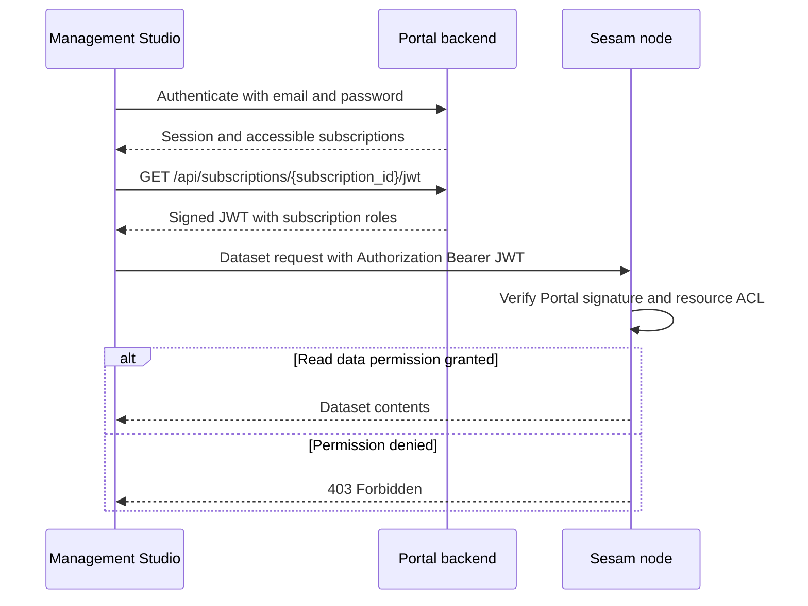

# Node and Portal APIs, public surfaces, and implementation handoffs

The **Node API** controls an instance's configuration, pipes, datasets, systems, and operational state. The **Portal API** manages users, subscriptions, subscription roles, and JWT issuance. Management Studio is the UI used to configure and administer a selected subscription; it is not a third interchangeable backend API. The **databrowser/Data Access Portal API** is a separate legacy, explicitly internal surface.

> **Safety boundaries:** Do not write through the dataset API in production. Ingest through a configured `http_endpoint` source using JSON Push or the supported receiver protocol. Bulk configuration PUTs replace configuration, not merge it. Configuration `force=true` accepts errors on a best-effort basis, not as a validation bypass with a correctness guarantee.

## Which reference to use

| Surface | Checked-in reference | Address convention and reference UI |
| --- | --- | --- |
| Node / instance | [swagger_public.yaml](../../hub/swagger_public.yaml) | Paths such as `/pipes` are relative to the instance API URL, typically `https://instance-guid.sesam.cloud/api`. Thus `/pipes` means `/api/pipes` on that host. Self-hosted reference: `<host:port>/api/reference`. |
| Portal | [swagger_portal.yaml](../../hub/swagger_portal.yaml) | Paths already contain `/api`, for example `/api/subscriptions`. Use the Portal origin, not the instance API base, and do not add another `/api`. Reference: `https://portal.sesam.io/api/reference`. The discovery path `/.well-known/openid-configuration` is an explicit exception outside `/api`. |
| Legacy databrowser / DAP | [swagger_databrowser.yaml](../../hub/swagger_databrowser.yaml) | Paths such as `/`, `/jwt_login`, and `/configuration/...` are relative to the DAP host, not the Node `/api` base. The specification says these endpoints are **only for internal use and may change or disappear at any time**. |

All three are Swagger 2.0 documents with `info.version: 0.0.0`; none declares a `basePath`. Their path conventions must not be normalized into one shared base. [Service API](../../hub/api.rst) embeds the checked-in Node and Portal files through `openapi` directives and separately points to the running services' references. Its curl examples are **narrative usage guidance**, not additional checked-in Swagger operations. In particular, its instance-host `POST /api/jwt` example is not a `/jwt` operation in `swagger_public.yaml`; the checked-in JWT issuance contract is in the Portal file. Verify routing for the deployment rather than inferring an undocumented Node operation.

This page reports documented contracts, not an executed API test or an inspection of sibling implementations. Some operations have no `operationId`; a method plus exact path still identifies the operation. Others use identifiers beginning `api.view_utils._not_in_use_` while remaining in the checked-in path map. Preserve those identifiers when searching an implementation; do not infer that a documented route is unavailable from its identifier alone. Many responses, including `Pump`, are lightly specified, and many operations declare only `200`. Missing media types, schemas, or error responses are specification gaps—not permission to invent them or assume no other failures are possible.

## Authentication: Portal identity, Node permission checks

The [security reference](../../hub/documentation/operations/security.rst) distinguishes subscription-scoped **roles** managed in the Portal from **permissions** granted to roles on Node resources. A user can have different roles in different subscriptions.

*Documented identity-to-data flow: the Portal supplies identity and roles, while the Node decides resource access.*

Send `Authorization: Bearer <JWT>` with Node requests. The Portal signs a subscription JWT using its private key; the Node verifies it with the Portal public key, then evaluates the dataset/pipe/system ACL against the user's roles. Authentication does not by itself authorize data access: the documented dataset denial is `403 Forbidden`. Runtime pipe permissions are also checked: a newly created pipe inherits the creator's roles in its config, and a run can fail if those roles cannot read the source system or write the target system. That is a Node runtime failure shown on the pipe's UI page, not a Portal subscription membership mutation.

Never copy embedded JWTs, passwords, or client secrets from historical examples into documentation or scripts. Keep temporary credential material out of source control; the narrative API guide specifically says to remove its temporary credential file after obtaining a token.

## Node operation map

**All paths in this section are relative to the Node API base ending in `/api`.** Path IDs are required; optional query/form inputs are called out below. Read responses marked JSON mean `application/json`. The complete parameter and definition tables remain in [Node Swagger](../../hub/swagger_public.yaml).

### Configuration: choose the replacement scope before uploading

| Exact operation | Request and result | Scope / important default |
| --- | --- | --- |
| `GET /config` | `200`, JSON array of `ConfigEntity` or `application/zip` | Default group only. Description spells header selection `Accepts`. |
| `PUT /config` | Consumes `application/json`, `application/zip`, or `multipart/form-data`; `200 OK` | Replaces **all** default-group config. Query `force=false`. |
| `GET /config/{config-group}` (`api.config.get_config_from_config_group`) | `200`, JSON `ConfigEntity[]` or ZIP | Only tagged group. The checked-in GET includes query `force=false`. |
| `PUT /config/{config-group}` (`api.config.put_config_to_config_group`) | Same three upload media types; `200 OK` | Replaces **all** config in that group. The checked-in PUT does **not** list `force`; do not silently move the GET parameter into PUT. |
| `GET /config-all` (`api.config.get_config_all`) | `200`, JSON `ConfigEntity[]` or ZIP | All groups, including default; description also spells `Accepts`. |
| `PUT /config-all` (`api.config.put_config_all`) | Same three upload media types; `200 OK`; query `force=false` | Replaces **all groups**. |
| `GET /config-history/entity` (`api.config.get_history_for_config_entity`) | `200`, JSON `ConfigEntity[]`; required query `entity_id` | Optional integer `limit` (unset means all), integer opaque `since`, `reverse=false`. |
| `GET`, `PUT`, `DELETE /metadata` | `200`, JSON `ServiceMetadata[]` | Read/update service metadata; DELETE removes all service metadata. The PUT body schema/media type is not declared. |

The [config-group narrative](../../hub/features/api-config-groups.rst) places individual pipe/system configurations in a group using `metadata.$config-group`; without it, they belong to `default`. Bulk group upload chooses the group in the URL. Swagger calls the default group “default (i.e empty)”; the narrative names it `default`. These describe the default scope, not a reason to guess a new URL spelling.

For configuration operations that actually declare it, `force` defaults to `false`; `true` forces the server to accept configuration errors and attempt application on a best-effort basis. Export and review the intended scope before replacement. Do not treat a partial bundle as a patch or a `200` as proof of healthy runnable configuration. Inspect the returned pipe's `runtime.is-valid-config` and `runtime.config-errors`. `PipeConfigError` records `elements` (JSON path), `level` (`error` or `warning`), and `msg`.

### Pipes, pumps, and inspection

| Exact operation | Inputs and response |
| --- | --- |
| `GET /pipes` | JSON `Pipe[]`, `200`; `verbose=false`; optional unique `fields` array drawn from `config`, `runtime`, `storage`, `graph`. |
| `POST /pipes` | Required body `PipeConfig[]`, query `force=false`; `200` with new `Pipe[]`. Request media type is not declared. |
| `GET /pipes/{pipe_id}` (`api.pipes.get_pipe`) | JSON `Pipe`, `200`; optional `fields` with the same choices. |
| `DELETE /pipes/{pipe_id}` (`api.pipes.delete_pipe`) | JSON, `200 OK`; deletes the pipe. |
| `GET /pipes/{pipe_id}/config` (`api.pipes.get_pipe_config`) | JSON `PipeConfig`, `200`. |
| `PUT /pipes/{pipe_id}/config` (`api.pipes.put_pipe_config`) | Required body `PipeConfig`, query `force=false`; JSON `Pipe`, `200`. Request media type is not declared. |
| `GET /pipes/{pipe_id}/pump` (`api.pump.get`) | JSON `Pump`, `200`. |
| `POST /pipes/{pipe_id}/pump` (`api.pump.post`) | Consumes `application/x-www-form-urlencoded` or `multipart/form-data`; required form `operation`; JSON `Pump`, `200`. |
| `GET /pipes/{pipe_id}/entities` (`api.view_utils._not_in_use_pipe_entities`) | JSON `PipeEntity[]`, `200`; integer `limit` (unset means all), string `since`, `stage=sink`. Other stages: `source`, `before-transforms`, `after-transforms`. |
| `GET /pipes/{pipe_id}/log` (`api.view_utils._not_in_use_pipe_log`) | JSON `DatasetEntity[]`, `200`; optional `limit`, integer opaque `since`; `history=true`, `reverse=false`, `deleted=true`. Full history includes deletes regardless of `deleted`. |
| `OPTIONS /pipes/{pipe_id}/log` (`api.view_utils._not_in_use_pipe_log_options`) | `text/plain`, `200`; the log's `since`, `history`, `reverse`, `deleted` controls; experimental string `webhook` requires string `token`, otherwise Badrequest. Webhook is POSTed when new data is available after request processing. |
| `GET /pipes/{pipe_id}/generate-schema-definition` (`api.pipes.get_schema_definition`) | JSON, `200`; integer `sample_size` from source, `keys_only=false` for whole schema rather than key array. |
| `POST /pipes/{pipe_id}/webhook` (`api.pump.webhook`) | Consumes/produces JSON; body must include registered `token`; schedules pump, `200`. Mismatch/unknown pipe or webhook gives `404`, documented as causing sender-side webhook unregistration. |

A `Pipe` separates `config.original` from `config.effective`: the latter is what runtime components use after environment-variable and shorthand expansion. Runtime fields include running/config-valid flags and dependencies. In multinode responses, `cached_response_info` can mean the aggregator returned cached subnode information because the subnode was not responding; inspect `timestamp` and `age` in seconds before treating it as live status.

Pump operations are capability-dependent. The [narrative API guide](../../hub/api.rst) tells clients to read `pipeinfo["runtime"]["supported-operations"]`, not hard-code a universally supported menu. The [pump Swagger block](../../hub/swagger_public.yaml#L519-L693) documents:

- `start`: manually starts a run. `enable` allows automatic scheduling; `disable` prevents automatic runs but not a manual start. The [Management Studio guide](../../hub/management-studio.rst#L194-L247) adds that disabling lets an already-running pipe finish.
- `stop`: stops normal and rescan runs, and has no effect when not running.
- `update-last-seen`: optional string form `last-seen` is source-specific, potentially an opaque value; empty string clears continuation for reprocessing from scratch. `set-last-seen-to-end` is source-dependent and **skips unread data**, potentially losing data.
- `start-rescan`: starts unless one is already running. `reset-rescan`: makes the next rescan begin at the start rather than resume an interrupted scan.
- `reset-tracking` (**experimental**): unsafe while running; tracking resumes at dependent datasets' ends when the next pump runs, not when this request is made. Skipped offsets can make output incorrect. Intended only for development or followed by full synchronization.
- `discard-retries`: records `pump-discard-retries` so the next run ignores pending write-error retries. Those discarded entities do **not** go to dead-letter storage.
- `discard-inferred-schema`: deletes accumulated schema; normally reset afterwards, especially for sources without continuation.

Optional form `comment` is persisted with a disable event in the execution log. `dont-wait-for-pump-to-start` and `relation` are deprecated parameters for older versions; they are not a current async-start or general relation-management contract. UI labels such as **Restart**, **Reset...**, and **Delete sink dataset...** describe workflows: Restart is effectively reset plus start; deleting the sink dataset also resets `since`. Do not invent similarly named pump `operation` strings from UI text.

### Dataset reads and administrative state

| Exact operation | Inputs, result, and failures |
| --- | --- |
| `GET /datasets` | JSON `Dataset[]`, `200`; `verbose=false`. |
| `GET /datasets/{dataset_id}` (`api.datasets.get_dataset`) | JSON `Dataset`, `200`. |
| `DELETE /datasets/{dataset_id}` (`api.datasets.delete_dataset`) | JSON, `200 OK`; destructive dataset removal. |
| `POST /datasets/{dataset_id}` (`api.datasets.post_to_dataset`) | Form-encoded or multipart; required `operation` is `rollback-circuit-breaker` or `commit-circuit-breaker`; JSON, `200 OK`. Not entity ingestion. |
| `GET /datasets/{dataset_id}/entities` (`api.view_utils._not_in_use_dataset_entities`) | JSON `DatasetEntity[]`, `200`; defaults detailed below. |
| `GET /datasets/{dataset_id}/entity` (`api.datasets.get_dataset_entity`) | Required query `entity_id`; optional JSON-encoded string `subset`, integer `offset`, `uncommitted=false`; JSON `DatasetEntity`, `200`. Unknown subset or absent/mismatched entity at the requested offset gives `404`. |
| `GET /datasets/{dataset_id}/entities/{rest_of_path}` (`api.datasets.get_dataset_entity_with_rest_of_path`) | Deprecated single-entity lookup; use `/entity`. Optional `subset`; JSON `DatasetEntity`, `200`; unknown subset gives `404`. |
| `OPTIONS /datasets/{dataset_id}/entities` (`api.view_utils._not_in_use_dataset_entities_options`) | `text/plain`, `200`; `since`, `history=true`, `reverse=false`, `deleted=true`, `subset`. Experimental `webhook` URL requires `token`, otherwise Badrequest. Webhook is POSTed when new data becomes available after request processing. |
| `GET /datasets/{dataset_id}/indexes` (`api.datasets.get_dataset_indexes`) | JSON `DatasetIndex[]`, `200`. |
| `GET /datasets/{dataset_id}/generate-schema-definition` (`api.datasets.get_schema_definition`) | JSON, `200`; integer `sample_size`, `keys_only=false`. |
| `GET /datasets/{dataset_id}/sdshare-collection`, `GET /datasets/{dataset_id}/sdshare-fragments` | `application/atom+xml`, `200`; collection and fragment feeds. |
| `GET /datasets/{dataset_id}/sdshare-fragments/{rest_of_path}` (`api.datasets.get_dataset_sdshare_feed_fragment`) | Required entity path; `application/n-triples`, `200`. |

The entity-list query defaults are **`history=true`, `reverse=false`, `deleted=true`, `populated=false`, `uncommitted=false`**. Unset integer `limit` returns all available entities; always choose a bounded limit for exploratory reads. Integer `since` is opaque continuation, not a page number. Full history returns replaced versions and always includes deletes; `history=false` returns only latest versions. `reverse=true` reads from the end of the log. `populated=true` adds `404` until the dataset represents a fully populated source view; having some data is insufficient. Unknown JSON-encoded `subset` gives `404`. `uncommitted=true` may expose circuit-breaker-uncommitted entities and is for debugging, not a committed-data guarantee. `DatasetEntity._updated` is the integer dataset offset.

**Production-write prohibition remains even though Swagger lists `POST /datasets/{dataset_id}/entities`.** That operation consumes/produces JSON and declares `200 OK`; its query `force=false` means compare entity hashes and suppress unchanged writes, whereas `force=true` always writes. This is **different from configuration force**. Its presence is not a supported production ingestion plan; the [Service API warning](../../hub/api.rst#L150-L156) explicitly prohibits that use.

### Receivers and publishers: integration entry/exit points

A configured [`http_endpoint` source](../../hub/documentation/service-configuration/pipes/configuration-sources-http.rst) registers receiver URLs. It has no pump; entities flow through the pipe to its sink only when posted. Starting a pump is therefore not how to ingest into that pipe.

| Exact receiver operation | Contract |
| --- | --- |
| `POST /receivers/{pipe_id}/entities` (`api.view_utils._not_in_use_receivers_post_endpoint_entities`) | JSON Push into a pipe with `http_endpoint` source; consumes/produces `application/json`; `200` with an object response. Query controls: string `sequence_id`, `request_id`, `previous_request_id`; booleans `is_full` (described default `false`), `is_first`, `is_last`. Swagger marks them optional; protocol sequencing rules still apply to full syncs. |
| `POST /receivers/{pipe_id}/sdshare-push-receiver` (`api.receivers.post_endpoint_sdshare_push_receiver`) | N-Triples into an `http_endpoint` pipe; required string body; consumes `application/n-triples` or `text/plain`; produces `text/plain`, `200`. String query `resource` is optional in Swagger, but source narrative requires at least one root resource. |

[JSON Push](../../hub/json-push.rst) specifies a JSON **array even for one entity**, while the HTTP endpoint source narrative also permits a single object. Prefer the protocol array form for interoperable clients; do not erase the difference. Full sync uses one active `sequence_id`, chained request IDs, and first/last markers; a new full sequence replaces the active one, and `is_last=true` closes it. Incremental requests do not change the active full sequence and their sequencing parameters may be ignored. Full-sync conflicts—incorrect previous request ID, inconsistent `is_full` within a sequence, or an invalid repeat of `is_first`—require `409 Conflict`. The JSON Push sink stops and retries later; a full-sync retry starts from the beginning with a new sequence. These failure rules come from the **protocol narrative**, not the receiver Swagger response table, which only lists `200`.

With dataset-sink `enable_optimistic_locking`, a one-entity post can return `updated_entity`. Stale `_updated` input can return `input_entity`, `existing_entity`, and `common_ancestor_entity` for a three-way merge. Swagger describes those fields in the `200` schema; it does not establish a new conflict status for optimistic locking. For SDShare, a named resource with no statements yields an entity marked `_deleted=true`; `graph` is ignored and the destination comes from the pipe sink.

Publisher operations are all **GET**, configured on the relevant publishing pipe:

| Exact paths | Response format (`200`) |
| --- | --- |
| `/publishers/{pipe_id}/entities`, `/publishers/{pipe_id}/entities/{filename}` | `application/json` |
| `/publishers/{pipe_id}/csv`, `/publishers/{pipe_id}/csv/{filename}` | `text/csv` |
| `/publishers/{pipe_id}/excel`, `/publishers/{pipe_id}/excel/{filename}` | `application/vnd.openxmlformats-officedocument.spreadsheetml.sheet` |
| `/publishers/{pipe_id}/xml`, `/publishers/{pipe_id}/xml/{filename}` | `application/xml` |
| `/publishers/{pipe_id}/sdshare-collection`, `/publishers/{pipe_id}/sdshare-fragments` | `application/atom+xml` |

These reads accept optional string `since` and integer `limit` (unset means all), **except the SDShare collection**, which only lists `pipe_id`. Filename variants require `filename` for the attachment name. CSV also accepts `linked_excel_file` (string filename), which returns an Excel file containing a connection to the original CSV URL rather than a CSV body. Exact Office compatibility operations are **`OPTIONS /publishers/{pipe_id}/csv/`**, **`OPTIONS /publishers/{pipe_id}/excel/`**, and **`OPTIONS /publishers/{pipe_id}/xml/`**: the trailing slash is part of the checked-in path; response is `text/plain`, `200`.

Shareable links use `GET /publishers/{pipe_id}/shareable-links` (`api.publishers.get_shareable_links`, JSON `ShareableLink[]`), `POST` at that same path (`api.publishers.post_shareable_link`, required `NewShareableLink` body, JSON `ShareableLink`), and `DELETE /publishers/{pipe_id}/shareable-links/{shareable_link_id}` (`api.publishers.delete_shareable_link`, JSON OK); each declares `200`. Do not extrapolate access policy from this path map alone. See [extensions and JSON protocols](extensions-and-json-protocols.md) for payload-level integration contracts.

### Systems, proxying, and secrets

| Exact operation | Request / response behavior |
| --- | --- |
| `GET /systems` | JSON `System[]`, `200`; `verbose=false`; true includes disk-usage breakdown in `storage`. |
| `POST /systems` | Required `SystemConfig[]` body, query `force=false`; `200`, new `System[]`; no request media type declared. |
| `GET /systems/{system_id}` (`api.systems.get_system`), `DELETE /systems/{system_id}` (`api.systems.delete_system`) | JSON `System` / JSON OK respectively, `200`. |
| `GET /systems/{system_id}/config` (`api.systems.get_system_config`) | JSON `SystemConfig`, `200`. |
| `PUT /systems/{system_id}/config` (`api.systems.put_system_config`) | Required `SystemConfig` body, query `force=false`; JSON **`SystemConfig`**, `200` (unlike pipe config PUT returning `Pipe`). |
| `GET /systems/{system_id}/logs` (`api.systems.get_microservice_logs`) | Last 1000 lines by default; optional string `since` is an ISO datetime and returns all lines after that point; `200`. Media type/schema not declared. |
| `GET /systems/{system_id}/status` (`api.systems.get_system_status`) | System status, for microservices a subset of Docker inspect; `200`; media type/schema not declared. |
| `POST /systems/{system_id}/reload` (`api.systems.post_microservice_reload`) | Asynchronously queues image pull and microservice recreation; **`202`**, not completion confirmation. |
| `GET`, `POST`, `PUT`, `PATCH`, `DELETE /systems/{system_id}/proxy/{rest_of_path}` | Pass request to the microservice's required relative path and return proxied response; each declares `200`. No fixed consumes/produces or body schema. IDs use `api.view_utils._not_in_use_microservice_proxy_` plus method. |
| `GET /secrets`; `PUT /secrets`; `POST /secrets`; `DELETE /secrets/{secret_key}` | Global secrets: GET lists **names**, PUT/POST accept JSON name-to-value object in their descriptions and overwrite matching values; POST explicitly keeps other secrets. DELETE removes named secret (`api.secrets.delete_secret_entity`). JSON responses, `200`; no `consumes` declarations. |
| `GET /systems/{system_id}/secrets` (`api.systems.get_system_secrets`) | JSON `SecretKeys` name list, `200`. |
| `PUT /systems/{system_id}/secrets` (`api.systems.put_system_secrets`) | `SecretValues` body; **overwrites system secrets**; JSON OK, `200`. |
| `POST /systems/{system_id}/secrets` (`api.systems.post_system_secrets`) | `SecretValues` body; add/overwrite supplied values without deleting others; JSON OK, `200`. |
| `DELETE /systems/{system_id}/secrets/{secret_key}` (`api.systems.delete_system_secret`) | Deletes named system secret; JSON OK, `200`. |

The security narrative says secrets are strongly encrypted with an instance-unique key and cannot be retrieved in their original form after upload. Keep a secure off-site copy. Global secrets last until explicit deletion; system-local secrets also disappear when their system is removed, so deleting and re-adding a system requires re-upload. `$SECRET(key)` substitutions apply only to **System configuration**, are resolved as needed at runtime, and are not exposed by the API or logs. The precise encryption/lookup implementation belongs to the runtime handoff, not this documentation repository. See [security and secrets](../operations/security-and-secrets.md).

### Health and metrics: two different reference levels

- **Swagger-backed Node probes:** `GET /health` returns JSON with `200` or `503` when unhealthy; `GET /ping` returns JSON with `200`. `GET /` returns JSON status with query `aggregated=true`; setting false avoids aggregation.
- **Narrative Node metrics contract:** [Metrics](../../hub/features/metrics-api.rst) documents **`/api/metrics`**, scraped with a JWT granting `Admin`, after enabling Metrics and monitoring on a clustered subscription. Output is Prometheus-compatible. **There is no `/metrics` operation in the checked-in `swagger_public.yaml`.** Do not fabricate a Swagger operationId, response schema, or status table for it. Pump metrics are not exposed for disabled pipes or `pump.mode="manual"` / `"off"`; absence does not prove a scrape failure.
- **Swagger-backed Portal monitoring:** `GET /api/monitoring/standard/{subscription_id}/pipes/{pipe_id}` (`api.monitoring_pipes.get_standard_pipe`) and `GET /api/monitoring/standard/{subscription_id}` (`api.monitoring_subscription.get_standard_subscription`) return standard monitoring information as JSON, `200`. `GET /api/monitoring/invoicing/{subscription_id}` (`api.monitoring_invoicing.get_invoice_information`) is JSON invoicing information, `200`, not the Prometheus scrape surface.

See [monitoring and troubleshooting](../operations/monitoring-and-troubleshooting.md) for interpretation rather than treating every operational read as a metrics API.

## Portal account, subscription, and JWT map

**Keep `/api` in these exact paths and use the Portal host.** Unless a row says otherwise, the checked-in response is `200`; JSON means `application/json`. “Form” below means either `application/x-www-form-urlencoded` or `multipart/form-data`. This is a focused public-use map, not an assertion that every checked-in admin/UI helper is a stable external interface.

| Exact account operation | Contract |
| --- | --- |
| `GET /api` (`api.root.get`) | JSON status plus authentication providers and login URLs. `status.feature-level` indicates supported API features. |
| `POST /api/login` | Form, required nonempty `email`, `password`; optional nonempty `g-recaptcha-response`; JSON; successful login creates an HTTP session and returns its ID in a cookie. |
| `POST /api/signup` | Form; required globally unique `email`, `password`, `name`; optional `g-recaptcha-response`; JSON. |
| `GET /api/profile` | JSON `Profile` for current user. |
| `PUT /api/profile` | Body requires `userInfo`; nested `profile` includes `nickname`, `name`, `picture`; JSON `Profile`. Sparse updates leave missing fields unchanged; name can change, email cannot. |
| `GET /api/profile2` | JSON `Profile`; explicitly returns **`401` if not logged in**. File contains a TODO to replace `/api/profile`, not proof replacement happened. |
| `DELETE /api/profile/{user_id}` (`api.profile.delete_user`) | Deletes specified user; JSON OK. |
| `GET /api/logout` (`api.authentication.logout`) | Clears session, returns `Profile`; explicitly deprecated legacy JSON logout. |
| `GET /api/logout2` (`api.authentication.logout2`) | Clears session; **`302`** to Portal frontpage or third-party logout URL. |
| `PUT /api/password` | Form `password`, `old_password`, both required; JSON object with required boolean `success`. |
| `POST /api/forgot-password` | Form required `email`, optional `g-recaptcha-response`; sends one-time password-change link; JSON object with required `success`. |
| `POST /api/reset-password` | Form required new `password`, one-time `token`; response object requires `success`; response media type is not declared. |
| `POST /api/verify-emailaddress` | Form required one-time `token`; `200` verified or **`400`** invalid, used, or expired token. |
| `POST /api/request-email-verification` | Resends verification email; `200` or **`409`** when one is already pending. |

Provider authentication is separate: `POST /api/login/{provider_id}` (`api.authentication.login`) redirects `302` to the configured OpenID Connect provider; `GET /api/login_callback/{provider_id}` (`api.authentication.login_callback`) takes optional query `code` and redirects `302` to the Portal frontpage. `GET /api/login_implicit_flow` (`api.authentication.get_login_implicit_flow`) serves `text/html`, `200`, to extract the fragment `id_token` and call `POST /api/jwt_login` (`api.jwt_login.jwt_login_post`, `200`). These implicit-flow helpers are not the ordinary email/password token issuance operation.

| Exact subscription operation | Contract |
| --- | --- |
| `GET /api/subscriptions` | JSON `Subscription[]` connected to current user. |
| `POST /api/subscriptions` | Optional body `NewSubscriptionInfo`; JSON `Subscription`. |
| `GET /api/subscriptions/{subscription_id}` (`api.subscriptions.get_subscription`) | JSON `Subscription`. |
| `PUT /api/subscriptions/{subscription_id}` (`api.subscriptions.put_subscription`) | Required `UpdatedSubscriptionInfo` body; JSON `Subscription`. |
| `DELETE /api/subscriptions/{subscription_id}` (`api.subscriptions.delete_subscription`) | Deletes subscription; JSON OK. |
| `GET`, `POST /api/subscriptions/{subscription_id}/available-roles` | JSON `RoleInfo[]` for built-in/custom roles; POST takes required `RoleInfo` and returns `RoleInfo`. IDs: `api.subscriptions.get_subscription_available_roles`, `api.subscriptions.add_custom_role`. |
| `GET`, `PUT`, `DELETE /api/subscriptions/{subscription_id}/available-roles/{role_id}` | Read/update/delete role; PUT requires `RoleInfo`; each returns JSON `RoleInfo`. IDs: `api.subscriptions.get_subscription_role`, `api.subscriptions.put_subscription_role`, `api.subscriptions.delete_subscription_role`. |
| `GET /api/subscriptions/{subscription_id}/members` (`api.subscriptions.get_subscription_members`) | JSON `SubscriptionMemberInfo[]`; query `start=0`, optional integer `limit` (unset means all). |
| `POST /api/subscriptions/{subscription_id}/members` (`api.subscriptions.post_subscription_members`) | Required `InvitedUser` body invites user; JSON `SubscriptionMemberInfo`. |
| `GET`, `PUT /api/subscriptions/{subscription_id}/members/{user_id}` | Read/update user's subscription roles; PUT requires `UpdatedSubscriptionMemberInfo`; JSON `SubscriptionMemberInfo`. IDs: `api.subscriptions.get_subscription_member`, `api.subscriptions.put_subscription_member`. |

These mutations own membership and subscription state; they do not replace Node pipe/system config or Node ACLs.

| Exact token operation | Format and lifecycle |
| --- | --- |
| `GET /api/jwt` | Current logged-in user's JWT as **`text/plain`**, not a JSON wrapper. |
| `POST /api/jwt` | Form required `email`, `password`; optional `subscription_id`. Unset subscription returns JWT for all user's subscriptions; `text/plain`. |
| `GET /api/subscriptions/{subscription_id}/jwt` (`api.jwt.get_subscription_jwt`) | Current user's JWT scoped to subscription; `text/plain`. |
| `GET /api/jwt/publickey` | RSA verification public key; `text/plain`. |
| `GET /api/subscriptions/{subscription_id}/api_json_web_tokens` (`api.subscription_api_jwts.get_json_web_tokens`) | JSON `SubscriptionJWT[]`. |
| `POST` at that same path (`api.subscription_api_jwts.post_json_web_token`) | Required `jwt_settings` body with **`exp` and `principals`**; optional `name`, `description`, `owner`, `refresh_interval`. Creates long-lived role-scoped API token for scripts/cron; JSON `SubscriptionJWT`. |
| `PUT` at that same path (`api.subscription_api_jwts.put_json_web_token`) | Required `jwt_settings` body including token `id` property and editable settings; JSON modified `SubscriptionJWT`. No individual settings fields are marked required in this PUT schema. |
| `DELETE /api/subscriptions/{subscription_id}/api_json_web_tokens/{api_json_web_token_id}` (`api.subscription_api_jwts.delete_json_web_token`) | Deletes token record; JSON OK. |
| `GET /.well-known/openid-configuration` (`api.openid_connect.get_configuration`) | JSON OpenID Provider Configuration Response. |
| `POST /api/openid_connect/token` (`api.openid_connect.token_endpoint_post`) | Form `grant_type` enum `client_credentials` / `refresh_token`, `client_id`, `client_secret`; JSON. Checked-in schema supplies no token-response fields or detailed errors. |

`exp` is seconds since Epoch. With `refresh_interval`, it is the last refreshable time; the signed token's actual expiry is current time plus refresh interval. `SubscriptionJWT.jwt_string` and refreshable `client_secret` are returned **only on creation**; persist them securely then, not by assuming a later GET can recover them. Its payload includes `api_token_id` so the Node can check invalidation, and `principals` maps exactly one subscription ID to its principals for these API tokens. Invalidation polling timing and refresh enforcement are implementation handoffs, not established here by the deletion response. See [Portal Swagger token definitions](../../hub/swagger_portal.yaml#L4647-L4788).

## Legacy databrowser: historical configuration, not a new integration target

The [databrowser API guide](../../hub/databrowser-api.rst) announces end-of-life **December 31, 2023**. The [2022-03-21 changelog](../../hub/changelog.rst#L921-L927) names Integrated Search as its successor. Keep the historical DAP host and APIs distinct from both Portal subscription APIs and Node inspection APIs; Management Studio's current browse/search documentation does not establish support for the old DAP API.

For historical configuration investigations only:

- Base layer: `GET`, `PUT`, `DELETE /configuration/{config_file_path}`. For the INI this is `/configuration/databrowser.ini`. The base `/sesam/data` layer overrides `/sesam/conf/databrowser.ini` and all numbered upload layers.
- Numbered layer: `OPTIONS`, `GET`, `PUT`, `DELETE /configuration/conf/{config_layer}/{config_file_path}`. Higher-numbered layers override lower ones; the base layer is applied last. The narrative introduction also writes `/configuration/<confignumber>/databrowser.ini` without `conf`, whereas its curl example and Swagger use `/configuration/conf/...`. Use the checked-in operation to identify the route and record the discrepancy rather than silently repairing the narrative.
- GET returns `text/plain` or `application/octet-stream`, `200`, with an **empty body if the file is absent**, not a documented `404`. PUT/DELETE produce JSON `ConfigFilePutOrDeleteResponse`; `200` can still contain configuration errors; `403` prevents changes that would lock the current user out of further config modification.
- PUT/DELETE query `validate_only=false`; true runs validation without changing files. Response requires `is-valid-config`, `current-user-would-be-locked-out`, and `config-errors`. Errors cover the **whole configuration set**, not just this file, with `warning`, `error`, or `critical` severity.
- `config_file_path` is really a rest-of-path; Swagger explicitly warns its representation is imperfect and says not to URL-escape that path. `GET /configuration` returns an HTML configuration view; string query `content_only='true'` supports embedding in Management Studio.
- The historical configuration-file API requires JWT-enabled databrowser configuration and an `Authorization` JWT granting `Admin`. That does not turn all DAP internal endpoints into a public supported interface.

Sources: [legacy configuration operations](../../hub/swagger_databrowser.yaml#L397-L569), [parameters and response](../../hub/swagger_databrowser.yaml#L1109-L1256). For broader historical scope, see [legacy data access](../references/legacy-data-access.md).

## Implementation ownership and not-yet-linked handoffs

The following are **handoff-routing assignments for this wiki**, not findings from sibling source inspection. **Only this repository was researched.** Product roles are grounded in the local API, security, and Management Studio references above; no sibling implementation or workspace page is linked or claimed inspected.

| Owner | Responsibility | Not-yet-linked implementation question |
| --- | --- | --- |
| `docs` | Documented product semantics, examples, checked-in specifications, and rendered reference guidance. | Reconcile copied Swagger with deployed references; resolve misplaced `force`, header spelling, narrative/Swagger route differences, and underspecified schemas. |
| `lake` | Data-processing runtime and related services, including Node behavior. | Trace handlers for configuration replacement/validation, pump capability dispatch, receiver sequencing and sink writes, proxies, secret deletion, ACL checks, caching, and metrics exposure. Check implementation tests before claiming transactional replacement, retry status codes, or cache freshness guarantees. |
| `portal` | Account and subscription management. | Trace session and JWT issuance, role/member mutations, token refresh/invalidation, subscription lifecycle, and response/error handling. Verify how a deployment routes the narrative instance JWT URL. |
| `webconsole` | Management Studio UI. | Verify actual calls behind Save, Start, Restart, Reset, Preview, and error/ACL displays; distinguish composite UI workflows from individual API operations. |
| `counting-semaphore` | Semaphore service. | Locate service protocol, callers, lease/release/failure behavior, and tests in its owning repository. This repository does **not** establish a semaphore API, a pump dependency, or a solution to concurrent configuration uploads. |

Connector tooling is another documented client boundary: [Connector Tools](../../hub/connector-tools.rst) describes manifest-to-system/pipe generation, `expand` during `sesam upload`, `collapse` after `sesam download`, and automatic OAuth 2.0 authorization (explicit `sesam authenticate`). Those are client workflows, not Node/Portal Swagger operations. The source links an external Sesam Client README; its implementation was not researched here. See [connectors and contracts](connectors-and-contracts.md).

## Safe validation and change planning

Use the exact operation block first, then the product narrative for semantic constraints, then route unproven implementation details to the owning repository. A focused change review should cover:

1. **URL and wire compatibility:** distinguish Node `/api` base from Portal paths containing `/api`, text JWTs from JSON records, form pump operations from JSON entity pushes, and publisher filename/trailing-slash variants.
2. **Configuration safety:** verify selected group versus `/config-all`, inspect validation errors with force disabled, and check that deleting systems does not accidentally lose required local secrets.
3. **Data and continuation safety:** bounded reads, latest versus history semantics, population checks, full-sync request ordering/`409`, manual start capability, and explicit approval for skipping last-seen/tracking offsets or discarding retries.
4. **Authorization:** subscription roles and Node ACL denial separately; never validate an Admin-only scrape with an unrelated identity token.

The repository documents **configuration tests**, not local backend API test implementations. [Testing locally](../../hub/documentation/operations/testing-locally.rst) uses `expected/<pipe>.json` and `<pipe>.test.json`, runs pipes until queues drain, and compares endpoint output with expected results via `sesam -vv test`. Output systems must be disabled or unreachable. Default inspection is `/pipes/<my-pipe>/entities` at sink stage; published endpoint tests can use `/publishers/<my-pipe>/<endpoint-type>` with bound parameters, making them relevant to publisher compatibility.

[Continuous integration](../../hub/documentation/operations/continuous-integration.rst#L7-L24) requires a designated CI node, **one test at a time**, because uploads overwrite configuration. It must be unable to write to external systems and should lack outbound connection secrets/variables. The [Sesam Client guide](../../hub/sesam-client.rst#L21-L36) forbids running the client on production subscriptions, allows only one client at a time on a subscription, and warns against concurrent manual edits. These client restrictions are not a blanket ban on all production Node administration. No live API calls, servers, containers, or tests were run for this page.

Further context: [Hub model and boundaries](../architecture/hub-model-and-boundaries.md), [pipes and systems](../configuration/pipes-and-systems.md), [configuration-change lifecycle](../testing/configuration-change-lifecycle.md), and [documentation maintenance](../workflows/documentation-maintenance.md).
