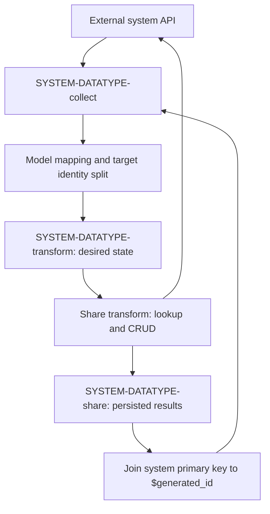

# Connector manifests, templates, and desired-state contracts

A connector is the system-facing configuration that collects API-shaped entities and applies a desired state back to that system. Its reusable configuration has three building blocks: **manifest**, **templates**, and environment-specific **`config.json`**. Model mapping supplies the desired-state dataset; the connector is responsible for making the external system reflect it. This page describes the contracts documented in this repository, not an inspected implementation of the external connector tooling or connector repositories. [Configuration overview](../../hub/documentation/connectors/connector-configuration.rst), [contract](../../hub/documentation/connectors/connector-contract.rst)

For a particular product, start at the authored [Available connectors catalog](../../hub/documentation/connectors/available-connectors.rst), then follow its FAQ and repository links. For example, the HubSpot entry hands off to `sesam-io/hubspot-connector` and describes `playground` as typically the most complete branch. **Those external repositories were not inspected here**; their current manifests, operation definitions, tests, and branch compatibility must be checked before deployment. This page intentionally does not reproduce a connector-by-connector catalog. [Representative catalog entry](../../hub/documentation/connectors/available-connectors/hubspot-connector.rst)

## Configuration ownership and expansion

| Building block | Responsibility | Change here when… |
| --- | --- | --- |
| Manifest | Selects a datatype template per datatype and the system template; declares authentication and datatype parameters. | Adding a datatype, reusing a flow, selecting auth variants, or changing datatype-specific expansion inputs. |
| Connector template file | Contains pipe configurations for collect and share patterns. It can use `{{@ system @}}` and `{{@ datatype @}}` rather than hard-coded names. | Changing system-facing collect/share behavior or reusable DTL. |
| `config.json` → `connector_config` | Environment configuration: an embedded pipe named `connector_config`, whose embedded-source entities configure connectors. | Selecting the connector repository revision, API environment, or manifest parameter overrides. |

The Sesam Client documentation says `sesam upload` runs `expand` to generate system and pipe configurations, while `sesam download` runs a subsequent `collapse` to reflect downloaded configuration changes locally. OAuth2 authorization participates in that workflow; `sesam authenticate` is the explicit authorization entrypoint. Installation and implementation are external handoffs to [sesam-py](https://github.com/sesam-community/sesam-py/blob/master/readme.usage.md), not code in this documentation repository. [Connector Tools](../../hub/connector-tools.rst)

For the underlying pipe/system configuration, see [Pipes and systems](../configuration/pipes-and-systems.md). For repository and API boundaries, see [APIs and repository handoffs](apis-and-repository-handoffs.md).

### Manifest: selection, not duplicated flows

`datatypes` is a dictionary keyed by datatype name. Each entry requires `template`; the key is substituted into every `{{@ datatype @}}` in the selected file. Multiple datatypes can select the same template when the flows differ only in names or parameters. The system template supplies the system configuration. A synthetic selection example, using the spelling in the manifest **property table**, is:

```json
{
  "auth": "api_key",
  "datatypes": {
    "contact": {
      "template": "templates/object.json",
      "parameters": {"api_object": "contacts"}
    },
    "project": {
      "template": "templates/object.json",
      "parameters": {"api_object": "projects"}
    },
    "country": {
      "template": "templates/country.json",
      "sync_frequency": "weekly"
    }
  },
  "system_template": "templates/system.json"
}
```

**Spelling discrepancy:** the [manifest example](../../hub/documentation/connectors/connector-manifest.rst) uses `system-template`, but its required-property table uses `system_template`. This repository does not establish that both are accepted aliases. Verify the expected key against the exact expander/connector revision; do not silently normalize or copy the example as a validated schema.

Other datatype fields are `label` (human-readable name), `parameters` (Jinja-accessible values), `parent` (parent datatype for child collection, including the `-all` source dataset), `sync_frequency`, and `webhook`. `auth` is required; optional authentication fields are discussed below. [Manifest reference](../../hub/documentation/connectors/connector-manifest.rst)

### Two different meanings of “template”

A **connector template file** is a file containing configurations to expand. The supplied contact example is an array with:

1. `{{@ system @}}-{{@ datatype @}}-all`, reading REST operation `{{@ datatype @}}-list`.
2. `{{@ system @}}-{{@ datatype @}}-collect`, reading `-all`, invoking `transform-collect-rest`, and optionally deriving `$last-modified` with DTL.
3. `{{@ system @}}-{{@ datatype @}}-share`, reading the corresponding `-transform` dataset and invoking `transform-share-rest` with datatype-specific lookup, insert, update, and delete operation names.

A **runtime template transform** is a transform configuration with `"type": "template"`, `template`, and `properties`. The built-in names include `transform-collect-rest`, `transform-defaults-rest`, and `transform-share-rest`. The `template` value can also be an object containing a template body to override the built-in version for development. These are not the same as a manifest path such as `templates/object.json`. [Connector template example](../../hub/documentation/connectors/connector-templates.rst), [runtime template reference](../../hub/documentation/service-configuration/pipes/configuration-transforms-template.rst)

### Substitution and parameter sources

Non-expanded connector configuration uses Jinja-like strings of the form `{{@ foo @}}`, injected by tooling such as sesam-py. Most supported variables must be declared in the manifest, with exceptions such as `system` and datatype-context `datatype`.

| Variable/input | Documented expansion source or effect |
| --- | --- |
| `system` | Always available; name of the system. |
| `datatype` | Available in configurations belonging to a datatype; its manifest key. |
| `parent` | The datatype's `parent` value. |
| Datatype `parameters` | Replaces occurrences of that parameter in the datatype configuration. Boolean values are supported; preserve their type rather than substituting a string such as `"true"`. |
| `base_url`, `token_url` | Connector configuration supplies the API base URL and OAuth2 token endpoint. |
| `parameter_values` in a connector configuration entity | Overrides parameters specified in the manifest, for example `base_url`. |
| `service_url` | `requires_service_api_access: true` signals replacement with `$ENV(service_url)` and injection of system secret `service_jwt`, referenced as `$SECRET(service_jwt)`. |
| `<connector>_webhook_dataset` | Declaring this under manifest `additional_parameters` signals replacement with `$ENV(<connector>_webhook_dataset)`. |
| `account_id`, `connected_ts`, `is_fullsync` | Described as coming from Consumer portal onboarding: connected account, datatype enablement timestamp, and experimental fullsync Boolean. Treat these as historical onboarding-dependent inputs, not guaranteed current automatic values. |

The source documents `additional_parameters`, `requires_service_api_access`, and datatype `schedule_interval` in the contract even though the manifest's main property table is not exhaustive. Expansion and secret provisioning are documented tooling behavior, not verified here in an expander implementation. [Injected variables and parameters](../../hub/documentation/connectors/connector-contract.rst), [parameter overrides](../../hub/documentation/connectors/connector-config-file.rst)

### Generated pump settings

The contract describes collect scheduling injection as follows:

- Default: every **300 seconds**.
- Collect pipe `metadata.supports_since: true`: every **10 seconds**.
- Datatype `sync_frequency: "slow"`: once per day at midnight.
- Datatype `sync_frequency: "weekly"`: Monday at 00:00.
- Datatype `webhook: true`: slower polling, default once per hour.
- Datatype `schedule_interval`: explicit custom setting, taking precedence over **all** of the above.

The source does not give a complete precedence order among the non-custom options. Inspect the expanded pump when combining them; do not infer an ordering from this list. These are connector expansion settings, distinct from receiver pipes: an `http_endpoint` source has no pump and only receives data through HTTP posts. [Injected pump properties](../../hub/documentation/connectors/connector-contract.rst), [HTTP endpoint source](../../hub/documentation/service-configuration/pipes/configuration-sources-http.rst)

## `config.json` metadata and the discontinued UI boundary

Within `config.json`, `connector_config` holds an embedded pipe configuration, not merely a dictionary of credentials. Each connector entity has required `_id` (connector identifier) and `type: "connector"`. Material deployment settings include:

- `url`: raw connector repository URL **including branch or commit hash**. The source example is `https://raw.githubusercontent.com/sesam-io/wave-connector/playground`.
- `parameter_values`: manifest parameter overrides.
- `auth`: an object describing authorization settings. This differs from the manifest's string `auth`.
- `auth.api_base_url`: replaces `{{@ base_url @}}` to select an API environment.

[Config file reference](../../hub/documentation/connectors/connector-config-file.rst)

**Do not interpret the remaining UI descriptions as a supported current onboarding workflow.** The changelog records removal of multitenancy and Management Console support on **2025-04-11**, and the Management Console index explicitly says it is discontinued. The connector config reference still contains the older fields below. They are useful for recognizing existing configurations, but their presence does not demonstrate a current UI consumer. [Removal notice](../../hub/changelog.rst#changelog-2025-04-11), [discontinuation warning](../../hub/index-management-console.rst)

| Historical metadata group | Exact fields and intended meaning in the older reference |
| --- | --- |
| Card/branding | `title`, `description`, `docs_url`, `logo`, `logo_symbol`, `favicon`; `visible` defaults to true. `category` and `stage` are described as unused in that UI. |
| User-supplied values | `additional-properties`, with `.name` and `.description` controlling labels/help text. This hyphenated property is **not** manifest `additional_parameters`. |
| Account choice | `account_selection.endpoint` specifies a POST endpoint to list accounts; `payload_property` traverses the response, then `id_property` and `label_property` select account values. These selectors accept a string or list of strings. |
| Filtering and tenancy | `hidden_entity_types` references manifest entity-type IDs; `multi-tenant` describes per-tenant availability, with shared connectors as exceptions. Do not use this as evidence that multitenancy remains supported. |
| Connect flow | `connect_flow.custom_sections` contains `order`, `title`, and `content`. |
| Vendor dashboard | `vendor.banner`, `vendor.description`, `vendor.title`, `vendor.supported_connectors`, `vendor.hidden_entity_type_options`, `vendor.homepageLogo.logo`, `vendor.homepageLogo.homepageUrl`. |

For API-key config, the reference describes `auth.type`, `auth.api_base_url`, and `auth.label`. OAuth2 config adds `auth.access_token_url`, `auth.authorize_scopes`, `auth.identity_url`, `auth.login_url`, and `auth.tenant_id_expression`. Despite its name, `auth.tenant_id_expression` selects **`account_id`**, not a Sesam tenant ID, from the authorization response, using a property name or path list. Several requirements are written in terms of the old Management Console or a particular connector; do not assume every OAuth provider needs an identity endpoint. [Metadata and auth reference](../../hub/documentation/connectors/connector-config-file.rst)

For policy/history context, see [History and policies](../references/history-and-policies.md).

## Authentication and webhook trust

### Manifest auth and system secrets

Manifest `auth` selects `oauth2` or `api_key`; the latter also covers manually supplied tokens and similar credentials. `auth_variant` documents `superoffice-ticket` for `oauth2`, and `jwt`, `tripletex`, and `service_account` for `api_key`. Optional OAuth2 manifest settings are `oauth2.login_url`, `oauth2.scopes`, and `oauth2.token_url`. [Manifest auth fields](../../hub/documentation/connectors/connector-manifest.rst)

The documentation distinguishes credential inputs from the secrets that templates use:

| Scheme | Documented inputs | Documented injected system secrets |
| --- | --- | --- |
| API key | `api_key` | `api_key` |
| OAuth2 | `client_id`, `client_secret`, with tokens obtained during onboarding | `oauth_access_token`, `oauth_client_id`, `oauth_client_secret`, `oauth_refresh_token` |
| Tripletex variant | `consumer_token`, `employee_token` | `consumer_token`, `employee_token` |
| SuperOffice variant | OAuth2 client credentials | Contract: regular OAuth secrets plus `so_ticket`. The authentication-pattern reference also names `SO-Apptoken` for the client secret. Check the actual system template rather than treating those names as interchangeable. |
| JWT variant | `api_key` application token used to request JWT access | `jwt_access_token`, `jwt_refresh_token` |
| Service account variant | Listed as supported by the manifest reference | No detailed secret mapping in the inspected contract/authentication-pattern references; verify the selected connector/tooling. |

Use secret references such as `$SECRET(api_key)` and `$SECRET(oauth_client_secret)`, with actual values provisioned out of band as `<API_KEY>` or `<OAUTH_CLIENT_SECRET>`. Do not embed credentials in committed connector templates. Automatic onboarding injection described by the older sources is not a substitute for checking that the required system secrets exist in the deployment. [Injected secrets](../../hub/documentation/connectors/connector-contract.rst), [authentication schemes](../../hub/documentation/data-synchronization/authentication-schemes-pattern.rst), [Security and secrets](../operations/security-and-secrets.md)

### Webhook validation is the trust boundary

Manifest `use_webhook_secret: true` signals generation of system secret `webhook_secret` and anonymous write access for the connector's receiver endpoints ending in `-event`. Anonymous access is intentional for clients that cannot use a Sesam JWT, **not** permission to accept unvalidated requests. The receiver must validate the provider's signature or shared-secret mechanism. Some providers sign with an existing OAuth client secret instead of a separately registered webhook secret. [Manifest](../../hub/documentation/connectors/connector-manifest.rst), [webhook contract](../../hub/documentation/connectors/connector-contract.rst), [receiving events](../../hub/documentation/data-synchronization/receive-webhook-events-pattern.rst)

The HTTP source's `validation_expression` is a Jinja template evaluated per request:

- **Empty rendered string:** accept.
- **Non-empty rendered string:** reject, reporting that string as an error in the response.
- `secret(...)` can read system and global secrets; a system secret takes precedence. A receiver using system secrets must be associated with the system and have permission to read it.

A synthetic source fragment using the documented HMAC pattern follows. `X-Example-Signature` must be replaced by the provider's real header and encoding, and `<WEBHOOK_SECRET>` provisioned as the system's `webhook_secret`, not pasted into the expression:

```json
{
  "type": "http_endpoint",
  "system": "example",
  "validation_expression": "FAIL!"
}
```

[Validation semantics](../../hub/documentation/service-configuration/pipes/configuration-sources-http.rst), [HMAC example](../../hub/documentation/data-synchronization/receive-webhook-events-pattern.rst)

**Another spelling discrepancy:** the receiving-events pattern says `use_webhook_secrets` (plural), whereas the manifest and connector contract specify `use_webhook_secret` (singular). Do not assume both work. Also, the older advice to manually put a client secret into a development validation expression should not be copied into committed configuration; use provisioned secrets.

Webhook registration precedes consumption. For partial events, the documented pattern keeps reception fast in `-event` and performs the full-entity lookup downstream in `-event2`; collect merges full-scan `-all` data with event data. This avoids blocking the HTTP receiver on external lookups. [Webhook collection pattern](../../hub/documentation/data-synchronization/receive-webhook-events-pattern.rst)

## Collect → desired-state transform → share



*The contract flow separates API-shaped collection, model-owned desired state, external writes, and persisted share results used to restore `$origin` on later collection.*

This diagram is grounded in the [connector contract](../../hub/documentation/connectors/connector-contract.rst), [template example](../../hub/documentation/connectors/connector-templates.rst), and [collect/share runtime template reference](../../hub/documentation/service-configuration/pipes/configuration-transforms-template.rst). It is a contract-level flow, not a promise that every connector uses exactly three pipes. See [Bidirectional synchronization](../workflows/bidirectional-synchronization.md) for the wider mapping loop.

### Collect output

The connector output dataset must be named `SYSTEM-DATATYPE-collect`, for example `example-person-collect`. Expose data as close to the original API as possible. Connector-added business properties absent from the API use the prefix `sesam_`; contract metadata such as `$origin` and `$last-modified` keeps its specified name.

| Field | Meaning |
| --- | --- |
| `_id` | Required Sesam entity identity, always a string. Do not confuse it with an API's numeric or composite primary key. |
| Raw API properties | Keep API names, datatypes, and structure. |
| `$origin` | Optional, opaque, managed by model mapping. Describes the entity/entities in other systems that caused this entity's creation. Retrieve it from the share sink by joining the entity's system primary key to `$generated_id`. |
| `$last-modified` | Optional Datetime of the last modification in the external system; collect it from the system or as close to it as possible. It is not Sesam's `_ts`. |

Synthetic collected record for an entity originally inserted from another system:

```json
{
  "_id": "7",
  "id": 7,
  "key": "sample",
  "value": 10,
  "$origin": "~:other-person:42",
  "$last-modified": "~t2025-01-01T12:00:00Z"
}
```

An already-existing entity may omit `$origin`. `~:` denotes a JSON-encoded namespaced identifier (NI), and `~t` a typed datetime; ordinary `_id` is still a string. `$` fields are semi-reserved, stored and hashed as normal entity content. Root `_` fields are reserved; when writing a dataset, fields other than `_id` and `_deleted` are ignored. [Collect contract](../../hub/documentation/connectors/connector-contract.rst), [entity model and type encoding](../../hub/documentation/data-management/entity-data-model.rst)

`transform-collect-rest` performs the origin join. Its reference also covers parameterized lookup and delete verification: `operation_lookup_delete` takes precedence over `operation_lookup` and can rewrite `_deleted` to false if a purportedly deleted entity still exists in the system. Match those options to the chosen collect pattern rather than assuming that a raw deletion notification is proof of absence. [Collect template options](../../hub/documentation/service-configuration/pipes/configuration-transforms-template.rst)

### Desired-state transform input and target identities

The input dataset must be named `SYSTEM-DATATYPE-transform`, for example `example-person-transform`. It represents the **desired target state**, not a generic mutation payload. Its business properties have the same names, datatypes, and structure as collect output, with property namespaces removed. **Do not remove the namespace from the `_id` value.**

Identity splitting is mandatory at this boundary:

- If the mapped entity includes one or more entities from the target system, output one desired-state entity for **each** target entity, using that target's system-specific enriched, namespaced `_id`.
- If it includes **no** target-system entity, output one entity and copy the source `_id` unchanged; that identity is treated as the origin of the inserted target entity.
- `$ids` contains the current `_id` identity and all other identities that may previously have been emitted as `_id` for the object, as NI values. This is not a list of unqualified API primary keys.

The namespace-split pattern describes a `-transform-split` between a global pipe and `-transform` for this purpose. Without the correct target identity, cross-system updates can acquire the wrong semantic identity and introduce duplicate risks. [Input contract](../../hub/documentation/connectors/connector-contract.rst), [namespace split](../../hub/documentation/data-synchronization/namespace-split-pattern.rst)

### Operation-specific field requirements

These are the normative requirements in the contract's property table, **not** its incomplete example snippets:

| Field | Insert | Update | Delete |
| --- | --- | --- | --- |
| `_id` | Required; source identity unchanged if no target exists | Required; target enriched identity | Required; target enriched identity for a physical delete |
| `_deleted` | Non-deleted, normally `false` | Non-deleted, normally `false` | `true` |
| `$ids` (`List<NI>`) | **Required**, including current and previously emitted identities | Optional | Optional |
| `$origin` (opaque) | **Required**; missing is an error | May be absent if the entity originated in this target system | May be absent if the entity originated in this target system |
| `$based_on` (`Dict<String,Any>`) | **Disallowed** | **Required** | **Required** |
| `$based_on_properties` (`List<String>`) | **Disallowed** | **Required** | **Required** |
| `$replaced` (Boolean) | **Disallowed** | **Disallowed** | Optional; `true` means identity replacement, **not a real external delete** |

`$based_on` carries the collected values for the relevant version of the target entity, covering raw properties to be written back. It is a subset of collect output, not a copy of the new desired values. `$based_on_properties` enumerates comparison property names or dot-separated paths. Together they support detection of later external modifications and avoidance of unnecessary writes. Synthetic `sesam_` properties must be removed from optimistic-locking comparisons because they do not exist in the external system. [Field requirements](../../hub/documentation/connectors/connector-contract.rst), [synthetic-property comparison warning](../../hub/documentation/data-synchronization/synthetic-properties-pattern.rst)

The merge source emits `_deleted: true` and `$replaced: true` when an old identity is replaced by a new one. Communicate that identity change downstream, but **filter it out of physical deletes**. It is not evidence that the external entity was deleted. The dataset source offers `include_replaced: false` for filtering replaced entities. [Merge behavior](../../hub/documentation/service-configuration/pipes/configuration-sources-merge.rst), [delete pattern](../../hub/documentation/data-synchronization/delete-pattern.rst), [dataset source](../../hub/documentation/service-configuration/pipes/configuration-sources-dataset.rst)

### Complete synthetic desired-state examples

These examples assume an API whose server-generated primary key is `id`, and business properties `key` and `value`. A natural-key connector may need different operation selection; absence of `id` is not a universal insert test.

**Insert:** no target `id`, preserves source identity, includes `$ids` and `$origin`, omits baseline fields.

```json
{
  "_id": "other-person:42",
  "_deleted": false,
  "$ids": ["~:other-person:42"],
  "$origin": "~:other-person:42",
  "key": "sample",
  "value": 10
}
```

**Update:** desired value differs from the collected baseline.

```json
{
  "_id": "example-person:7",
  "_deleted": false,
  "id": 7,
  "key": "sample",
  "value": 20,
  "$based_on": {"id": 7, "key": "sample", "value": 10},
  "$based_on_properties": ["id", "key", "value"],
  "$origin": "~:other-person:42"
}
```

**Physical delete:** includes the target key and baseline, not `$replaced: true`.

```json
{
  "_id": "example-person:7",
  "_deleted": true,
  "id": 7,
  "$based_on": {"id": 7, "key": "sample", "value": 20},
  "$based_on_properties": ["id", "key", "value"],
  "$origin": "~:other-person:42"
}
```

**Source example problems to avoid:** the contract's insert example omits the explicitly required `$origin`; its update example uses invalid JSON array syntax for the dictionary `$based_on` and omits `$based_on_properties`; its delete example omits required baseline fields and the illustrative API key `id`. The replacement paragraph says `_delete`, but the examples and entity model use **`_deleted`**. Its merged-identity sentence also mixes `foo-person:123` and `foo:person:124`. Use actual enriched namespace values, not that mixed spelling as a convention. The short `$replaced` example is an identity-change notification, not a complete physical-delete request. [Original contract examples](../../hub/documentation/connectors/connector-contract.rst)

## Share results, locking, and extension points

### Persist the result, not just the outgoing payload

`transform-share-rest` performs CRUD against a REST system and checks optimistic locking to avoid overwriting changes made since collection. Its required core properties are `rest_system`, `primary_key` (string or list of key-property names), and `share_dataset`. Optional `primary_key_insert` handles a different insert key; `is_natural_key: true` means the key is part of the entity rather than server-generated. `operation_lookup`, `operation_insert`, `operation_update`, and `operation_delete` default to `lookup`, `insert`, `update`, and `delete`; the connector template example explicitly chooses datatype-specific operation IDs. [Share template reference](../../hub/documentation/service-configuration/pipes/configuration-transforms-template.rst)

For an externally modified entity, the locking pattern defers the update until a new import rather than overwriting the unseen change. This reduces risk; it is not documented as an atomic cross-system transaction. `$unsafe_skip_optimistic_locking: true` explicitly allows updating despite a `modified-in-system` comparison result and is intended primarily for repair. Do not emit it by default. [Locking pattern](../../hub/documentation/data-synchronization/optimistic-locking-pattern.rst), [unsafe bypass](../../hub/documentation/service-configuration/pipes/configuration-transforms-template.rst)

The template example persists results in `SYSTEM-DATATYPE-share`, and the contract requires passing `$origin` through to the share sink entity. The essential identity loop is:

1. Obtain the inserted target's primary key from the external response.
2. Persist it as `$generated_id` alongside the originating metadata.
3. Later collect joins its raw target key to that stored `$generated_id` to recover `$origin`.

Without that relationship, a recollected insertion can be treated as unrelated and cause another insertion in the original system. A direct external sink does not capture the response for this purpose; the documented pattern communicates through a transform and stores its result in a dataset. [Origin contract](../../hub/documentation/connectors/connector-contract.rst), [establish origin](../../hub/documentation/data-synchronization/establish-origin-pattern.rst), [capture response](../../hub/documentation/data-synchronization/capture-response-with-transform-pattern.rst)

**Result-schema boundary:** the inspected references do not provide a complete universal `transform-share-rest` sink schema or an exhaustive list of result/error codes. They do establish `$origin` pass-through and the `$generated_id` join. Do not invent a fixed `$status` schema or assume response fields from a custom pattern are built-in guarantees.

The custom capture-response pattern uses configurable `response_body` and `response_status` names, writes `$error: "error-insert"` for its non-success statuses, and trips if a successful insert has a missing/incomplete generated key. A **synthetic result sketch for that custom single-key pattern**, not a universal share result, is:

```json
{
  "_id": "other-person:42",
  "$ids": ["~:other-person:42"],
  "$origin": "~:other-person:42",
  "$generated_id": 7,
  "response_body": {"id": 7},
  "response_status": 201
}
```

Match `$generated_id` representation and datatype to the chosen key/join logic; verify composite keys separately. In a REST transform, `response_property` defaults to `response`, `replace_entity` defaults to false, and configured status/header fields are emitted only when `replace_entity` is false. [Custom result pattern](../../hub/documentation/data-synchronization/capture-response-with-transform-pattern.rst), [REST response configuration](../../hub/documentation/service-configuration/pipes/configuration-transforms-rest.rst)

### Rewrite at the supported boundary

Prefer the share template's extension points over extra transforms around it when they express the needed adaptation:

| Configuration dictionary | Named rule(s) | Contract at the boundary |
| --- | --- | --- |
| `rewrite_rules_payload` | `rewrite_insert_payload`, `rewrite_update_payload` | Rewrite outgoing payloads. Receives `_S.`; original source is `_S.$source`. Return a dictionary with the new payload in `$payload`. These rules take precedence over the entity's `$payload`. |
| `rewrite_rules_payload` | `rewrite_update_payload_after_patch` | Runs after client-side patching. Patched payload is `_S._payload`; original source is `_R._S.$source`. |
| `rewrite_rules_lookup` | `rewrite_lookup` | Rewrite lookup response body; receives `_S.` returned from lookup. |
| `rewrite_rules_mutation` | `rewrite_insert`, `rewrite_update`, `rewrite_delete` | Rewrite mutation responses, for example to normalize an API's returned key. Receives `_S.` returned from the mutation. |
| `rules` | `lookup_rewrite`, `lookup_rewrite_based_on`, `lookup_rewrite_update` | Comparison/patch-specific lookup rewrites. `lookup_rewrite` is the fallback; `lookup_rewrite_based_on` prepares `$based_on_lookup`, while `lookup_rewrite_update` prepares client-side patching input. |

`client_side_patching: true` builds an update payload from the lookup result and patches it with the actual payload, for APIs requiring complete replacements instead of partial patches. The entity's `$payload` can customize update/insert requests; the share template's `payload_property` chooses the request payload property and defaults to `payload`. Do not confuse this with the raw REST transform's `payload_property`, which selects a sub-property of the **response**. [Extension-point pattern](../../hub/documentation/data-synchronization/share-template-extension-points-pattern.rst), [template details](../../hub/documentation/service-configuration/pipes/configuration-transforms-template.rst), [raw REST transform](../../hub/documentation/service-configuration/pipes/configuration-transforms-rest.rst)

**Reference inconsistency:** the prototype under the `transform-share-rest` heading says `"template": "transform-collect-rest"`. The share heading, CRUD description, and connector template example identify `transform-share-rest`; do not copy that prototype unchanged. [Runtime template prototype](../../hub/documentation/service-configuration/pipes/configuration-transforms-template.rst), [connector usage](../../hub/documentation/connectors/connector-templates.rst)

### Failure and replay safety

- Each share template `*_allowed_status_codes` option defaults to `100-599`; restricting it makes excluded statuses fail the pipe. This differs from the raw REST transform default of `200-299`. Passing a response downstream is not the same as success—allowed error statuses need handling. [Template status options](../../hub/documentation/service-configuration/pipes/configuration-transforms-template.rst), [REST status options](../../hub/documentation/service-configuration/pipes/configuration-transforms-rest.rst)
- The connector example uses `batch_size: 1`, sink `set_initial_offset: "onload"`, and `deletion_tracking: false` for share. The insert/capture patterns explain why one-entity batches and stored successful responses matter: external mutations and local dataset writes are not transactional, and replay can repeat inserts. Duplicate checks should consult persisted successful insert results, without dependency tracking that retriggers mutations. [Connector template](../../hub/documentation/connectors/connector-templates.rst), [insert safety](../../hub/documentation/data-synchronization/insert-pattern.rst), [duplicate check](../../hub/documentation/data-synchronization/duplicate-hops-block-pattern.rst), [capture safety](../../hub/documentation/data-synchronization/capture-response-with-transform-pattern.rst)
- Durable data (`metadata.durable: true`) is recommended for pushed inbound data and non-idempotent endpoint/share data and state. It reduces data-loss risk; it is not an exactly-once guarantee. [Durable data](../../hub/features/durable-data.rst)
- Preview executes transforms. Mark mutations as having `side_effects: true`; do not preview non-idempotent operations against production with the guard disabled. The common transform default is false, but the REST transform default is true. [Common transform options](../../hub/documentation/service-configuration/pipes/configuration-transforms.rst), [REST guard](../../hub/documentation/service-configuration/pipes/configuration-transforms-rest.rst)

## Focused validation when changing a connector

This repository supplies reference documentation, not an inspected connector runtime/test suite. The following is a recommended contract-focused test plan, not a report of tests executed here:

1. **Expansion:** reuse one template for two datatypes; confirm IDs, dataset references, operation IDs, `parent`, Boolean parameters, overrides, and generated pump settings. Resolve `system-template` versus `system_template` against the selected tooling.
2. **Collect fidelity:** verify raw types/structure, `sesam_` additions, timestamps, and recovery of `$origin` using the correct generated key type. Test an existing entity with no origin as well as a previously inserted entity.
3. **Transform requirements:** cover insert/update/delete, missing insert `$origin`, missing `$ids`, invalid baseline type, absent comparison paths, forbidden baseline fields on insert, and forbidden `$replaced` on non-delete operations. Assert one output per target identity and unchanged source identity when no target exists.
4. **Locking:** use synthetic external lookup responses for unchanged baseline, changed target, already-desired value, nested comparison paths, and synthetic properties excluded from comparison. Exercise the repair bypass only as a separate explicit scenario.
5. **Share results and replay:** test generated-key extraction, missing key failure, mutation-response rewrites, rejected versus passed-through HTTP errors, stored origin recovery, repeated insert input, and identity-replacement tombstones that must not physically delete or reinsert records.
6. **Webhook trust:** valid signature, invalid signature, changed body, wrong header, wrong secret, and permission configuration. Verify that partial-event lookups are downstream of reception. Resolve singular/plural manifest spelling; confirm secrets are provisioned without committed plaintext.

The documented local workflow runs pipes until queues drain, with output pipes disabled or unable to send to external systems, then compares endpoint output with expected results. It uses `expected/<name_of_pipe>.json` plus `expected/<name_of_pipe>.test.json`; test options include `stage`, `endpoint`, `blacklist`, and endpoint-bound `parameters`. Run:

```text
sesam -vv test
```

Inspect actual results rather than blindly updating snapshots. The local-testing source itself has imperfect examples and an ambiguous internal-property filtering paragraph; verify the selected client's comparison behavior, particularly around `_deleted`. [Local testing reference](../../hub/documentation/operations/testing-locally.rst)

Continue with [Configuration change lifecycle](../testing/configuration-change-lifecycle.md), [Build an integration](../workflows/build-an-integration.md), or [Extensions and JSON protocols](extensions-and-json-protocols.md) for broader validation and extension boundaries.
