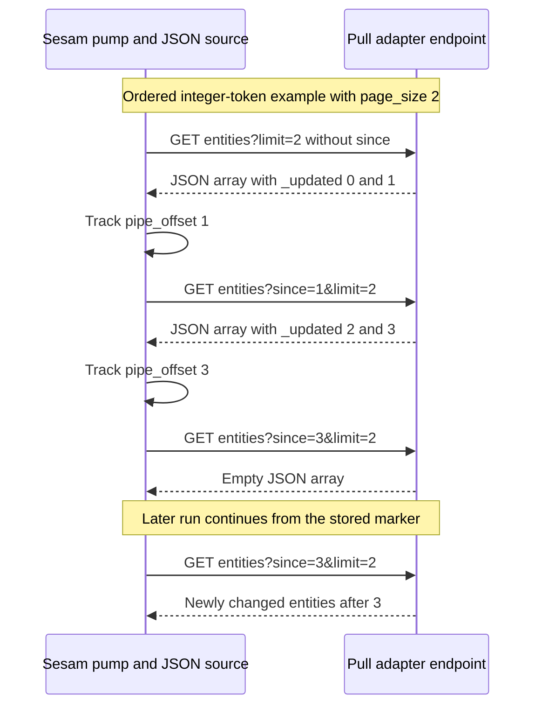
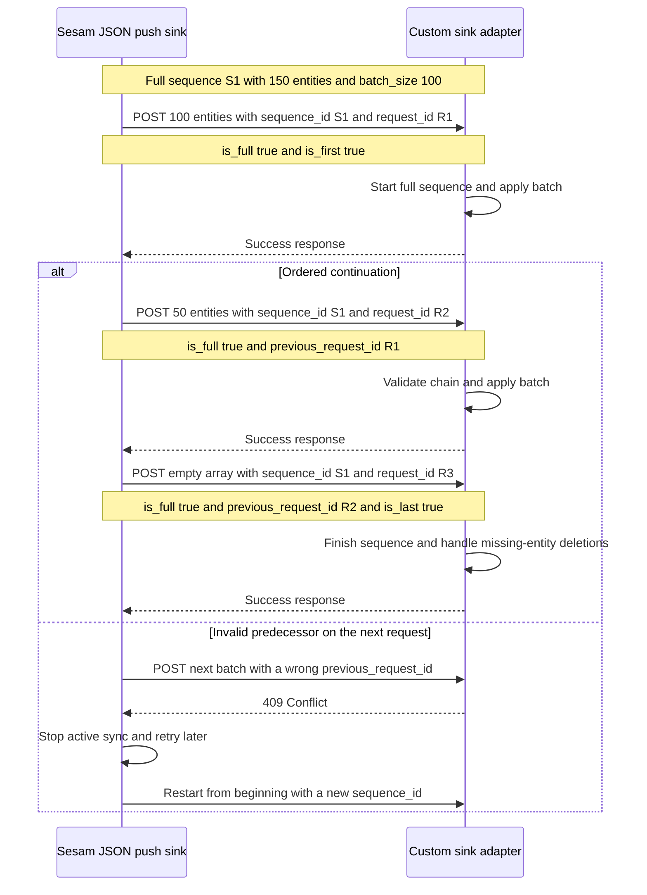

# Custom sources, transforms, sinks, and JSON streaming protocols

Sesam extensions adapt systems that the built-in components cannot handle directly. The custom code lives in an HTTP service, not inside the pipe configuration. A **system** supplies connectivity and authentication; the pipe's **source, transform, or sink** determines what the service must do with entities. Hosting an adapter as a microservice does not change its wire contract.

The key distinction is between **synchronizing an entity stream** and **transforming a batch**. JSON Pull and JSON Push carry synchronization state. An HTTP transform is an array-in/array-out request-response operation, even though it also uses JSON over HTTP.

## Choose the role and the hosting boundary separately

| Role | Sesam configuration | Direction and responsibility |
|---|---|---|
| Custom pull source | `source.type: "json"` with a URL or microservice system | Sesam GETs an entity array using JSON Pull. The adapter exposes source data and, when supported, interprets `since` and returns change markers. |
| Custom transform | `transform.type: "http"` with a URL or microservice system | Sesam POSTs an array and consumes the returned array as the next transformation stage. The service may modify, filter, or create entities. |
| Custom push sink | `sink.type: "json"` with a URL or microservice system | Sesam POSTs entity batches using JSON Push. The adapter applies them to a target, including deletions and full-sync boundaries. A legacy-system adapter should make repeated writes appear idempotent. |
| External producer pushing into Sesam | `source.type: "http_endpoint"` | Registers `/api/receivers/{pipe_id}/entities`. Incoming POSTs drive the pipe and write to its sink; no pump is configured for this source. |
| External consumer pulling from Sesam | `sink.type: "http_endpoint"` | Registers `/api/publishers/{pipe_id}/entities`. Incoming GETs drive retrieval from the pipe; no pump is configured for this sink. |

The first three roles are outbound HTTP interactions initiated by Sesam. The last two expose the complementary protocols through the Service API. Dataset reads at `/api/datasets/{dataset_id}/entities` also support JSON Pull. Publisher query parameters are available to DTL as `_B`, so a publisher transform can affect which entities a client sees.

Choose the system independently:

- **Remote URL service — `system:url`:** represents an already-running HTTP/HTTPS server. It provides sessions, connection pooling, and authentication, but does not start an adapter. The service can run anywhere reachable over HTTP from Sesam. `url_pattern` inserts a pipe's relative URL at `%s`; without `%s`, the relative URL is appended. `base_url` is deprecated, and exactly one of `base_url` and `url_pattern` must be specified.
- **Remote REST service — `system:rest`:** extends the URL system with named operations, HTTP methods, templates, and response/pagination mapping. Prefer REST source/sink/transform components for APIs that do not implement Sesam's contracts. A JSON-capable API is not automatically a JSON Pull/Push endpoint. REST sources support pagination in bodies or link headers and continuation in query parameters or headers. REST operations can be shared on the system or overridden on a component; component definitions take precedence, and secret-bearing operations belong on the system.
- **Managed adapter — `system:microservice`:** supplies similar HTTP connectivity but also provisions the configured Docker image. It works with the JSON source, HTTP transform, and JSON push sink, and determines its own service address rather than taking `base_url`.

See [Pipes and systems](../configuration/pipes-and-systems.md) for configuration ownership and [Connectors and contracts](connectors-and-contracts.md) for built-in alternatives. The role contracts are documented in [custom sources](../../hub/custom-data-source.rst), [custom transforms](../../hub/custom-data-transform.rst), and [custom sinks](../../hub/custom-data-sink.rst).

## Entity and media-type contract

For portable Pull/Push implementations, send an **array of entities**, including for a single entity. The protocols specify arrays. The Sesam HTTP receiver additionally accepts a single object, but that is an endpoint convenience, not the array-only HTTP transform contract. Receiver POSTs require `Content-Type: application/json`; HTTP transforms require `application/json` in both request and response.

An entity is a dictionary with string keys and values that may be literals, lists, or nested dictionaries:

| Field | Contract at the extension boundary |
|---|---|
| `_id` | Required string primary key, unique for a logical entity within a flow. Multiple versions may share that identity. |
| `_deleted` | Optional; omitted means not deleted. Boolean `true` marks deletion; the entity model interprets other values as not deleted. Emit booleans rather than strings such as `"true"`. |
| `_updated` | Optional string or integer source sequence/token. Needed for continuation; meaningful to the producing source, not a timestamp that every consumer should parse. It can be relayed as `since`. |
| Other root-level `_...` fields | Reserved. When writing to a dataset, only `_id` and `_deleted` are accepted as stored input fields; other reserved input fields are ignored. The source can still use incoming `_updated` for continuation before that write. The reservation does not apply to nested child dictionaries. |

Dataset-generated metadata such as `_updated`, `_hash`, `_previous`, and `_ts` may be present on exported entities. A JSON push sink includes reserved fields. Do not forward them blindly into a legacy target: interpret `_deleted: true` as a target deletion operation where appropriate, and remove metadata that the target does not understand.

### Preserve typed values, not just JSON shape

Sesam supports JSON values and a limited set of Transit-style extension strings. Preserve their prefixes when exchanging entities:

| Type | Wire example |
|---|---|
| Namespaced identifier | `"~:example:123"` |
| URI | `"~rhttps://example.invalid/resource"` |
| Date | `"~t2024-01-02"` |
| Datetime | `"~t2024-01-02T03:04:05.123456789Z"` |
| Bytes, base64 encoded | `"~bAAECAwQF"` |
| UUID | `"~u531a379e-31bb-4ce1-8690-158dceb64be6"` |
| Arbitrary-precision decimal | `"~f12345678901234567890.1234567890"` |

Datetime strings require both date and time, UTC, and the final `Z`; fractional seconds are optional, with up to nanosecond precision. Unrecognized Transit tags are treated as strings, and the documentation reports no escape mechanism for literal strings beginning with `~`. Treat that as a compatibility constraint for an adapter handling such strings. Decimal is arbitrary precision; Float is IEEE 754 binary64 and can lose precision. The HTTP receiver defaults `do_float_as_decimal` and `do_float_as_int` to `true`: fractional numbers become Decimal, while numbers whose fractional digits are all zero become Integer.

**Illustrative payload derived from documented contracts; unexecuted, with synthetic data:**

```json
[
  {
    "_id": "contact-001",
    "_deleted": false,
    "_updated": 42,
    "name": "Example Contact",
    "reference": "~:example:123",
    "modified_at": "~t2024-01-02T03:04:05Z",
    "amount": "~f12345678901234567890.1234567890"
  }
]
```

See [Entities, datasets, and identifiers](../concepts/entities-datasets-and-identifiers.md) and the [entity model](../../hub/documentation/data-management/entity-data-model.rst) for the full data contract.

## JSON Pull: continuation belongs to the source and pump

JSON Pull uses GET to retrieve entity streams across one or more requests. The [protocol](../../hub/json-pull.rst) defines:

| Query parameter | Meaning |
|---|---|
| `since` | Start **after** the specified stream offset/token, which refers to `_updated`. Omission requests the beginning. For an ordered stream, use the last received entity's `_updated` to continue. The documented publisher example `since=21` starts at `_updated: 22`. |
| `limit` | Integer cap on the number of returned entities. The protocol default is unlimited, but an endpoint may choose another default. It is not a page number. |
| `subset` | JSON-encoded subset expression. If the endpoint supports subsets but the requested subset does not exist, it returns `404`. An endpoint without subset support may ignore the parameter entirely. |

URL-encode query values, particularly subset expressions. A documented subset form is `["eq", "_S.vowel", true]`, with an index expression on the left and a subset value on the right. Do not assume that an arbitrary REST filter provides this subset contract.

### Configure only capabilities the source actually has

The JSON source defaults to `supports_since: false`, `is_since_comparable: true`, and `is_chronological: false`. Setting `supports_since: true` causes Sesam to add `since` to its requests. The pump chooses its tracking strategy in this order:

1. **Chronological:** `supports_since` and `is_chronological` are true. Store `_updated` values in stream order; the pump can checkpoint during a run and resume after an interrupted run.
2. **Max:** otherwise, `supports_since` and `is_since_comparable` are true. Store the maximum marker seen in the run. For an unordered source, the new marker is known at the end, and a failed request must be reread rather than resumed at an arbitrary last entity.
3. **None:** otherwise, no continuation tracking.

The marker is stored in the pump's `pipe_offset`, visible through the Service API and execution logs. The pump's `update-last-seen` operation can update or reset it. On initial import or reset, a source without `initial_since_value` has no stored marker and is requested from the beginning. If configured, `initial_since_value` deliberately changes that behavior.

For built-in JSON-source paging, set `page_size` to an integer at least 1. Sesam then passes it as `limit` and requests pages until there is no more data. This requires **all three** flags—`supports_since`, `is_chronological`, and `is_since_comparable`—to be true. Do not enable chronology merely to turn paging on when the upstream results are unordered.


*Pull continuation for an adapter that really supplies ordered, comparable tokens; each response may also carry dataset-state headers.*

The continuation tutorial maps a remote modification field into `_updated`, then maps incoming `since` into the remote API's changed-record query. This is a mapping pattern, not a universal API implementation. Verify the remote API's ordering, filter operator, and pagination. In particular, timestamp ties at a page boundary deserve a focused test so that a strict “after” query does not skip records. The tutorial's unordered example uses the max strategy; it does not establish chronological paging support.

### Dataset-state response headers

Do not reduce a Pull response to its array and discard its state metadata:

| Header | Meaning |
|---|---|
| `X-Dataset-Populated` | `true` or `false` for the dataset's populated flag. Missing means **unknown**, not false. |
| `X-Dataset-Max-Updated` | JSON-encoded highest committed offset. For an unfiltered complete retrieval, the last entity should have this `_updated`. |
| `X-Dataset-Filtered` | `true` when the source stream is filtered. The entity at `X-Dataset-Max-Updated` is then not guaranteed to appear, for example through a publisher with a transform. |
| `X-Dataset-Generation` | UUID assigned at creation. Deleting and recreating the dataset gives it a new generation UUID. |
| `X-Dataset-Completeness` | When set, completeness as integer microseconds since the Unix epoch. |
| `X-Dataset-Restore-Uuid` | UUID assigned when the dataset is restored from backup. |
| `X-Dataset-Restore-Offset` | JSON-encoded highest committed offset at the last restore. |

Automatic reprocessing uses several of these headers to detect when a pipe must rewind or reset. That feature is policy-controlled: `reprocessing_policy` defaults to `continue`, not automatic reset. See [Synchronization and state](../configuration/synchronization-and-state.md).

### Absence is not a delta deletion

A continuation response describes changes, not an authoritative snapshot. An entity absent from it is not automatically deleted. Emit deletion entities or periodically perform a full rescan to detect disappearance. The tutorial demonstrates `rescan_cron_expression` for periodic complete imports.

For a snapshot-style JSON source, an empty successful import can delete previously synchronized entities. `if_source_empty` defaults to `"accept"`; setting it to `"fail"` fails an empty import and preserves previous entities instead. This is especially important when an adapter might confuse an upstream outage with an empty collection. Propagate an upstream failure as a failure rather than returning a successful error array or `[]`.

## HTTP transform: a batch operation, not a synchronization session

An HTTP transform POSTs a JSON array and must receive a JSON array, containing **zero or more** entities. It may change cardinality: drop inputs, expand them, or create new entities. Its result continues through later transforms and into the sink; it is not merely an acknowledgement that the input was stored.

- Both request and response must be `application/json`.
- Non-`2xx` responses raise an exception.
- `system` and `url` identify the endpoint. Optional `headers` require string keys and string values.
- `batch_size` limits entities per request and defaults to `100`.
- `side_effects` defaults to `true`, protecting against unintended external changes through features such as pipe preview. Set it to `false` only when the transform is actually safe to preview or those effects are explicitly acceptable.
- `trigger_on` can select entities by a property and value, with `*` substring wildcards. Its default key is `_trigger`; entities with a missing key or nonmatching value pass through without transformation.

Do not implement `since`, `is_first`, `is_last`, or full-sync deletion detection merely because this operation uses POST. They belong to the Pull/Push contracts, not the [HTTP transform contract](../../hub/documentation/service-configuration/pipes/configuration-transforms-http.rst). A later DTL stage can normalize the response and supply the required `_id` before it reaches a dataset.

## JSON Push: full versus incremental synchronization

JSON Push POSTs entity arrays in batches. It is implemented by the JSON push sink and accepted by the HTTP endpoint source. The [protocol](../../hub/json-push.rst) defines these query parameters:

| Parameter | Type and scope |
|---|---|
| `sequence_id` | String token generated when a sync starts, included in all protocol requests. A UUID is recommended for uniqueness. |
| `request_id` | String token generated for each request, included in all requests. It is local to the sequence, so numeric-looking string tokens are acceptable. |
| `previous_request_id` | String reference to the prior request's `request_id`; omitted on the first request. |
| `is_full` | Boolean in all requests, default `false`. `true` declares that the sequence contains the complete set. |
| `is_first` | Boolean `true` on the first request of a **full** sync only. |
| `is_last` | Boolean `true` on the last request of a **full** sync only. |

### Incremental push

Incremental requests add/update the supplied entities and can explicitly delete them with `_deleted: true`. The server may silently ignore the sequence parameters and accept the entities. The documented minimal receiver example omits query parameters entirely and is treated as incremental.

An incremental request does **not** change an active full-sync sequence. Omission from an incremental push is not deletion: the HTTP endpoint source registers incoming data as a stream of changes. A producer that stops including a record has not, by that act alone, removed it downstream.

### Full push and the final batch

A full sequence declares an authoritative set. Only one full `sequence_id` should be active at a time. A different full sequence replaces the active sequence, and `is_last=true` ends its scope. Entities previously present but missing from the completed full sequence are marked deleted. The documented examples show updates visible between requests; do not design the target around an assumed all-batches atomic commit.

The Sesam JSON push sink defaults to batches of `100` and **always sends a final empty batch**. For 150 entities, the adapter receives arrays of 100, 50, and 0 entities. A full sync uses the last request to signal completion. An empty final array is therefore meaningful control flow, not malformed input. An external producer may instead include entities in its last batch, as the protocol examples do.


*Multi-batch full push, including Sesam's empty closing batch, with an alternative ordering-conflict and restart path.*

### Conflicts are restart signals

For a full sync, the HTTP server should return `409 Conflict` when:

- `previous_request_id` does not match the preceding request's `request_id`;
- `is_full` differs from the preceding request in the same sequence;
- `is_first=true` is supplied when the server knows it is not the first request in the active sequence.

On `409`, the JSON push sink must stop the active sync and try again later. For a full sync it restarts **from the beginning with a new sequence**, rather than resending only the disputed page. Implement ordering validation and restart behavior together. General retry settings are not a substitute for this protocol rule.

A sink adapter also needs target-specific idempotency and deletion handling. Test replay against the actual target operation: a repeated create must not accidentally create duplicates, and a deleted entity must not become an ordinary update just because reserved fields were stripped too early.

## Configuration and hosting

The following configurations are **illustrative, derived from documented examples, and unexecuted**. Hosts, image names, entity IDs, variables, and secrets are synthetic placeholders. No endpoints were contacted and no adapter containers were started for this page.

### An already-running remote adapter

```json
{
  "_id": "remote-adapter",
  "type": "system:url",
  "url_pattern": "https://adapter.example.invalid/api/%s",
  "verify_ssl": true,
  "authentication": "jwt",
  "jwt_token": "$SECRET(adapter-jwt)",
  "connect_timeout": 60,
  "read_timeout": 1800
}
```

Point a JSON source or sink at this system only if that endpoint implements Pull or Push. Otherwise use a REST system and REST components to map its real API.

### A managed adapter and a chronological pull source

```json
[
  {
    "_id": "managed-adapter",
    "type": "system:microservice",
    "docker": {
      "image": "registry.example.invalid/team/adapter:1.0.0",
      "port": 5000,
      "memory": 128,
      "environment": {
        "UPSTREAM_URL": "$ENV(upstream-url)",
        "UPSTREAM_TOKEN": "$SECRET(upstream-token)",
        "OPTIONS": {"collection": "contacts"}
      }
    },
    "connect_timeout": 60,
    "read_timeout": 1800
  },
  {
    "_id": "contacts-collect",
    "type": "pipe",
    "source": {
      "type": "json",
      "system": "managed-adapter",
      "url": "/entities",
      "supports_since": true,
      "is_since_comparable": true,
      "is_chronological": true,
      "page_size": 100
    },
    "sink": {"type": "dataset", "dataset": "contacts"},
    "pump": {"rescan_cron_expression": "0 0 ? * *"}
  }
]
```

This source configuration assumes `/entities` implements chronological, comparable continuation and `limit`. It is not a declaration that the image acquires those capabilities automatically. For an unordered but comparable source, use the max strategy and omit chronological paging.

The same managed system can be referenced in the other roles, if it implements the corresponding routes:

```json
[
  {
    "_id": "contacts-enrich",
    "type": "pipe",
    "source": {"type": "dataset", "dataset": "contacts"},
    "transform": {
      "type": "http",
      "system": "managed-adapter",
      "url": "/transform",
      "batch_size": 100
    }
  },
  {
    "_id": "contacts-export",
    "type": "pipe",
    "source": {"type": "dataset", "dataset": "contacts"},
    "sink": {
      "type": "json",
      "system": "managed-adapter",
      "url": "/receive",
      "batch_size": 100
    }
  }
]
```

### Provisioning, reachability, and lifecycle

- `docker.image` and `docker.port` are required. The port must be exposed by the container and match the service listener. The system supports private image repositories through `docker.username` and `docker.password`; those credentials are separate from HTTP authentication with the running service.
- Managed microservices are individual Docker containers in the documented single-machine architecture, and individual Kubernetes deployments in the clustered architecture. The `docker` configuration describes the image even when the runtime is Kubernetes. Self-hosted cluster installation is a separate deployment concern; its repository guide is explicitly marked draft.
- Microservice HTTP is the default; `use_https: true` selects HTTPS. URL and microservice `verify_ssl` both document a default of `false`. Set certificate verification deliberately; a URL system can use `custom_ca_pem_chain` when verification is enabled.
- A microservice `_id` becomes a local-network domain name. Follow the documented 2–63 character length, start with an ASCII letter or number, use only letters, numbers, `_`, and `-`, and use lower-case letters to avoid DNS lookup errors.
- Check both hops: Sesam must reach the adapter, and the adapter must reach the upstream/target service. `docker.hosts` adds hostname-to-IP mappings inside the container; URL systems offer HTTP(S)/SOCKS5 proxy settings. The Service API proxy can access a managed route through `/api/systems/{system_id}/proxy/{rest_of_path}`; it is not the same endpoint as a pipe receiver or publisher.
- `docker.skip_pull` defaults to `false`: restarts, including configuration changes, attempt to pull the image. `docker.pull_image_cron_expression` schedules pulls and restarts the container if a newer image is pulled. Plan for restart-safe adapter behavior and deliberate image versioning.
- `eager_load: false` lets Sesam defer starting an unconnected microservice. The documented default is `true`, except `false` for developer subscriptions. The property overrides the service-metadata default.
- `docker.memory` defaults to 128 MB. Container resource use can affect the whole node. The documentation recommends small containers and streaming rather than retaining entire imports/exports in adapter memory.

See [Deployment and durability](../operations/deployment-and-durability.md) for platform concerns and the [microservice configuration](../../hub/documentation/service-configuration/systems/configuration-systems-microservice.rst) for resource and lifecycle settings.

### Environment, secrets, and authentication

`$ENV(name)` resolves configuration environment values; `$SECRET(name)` references a secret in a supported configuration location. Pass adapter-wide values in `docker.environment`, pipe-specific routing values in URLs, and synchronization state in the protocol parameters. String environment values are passed as-is; other values are serialized to JSON strings, so the adapter must decode values such as `OPTIONS` itself.

Secrets are write-only through the API and should be used for credentials. Prefer system-local secrets. Removing and re-adding a system removes its local secrets, so re-upload them as part of recovery. Receiving a secret through a container environment does not excuse the adapter from protecting it in its own logs.

Keep the authentication domains distinct:

| Connection | Documented authentication contract |
|---|---|
| Client to Sesam Service API | Normally `Authorization: Bearer YOUR-JWT-TOKEN`, with appropriate permissions. The protocol examples use `Authorization: bearer YOUR-JWT-TOKEN`. |
| Sesam to URL/REST server | Authentication is opt-in. URL values are `basic`, `digest`, `ntlm`, `tripletex`, or `jwt`; provide the corresponding credentials. `jwt` requires `jwt_token`, which overwrites an `Authorization` header set in system headers. |
| Sesam to managed microservice | Authentication is opt-in, with `basic` or `digest`. Set `authentication`, `username`, and `password`; without authentication selection, username/password are ignored. |
| Managed adapter to its upstream | Implemented by adapter code using its own supplied credentials and the upstream API contract. Hosting does not supply upstream authentication logic. |

URL OAuth2 configuration supports client-credentials and refresh-token grants. It cannot be combined with JWT authentication or `jwt_token`; TLS is required for token and target endpoints. Token refresh is controlled by `refresh_window`, default 30 seconds before expiry.

A receiver has an alternative for clients unable to use JWT: `validation_expression` is a Jinja template rendered for each request. **Empty rendered text accepts; nonempty text is the error response.** It has `url`, `request_params`, and `request_headers`, plus `secret(...)` and custom filters such as `decode_jwt`. A documented form is:

```jinja
{{ '' if request_headers['X-Sesam-Authorization'] == secret('webhook_secret') else 'Invalid authorization header value' }}
```

Without JWT, the receiver pipe must grant `write_data` to `group:Anonymous`; custom validation then becomes the critical guard. System secrets take precedence over same-named global secrets, and using system secrets requires the pipe to have permission to read that system. Do not turn on anonymous access without installing and testing validation.

On receiver POSTs, sink-dataset completeness defaults to the current time. A positive integer `X-Dataset-Completeness` request header can override it; microseconds since epoch are recommended. `auto_populate_dataset` defaults to `true` and applies only to a dataset sink. These are separate from whether a full synchronization has completed.

See [Security and secrets](../operations/security-and-secrets.md), [URL configuration](../../hub/documentation/service-configuration/systems/configuration-systems-url.rst), and [receiver configuration](../../hub/documentation/service-configuration/pipes/configuration-sources-http.rst).

## Timeouts, retries, and operational diagnosis

URL and microservice systems default to `connect_timeout: 60` seconds and `read_timeout: 1800` seconds. These govern Sesam's connection to and wait for the HTTP service. Configure the adapter's upstream HTTP calls separately; do not assume Sesam's system settings are propagated into its HTTP library.

`retry_strategy` on URL systems—and through the microservice system's reference to the same policy—sets pump retry defaults by HTTP status code. Keys can be individual codes, ranges such as `400-428`, lists such as `500,502,504`, or `default`. A property set directly on the pump takes precedence. Supported policy properties are:

`max_read_retries`, `read_retry_delay`, `write_retry_delay`, `max_retries_per_entity`, `max_consecutive_write_errors`, `max_write_errors_in_retry_dataset`, and `batch_retries`.

The documented example treats `400-428` as nonretryable writes, delays `429` by 30 seconds, and delays selected server errors by 60 seconds. Those are example policies, not automatic defaults. In particular, retain the special JSON Push `409` restart semantics.

The pump owns retries, execution logging, and optional dead letters. Defaults include `max_read_retries: 0`, `max_consecutive_write_errors: 1`, and `max_write_errors_in_retry_dataset: 0`; the last setting effectively disables failed-write retries recorded in that dataset. `batch_retries` defaults to 3, and `fallback_to_single_entities_on_batch_fail` defaults to `true`. Review the combined settings rather than assuming that increasing only `max_retries_per_entity` enables a durable retry queue.

For diagnosis:

1. Inspect the managed system's **Status** page and adapter logs. Log relevant route, sequence, batch, and upstream-failure context from adapter code. System APIs expose logs, status, reload, and proxy access.
2. Inspect the pipe execution log for failures, `pipe_offset`, and `processed_last_run`. The continuation tutorial uses the offset and changed-record count to check behavior. Adapter logging often gives more context than a pipe traceback alone.
3. Enable receiver `trace` only deliberately. It can log request/response headers and body prefixes in execution events; defaults are trace off, 100-byte body prefixes, and 600 redacted bytes of the `Authorization` request header. `trace.log_secret_redacted_bytes: -1` redacts that entire header. Other sensitive headers and bodies still need scrutiny.
4. Distinguish reachability, authentication, upstream failure, malformed entity data, transform media-type failure, and Push ordering conflict. Do not mask any of these as a successful empty source response.

See [Monitoring and troubleshooting](../operations/monitoring-and-troubleshooting.md) and [pump configuration](../../hub/documentation/service-configuration/pipes/configuration-pump.rst).

## Adapter implementation boundary and focused tests

This repository documents contracts and configuration examples; the starter implementations are external repositories. For example, the documentation links [Python datasource](https://github.com/sesam-io/python-datasource-template), [Python transform](https://github.com/sesam-io/python-transform-template), and [Python datasink](https://github.com/sesam-io/python-datasink-template) templates, with source templates also available for ASP.NET, Java, and NodeJS. Those links are implementation handoffs, not evidence that their current code or dependency versions have been validated here.

The [source microservice tutorial](../../hub/tutorial-custom-data-source-microservice.rst) and [continuation tutorial](../../hub/tutorial-microservice-continuation-support.rst) are **documented but unexecuted examples**. Their API-specific filters, credentials, and illustrative Flask code must be reviewed in the adapter's implementation repository before deployment. They establish the integration pattern, not a tested production implementation for a current upstream API.

Recommended contract tests, derived from the behaviors above:

| Area | Focused checks |
|---|---|
| Entity round-trip | String `_id`, booleans for deletion, integer/string tokens, nested dictionaries, typed prefixes, and decimals that would lose precision through Float. Verify reserved-field handling at dataset and target boundaries. |
| Pull | Initial request without `since`, resume after the last marker, `limit` paging, timestamp ties, unsorted input never advertised as chronological, empty change responses, and interruption under both chronological and max strategies. |
| Pull metadata | Missing populated header remains unknown; filtered streams need not contain the max-offset entity. Exercise generation changes and restores under the intended reprocessing policy. |
| Transform | Arrays for one, zero, and many outputs; non-JSON media type; non-`2xx` failure; batch splitting; trigger bypass; and preview protection for side effects. |
| Push | Incremental omission leaves entities intact; explicit deletion reaches the target; full omission marks deletion only on completion; empty closing batches are accepted. Inject wrong predecessor IDs, inconsistent `is_full`, and repeated `is_first`, then check `409` and a new full sequence from the beginning. |
| Failure and operations | Upstream outage is not a successful empty snapshot. Check connection/read timeouts, configured status policies and pump overrides, replay idempotency, restart during a full sequence, secret restoration after system recreation, and trace redaction. |
| Receiver security | Valid/invalid JWT or custom validation, anonymous write permission only when intended, secret precedence, and completeness-header validation. |

The documented Sesam client testing workflow compares endpoint-pipe output against fixtures in `expected/`, using `<pipe>.json` and `<pipe>.test.json`, and runs `sesam -vv test`. It recommends disabling output pipes or making them unable to send to real target systems during tests. Use adapter-local tests as well: fixture comparison alone does not verify remote writes, deletion operations, or synchronization ordering. This page has not run either workflow.

For the surrounding workflow, continue with [Build an integration](../workflows/build-an-integration.md) and [APIs and repository handoffs](apis-and-repository-handoffs.md).
