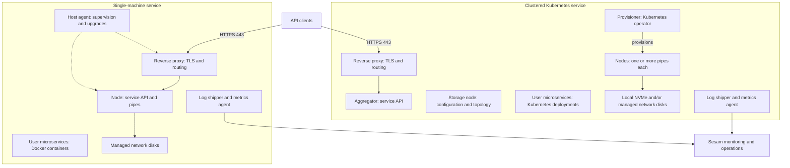
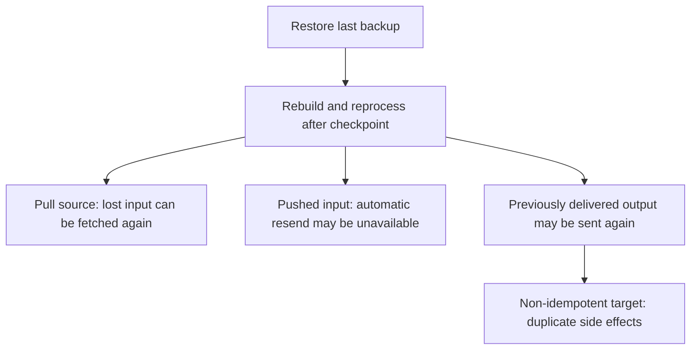

# Deployment variants, backups, compaction, and durable data

Sesam offers hosted and self-hosted services. **A subscription plan, its actual provisioner, and its backup policy are separate operational facts.** Do not infer a recovery guarantee or a deployment architecture from a plan name alone: the architecture overview, migration history, and roadmap do not all describe the same deployment generation.

## Deployment and ownership boundaries

| Variant | Documented scope and responsibilities |
| --- | --- |
| Hosted developer | A cloud-only, restricted environment for one developer or CI. Developer and Developer Pro have no backup, VPN, or SLA support and cannot host test, staging, or production environments. |
| Hosted production/test | Pricing documents automated backup and support for SLA and VPN, with geo-replicated backup included in cloud environments. It lists Single, Flexi, and Multi compute plans; Single is limited to four engines, and Flexi is recommended for scalable production workloads. |
| Single-machine service | The architecture overview associates Developer and Single compute with one VM. A host agent supervises/upgrades the containerized service components. The single-machine self-hosted installation guide is the documented non-cloud entrypoint. |
| Clustered service | The overview associates Multi compute with a Kubernetes service that can scale across machines. API aggregation, topology/configuration storage, pipe provisioning, and pipe execution are separate roles. Later migration documentation describes clustered provisioning beyond Multi compute. |
| Self-hosted Kubernetes | There is a **draft, subject-to-change** guide, not a complete standalone installation recipe. Licenses, secrets, and chart installation require Sesam support assistance. Confirm support status before treating it as a supported production deployment. |

Sources: [pricing](../../pricing.rst), [architecture overview](../../hub/documentation/operations/behind-the-scenes.rst), [single-machine guide](../../hub/documentation/operations/self-hosted.rst), [draft Kubernetes guide](../../hub/documentation/operations/self-hosted-k8s.rst).

### Documented runtime topology

*The overview's two service layouts, showing only documented routing, supervision, provisioning, storage, and telemetry relationships; it does not specify the aggregator's internal RPC path.*

Hosted software is distributed as OCI/Docker images from a private Docker Hub repository. The overview describes Azure infrastructure provisioned with Terraform. In the single-machine layout, subscriptions have individual resource groups in a shared Azure subscription and store data on managed network disks. In the clustered layout, provisioning uses one Azure subscription per customer, with local NVMe and/or managed network disks. Each has its own Azure Network Security Group. Subscription groups share a common network; a clustered group sits in its own Azure subscription.

Both layouts include a port-443 TLS-terminating reverse proxy, log shipping, metrics shipping, and user microservices. The overview documents automatic Let's Encrypt certificates for both proxies, with operator-provided certificates also possible in the single-machine layout. The single-machine node owns the service API; the cluster's aggregator owns that API, its storage node holds configuration/provisioner topology, and its Kubernetes operator provisions processing pipes. User microservices run as individual Docker containers or Kubernetes deployments respectively. The overview and the supplied self-hosted Compose examples describe different update mechanisms: a host agent versus Watchtower. Do not assume they are the same setup.

Sesam persists data in **RocksDB**, using **MessagePack** and RocksDB's default compression. This physical persistence is distinct from retained dataset history, backup copies, or opting a pipe into high-durability storage. See [Hub model and boundaries](../architecture/hub-model-and-boundaries.md) for the logical model and [monitoring and troubleshooting](monitoring-and-troubleshooting.md) for telemetry responsibilities.

Source: [Behind the scenes](../../hub/documentation/operations/behind-the-scenes.rst).

### Conflicts and version-sensitive instructions

These are documentation differences to resolve with the actual subscription and [Sesam support](https://support.sesam.io/), not gaps to fill with guessed configuration.

| Issue | Evidence and safe interpretation |
| --- | --- |
| Region versus geo-replication | The [overview](../../hub/documentation/operations/behind-the-scenes.rst) names North Europe (Dublin, Ireland) and says data never leaves that region. Its own backup sections describe geo-redundancy, while [pricing](../../pricing.rst) and [BYOK](../../hub/features/bring-your-own-key.rst) describe geo-replicated backup storage. This is an unresolved scope tension, not evidence of a specific secondary region. Do not extend the region statement into an all-copies residency guarantee. Confirm primary and backup locations. |
| BYOK support and cost | The overview says BYOK is not supported. The focused [BYOK feature](../../hub/features/bring-your-own-key.rst) instead documents opt-in support for **new single subscriptions**, not multi subscriptions, through support. It is badged free, but the [portal API schema](../../hub/swagger_portal.yaml) says enabling `byok` incurs additional costs. Confirm eligibility and charging rather than promising either universal support or zero cost. |
| Plan name versus provisioner | The overview maps Developer/Single to one machine and Multi to a cluster. The [2022-02-11 changelog](../../hub/changelog.rst) describes migration and checking `Subscription` > `Basics`: `version 1` is single-machine, `version 2` is clustered, and self-hosted is labeled `self-hosted`. The 2022-03-24 entry says portal-created subscriptions now use clustered architecture; the [roadmap](../../hub/roadmap.rst) says all cloud subscriptions now run on it. Treat the overview as a description of layouts, not a reliable current mapping from every plan to infrastructure. |
| Self-hosted cluster support | The roadmap still describes self-hosted clustering as planned and self-hosting as single-machine only, whereas the Kubernetes guide supplies a draft GKE setup. Neither makes that draft a complete supported deployment contract. |
| Compose and chart paths | The [self-hosted guide](../../hub/documentation/operations/self-hosted.rst) links `files/env`, which is absent from the documented files directory in this repository. It tells operators to use `traefik.yaml`, but the [selfcert Compose file](../../hub/documentation/operations/files/selfcert/docker-compose.yaml) mounts `traefik.yml`. Certificate names differ between the prose and [Traefik template](../../hub/documentation/operations/files/selfcert/traefik.yaml). The directory/symlink examples spell the base path concatenation differently. The draft Helm repository URL contains `https://https://github.com/sesam-io/helm-charts/`. Follow the authored references with support review; this page does not silently repair or present them as tested commands. |

The focused BYOK reference says disks and their backup storage account use platform-managed keys by default. In its BYOK model, Sesam manages the key, while the customer can decide to revoke it; this generally requires that Sesam can reload the data afterwards. Revocation is therefore a data-availability decision, not merely a settings change.

The migration changelog provides dated deployment evidence, not a new region or BYOK contract. Feature-specific lifecycle evidence is also important: durable data was added on **2022-03-25**, TTL deletes on **2024-11-27**, and retract on **2026-04-07**. The roadmap still has a planned history-removal item, but the current compaction reference and retract changelog document the implemented feature.

## Software release channels

Self-hosted subscriptions must run the latest image of their **chosen channel**, not necessarily the image tagged `latest`.

| Channel | Authored intended use and rollout |
| --- | --- |
| `weekly-prod` | Production; weekly, two weeks behind `nightly`, most stable. |
| `weekly` | Staging; weekly, one week behind `nightly`. |
| `nightly` | Development; nightly. |
| `latest` | Expert development use only; every merged pull request. |

Weekly/nightly upgrades are documented for 00–03 CET, with weekly upgrades on the night to Monday. Promotions may be withheld, so build dates indicate a minimum rather than maximum age. Security hotfixes need not wait for the scheduled window. **Downgrades are unsupported.**

Sources: [software channels](../../hub/features/software-channels.rst), [self-hosted requirements](../../hub/documentation/operations/self-hosted.rst), [draft Kubernetes requirements](../../hub/documentation/operations/self-hosted-k8s.rst).

## Self-hosted preparation and failure boundaries

### Single machine

The guide recommends at least **4 CPUs, 16 GB RAM, and a 350 GB fast-storage data partition**, adjusted for workload. It requires Docker and Ubuntu ≥ 20.04 or RHEL ≥ 8, preferring Ubuntu. Before installation, obtain a portal subscription, a valid license, support-provided private Docker repository login, and a `sesam` VM user.

The authored data layout assumes `/srv/data`, with `/srv/data/sesam/node-00/data` linked to `/sesam/node-00/data`; a root-disk alternative is described. The license is saved in the data directory as `license.key`. **Without a valid license, pipes stop running.** The guide finishes by adding the node URL in the portal's network tab and uploading the license. Migration from an old installation explicitly starts with a backup, then stopping/removing containers and moving the store and license to the configured location. Review this migration boundary with support; it is not an instruction to perform it during documentation work.

The supplied [standard Compose](../../hub/documentation/operations/files/standard/docker-compose.yaml) and [selfcert Compose](../../hub/documentation/operations/files/selfcert/docker-compose.yaml) describe Watchtower, Traefik, `sesam-node`, and Fluent Bit. Watchtower checks hourly and targets the node, Fluent Bit, and Traefik. Both node commands enforce licensing, enable engine-managed microservices, and select checkpoint backups under `/sesam/data/backup`. They mount the host data directory into `/sesam/data`, use external `sesam` and `microservices` networks, and route Traefik to the node's internal port 9042. These examples do **not** supply the host-agent/metrics-agent layout from the overview in the same form.

### Kubernetes — draft only

The [draft guide](../../hub/documentation/operations/self-hosted-k8s.rst) calls for Kubernetes ≥ 1.22 and one worker with at least **8 CPU cores and 32 GB RAM**. Its GKE example recommends a dedicated `n2-standard-8` node pool labeled `sesam.io/nodepool: primary`, client access via `kubectl`, namespace `sesam`, and a persistent volume claim. The sample requests **512Gi**, `ReadWriteOnce`, and storage class `standard`; that is the sample PVC, not a universal sizing guarantee.

At the time of the authored guide, only **Azure Storage Accounts** are supported as the cluster backup backend, even for its GKE example. Helm manages the services, but the guide ends by requiring a license and various secrets and directing installation assistance to support. Do not substitute a PVC for a backup plan.

### Firewall, TLS, and VPN

For self-hosting, client access to the node API requires inbound **443**; it may be private-network or VPN access. Automatic HTTP-challenge certificate generation/renewal requires public inbound **80** from any source. With operator-provided or self-signed certificates, the guide says that port opening can be skipped, although the selfcert Compose example still publishes 80.

Required self-hosted outbound HTTPS destinations are:

- `*.docker.com`, `*.docker.io`: image pulls/updates; blocking them prevents self-update.
- `*.letsencrypt.org`: needed for managed certificates; blocking it prevents renewal.
- `*.sesam.io`, `*.sesam.cloud`: portal communication, log/metric shipping, and agent updates. Blocking them breaks portal retrieval, notifications, and billing-related telemetry.
- `files.pythonhosted.org`, `pypi.org`, `pypi.python.org`: Python dependencies used by the agent; blocking them prevents self-update.

The guide treats the required outbound openings as necessary to operate under the terms of service. CDN addresses can change, so it recommends domain/wildcard-aware rules or a proxy rather than fixed IP assumptions. The hosted overview separately says cloud NSGs can expose only port 443; do not apply that statement to self-hosted certificate challenges.

[Network policy](../../hub/features/network-policy.rst) can block public access or allowlisted addresses/ranges. It describes reverse-proxy allowlisting and custom per-pipe public/restricted rules in the new architecture, and says outgoing traffic is currently unrestricted. That is a product-policy statement, **not** permission to ignore self-hosted firewall dependencies.

[VPN](../../hub/features/vpn.rst) is a paid IPSec feature, enabled through the portal's Products and VPN tabs; operators supply gateway, routed address spaces, and authentication details. Multi and Flexi support advanced highly available BGP/redundant connections and custom IPSec rules, arranged by support. Developer subscriptions do not support VPN. Keep credentials, private keys, licenses, and actual account configuration out of documentation; see [security and secrets](security-and-secrets.md).

Sources: [self-hosted firewall requirements](../../hub/documentation/operations/self-hosted.rst), [hosted isolation/firewall](../../hub/documentation/operations/behind-the-scenes.rst).

## Backup policy is subscription-scoped

The following policies belong to the authored architecture sections. They are not defaults for every developer, self-hosted, Flexi, or migrated subscription.

| Authored scope | Cadence, retention, and ownership |
| --- | --- |
| Single-machine `Local` backup | Once per 24 hours; seven daily checkpoints on local disk. |
| Sesam-hosted Single compute `Geo-redundant` | Daily Azure VM backup. Keeps the last backup, seven daily, four weekly, and four monthly backups. |
| Single-machine self-hosting | The owner is responsible for off-site copies of checkpoint directories or the VM. Local checkpoints alone are not off-site recovery. |
| Clustered service | Every 24 hours, with a geo-redundant copy to the Azure subscription's storage account at the same time. Keeps the last backup, seven daily, four weekly, and four monthly backups. |
| Developer / Developer Pro | No backup support under the pricing scope, regardless of general cloud-backup language elsewhere. |

The overview says termination deletes subscription data and backups, but the Azure backups described in its single-machine section are retained **30 days after deletion**, as mandated by Azure. This exception is not a universal deletion delay for all stores or a promise of customer restoration access.

Sources: [backup and termination sections](../../hub/documentation/operations/behind-the-scenes.rst), [subscription scope](../../pricing.rst).

## Recovery replay and durable pipe data

For the cloud-backup scenario described by [Durable Data](../../hub/features/durable-data.rst), the last 24 hours of writes can be lost during disaster recovery. Pull sources may be able to supply the lost data again; pushed HTTP endpoint input may not have an automatic resend path. Rewinding to a checkpoint also replays output: the documented invoice example restores a 10:00 backup after an invoice was sent at 12:00, causing that invoice to be sent again. **External side effects are not rolled back just because Sesam is restored.**

*The durable-data guide's recovery risk model, not a universal recovery algorithm or exactly-once delivery guarantee.*

`metadata.durable` is a pipe-level boolean, default **`false`**. Setting it to `true` places the pipe's **data and state** on high-durability disk; the guide also describes replicas as reducing loss risk. It recommends enabling it for pushed inbound pipes, non-idempotent endpoint pipes, and **both endpoint pipes and the share pipes that feed them**. It reduces risk rather than guaranteeing zero loss, replay-free recovery, or recovery of compacted history.

Durable data is a paid feature; the focused guide says it increases durable pipes' data consumption **3×**. The roadmap says it is available on all cloud subscriptions, and the changelog records its introduction on 2022-03-25. Availability does not override developer subscriptions' lack of backups or establish self-hosted eligibility. Confirm subscription-specific costs and storage behavior with support.

Restoring datasets can also make pipes out of sync. [Automatic reprocessing](../../hub/features/automatic-reprocessing.rst) can reset/rescan or sometimes rewind when enabled. Its default `reprocessing_policy` is `continue`, not `automatic`; recovery must not assume every pipe automatically resets. See [synchronization and state](../configuration/synchronization-and-state.md) and [bidirectional synchronization](../workflows/bidirectional-synchronization.md) for offset and external-state considerations.

## Compaction, deletion, and permanent removal

A dataset is an append-only immutable log. New or changed content is appended after comparison with the latest entity's content hash. Retention/compaction limits that log's growth; it is not the same operation as setting deletion state or retaining a backup.

### Retention controls and dependency tracking

The default policy keeps **two unique versions per entity**. Two versions are needed for reliable dependency tracking; fewer than two changes it to best effort and may miss reprocessable entities, especially hops involving a sink dataset. The reference suggests full or partial rescans as a countermeasure.

Compaction cannot advance past the **lowest tracking offset** held by any pipe doing dependency tracking on that dataset, preserving the history those pipes need to stay correct. **Disabled pipes still hold back compaction.** For long-term disabling, the guide suggests removing the pipe or commenting out its hops; assess the effect on the dataflow before doing either.

| Pipe property | Documented default and behavior |
| --- | --- |
| `compaction.automatic` | `true`: eligible for automatic compaction. With sink compaction disabled, automatic dataset compaction is documented once per 24 hours. |
| `compaction.sink` | `true`: incremental dataset compaction as the sink writes. Automatic compaction does not run on that dataset itself, but index compaction is scheduled and requires no dataset lock. |
| `compaction.keep_versions` | `2`; must be ≥ `0`. Setting `0` requires a time threshold; values below `2` weaken dependency tracking. |
| `compaction.time_threshold_hours` | `null`: optional age threshold for compaction candidates. |
| `compaction.time_threshold_hours_pump` | `720`: pump execution datasets are always time-trimmed; 30 days is the minimum. |
| `compaction.growth_threshold` | `1.0`, the minimum/default growth factor for automatically scheduled compaction; new writes make it eligible to run. |
| `compaction.compaction_interval` | `0`: sink compaction each pipe run. A positive value requires that many seconds since the last sink compaction. |
| `compaction.ttl_deletes_hours` | `null`: opt-in age threshold for removing all versions of a deleted entity. |
| `compaction.retract` | `false`: opt-in honoring of `$retract: true` in output entities. |
| `compaction.ttl_deletes_timeout_seconds`, `compaction.retract_timeout_seconds` | Both `60`: limit time spent per pipe run; unfinished work resumes from where it stopped on the next run. |

Source: [Compaction](../../hub/features/compaction-feature.rst). Dependency tracking discovers transform dependencies such as DTL hops and reprocesses affected entities; the [dependency-tracking reference](../../hub/features/dependency-tracking.rst) restricts that mechanism to `dataset` sources.

### Three different meanings of removal

| Operation | Effect on current state and history |
| --- | --- |
| Logical deletion | `_deleted: true` means the entity is deleted. It is still represented in the log under retention rules. Dataset-sink deletion tracking defaults to `true`: after a full run, previously existing entities not seen in that run are deleted. This is not physical erasure of their history. |
| Ordinary retention compaction | Prunes eligible versions under count/age policy and tracking-offset constraints. A `_previous` reference can point to a version already reclaimed by compaction. |
| TTL delete compaction | When the latest version has `_deleted: true` and exceeds the configured TTL, **all versions**, including the deletion marker, are removed from the database. The 2024-11-27 changelog says recovery then requires a backup that still contains them. No such backup is implied for a developer subscription. |
| Retract | With `compaction.retract: true`, output `$retract: true` permanently removes **earlier versions in that pipe's sink dataset**, retaining the current version. Deletion state is unchanged, the operation is idempotent, and it overrides `keep_versions` for that entity. It is irreversible; the feature reference says pruned versions cannot be recovered. |

Retract is **not** a global purge: upstream datasets and external consumers are unchanged. `$retract` propagates as an ordinary field but can be dropped by merge sources or `emit_children`. Every downstream pipe expected to honor it must enable `compaction.retract` and explicitly include `$retract` in its output. Do not read retraction as deletion of backup copies, external side effects, or all downstream history.

Sources: [entity data model](../../hub/documentation/data-management/entity-data-model.rst), [dataset sink](../../hub/documentation/service-configuration/pipes/configuration-sinks-dataset.rst), [compaction/retract](../../hub/features/compaction-feature.rst), [TTL and retract changelog](../../hub/changelog.rst). See [entities, datasets, and identifiers](../concepts/entities-datasets-and-identifiers.md) for entity version semantics.

## Focused operational checks

Before deployment or a storage-policy change, review the actual provisioner, chosen channel, license validity, data mounts/PVC, TLS renewal path, required egress, backup policy/off-site owner, and the pushed-input/non-idempotent-output paths. For unexpected disk growth, inspect dependency-tracking offsets and disabled pipes before lowering retained versions.

For configuration regression checks, the [local testing guide](../../hub/documentation/operations/testing-locally.rst) documents using the Sesam client to drain input queues, keeping output pipes disabled or unable to contact real targets, and comparing endpoint output with files in `expected/`. It uses paired `<name_of_pipe>.json` and `<name_of_pipe>.test.json` files. This validates configuration outputs, not Azure backup retention, disk durability, or restoration safety.

Recommended additional checks in an isolated, supported environment are: exercise hop-triggered changes with the proposed version policy; verify the latest-version/TTL boundary; verify retract retains the current version and reaches only explicitly configured downstream pipes; and review replay handling against a non-idempotent target before approving a restore plan. These are operator review targets derived from the documented semantics, not claims that this repository contains an infrastructure recovery test suite. No deployment, migration, compaction, or restore commands were executed to produce this page.

For chronology and policy context, see [history and policies](../references/history-and-policies.md).
