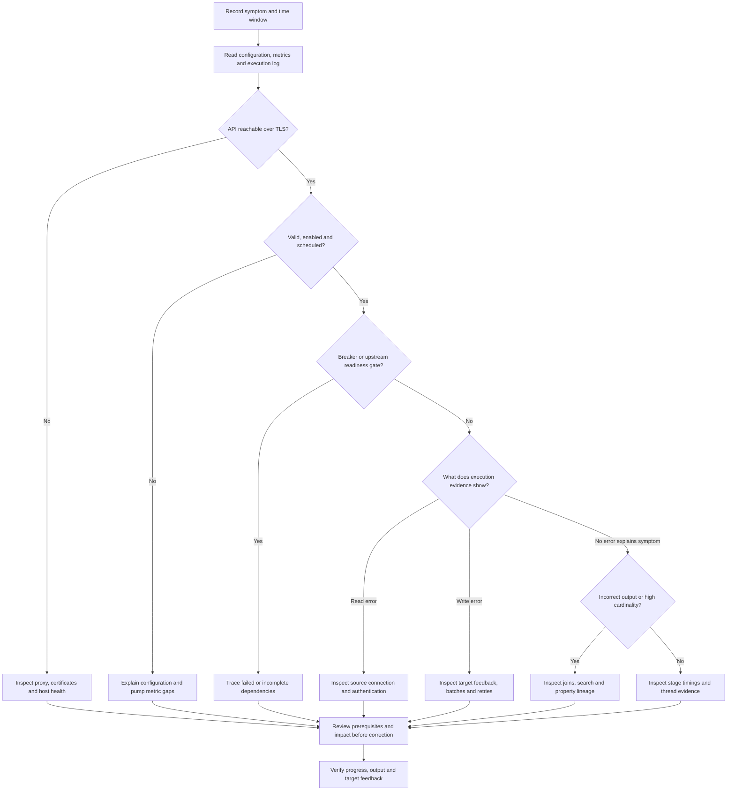

# Metrics, execution logs, lineage, and failure diagnosis

Diagnose **where progress stopped and what evidence explains it** before resetting offsets, increasing retries, or replaying data. A pump reads entities from a source, moves them through the pipe to its sink, owns failed-write retries, and records execution history. A downstream symptom may therefore originate in a source system, a transform or dependency, the target, or the hosting infrastructure—not in the pipe where the queue is visible.

> **Lifecycle warning:** The [2025-04-02 changelog](../../hub/changelog.rst) announced Notifications end-of-life on **June 30th 2025**, with **Metrics** as its replacement. Older pages still describe notification rules, a notifications/insights bundle, activation menus, and pricing. Treat those as historical guidance, not a promise of current notification delivery, product availability, or price. Confirm the subscription's current products and access in the portal or with support; build monitoring around the supported metrics exposure rather than legacy Notifications.

> **Internal evidence, not an application API:** `system:pump_execution:<pump_id>` is the pump execution dataset. Its entity IDs and structure are explicitly **non-public and subject to change**. Use it for investigation, not as a stable integration contract. Logs can contain complete failed entities and user metadata; never paste raw log entities, credentials, tokens, or HTTP payloads into tickets or this wiki.

## Read-first incident workflow

1. **Fix the scope:** record subscription, affected pipe and system IDs, observed time window in UTC, configuration revision, and the expected versus observed behavior. Preserve a sanitized evidence summary before changing state.
2. **Inspect configuration and runtime:** look at source, transform chain, sink, pump mode/schedule, enablement, completeness inputs, retry settings, and the dependency graph. Read-only API entrypoints include `GET /api/pipes/{pipe_id}/config`, `GET /api/pipes/{pipe_id}`, and `GET /api/pipes/{pipe_id}/pump`. Pipe information can select `config`, `runtime`, `storage`, and `graph` fields. The pump endpoint's **POST** operations change state; they are not inspection commands.
3. **Compare observations over time:** use queue gauges, run success, last-completion and scheduled timestamps, retry counts, and storage usage. A single queue snapshot or missing metric does not establish failure.
4. **Correlate execution evidence:** inspect the latest logged run and its errors, then follow the earliest failed or incomplete upstream dependency rather than restarting every downstream pipe.
5. **Trace data only when needed:** compare stored input and output for a small, authorized sample; navigate search and property lineage to find the producer of an incorrect property. A preview is not automatically read-only when external transforms are involved.
6. **Choose the narrowest correction:** repair connectivity, authentication, data shape, join criteria, or target ordering first. Review replay/idempotency and deletion effects before performing any recovery operation. Verify progress and output after the change.


*Diagnostic decision flow based on pump modes, readiness/completeness, execution error types, and the documented low-level evidence tools; it is an operator workflow, not an automatic recovery algorithm.*

### Symptom routing

| Symptom | First evidence to collect | Do not jump straight to |
| --- | --- | --- |
| Growing queues, missing entities, stalled completeness | Source/tracking/replica queues, mode/schedule, upstream completeness and population, breaker status | Resetting the downstream pipe or bypassing completeness |
| Read or authentication errors | `read-error`, original source error, connected system configuration, token expiry metadata | Increasing write retries |
| Failed batches or exhausted retries | `write-error` state, target feedback, effective retry settings, dead-letter counts | Reposting every failed entity |
| Duplicates or repeated bidirectional changes | Target identifiers, insert feedback/origin mapping, before/after values | Blindly replaying inserts or merging all matches |
| Dependency limit failures or excessive hops | Tracking queue, hops cardinality/trace, join keys and inverse traversal | Raising memory thresholds |
| Incorrect merge or child output | Source versions, equality/identity rules, lineage, child IDs and deletion history | Deleting global datasets |
| Disk pressure or slow/frozen node | Pipe bytes and log/index counts, tracking offsets, host telemetry, recent stacktraces | Forcing compaction or leaving global profiling on |
| Certificate failures | Which TLS connection failed, proxy certificate/renewal path, outbound system verification settings | Disabling certificate verification |

## Metrics: endpoint, units, and blind spots

The documented endpoint is **`/api/metrics`**, exposing Prometheus-compatible metrics for scraping into Prometheus and dashboards such as Grafana. Scraping requires a JWT with the **`Admin` role**. This token is separate from the credentials used to authenticate a pipe to an external system.

In the following source example, `SESAM_API_URL` is the service API base URL **including `/api`**, and `JWT` is supplied securely in the environment—not copied into documentation:

```sh
curl -s -H "Authorization: bearer $JWT" "$SESAM_API_URL/metrics"
```

Do not confuse customer scraping with infrastructure telemetry shipping. The deployment documentation describes a metrics agent pushing Prometheus-compatible memory, disk, and resource telemetry to Sesam, alongside log shipping. Those signals help distinguish resource or service faults from entity failures; they are not all named in the customer Metrics API table.

That reference lists shipped service/error logs, health/status, configuration without secrets or embedded data, and kernel logs. Its conditional pipe-execution shipment description excludes the embedded entities that caused failures. The associated notification-rule explanation is historical; shipment filtering is not a guarantee that local logs are safe to share.

### Service and pipe signals

| Metric | Type and unit/value | Interpretation |
| --- | --- | --- |
| `sesam_health` | Enum: `healthy`, `unhealthy`, `unknown` | Whether the Sesam API is up |
| `sesam_backup_health` | Same enum | Whether there are failed backups |
| `sesam_service_restarts` | Gauge, count | Restarts **since last upgrade**, not a lifetime total |
| `sesam_pipe_enabled` | Gauge: `1.0` enabled, `0.0` disabled | Check before diagnosing a stopped pump |
| `sesam_pipe_config` | Gauge: `1.0` valid, `0.0` invalid | Labels include `config_group` and `leaf` (`1` for no downstream pipes) |
| `sesam_pipe_usage` | Gauge, **bytes** | Storage used by the pipe |
| `sesam_pipe_queue_source` | Gauge, entity count | Source entities queued |
| `sesam_pipe_queue_tracking` | Gauge, entity count | Untracked entities queued |
| `sesam_pipe_queue_replicas` | Gauge, entity count | Entities in replica queues |
| `sesam_pipe_circuit_breaker_tripped` | Gauge: `1.0` tripped, `0.0` otherwise | A tripped breaker prevents running |

For either prefix `sesam_pipe_sink_dataset_count_` or `sesam_pipe_dead_letter_dataset_count_`, the following gauge suffixes distinguish current IDs from log versions:

| Suffix | Counted item |
| --- | --- |
| `index_exists` | Non-deleted entity IDs |
| `index_deleted` | Deleted entity IDs |
| `log_exists` | Non-deleted entities in the log |
| `log_deleted` | Deleted entities in the log |

Thus `sesam_pipe_dead_letter_dataset_count_index_exists` measures current non-deleted IDs, whereas `sesam_pipe_dead_letter_dataset_count_log_exists` measures log entries. Do not equate a growing log with an equal number of newly failing business objects.

### Pump signals

**Pump metrics are not exposed for disabled pipes or pipes with `pump.mode="manual"` or `pump.mode="off"`.** Absence is not a zero or proof of a healthy run. `manual` pumps are API-operated, not scheduled; `off` pumps cannot start at all. Runtime scheduler disablement is another reason to inspect configuration rather than infer activity from missing runs.

| Metric | Type and unit/value |
| --- | --- |
| `sesam_pump_total_time` | Gauge, runtime in **seconds**; `0.0` if never run |
| `sesam_pump_successful` | Gauge: `1.0` last run successful, `-1.0` unsuccessful, `0.0` never run |
| `sesam_pump_started_total`, `sesam_pump_completed_total` | Counters of starts/completions; no-op runs are currently not counted |
| `sesam_pump_failed_total` | Counter of non-interrupted failure events |
| `sesam_pump_interrupted_total` | Counter of interrupted failure events |
| `sesam_pump_entities_seen_total` | Counter of entities seen |
| `sesam_pump_entities_changes_total` | Counter of entities changed |
| `sesam_pump_entities_retryable` | Gauge, entity count in the retry queue |
| `sesam_pump_entities_compacted_total` | Counter of entities compacted away |
| `sesam_pump_entities_deletion_tracked_total` | Counter of deletion-tracked entities |
| `sesam_pump_scrape_time` | Gauge, scrape time in **seconds since epoch** |
| `sesam_pump_last_completed_time` | Gauge, last completion **or failure** time in **seconds since epoch** |
| `sesam_pump_scheduled_time` | Gauge, next scheduled run in **seconds since epoch** |
| `sesam_pump_previous_scheduled_time` | Gauge, previous scheduled run in **seconds since epoch** |

Use counter changes/rates over a time window for activity, gauges for present state, and timestamps relative to the scrape time and configured schedule for freshness. A recent `sesam_pump_last_completed_time` alone does not mean success. The Metrics documentation also describes counter pairs suffixed `_counter` and `_created`; check the actual exposition and its type metadata rather than inventing a series name from prose.

[Metrics reference](../../hub/features/metrics-api.rst) · [Infrastructure monitoring boundary](../../hub/documentation/operations/behind-the-scenes.rst)

## Execution evidence: correlate a run, not just the latest entity

Use the pipe's execution log view or `GET /api/pipes/{pipe_id}/log`. The API reference provides `limit`, `reverse`, and `history`: reading in reverse starts at the newest end, and `history=true` includes replaced versions. A bounded history read is useful because run-event IDs such as `pump-started` repeat; a latest-entity view is not a complete timeline.

**Keep the non-public/changeable status of `system:pump_execution:<pump_id>` in mind even when using this read endpoint.** A logged run starts with `pump-started`, then records successful completion or failure and any error evidence. Logging policy matters: `log_events_noop_runs=false` suppresses no-op runs by default; `log_events_noop_runs_changes_only=true` judges no-op by sink changes even when source entities were produced. Errors and retries always imply execution logging. The legacy name `notification_granularity` is documented as forcing periodic no-op logging; it does not establish current Notifications availability.

| Event | Diagnostic meaning and useful fields |
| --- | --- |
| `pump-started` | Written before processing. `start_time`, `sync_type` (`full`, `partial`, `incremental`), pipe/pump definition, and initiating user if available |
| `pump-completed` | Run completed successfully. Correlate `start_time`, `end_time`, `total_time` in seconds, `pump_started_location`, `entities_succeeded`, `entities_failed`, `retry_entities_exist`, and `next_interval` in seconds |
| `pump-failed` | Termination due to failure. In addition to run metadata/counts, inspect `reason_why_stopped`, `traceback`, `original_traceback`, `original_error_message`, `node_build_info`, and `exception_entity` if present |
| `read-error` | `error_code=0`: unable to establish source communication. `error_code=1`: error reading a particular entity. Inspect `event_time` and original source error |
| `write-error` | `error_code=0`: unable to establish target communication. `error_code=1`: error writing a particular entity. Inspect `retry_attempts`, `retryable`, `resolved`, `dead`, and original sink error |
| `pump-enabled`, `pump-disabled` | Administrative enablement evidence; the API supports persisting a disable comment |
| `pump-offset-set` | Explicit offset set/reset, including original/new offset and `is_reset` |
| `entities-reposted` | User repost evidence containing `_id`, `_deleted`, and `_updated` for reposted entities |
| `pump-discard-retries` | Evidence of intentionally abandoning pending retries |

For custom authentication or OAuth2 on connected systems, log entities may also contain **`tokens` expiry metadata**. It exposes expiry dates useful for diagnosing token refresh configuration, not a reason to export token material.

A `write-error` embeds the failed entity; a `pump-failed` can embed the exception entity. Inspect these only within authorized tooling. A newer version successfully written to the sink can resolve an old failure, mark it non-retryable, and optionally record a different `resolved_entity`. A `dead=true` failure has been given up on and is not retried again until a new source version comes along; with a configured dead-letter dataset it is written there. `retry_entities_exist` only tells you that retryable entities were logged during the run—not that the target's business state is correct.

### Per-run metrics that explain cost and amplification

The log's `metrics` property adds evidence beyond the Prometheus summary:

- `entities.entities_last_run`: source entities seen and processed.
- `entities.changes_last_run`: changed dataset entities or entities written to an external sink. Dataset change tracking means this can differ from the number sent to the sink.
- `entities.read_errors_last_run`, `entities.write_errors_last_run`: run error counts.
- `entities.source_time`, `entities.transform_time`, `entities.sink_time`: **seconds** in each stage. Optimizations can make these timings misleading; use them as leads rather than exact additive accounting.
- `hops.max-cardinality` and `hops.max-cardinality-last-run`: maximum entities retrieved through hops for one source entity in the run; `hops.total-rows-last-run`: total traversal rows, potentially containing multiple bound entities per row.
- `memory.batch-max-mem-size`, `memory.total-peak`: maximum batch and worker-thread memory footprints. The execution reference does not specify units for these fields; do not silently equate them with `sesam_pipe_usage` bytes.

[Execution dataset reference](../../hub/documentation/operations/pump-execution.rst) · [Pump logging/retry policy](../../hub/documentation/service-configuration/pipes/configuration-pump.rst) · [Read and mutation API contracts](../../hub/swagger_public.yaml)

## Queues, missing entities, and stalled completeness

**Inspect:** compare source, tracking, and replica queues over several expected run intervals. Check valid configuration, enabled state, `pump.mode`, scheduler disablement, `schedule_interval`/`cron_expression`, and upstream failures. Scheduling and signalling are separate: signals are best-effort and not persisted, so retain a scheduled fallback. Cron and long intervals greater than an hour have persisted scheduled start times; a missed run is attempted when the service can run it again.

**Explain the gate:** completeness deliberately holds back newer source entities until dependent processing has completed. A successful pipe run propagates the smallest completeness timestamp from source and related datasets into its sink. Dataset-source `completeness=true` uses the source timestamp; a list uses the smallest timestamp of the listed datasets. `initial_completeness` only requires the specified datasets to have a completeness value, not a particular timestamp. Inspect `include_completeness`, `exclude_completeness`, and `require_populated_input` as well as the dependency graph. Recover the upstream producer whose readiness or timestamp is holding the flow back.

A tripped dataset-sink circuit breaker is another deliberate stop: it applies only once the sink is populated and trips on a configured per-run write limit. It prevents further runs, compaction, and reposts. Determine whether the change surge is legitimate before choosing rollback or commit.

For incremental SQL or similar ingestion, a missing row can be a source/since-window problem rather than a failed run. The troubleshooting guidance recommends partial rescans for incremental connect pipes. `partial_rescan_run_count` requires `partial_rescan_delta`; the delta shifts the since value backward, subtracting an integer delta or seconds from a timestamp. Review the source's actual incremental semantics before setting a window.

**Safe correction boundary:** fixing an upstream failure is preferable to removing completeness checks. Full rescans combined with completeness filtering can hide recent entities from deletion tracking and cause their sink IDs to be deleted. Do not reset/rescan until that interaction and the sink's `deletion_tracking` policy have been reviewed. See [Synchronization and state](../configuration/synchronization-and-state.md).

[Completeness](../../hub/features/completeness-feature.rst) · [Scheduling/signalling configuration](../../hub/documentation/service-configuration/configuration-metadata.rst) · [Circuit breakers](../../hub/features/circuit-breakers.rst)

## Read failures and authentication errors

**Inspect:** start with `read-error.error_code`, `original_error_message`, and `original_traceback`; distinguish inability to connect from entity-specific decoding/query failures. Trace the pipe's source to its system definition: URL pattern/base URL, selected authentication method, secret references, proxy, and connection/read timeouts. For URL systems, `jwt_token` overwrites a supplied `Authorization` header, so inspecting only custom headers can miss the effective authentication choice.

Compare the log's `tokens` expiry dates with the failure window and the configured refresh policy. Custom authentication's `expires_in_expression` must yield **seconds**; `expires_at_expression` must yield a date and takes priority when both yield usable expiry information. The changelog specifically introduced expiry evidence to expose misconfigured expressions producing the wrong date. Do not confuse external-system token expiry with the Admin JWT needed for a metrics scrape.

**Correct only after classification:** repair the endpoint, secret reference, authentication selection, or expiry conversion first. `max_read_retries` defaults to `0` (log immediately rather than retry), and `read_retry_delay` defaults to zero seconds. More immediate retries can exhaust quickly without fixing a persistent authentication error. Where configured, HTTP-status `retry_strategy` supplies retry defaults; explicit pump properties take precedence. Check the effective policy before changing it.

For a microservice failure, also inspect its exception handling and memory/resource evidence. An HTTP transform POSTs JSON arrays, expects a JSON-array response, and raises on non-2xx status; do not diagnose such a failure as a sink write simply because the pipe eventually failed.

[URL system configuration](../../hub/documentation/service-configuration/systems/configuration-systems-url.rst) · [Custom authentication](../../hub/documentation/service-configuration/systems/configuration-systems-rest.rst) · [HTTP transform contract](../../hub/documentation/service-configuration/pipes/configuration-transforms-http.rst) · [Security and secrets](security-and-secrets.md)

## Failed batches, retry exhaustion, and target failures

**Inspect:** correlate write errors with target result/status/feedback, not just pump success. The operational guidance recommends storing target feedback in a dataset and separating **system failures** from **entity failures**. Check non-idempotent inserts/updates, missing parent prerequisites, dependent deletes, already-deleted objects, invalid values, and payload shape. Monitor and handle dead-letter datasets explicitly; configuring one is not error handling by itself.

### Retry policy is layered

| Setting | Documented default | Failure semantics |
| --- | --- | --- |
| `max_consecutive_write_errors` | `1` | Terminate the current run after the first consecutive write error |
| `write_retry_delay` | `0` seconds | Delay for retrying write errors when the consecutive-error allowance is greater than one |
| `max_write_errors_in_retry_dataset` | `0` | Effectively disables failed-write retries; when enabled, bounds retryable, non-dead failures in execution history and can terminate the run before other limits |
| `max_retries_per_entity` | `5` | Give up on a failing entity after its permitted retries; optionally send to the dead-letter dataset |
| `batch_retries` | `3` | Maximum batch-write retries, only for batching-capable sinks |
| `fallback_to_single_entities_on_batch_fail` | `true` | Try individual entities after a batch failure; useful for isolating the offender but potentially expensive |

A dead-letter dataset is unique per pipe and requires non-zero `max_write_errors_in_retry_dataset` plus exhausted per-entity retries. The documentation restricts access to users authorized to see the pipe configuration. Inspect `retry_attempts`, `resolved`, `retryable`, and `dead` before assuming every historical error needs replay.

**Risky correction:** changes to batch size, retry allowance, or fallback can multiply external requests. Confirm target idempotency and partial-batch behavior, required object ordering, accepted duplicate handling, and a rate/load budget first. Validate outgoing data and capture feedback. Ignore an already-deleted-target response only when its meaning has been verified; do not suppress all delete errors. For SQL bulk failures, retained bulk files can help an authorized host administrator, but contain data and consume disk: `keep_failed_bulk_operation_files=true` preserves failed-operation files in a temporary folder until the next node restart.

[Pump retry configuration](../../hub/documentation/service-configuration/pipes/configuration-pump.rst) · [Operational failure examples](../../hub/documentation/operations/troubleshooting.rst) · [SQL bulk-file debugging](../../hub/documentation/service-configuration/pipes/configuration-sinks-sql.rst)

## Duplicates and bidirectional loops

**Inspect:** trace the entity through source namespace, global record, target namespace split, insert/share response, returned target ID, and origin mapping. Compare values sent to the target with those read back. A target that automatically normalizes or modifies written values can cause a bidirectional loop. A wrong target identifier can produce unexpected updates or deletes even when all runs succeed.

The documented protections are distinct:

- Namespace splitting blocks inserts of entities that already have the target system's namespace.
- The duplicate hops block prevents another insert after a successful insert is already recorded in the share pipe's sink dataset.
- Capturing the insert response and establishing origin connects a newly created target object to its originating entity.
- Pre-existing duplicates require a justified global merge criterion; insert-retry configuration does not resolve them.
- Completeness addresses propagation races; optimistic locking reduces the window for overwriting source-system changes Sesam has not yet imported.

**Safe correction boundary:** identify whether the issue is repeated creation, pre-existing duplicates, target normalization, or stale feedback before altering merge or feedback rules. Replaying non-idempotent operations can produce different results on each attempt. Use the documented [Bidirectional synchronization](../workflows/bidirectional-synchronization.md) pattern, rather than building an ad hoc loop fix by clearing offsets.

[Bidirectional safeguards](../../hub/bidirectional-synchronization.rst) · [Non-idempotency](../../hub/idempotency.rst)

## Dependency-cardinality problems and missed reprocessing

**Inspect:** a high tracking queue, dependency-limit failure, large `hops.max-cardinality`, or rising traversal rows directs attention to joins. Blank or overly common keys can produce large equality groups. Joins succeed when **any values overlap**; this is not necessarily the scalar comparison intended by the data model. `null` values and deleted entities are not indexed, so distinguish null keys from non-null blank strings.

Use a unique `trace` name on the last HOP_SPEC to collect per-hops maximum join-cardinality statistics in completion/failure logs. This is an instrumentation/configuration change, not an initial read-only step. Prefer testing it on sanitized fixtures first.

Dependency tracking traverses hops in reverse from a changed referenced entity to affected source entities. It only supports dataset-source pipes: hops in a merge-source pipe do not get that tracking. Chained transforms that change join-key values, namespace rewriting, or dynamic `$ids` rewriting can make the inverse traversal fail to match the stored source entity. `lookup-entity` also does **not** trigger automatic dependency reprocessing when the looked-up entity changes.

Service-metadata defaults bound dependency tracking's in-memory work:

- `dependency_tracking.dependency_warning_threshold`: **10,000 entities**, warn.
- `dependency_tracking.dependency_error_threshold`: **50,000 entities**, fail.
- `dependency_tracking.dependency_warning_threshold_total_bytes`: **33,554,432 bytes (32 MiB)**, warn.
- `dependency_tracking.dependency_error_threshold_total_bytes`: **134,217,728 bytes (128 MiB)**, fail.
- `dependency_tracking.enable_hops_thresholds`: default **false**; when true, applies these limits to ordinary hops too, and is recommended in development.

**Corrective options:** use more selective, semantically valid composite keys built with `tuples`, filter invalid join values, and preserve join-key compatibility with stored source entities. Splitting merge ingestion from a dataset-source transform can restore tracking support. Rescans may be required where tracking is unsupported or cannot cover the data. Do not merely raise thresholds: the limits protect against excessive memory use.

For self-hops into a pipe's sink, the documented caveats are especially important: unflushed batch entities are invisible, so `batch_size=1` is required to guarantee visibility, and dataset-sink `set_initial_offset="onload"` avoids waiting forever for its own initial population. Treat this as a special design review, not a general tuning recommendation.

[Dependency caveats](../../hub/dtl/caveats.rst) · [Hops tracing and self-hop caveats](../../hub/dtl/dtl-functions-hops.rst) · [Join semantics](../../hub/dtl/joins.rst) · [Threshold configuration](../../hub/documentation/service-configuration/configuration-metadata.rst) · [DTL joins and transformation patterns](../workflows/dtl-joins-and-transformation-patterns.md)

## Incorrect merges, child output, and property provenance

### Search and lineage: locate the producer

When enabled, Integrated Search indexes globals for free-text search and navigation. Search results are restricted to data the user may read; a missing result is not proof that the entity is absent. Indexing incurs a documented **2x global-pipe data-size requirement**, so enabling it is not a cost-free disk-pressure investigation.

Search uses default **OR**, ranks by relevance, and supports `+` for AND, `|` for OR, `-` for negation, quotes for phrases, `*` for prefix search, `~N` for phrase slop or term fuzziness, and parentheses for precedence. Use an exact identifier and known dataset inspection when diagnosing identity collisions rather than treating a relevance-ranked first result as authoritative.

Property lineage is a **best-effort property dependency graph**, built by static analysis of pipe configuration combined with schema inference. It shows upstream properties a namespaced property depends on and downstream properties depending on it; it is not an execution trace proving the origin of one particular value. Entry points are:

- `Ctrl/Cmd+Click` on a namespaced property in Integrated Search's entity view.
- The same gesture in a pipe's Input/Output entity view.
- A property in Browse/Entity Types or the pipe's Inferred Schema tab.

The feature documentation describes lineage as part of Integrated Search, historically enabled by the payment method owner for clustered subscriptions. Verify current entitlement and menus rather than assuming the older activation instructions apply unchanged.

### Explain the transformation or identity error

**Merge:** inspect equality sets, source versions, identity strategy, and intervening source changes. Merge sameness is transitive: an unintended bridge can merge an entire group. Null or empty-list equality values do not cause merging. Obsolete merged IDs can be emitted as deletes with `$replaced=true`; a source-deleted entity is emitted separately with `_deleted=true` rather than merged. A change in output IDs can therefore be legitimate merge behavior, not evidence of lost input.

Added equality rules do not retroactively merge already-processed entities without a reset/rescan; removing datasets requires a full run to clear their merge state. During a background rescan after merge configuration changes, incremental runs can temporarily use the old merge state and produce erroneous output that is cleaned up at completion. Keep outgoing effects controlled while validating such a change.

**Selection:** the generic troubleshooting page warns about using `first` on hops to choose a unique entity. The specific hops reference clarifies that identical input entities give deterministic `_id`-based result order, but it is not a business-property ordering. Apply an explicit `sorted*` rule when order matters; `first` does not establish business uniqueness.

**Children:** inspect whether two parents generate the same child ID, and whether removed children are tracked. `create` emits independent entities and can leave orphans without rescans. `create-child` instead stores children in `$children`; a dataset sink compares the previous parent's children and adds deletion information for removed children. `emit_children` emits child entities with IDs, not the parent, and belongs in a **separate pipe** so parent retention/deletion tracking remains possible.

**Safe correction boundary:** reproduce with a small sanitized parent/global sample and compare all affected IDs, deletes, and values before changing merge rules or running full reprocessing. See [Master data management](../workflows/master-data-management.md).

[Integrated Search](../../hub/features/integrated-search.rst) · [Property lineage](../../hub/features/property-lineage.rst) · [Merge state and deletes](../../hub/documentation/service-configuration/pipes/configuration-sources-merge.rst) · [Child creation](../../hub/dtl/dtl-functions-transforms.rst) · [Emit children](../../hub/documentation/service-configuration/pipes/configuration-transforms-emit-children.rst)

## Disk pressure, slow processing, and frozen nodes

**Inspect storage first:** compare `sesam_pipe_usage` with log-versus-index counts, queue growth, retry history, dead letters, global search indexing, and host disk telemetry. Datasets are append-only logs; unchanged content is suppressed, but changed versions accumulate. The default retention keeps two versions, needed for reliable dependency tracking. Reducing `compaction.keep_versions` below two makes tracking best-effort and may miss reprocessable entities.

Compaction stops at the lowest dependency-tracking offset to preserve synchronization. **Disabled dependent pipes still hold back compaction.** Resolve that stalled dependency or review its long-term design rather than assuming automatic compaction is broken. Removing a pipe or commenting out its hops to release the hold is a configuration/behavior change requiring a recovery plan, not harmless cleanup. Tripped circuit breakers also block compaction. Execution datasets are time-trimmed, with `compaction.time_threshold_hours_pump` defaulting to **720 hours (30 days)**, the documented minimum.

**Inspect execution cost:** compare stage timings, traversal cardinality, and recent service restarts. For an apparently frozen node, inspect already-created `stacktrace.html` files and `node_health.log` if authorized host access is available. The node periodically calls its own `/api/health`; a failed health check creates a stacktrace. `/api/status` includes psutil memory information and `/api/status/heap` provides a higher-level memory breakdown.

Do not leave debug artifacts growing unchecked. Global API profiling produces files that are not automatically cleaned up and can fill the disk; retained SQL bulk files also need controlled handling. Storage, backups, and recovery ownership belong in [Deployment and durability](deployment-and-durability.md).

[Compaction safety](../../hub/features/compaction-feature.rst) · [Low-level debugging](../../hub/documentation/operations/low-level-debugging.rst)

## Certificates and TLS failures

**Locate the failing connection:** client-to-Sesam TLS terminates at the reverse proxy on port **443**; a pipe's outbound HTTPS connection uses its system's SSL verification configuration. Do not change outbound `verify_ssl` to address an expired inbound proxy certificate.

For the documented self-hosted Traefik/Let's Encrypt setup, certificate renewal requires inbound **80/HTTP from public sources** and outbound **443/HTTPS to `*.letsencrypt.org`**. A bring-your-own-certificate setup can skip the inbound ACME opening, but then requires the operator's own certificate lifecycle. Check the actual deployment and renewal configuration; do not apply self-hosted firewall instructions indiscriminately to managed subscriptions.

For outbound URL-system TLS, inspect `verify_ssl`, any service-metadata default, and `custom_ca_pem_chain`. The custom PEM chain is used when verification is enabled. Although the older configuration reference documents a false default for verification, that is not a security recommendation. Fix expiry, trust chain, endpoint configuration, or renewal connectivity instead of bypassing verification. Keep private keys and credential-bearing traces out of shared evidence.

[Self-hosted renewal requirements](../../hub/documentation/operations/self-hosted.rst) · [Proxy ownership](../../hub/documentation/operations/behind-the-scenes.rst) · [Outbound SSL configuration](../../hub/documentation/service-configuration/systems/configuration-systems-url.rst) · [Security and secrets](security-and-secrets.md)

## Escalation and dangerous operations

The low-level debugging reference is aimed at **self-hosting system administrators** and often requires host filesystem access. For hosted environments, escalate with sanitized pipe IDs, timestamps, build/version information, original error summaries, and observed queue/metric changes. Do not assume a subscription API call can reach every worker-local diagnostic endpoint.

| Action | Prerequisites and impact |
| --- | --- |
| `GET /api/status/stacktrace` | Unofficial HTML endpoint; authenticated nodes require JWT `group:Admin`. Restrict access to the resulting diagnostic file. |
| Send `SIGUSR1` to the node process | Authorized host access and correct process identity required. Writes/rotates `stacktrace.html` even when the API is broken; not a restart. Avoid copying the source's example PID. |
| Change log level with `/api/logs` | State-changing diagnostic action, sent **directly to the worker node**, not the subscription service API. Choose a narrow logger and time window, protect the output, and restore the previous level. |
| HTTP trace logging | `global_defaults.trace` records REST/source/sink/HTTP-endpoint request and response information in completion/failure events, including headers and partial bodies by default. Configure capture narrowly, prefer full secret redaction (`trace.log_secret_redacted_bytes=-1`), and inspect sanitized output: redaction is explicitly best-effort. |
| Preview external transforms | HTTP and REST transforms default `side_effects=true` to prevent inadvertent external changes in previews. Do not set false merely to make a preview work; confirm the transform is genuinely safe or use an isolated target. |
| Profile one API request with `SESAM-API-PROFILER` | `pstats` or `calltree` returns profile data **instead of the normal response**. Restrict to a suitable diagnostic request and account for profiling cost. |
| Global `--enable-api-profiler` | Requires service restart and filesystem access; documented as unavailable for Sesam cloud operation. Generates unbounded, non-auto-cleaned profile files: use only with a cleanup/disk budget. |
| Pump `profiler=true` with `operation=start` | Starts a real pump run and writes `.pstat`/`.calltree` files in the logs folder. Requires isolated or replay-safe targets and an artifact budget. |
| `max_seconds_per_entity` | Deliberately **fails** a run when average transform time per entity in a batch exceeds the limit. The first batch entity is embedded in the failure; `batch_size=1` isolates the exact offender at a performance cost. Use in a controlled test. |
| Disable the pump scheduler | `task_manager.disable_pump_scheduler=true` prevents automatic starts across the instance. Plan the backlog and restoration. The host-file fallback `/sesam/node/data/startup_options.json` requires a node restart to take effect. |
| `stop`, `disable`, `start`, `start-rescan` | Pump POST operations interrupt runs or alter scheduling/processing. `disable` stops automatic scheduling but still allows manual start; `stop` stops normal and rescan runs. Review external side effects and concurrent work first. |
| Clear `last-seen` / reset | Reprocesses from the beginning; a full run performs deletion tracking. Check idempotency, completeness, deletion policy, and downstream effects. Background rescans are supported only with dataset sinks and need explicit enablement. |
| `set-last-seen-to-end` | Skips unread source entities and can cause data loss. Development/testing only unless an explicit loss decision and reconciliation plan exist. |
| `reset-tracking` | Experimental, unsafe while running. Skips untracked dependency offsets, continuing from dataset ends at the next run; output may be wrong. Use only in development or with a planned full synchronization. |
| `discard-retries` | Pending failed-write retries are ignored at the next run and **are not copied to dead letters**. Preserve authorized evidence and plan reconciliation first. |
| Commit/rollback circuit breaker | Both reset the breaker. Commit exposes pending entities; rollback deletes entities written during the tripped run. Review whether the surge is valid and its downstream implications before choosing. |
| Force configuration acceptance | `force=true` on pipe configuration updates accepts configuration errors with best-effort application. The API calls it rarely a good idea; do not use it to hide a validation failure. |

[Low-level diagnostic procedures](../../hub/documentation/operations/low-level-debugging.rst) · [Mutation semantics](../../hub/swagger_public.yaml) · [Pump debug/rescan settings](../../hub/documentation/service-configuration/pipes/configuration-pump.rst)

## Verify the fix without changing production by accident

Use a personal/local or dedicated CI subscription with **output pipes disabled or unable to reach production targets**. The documented local testing workflow runs pipes until internal queues drain, then compares endpoint output against expected fixtures. It uses an `expected` directory with `<name_of_pipe>.json` and `<name_of_pipe>.test.json`; tests can select pipe, output stage, endpoint, and ignored properties.

```sh
sesam -vv test
```

The Sesam client is explicitly **not for production subscriptions**. Only one client should operate on a subscription at once, and manual concurrent changes should be avoided.

Build focused regression cases for the diagnosed failure:

- A missing/late incremental update and the chosen partial-rescan window.
- A failed batch with one invalid entity, a transient system failure, and an exhausted-retry case with inspected dead-letter behavior.
- A blank/common join key, a composite key, and a changed referenced entity requiring reverse dependency reprocessing.
- An unintended transitive merge bridge and expected obsolete-ID deletes.
- Two parents colliding on a child ID, a removed child, and correct parent/child deletion propagation.
- A repeated insert and a target-normalized value round trip, verifying feedback/origin and loop prevention.

These are recommended incident-specific fixtures, not a claim that the repository contains runtime tests for every scenario. In production, close the incident only after expected progress resumes, retries/dead letters have an explicit disposition, representative output is correct, and target feedback confirms the intended effect. Use [API and repository handoffs](../integrations/apis-and-repository-handoffs.md) for promoting the tested configuration and [History and policies](../references/history-and-policies.md) for lifecycle context.

[Local test workflow](../../hub/documentation/operations/testing-locally.rst) · [Sesam client safety](../../hub/sesam-client.rst)
