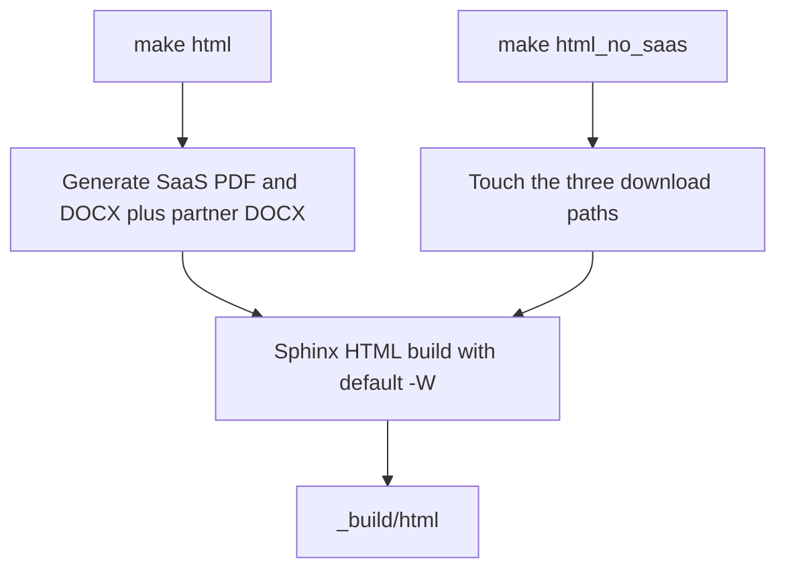

# Sesam Hub: product learning and documentation quickstart

## What this repository is for

Sesam Hub is documented as a **Master Data Hub** for making up-to-date master data available in a data platform architecture. This is its **product-reference repository**: it owns documented product semantics—configuration contracts, data models, synchronization behavior, API specifications, tutorials, and operational guidance—not the data-processing runtime, Portal backend, or Management Studio implementation. Correcting a description here is not a runtime fix. Route implementation work through [architecture and ownership boundaries](architecture/hub-model-and-boundaries.md) and [API and repository handoffs](integrations/apis-and-repository-handoffs.md).

The authored reference is reStructuredText built with Sphinx. Its actual entrypoint is [hub/index.rst](../hub/index.rst), set by `master_doc = 'hub/index'` in [conf.py](../conf.py); the root [index.rst](../index.rst) is an orphan page, and the configuration redirects `index.html` to `hub/index.html`. This Markdown wiki is a navigation and explanation layer, not a replacement for those authored sources. Sphinx is configured for `.rst`, despite Markdown-related packages in the dependency file.

Keep three activities separate:

- **Integration developers:** learn the model, build version-controlled pipe/system configuration in an integration project, and test it against an isolated Sesam node.
- **Operators:** inspect the subscription, processing evidence, connectivity, and durability/security constraints before changing configuration or processing state.
- **Documentation contributors:** change the relevant authored reference, preserve labels/includes/assets, and validate its rendered documentation. A local documentation preview does not create a Sesam subscription or test an integration.

Source anchors: [Hub landing page](../hub/index.rst), [Sphinx configuration](../conf.py), [configuration-management guidance](../hub/documentation/operations/configuration-management.rst), and [Management Studio introduction](../hub/management-studio.rst).

## Choose a task, not a directory

These links route through the planned wiki hierarchy. Use the destination page for detail and its source references for exact contracts.

| Your task | Start here | Continue when needed |
| --- | --- | --- |
| Understand the Hub and its ownership boundaries | [Architecture](architecture/hub-model-and-boundaries.md) | [Entities, datasets, identifiers](concepts/entities-datasets-and-identifiers.md) |
| Create or adjust configuration | [Pipes, systems, defaults](configuration/pipes-and-systems.md) | [Synchronization and recovery state](configuration/synchronization-and-state.md) |
| Build an end-to-end integration | [Collect, Enrich, Connect, Transform, Share](workflows/build-an-integration.md) | [Bidirectional synchronization](workflows/bidirectional-synchronization.md) |
| Transform or connect data | [DTL evaluation and operators](concepts/dtl-evaluation-and-operators.md) | [Joins and transformation patterns](workflows/dtl-joins-and-transformation-patterns.md), [master data management](workflows/master-data-management.md) |
| Reuse a connector or implement an adapter | [Connectors and contracts](integrations/connectors-and-contracts.md) | [HTTP extensions and JSON protocols](integrations/extensions-and-json-protocols.md) |
| Automate through an API or find an implementation owner | [Node and Portal APIs and handoffs](integrations/apis-and-repository-handoffs.md) | [Architecture boundaries](architecture/hub-model-and-boundaries.md) |
| Diagnose or operate a subscription | [Monitoring and troubleshooting](operations/monitoring-and-troubleshooting.md) | [Deployment and durability](operations/deployment-and-durability.md), [security and secrets](operations/security-and-secrets.md) |
| Test and release integration configuration | [Configuration-change lifecycle](testing/configuration-change-lifecycle.md) | [Build an integration](workflows/build-an-integration.md) |
| Change or preview the reference documentation | [Documentation maintenance](workflows/documentation-maintenance.md) | The contributor path below |
| Qualify old capabilities, availability, or policies | [History and policies](references/history-and-policies.md) | [Legacy Databrowser and GDPR reference](references/legacy-data-access.md) |

## Integration-learning path

### 1. Learn the minimum vocabulary

- An **entity** is a JSON-like collection of key-value pairs with reserved properties; Sesam consumes and produces streams of entities.
- A **dataset** is retained storage: an indexed entity log, not merely a transient pipe result. Content hashing appends a new version only when an entity is new or changed.
- A **pipe** combines a source, a transform chain, a sink, and a pump. Sources expose entity streams, transforms reshape them, sinks write results, and the scheduled pump moves the data. DTL is the primary documented transformation language.
- A **system** represents an external connection and centralizes shared connection configuration; documented services include connection pooling and rate limiting.

Read [the data model](concepts/entities-datasets-and-identifiers.md) before choosing identifiers or namespaces, and [configuration contracts](configuration/pipes-and-systems.md) before copying options from a tutorial. These definitions come from the authored [building-blocks reference](../hub/documentation/building-blocks/index-building-blocks.rst).

### 2. Establish an isolated learning subscription

The authored [getting-started guide](../hub/guide-getting-started.rst) describes signup, connecting to a subscription, and a baseline configuration. However, its baseline-upload tutorial panel is commented out; do not assume there is an active three-step wizard. The [signup tutorial](../hub/tutorial-signup.rst) describes requesting trial access or obtaining an invitation to an existing subscription. Management Studio configures, manages, and administers subscriptions through the Portal; it is not launched by building this documentation.

**Dated tutorial prerequisites, not verified third-party setup:** [Create your first synchronization](../hub/guide-create-first-synchronization.rst) still asks for a HubSpot app developer account, test account, and API key, including a `legacydocs.hubspot.com` link. Treat those account/authentication steps and screenshots as historical instructions to revalidate before use. The [Collect tutorial](../hub/tutorial-getting-started-collect.rst) uses `sesamcommunity/learn-sesam-crm:v1.1.2` for the Enhetsregisteret side and explicitly says that connection supplies mock test data, not live register data. Neither third-party availability nor credentials nor that image have been checked here. Use disposable data: the tutorial imports CRM data and later writes back to HubSpot.

### 3. Trace the five conceptual phases

Follow [Build an integration](workflows/build-an-integration.md) in the conceptual order **Collect → Enrich → Connect → Transform → Share**:

1. **Collect:** keep source data, including a raw copy where replay/retention matters.
2. **Enrich:** add business typing, namespaces, and same-source relationship identifiers.
3. **Connect:** connect data across sources into appropriately scoped global datasets.
4. **Transform:** map the global data into the target schema at the preparation stage.
5. **Share:** deliver data in the target's required form.

This sequence is the product model in [Creating a Dataflow in Sesam](../hub/sesam-dataflow.rst), not a claim that every integration has exactly five pipes. The introductory tutorial presents Collect/Share under Data Synchronization and Enrich/Connect/Transform under Data Management; its navigation order is not the conceptual processing order.

### 4. Test before enabling real delivery

Use [the configuration-change lifecycle](testing/configuration-change-lifecycle.md), not the Sphinx preview workflow. The documented local-test approach runs pipes until queues are drained, keeps outbound delivery disabled or unable to reach targets, and compares endpoint outputs with expected fixtures. The documented CI node must not write to external systems, and tests sharing that node must be serialized because the client overwrites its configuration. See [local testing](../hub/documentation/operations/testing-locally.rst) and [integration CI](../hub/documentation/operations/continuous-integration.rst).

For a stalled or incorrect flow, take [the monitoring path](operations/monitoring-and-troubleshooting.md) before resetting offsets or retrying writes. The documented [pump execution dataset](../hub/documentation/operations/pump-execution.rst) records execution history and read/write errors, but is explicitly **not a stable public API**. The [troubleshooting reference](../hub/documentation/operations/troubleshooting.rst) distinguishes target/entity failures and calls for monitoring dead-letter data; a stopped flow is not automatically a transformation bug.

## Documentation-contributor preview path

**Verification scope:** the commands below are source-verified against [README.md](../README.md), [Makefile](../Makefile), [conf.py](../conf.py), [requirements.txt](../requirements.txt), and [pull-request CI](../.github/workflows/pull_request.yml). They were **not executed**. No dependencies were installed, no builds, servers, or containers were started, and no live APIs or external links were checked.

### Prerequisites and the environment trap

- **Python:** README says `pydata-sphinx-theme` needs at least Python 3.7. Both PR and merge workflows select **Python 3.9 on Ubuntu 22.04**. That is the concrete CI version evidence, not proof that every newer Python works with this older dependency set.
- **Pinned documentation dependencies:** install the repository requirements rather than silently upgrading Sphinx or the theme. The direct pins include `Sphinx==4.5.0`, `docutils==0.16`, `pydata-sphinx-theme==0.8.0`, `sesamclient==0.2.68`, and the documentation extensions. The pins are not a claim of a fully locked transitive environment.
- **`VIRTUAL_ENV` is required by configuration:** `conf.py` directly indexes `os.environ['VIRTUAL_ENV']` to exclude that environment directory. If it is absent, configuration loading can raise `KeyError`, even if `sphinx-build` is on `PATH`. Activating the local virtual environment supplies it. CI instead sets `VIRTUAL_ENV: venv` explicitly; that value alone does not create or activate a virtual environment.
- **Pandoc and LaTeX:** ordinary `make html` generates downloadable contracts before Sphinx. PR CI installs Pandoc **2.13** and `texlive-latex-base texlive-latex-extra texlive-plain-generic lmodern texlive-fonts-recommended ghostscript`. README's Ubuntu examples list Pandoc plus `texlive-latex-base` and `texlive-latex-recommended`; its macOS example is `brew install pandoc mactex`. These are authored/CI prerequisite evidence, not executed package-installation or cross-platform compatibility checks.

From the repository root, the README's environment sequence is:

```sh
# Source-verified instructions only; not executed here.
python3 -m venv .python_env
. .python_env/bin/activate
pip install --upgrade pip
pip install wheel
pip install -r requirements.txt
```

### Choose the build deliberately

```sh
# Source-verified instructions only; not executed here.
make html
```

The ordinary target generates SaaS PDF/DOCX and partner DOCX downloads, then runs the HTML builder into `_build/html`. The contract path uses Pandoc and `pagebreak.lua`; PDF generation explains why a LaTeX toolchain is needed even for this HTML target. Make checks that `sphinx-build` can be found and defaults `SPHINXOPTS` to **`-W`**, so Sphinx warnings are errors.


*The Makefile's two HTML paths differ in download preparation, not in source-content exclusion.*

For a shortcut preview:

```sh
# Source-verified instructions only; not executed here.
make html_no_saas
```

**Do not interpret `html_no_saas` as a SaaS-content filter.** It touches `files/sesam-cloud-service-contract.pdf`, `files/sesam-cloud-service-contract.docx`, and `files/partner-agreement.docx`, then invokes the same Sphinx HTML command. It bypasses contract generation, invokes neither Pandoc nor LaTeX in its recipe, and supplies no content-exclusion option. `touch` leaves existing contents unchanged or creates empty files if absent; these downloads are not freshly validated contracts. Review the working tree and do not publish or commit placeholder downloads as genuine contracts.

README suggests `SPHINXOPTS= make html_no_saas`. The empty assignment also removes the default `-W`; it is a weaker preview, **not equivalent to the PR gate**. Prefer keeping warnings-as-errors while fixing documentation.

### Inspect and submit a documentation change

Open `_build/html/index.html` after a future successful build. README also offers the following optional local serving command for search summaries:

```sh
# Source-verified README option only; not executed here.
cd _build/html && python3 -m http.server
```

Before submitting, check the changed page's headings, cross-references, includes, downloads, code blocks, and relevant navigation in the rendered output. Keep authored `.rst`, labels, and presentation assets intact; do not replace authored content with build output or this wiki. For the full composition and publishing path, use [documentation maintenance](workflows/documentation-maintenance.md).

The actual **PR check is `make html`**, not runtime integration tests. The Makefile offers `linkcheck`, `doctest`, and `coverage`, but PR CI does not invoke them, and `conf.py` does not enable the Sphinx doctest or coverage extensions. Do not report those checks as having run; link checking would also require external requests outside this research scope. On a push to `master`, [merge CI](../.github/workflows/merge.yml) builds HTML, packages/pushes documentation images, and deploys an Azure Container App. Local preview is not publication, and neither documentation build validates third-party tutorial setup nor proves runtime correctness.
