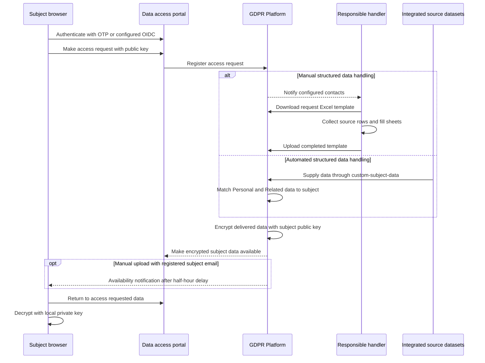

# Legacy Databrowser and GDPR Platform reference

> **Historical lookup only.** Databrowser's documented end-of-life is **December 31st 2023**; GDPR Platform's documented end-of-life is **June 30th 2025**. The Databrowser warning references the **2022-03-21** changelog, which names Integrated Search as its successor. The GDPR Platform warning references **2025-04-02**. A later **2025-04-11** entry records **early retirement** of GDPR Platform, so the scheduled June date must not be read as a guarantee of availability until then. Both products are listed under deprecations, whose instruction is not to use these features.
>
> Sources: [Databrowser warning](../../hub/databrowser.rst), [GDPR Platform warning](../../hub/gdpr-platform.rst), [referenced and later changelog entries](../../hub/changelog.rst), [deprecations](../../hub/deprecations.rst).

This page preserves the documented responsibilities and integration boundaries for interpreting old configurations and workflows. It is not an adoption guide, a promise that an endpoint still exists, or legal compliance advice. Evidence here is repository documentation and the checked-in API description, not inspection of sibling service implementations.

**Two kinds of contract must stay distinct:**

- The narrative guides describe administrator configuration and GDPR Platform dataset integration contracts.
- [`swagger_databrowser.yaml`](../../hub/swagger_databrowser.yaml) explicitly says its endpoints are **only for internal use and can be changed or removed at any time**. The [Databrowser guide](../../hub/databrowser-guide.rst) embeds this checked-in specification. Its routes are historical UI/backend reference, not a supported public SDK surface.

## Historical ownership and state

The [GDPR Platform configuration overview](../../hub/gdpr-platform-configuration.rst) describes three parts:

| Part | Historical responsibility |
| --- | --- |
| Management Studio | Operator configuration and access to the platform datahub, reached through a GDPR subscription in the Sesam portal. |
| GDPR Platform datahub | Collection, connection, and storage of platform data, with datasets and pipes used for automation. |
| GDPR data access portal, or DAP | Public-facing subject interface for requests, data, and consents. |

Databrowser documentation describes Solr-backed authorization and `databrowser.ini` configuration; its guide describes Redis as the owner of GUI configuration changes. These are different kinds of state from the GDPR datasets and the subject's private key. Do not treat the Sesam operator role, a subject login, and possession of a request's key pair as interchangeable credentials.

## Databrowser configuration and administrator entrypoints

### File layers and GUI state

The [configuration file API narrative](../../hub/databrowser-api.rst) defines this file precedence, from earlier to later processing:

| Layer | Location | Override behavior |
| --- | --- | --- |
| Installation file | `/sesam/conf/databrowser.ini` | Overridden by uploaded settings. |
| Additional uploaded layers | `/sesam/data/conf/1/databrowser.ini`, `/sesam/data/conf/2/databrowser.ini`, and so on | Numeric order; a higher-numbered folder overrides a lower-numbered one. This upload surface is not exposed in the end-user GUI. |
| End-user uploaded file | `/sesam/data/databrowser.ini` | Processed last and can override all additional uploaded layers. Its upload API is exposed in the GUI. |

The [guide's configuration page](../../hub/databrowser-guide.rst#L581-L612) separately lists shared defaults, installation-specific files, and the connected Redis server. GUI changes are stored in Redis, and the Redis upload page supports bulk editing or copying settings between instances. The cited narrative does **not** establish Redis's precedence relative to every numbered file layer; avoid inventing a single merged precedence order.

The narrative's GET/PUT/DELETE file API requires a JWT in the `Authorization` header, enabled JWT authentication, and an `Admin` role. Its example describes a token generated for the configured subscription. Embedded tokens are deliberately not reproduced here.

### Preserve the endpoint discrepancy

| Surface in the source | End-user file | Additional layer |
| --- | --- | --- |
| Narrative endpoint declaration | `/configuration/databrowser.ini` | `/configuration/<confignumber>/databrowser.ini` |
| Narrative upload/download example | — | `/configuration/conf/1/databrowser.ini` |
| Internal Swagger route | `/configuration/{config_file_path}` | `/configuration/conf/{config_layer}/{config_file_path}` |

The narrative declaration omits `/conf/`, whereas its own example and Swagger include it. This reference records the disagreement; it does not silently “fix” the narrative or assert which route an old deployment implemented. Sources: [narrative declaration and example](../../hub/databrowser-api.rst#L33-L69), [internal file routes](../../hub/swagger_databrowser.yaml#L430-L569).

Within the **internal specification**:

- GET returns an empty response body if a configuration file does not exist.
- PUT/DELETE can return HTTP 200 **with configuration errors**. `ConfigFilePutOrDeleteResponse` carries `is-valid-config`, `current-user-would-be-locked-out`, and `config-errors`; errors concern the full configuration set, not just the changed file.
- HTTP 403 describes refusing a change that would prevent the current user from modifying configuration again.
- `validate_only=true` runs validation without changing configuration.
- `config_file_path` represents a remainder-of-path that OpenAPI cannot accurately model. The description explicitly says not to URL-escape it; the example includes nested `css/temp/test.css` segments. This is an internal route convention, not general URL-encoding guidance.

Sources: [route responses](../../hub/swagger_databrowser.yaml#L430-L569), [response schema](../../hub/swagger_databrowser.yaml#L1109-L1148), [parameters](../../hub/swagger_databrowser.yaml#L1227-L1256).

For historical diagnostics, `/admin_index` leads to configuration, data-type, and logging pages. The guide says GUI log-level changes are not persisted and reset on server restart; permanent logging changes belong in installation-specific `production.ini`. See [admin pages](../../hub/databrowser-guide.rst#L560-L644).

## Authentication is not authorization

### Databrowser identity and Solr filtering

The [authentication narrative](../../hub/databrowser-auth.rst) selects authentication with `[main] use_x_remote_user_header`:

- **False:** redirect the browser through an external OpenID Connect provider.
- **True:** trust `X-Remote-User`. The documentation restricts this to a webapp safely hidden behind an authenticating proxy such as httpd or nginx that sets the header.

For header authentication, Solr is searched using `[authentication] x_remote_user_username_psi`; email fields configured by `x_remote_user_email_psi` supply the session's `email`. If no email is found and the username looks like an email address, that username is used instead.

Authorization uses the session email to search the fields configured by `[search fields] email`. IDs of matching items and IDs referenced through `psi*` fields become the session's `psis` list.

| `[authentication] authorization model` | Documented visibility |
| --- | --- |
| `OPEN` | Items without configured `AUTH_FIELDS` fields are available to all users. |
| `AUTHENTICATED` | Authenticated users can see items without those fields; anonymous users see none. |
| `AUTHORIZED` | Authenticated users are restricted to items whose authorization or ID fields match session `psis`. `AUTH_FIELDS`, configured by `[search fields] auth`, must be set. The detailed description also requires the configured authorization fields to be present. |

For `OPEN` and `AUTHENTICATED`, if `AUTH_FIELDS` is configured, searches exclude items containing any of those fields. These mode differences are material when interpreting a legacy configuration; authentication alone is not a subject-data isolation policy. See [identity mapping and authorization rules](../../hub/databrowser-auth.rst#L26-L151).

### Sesam JWT login

`[authentication] jwt_authentication_subscription_ids` enables Sesam-portal JWT authentication for one or more subscriptions; `*` accepts JWTs from all subscriptions. Ordinary JWT users still use Solr-based authorization. A JWT granting `group:Admin` permits visibility of all Solr documents and editing portal configuration.

The narrative describes `/jwt_login` GET as a token-entry form and POST as parsing the token, storing credentials in the **server-side HTTP session**, and redirecting to the front page. Swagger further labels GET as internal development/testing and POST as Management Studio access. These descriptions do not turn JWT login into an external API commitment. Sources: [JWT narrative](../../hub/databrowser-auth.rst#L154-L195), [internal login specification](../../hub/swagger_databrowser.yaml#L70-L84).

### Shared OIDC provider documentation

Both Databrowser authentication and GDPR Platform configuration include the same [provider documentation file](../../hub/databrowser-authentication_providers_examples_and_docs-for_include.rst). Consequently, provider-option documentation is shared, and the Databrowser end-of-life warning embedded in that include must not be mistaken for GDPR Platform's separate retirement date.

`[authentication] authentication_providers` is a list with:

| Option | Contract |
| --- | --- |
| `provider_id` | User-selected and unique within the list. Must match the callback's provider ID. |
| `consumer_key`, `consumer_secret` | Registration ID and secret used by the DAP with the provider. |
| `openid_configuration_url` or `openid_configuration` | Discovery URL or inline provider metadata. The docs prefer discovery over inline metadata. |
| `user_id_attribute` | UserInfo claim used as `user_id`, default `sub`; examples recommend `email` for Google and `upn` for Microsoft. |
| `contactinfo_attribute` | Contact claim, default `email`. |
| `allow_unverified_email` | Default **true**; can be false for email-based providers that do not already verify addresses. |
| `use_userinfo_endpoint` | Can be false where UserInfo is unnecessary or unavailable; identity is then extracted from the IDToken. |
| `scope` | Default `openid profile email`. |

The documented flow redirects the subject to the provider, then returns an authorization code to `<Data Access Portal backend url>/login_callback/<provider_id>`. A provider's allowed post-logout redirect uses the backend base URL. No provider secrets or account-specific backend URLs are copied here. See [shared include](../../hub/databrowser-authentication_providers_examples_and_docs-for_include.rst#L7-L115) and [including GDPR section](../../hub/gdpr-platform-configuration.rst#L180-L194).

## GDPR setup: types, purposes, contacts, and subject identity

### Configuration model

The [types and purposes guide](../../hub/gdpr-data-types-purposes-configuration.rst) describes an Excel setup template with `Purpose` and `Data type` sheets:

- **Purposes** supply processing-activity descriptions, legal-ground metadata, language, source/sharing information, retention-day metadata, and criteria. A purpose appears as a navigation tab; a consent-type purpose may be opted into or out of. These are configured product fields, not this page's legal conclusions or a verified automatic retention-enforcement mechanism.
- **Data types** describe the source system, type, description, `Personal` or `Related` level, and responsible `Contact` values. A generated purpose matrix uses `x` marks and permits multiple purposes per type.
- Purpose and data-type `ID` cells are computed and must not be manually edited. The data-type guide says computed IDs have a maximum of 32 characters, while its `Type`/`System` descriptions say their combination must be **less than 32**, including whitespace. Keep this wording distinction visible rather than choosing a repaired boundary.
- `Contact` can be a comma-separated email list with no whitespace around commas. These contacts route access and change notifications.

Uploading the setup updates platform data structures and the subject UI, potentially after a few minutes. Operators can inspect `gdpr-data-type` and `gdpr-purpose`. The setup file can instead be fetched from a shared URL on a configurable cron schedule, defaulting to midnight UTC. Sources: [setup model and update behavior](../../hub/gdpr-data-types-purposes-configuration.rst), [URL and schedule](../../hub/gdpr-platform-configuration.rst#L58-L101).

### Subject login and request-time fields

The default GDPR DAP login sends a one-time password to the supplied email address or phone number. The portal guide says it expires when the session ends or after an idle interval, requiring login again; it supplies no fixed timeout value. OIDC is an alternative described above.

If an OIDC identity lacks a notification destination, `[gdpr] access_request_contactinfo` can require contact information at request time. Supported configuration values are `email` and `mobile_phone`; when multiple values are listed, the subject chooses a type. Validation uses `[authentication] otp_valid_email_address_regexp` and `otp_valid_mobile_phone_number_regexp`. `[gdpr] extra_access_request_fields` adds required subject-identifier fields, empty by default, with header/tooltip text resolved through `[localization]`.

The old documents also use different URL forms: the configuration guide describes `https://selected-domain-name.sesamdata.com`, while the portal guide describes a `gdpr-dap-subscription_id` backend on the configured domain or `sesam.cloud`, discoverable under Network → Data Access Portal backend. Do not derive a universal host-naming rule from these examples. Sources: [portal login](../../hub/gdpr-data-access-portal.rst#L7-L29), [domain setting](../../hub/gdpr-platform-configuration.rst#L49-L56), [contact and extra-field settings](../../hub/gdpr-platform-configuration.rst#L197-L278).

## Historical subject request flow

*Historical access-request flow described by the portal and automation guides; unstructured data still requires vetting, as explained below.*

### Manual access requests

An access request notifies all unique contacts in the setup spreadsheet. Handlers must be registered Sesam portal users, members of the GDPR Platform, and granted **GDPR operations** to download and upload the request template.

The template's `DataSubject` sheet contains identifiers and a UTC request timestamp and must remain unchanged. Remaining sheets are organized by data type/system. Each requires an `id` column with a unique row identifier; handlers define other columns and populate one row per source-data row. The completed file is uploaded through **Access request → Upload data request template**.

The guide says uploaded data is encrypted with the subject's public key, stored in the platform datahub, and sent to the DAP. A subject with a registered email address receives an availability notification **half an hour after upload**, to allow portal data propagation. Each separately uploaded completed spreadsheet triggers its own notification. Sources: [manual request and template](../../hub/gdpr-data-access-portal.rst#L31-L90).

### Changes, consent changes, and deletion

| Subject action | Historical handling contract |
| --- | --- |
| Data correction | Configurable editable properties generate a change request and notify the contact for the originating data type. The downloadable change list includes subject ID, data IDs, old and requested values, and timestamp. |
| Grant or revoke consent | Also generates a change request. The portal narrative says data pertaining to revoked consent should be deleted. This states the documented workflow, not a legal rule supplied by this wiki. |
| Delete all subject data | Treated as revocation of all consents, a special change-request case, notifying the relevant data-type handlers. |

For **manual** handling, the responsible operator accepts and applies changes or deletions in source systems, then refills and reuploads the relevant spreadsheet to reflect the result. A request/notification alone is not documented as completing a source-system mutation. For **automated** handling, the guides say integrations can trigger changes or deletions directly in source systems; this requires implementing the mechanism, not merely turning on a universal deletion switch. The same GDPR operations role requirement applies to notified handlers. See [change and deletion workflows](../../hub/gdpr-data-access-portal.rst#L92-L135).

### Key ownership and internal request routes

The documented request-delivery contract is public-key encryption with decryption using the subject's private key, stored only on the subject's computer/originating device. This is not a blanket claim that all source copies imported into an automated datahub are already encrypted this way: the [automation guide](../../hub/gdpr-getting-started.rst#L138-L152) separately describes copying source data into that datahub.

The **internal Swagger** request surface helps interpret old browser/backend exchanges:

- `POST /accessrequests` requires `publicKey`, boolean `deleteRequest`, and `lang`; it accepts configured `extraFields` and request-time `contactinfo`. Its success response is an empty JSON object, not delivery of requested records.
- `POST /accessrequest_login` is called after login when a prior request exists; the specification associates readable request data with the supplied original `publicKey`.
- `POST /accessrequests_update` takes the original `publicKey` and actions `update`, `delete`, or `add-purpose-to-access-request`.
- `GET /changerequests` lists changes for a specified document. Search, item-detail, download, and client-side field-formatting routes are also internal; this specification does not promise a complete external change-processing API.

Sources: [request routes](../../hub/swagger_databrowser.yaml#L219-L374), [downloads and field formatting](../../hub/swagger_databrowser.yaml#L647-L718), [private-key delivery narrative](../../hub/gdpr-data-access-portal.rst#L80-L87), [experimental receiver encryption](../../hub/gdpr-platform-developer-docs.rst#L1348-L1355). The inspected contracts do not specify a private-key recovery procedure; one must not be inferred from the login routes.

## Dataset automation contracts, not Databrowser's internal API

The [developer guide](../../hub/gdpr-platform-developer-docs.rst) describes integration APIs as datasets with defined entity structures and receiver/publisher pipes conforming to [JSON Push](../../hub/json-push.rst). Representative URL forms are:

- Subject input: `https://gdpr-platform-datahub-url/api/receivers/gdpr-subject-in/entities`
- Subject output: `https://gdpr-platform-datahub-url/api/publishers/gdpr-subject-out/entities`
- Access-request input/output use `gdpr-access-request-in` and `gdpr-access-request-out` in the corresponding paths.

JSON Push sends an array even for one entity, supports incremental/full synchronization and batching, and defines sequencing conflicts for full synchronization. It is not equivalent to the DAP's single-object `POST /accessrequests` body. See [subject API](../../hub/gdpr-platform-developer-docs.rst#L111-L186), [access-request API](../../hub/gdpr-platform-developer-docs.rst#L1274-L1296), and [JSON Push requests/conflicts](../../hub/json-push.rst#L8-L88).

### Matching and extension datasets

Automation adds `TypeID`, `Identifiers`, and `Exclude` columns; the purpose sheet is unchanged. The developer guide says `TypeID` matches the dataset ID, `Identifiers` supplies optionally namespaced matching properties, and `Exclude` removes configured properties. `Personal` records match subject identifiers directly. `Related` records match parents, potentially through a chain that ultimately reaches `Personal` data. Source datasets must be registered in `custom-subject-data` to join the internal subject-data processing and matching access request.

**Configuration discrepancy:** the getting-started guide instead says `TypeID` matches `rdf:type`. These descriptions are not interchangeable for every possible configuration; this page does not resolve them. Sources: [developer matching model](../../hub/gdpr-platform-developer-docs.rst#L32-L109), [getting-started alternative wording](../../hub/gdpr-getting-started.rst#L163-L202).

The subject contract uses `gdpr-subject:subject-id` plus a nonempty identifier list to match instances of the same subject. `custom-subject` is merged with receiver input into `gdpr-subject`, then exposed by its publisher. The guide describes analogous extension datasets `custom-consent`, `custom-subject-consent`, `custom-purpose`, `custom-purpose-type`, `custom-data-type`, and `custom-policy`. For purpose types it specifically says the newest version wins when custom and input entities share `purpose-type-id`; do not generalize that conflict rule to every dataset without evidence. `gdpr-subject-consent` records each subject's affirmative/negative consent choice and selection time.

Sources: [subject merge](../../hub/gdpr-platform-developer-docs.rst#L111-L186), [consent and subject-consent merges](../../hub/gdpr-platform-developer-docs.rst#L336-L443), [purpose and purpose-type merges](../../hub/gdpr-platform-developer-docs.rst#L599-L708), [data-type merge](../../hub/gdpr-platform-developer-docs.rst#L826-L832), [policy merge](../../hub/gdpr-platform-developer-docs.rst#L952-L958).

Additional developer-contract discrepancies are preserved for lookup: the purpose-type input paragraph names `gdpr-purpose-in` but its URL uses `gdpr-purpose-type-in`; subject-consent's prototype uses `gdpr-subject-consent:valid-from` while its property table labels the time field `gdpr-consent:valid-from`. The data-type prototype uses language-prefixed descriptions such as `gdpr-data-type:en-description`, whereas the property table uses suffixes such as `gdpr-data-type:description-en`. See [purpose type](../../hub/gdpr-platform-developer-docs.rst#L676-L686), [subject consent](../../hub/gdpr-platform-developer-docs.rst#L354-L399), and [data type](../../hub/gdpr-platform-developer-docs.rst#L724-L779).

### Access-request lifecycle fields and experimental delivery

Dataset access requests require `gdpr-access-request:access-request-id`, `gdpr-access-request:user-id`, and a PGP `gdpr-access-request:public-key`. The key encrypts collected request data before storage/further processing; the corresponding private key decrypts it. Optional contact metadata chooses `email` or `phone_number`, and `gdpr-access-request:delete-request` is documented as a **string** `false`/`true`, default `false`—unlike Swagger's boolean `deleteRequest`. Extra properties pass through to the outgoing API. The outgoing UTC `gdpr-access-request:timestamp` is assigned by the platform and overwrites an incoming value. See [access-request schema](../../hub/gdpr-platform-developer-docs.rst#L1173-L1270).

`gdpr-access-request-subject-data-in` is explicitly **experimental** and may not exist in every installation. It receives an existing access-request ID, existing data-type ID, reporter, and entities containing unique IDs and data objects. It encrypts with the registered subject public key before processing and has **no corresponding output API**, because the documented consumer decrypts on the originating device. See [experimental receiver](../../hub/gdpr-platform-developer-docs.rst#L1298-L1411).

### Unstructured data retains a human gate

The unstructured workflow automates extraction, indexing, and search, **not final disclosure approval**:

1. Document-source microservices supply metadata and a binary-download HTTP API; importing pipes normalize their output. Source datasets are merged through `custom-documents`.
2. The extractor fetches `gdpr-document:extract-content` and extracts text. The document index stores extracted text and the described properties except metadata; it does not store the original file in that process.
3. A new access request searches the index using subject properties. Search is **point-in-time**: newly indexed documents do not automatically rerun older searches; a new request is needed.
4. Every match must be manually vetted because of false positives and possible information about other subjects. Operators can remove rows, remove the extraction link to withhold a file, and supply reduced/redacted text before uploading the reviewed template.
5. Only after vetting is metadata encrypted with the subject public key and transmitted. If an extraction link remains, the file is downloaded, encrypted, and transmitted too, for client-side decryption/download.

The source-download trust boundary is deliberate: `extract-content` must not itself challenge for authentication and is described as local-network-only, reachable by GDPR Platform; the microservice handles any backend credentials. Conversely, `gdpr-document:original-url` must challenge for required authentication and be reachable by the human reviewer. This historical local-network assumption must not be read as advice to expose an unauthenticated file service publicly.

The search paragraph spells the joined source `custom-document` singular even though the internal dataset section names `custom-documents`; this reference preserves that inconsistency. Source: [unstructured data contract](../../hub/gdpr-platform-developer-docs.rst#L1414-L1606).

## Historical operations and focused verification

Configuration and delivery are not uniformly immediate: setup propagation may take minutes, manual availability mail has a half-hour delay, and unstructured searches are snapshots. Translation changes also apply only to newly emitted notifications/objects in affected cases. The developer guide instructs operators to preserve `{{ ... }}` and `$ENV(..)` macros in `custom-translations` and start that pipe after saving. Sources: [setup propagation](../../hub/gdpr-data-types-purposes-configuration.rst#L165-L178), [delivery timing](../../hub/gdpr-data-access-portal.rst#L80-L90), [translation operation](../../hub/gdpr-platform-developer-docs.rst#L1164-L1170).

For archival validation in an authorized historical environment, useful **proposed contract checks**, not claimed executed tests, are:

- Compare effective file settings across numbered and end-user layers; inspect Redis separately. Validate both written layered route forms against that deployment instead of normalizing the documentation.
- Check configuration response bodies even after HTTP 200; exercise `validate_only` and lockout refusal with non-sensitive fixtures.
- Verify `OPEN`, `AUTHENTICATED`, and `AUTHORIZED` search outcomes with synthetic Solr data and an authenticating-proxy boundary. Review JWT subscription scope and `group:Admin` separately from subject login.
- Exercise request matching with synthetic `Personal` and chained `Related` records; ensure `Exclude` and the chosen `TypeID` convention match the archived configuration.
- Keep `DataSubject` identifiers/timestamp and unique row IDs intact; verify public-key encryption and local private-key decryption without publishing key material or subject records.
- Confirm source-system mutation and refreshed delivery for manual change/deletion handling; verify that unvetted documents and later index additions do not silently reach an older request.

This repository's inspected pull-request workflow runs `make html` for documentation builds; it is not evidence that the legacy services passed runtime integration tests. See [build workflow](../../.github/workflows/pull_request.yml) and [preview instructions](../../README.md).

## Related reference paths

- [APIs and repository handoffs](../integrations/apis-and-repository-handoffs.md) — broader API and implementation boundaries.
- [Security and secrets](../operations/security-and-secrets.md) — credential and trust-boundary context.
- [Deployment and durability](../operations/deployment-and-durability.md) — operational state context.
- [History and policies](history-and-policies.md) — retirement and policy navigation.
- [Documentation maintenance](../workflows/documentation-maintenance.md) — maintaining evidence and conflicting legacy descriptions.
