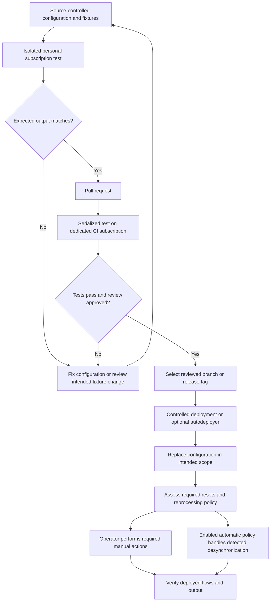

# Test and deploy configuration changes safely

A Sesam integration project should treat configuration changes as reviewed software changes: keep configuration and fixtures in source control, test on isolated subscriptions, require CI results before merging, and deliberately select the release to deploy. Sesam exposes APIs that development tools can use; the documented workflow delegates orchestration to the Sesam client and CI/CD tools rather than providing a built-in project version-control and test system.

**Scope of evidence:** the commands and examples below were inspected in documentation, not executed. The [Sesam client](https://github.com/sesam-community/sesam-py) and [GitHub Autodeployer](https://github.com/sesam-community/github-autodeployer) are external implementation handoffs and were not inspected. “Documented client behavior” is not a claim that this documentation repository contains or has passed a local runtime test suite.

## Safety requirements before any test

> **Do NOT run the Sesam client on production subscriptions!** The client documentation explicitly says production use is outside its intended usage and may produce undesired results. Do not interpret older CD examples as an exception to this warning.

Require all of the following:

- **Isolated subscriptions:** each developer uses a personal development subscription; automated tests use a dedicated CI subscription. The environment guide distinguishes these from a production-sized test environment and production itself. “Local testing” means testing a developer's changes against their own Sesam subscription, not running an in-process service emulator in this repository.
- **No output writes to connected systems:** output pipes must be disabled or unable to send data to their systems. The CI node must be unable to write to another system. Do not put production connection secrets or the variables needed for production output connections on personal/CI nodes. Supply only the JWT for the intended test subscription.
- **One writer/test at a time per subscription:** serialize client commands and CI tests, including jobs from different branches or pipelines sharing a node. Do not manually edit the subscription while a client run is in progress. CI tests overwrite configuration, so concurrent runs can fail or never finish.

Disabling a pump is not an absolute write barrier: the pump API says `disable` prevents automatic execution but still permits a manual `start`. Combine safe configuration with unreachable output destinations and absent production credentials rather than relying on one switch.

A documented isolation pattern uses a conditional source to select embedded test data and a conditional sink to select a `null` sink for development. The condition normally comes from an environment variable, and all its possible values must have entries in `alternatives`; selection is resolved when the parent pipe is created. The null sink discards entities without sending them elsewhere. Inspect the selected source and sink on the target subscription before testing.

See [Security and secrets](../operations/security-and-secrets.md) for credential handling. Sources: [client warnings](../../hub/sesam-client.rst), [local testing](../../hub/documentation/operations/testing-locally.rst), [CI isolation](../../hub/documentation/operations/continuous-integration.rst), [environment setup](../../hub/setup-environment.rst), [conditional source](../../hub/documentation/service-configuration/pipes/configuration-sources-conditional.rst), [conditional sink](../../hub/documentation/service-configuration/pipes/configuration-sinks-conditional.rst), [null sink](../../hub/documentation/service-configuration/pipes/configuration-sinks-null.rst), and [pump API](../../hub/swagger_public.yaml).

## Change lifecycle



*The documented source-control, personal-test, CI, and deployment lifecycle, with explicit review and post-deployment state responsibilities.*

The reset branches are responsibilities to assess, not mutually exclusive guarantees: a release may still need manual actions even when automatic reprocessing is enabled. Automatic deployment is optional; the deployment guide cautions that larger or business-critical installations often need more control over release timing.

Sources: [configuration management](../../hub/documentation/operations/configuration-management.rst), [environment workflow](../../hub/setup-environment.rst), [CI gates](../../hub/documentation/operations/continuous-integration.rst), [deployment](../../hub/documentation/operations/automatic-deployment.rst), and [automatic reprocessing](../../hub/features/automatic-reprocessing.rst).

## 1. Version configuration and both sides of the test contract

Export configuration with the client, API, or portal into a working copy of the project repository. The source recommends a structure such as:

```text
my-project-directory
  ├ expected
  ├ pipes
  ├ systems
  ├ variables
  ├ README.md
  ├ LICENSE
  └ .gitignore
```

The CI examples wrap configuration under `node/`, so `node/expected`, `node/pipes`, and `node/systems` sit together. The important relationship is that `expected/` is a sibling of `pipes/` and `systems/`, not a folder inside an individual pipe.

Keep **input fixtures** distinct from **expected results**:

- The environment guide recommends test data for all incoming data types so developers can work independently. Embedded sources can store small, static sets of input entities directly in configuration; do not use them for large datasets. Conditional inbound sources allow the same configuration to select anonymized embedded data on a development node instead of accessing external data.
- `expected/` describes the outputs to compare after processing those inputs. A new input type or output endpoint therefore requires more than a configuration edit: it needs meaningful fixture coverage and an expected result to review.

Sesam retains previous uploaded pipe/system versions in `system:config` and exposes configuration history, but the version-control guide explicitly says this is not proper project version control. Use a separate VCS. The documented recommendation is GitHub Flow with semantic-version release tags.

Sources: [version control](../../hub/documentation/operations/version-control-system.rst), [environment setup](../../hub/setup-environment.rst), [embedded source](../../hub/documentation/service-configuration/pipes/configuration-sources-embedded.rst), and [embedded data for testing](../../hub/documentation/data-management/data-management.rst).

### Expected files and test-selection settings

For each endpoint pipe, the local-testing guide requires these default files:

| File | Contract |
|---|---|
| `expected/<name_of_pipe>.json` | Expected output. |
| `expected/<name_of_pipe>.test.json` | Test configuration selecting which output to fetch and how to compare it. |

The documented settings are optional:

| Setting | Selection or comparison responsibility |
|---|---|
| `_id`, `type`, `description` | Test name, test configuration type, and description. The examples use `"type": "test"`; naming is filename-based by default. |
| `pipe` | Select the pipe whose output is tested. Set this explicitly when a test filename differs from the pipe name. The source's default description repeats the expected-file wording, so do not treat that wording as a precise pipe-name algorithm. |
| `file` | Select the expected-results file. By default `foo.test.json` looks for `foo.json`. Published outputs can use files such as `foo.xml`. |
| `stage` | Select source, before-transform, after-transform, or sink output; the stated default is `sink`. See the spelling uncertainty below before using intermediate stages. |
| `endpoint` | Select a published endpoint instead of the default `/pipes/<my-pipe>/entities` read. The pipe must be configured to publish that endpoint. |
| `parameters` | Object of bound parameters, default `{}`. Documented to work only for published endpoints. Use separate `.test.json` files for different parameter combinations. |
| `blacklist` | Array of output property names to ignore, default `[]`; useful for deliberately excluded volatile fields. |
| `ignore` | Whether to ignore this output during tests, default `false`. This is a comparison setting, not an output-write safety control. |

A **syntactically corrected illustration**, based on the documented fields and not an executed test, is:

```json
{
  "_id": "foo",
  "type": "test",
  "pipe": "foo",
  "file": "foo.json",
  "blacklist": ["my-last-updated-ts"],
  "ignore": false
}
```

For parameterized published output, the guide describes `foo-A.test.json` selecting `"pipe": "foo"`, `"endpoint": "xml"`, `"file": "foo-A.xml"`, and `"parameters": {"my-param": "A"}`. It compares `/publishers/foo/xml?my-param=A` with `foo-A.xml`; a second file using `B` compares the corresponding URL with `foo-B.xml`. API paths here are relative to the service API base, normally ending in `/api`.

### Documentation uncertainties to resolve before relying on a fixture

Do not copy every authored example verbatim:

1. **Malformed fixture examples:** the first `foo.test.json` example includes a shell prompt inside surrounding braces and lacks a comma after `"file": "foo.json"`. The parameter examples also wrap separate shell transcripts/objects in braces. Extract individual objects and validate their JSON before use.
2. **Stage spellings disagree:** the test-settings table lists `before-transform` and `after-transform`, but the public entities API lists `before-transforms` and `after-transforms`, alongside `source` and `sink`. Check the external client version and target API rather than assuming aliases.
3. **Endpoint selection is ambiguous in one example:** the guide generally says setting `endpoint` uses `/publishers/<my-pipe>/<endpoint-type>`, yet an example with `"endpoint": "json"` and `"stage": "source"` is described as reading `/pipes/foo/entities?stage=source`. The route precedence for that combination is not established here.
4. **Deletion normalization is suspicious:** the guide says internal properties other than `_id` and `_deleted` are stripped, then says entities with `_deleted` set to `false` are removed. This is an authored statement, **not verified client behavior**. Elsewhere Sesam deletion tracking marks deleted entities with `_deleted: true`. Do not silently invert the statement or assume tombstone comparison behavior until the external client is checked.

The inspected sources do not establish sorting, comparison tolerances, or a complete normalization algorithm. Keep these uncertainties visible when reviewing golden outputs.

Sources: [fixture contract and examples](../../hub/documentation/operations/testing-locally.rst), [entities API](../../hub/swagger_public.yaml), [API base URL](../../hub/api.rst), and [deletion tracking](../../hub/features/deletion-tracking.rst).

## 2. Run to conclusion, then compare results

Install/configure the client through its external README. The local prerequisites are a personal subscription and a JWT created under **Settings > Subscription > JWT**. Confirm the subscription URL and isolation requirements before using the documented command from the configuration directory:

```sh
sesam -vv test
```

The documented test model is **drain-to-conclusion**, not “start each pipe once.” Run the non-output pipes until no entities remain in their queues; output pipes stay disabled or unable to write. Only then compare endpoint results against expectations. The client is documented to automate running pipes to conclusion and comparing their outputs.

The guide describes three result classes:

- Invalid test setup or endpoint pipes without corresponding tests: report the problem, fix coverage/configuration, and run again.
- All comparisons succeed: report that all tests passed.
- A comparison fails: identify the test/pipe and show expected versus received output.

When an output change is intentional, the client is described as able to update expected results. Review those fixture changes with the configuration change; do not replace expectations merely to make a failure disappear. No update-results command is asserted here because the inspected local guide does not provide one.

Sources: [running local tests](../../hub/documentation/operations/testing-locally.rst) and [client capabilities and setup](../../hub/sesam-client.rst).

## 3. Apply the same test on a serialized CI node

CI should validate that additions do not break existing pipes, flows, or integrations. Require a passing configuration test against the CI node and a peer-review gate before merge. The documented CI node uses the same testing approach as a personal subscription, initiated by the CI system; small fixture volumes usually allow a smaller node than production.

### Jenkins example

The guide supplies a Kubernetes pod definition, a client container image, and a Jenkinsfile. The pipeline sets the CI node/JWT, verifies the client version, and runs tests with scheduler logs. Its serialization option is:

```groovy
options {
    disableConcurrentBuilds()
}
```

Its source-authored test step is:

```groovy
sh "export NODE='${env.Sesam_CI_node}'; export JWT='$Sesam_CI_node_jwt'; cd node && /./sesam -vv test  -print-scheduler-log"
```

`Sesam_CI_node_jwt` is obtained through Jenkins `credentials(...)`. The accompanying Cloud Build/Dockerfile example downloads a pinned client release (`1.16.1` in the example). These are integration templates, not active Jenkins jobs in this documentation repository. Ensure serialization covers every job sharing the node, not just one Jenkinsfile's concurrent builds.

### Azure DevOps example

The documented `azure-pipelines.yml` downloads the client selected by `sesam_cli_version`, verifies it with `./sesam -version`, and runs:

```yaml
- script: |
    export NODE='$(node)'
    export JWT='$(node_jwt)'
    cd node
    .././sesam -vv test  -print-scheduler-log
  displayName: 'Run Tests'
```

The example sets `trigger: none` and pairs this with branch build policies for PR validation. It also calls for a minimum of one reviewer and linked work items on the example main branches `develop` and `master`. Do not assume `trigger: none` alone installs a PR gate.

For parallel-capable agent pools, the guide says to disable parallel runs and queue the second build; it illustrates the agent capability `Limit = DisAbleParallel` and pool demand `Limit -equals DisAbleParallel`. Treat this as a setup example to check against your actual pool, not proof that all writers to a shared CI subscription are locked.

Source: [Jenkins and Azure CI examples](../../hub/documentation/operations/continuous-integration.rst).

## 4. Deploy a reviewed configuration in an explicit scope

Deployment replaces configuration; it is not automatically a merge of uploaded fragments. The public API defines these boundaries:

| Entrypoint | Read/write scope |
|---|---|
| `GET /config` / `PUT /config` | Read or overwrite all configuration in the default, empty config-group. |
| `GET /config/{config-group}` / `PUT /config/{config-group}` | Read or overwrite all configuration in the named group. |
| `GET /config-all` / `PUT /config-all` | Read or overwrite configuration across all groups, including the default. |

For individual pipe/system configuration endpoints, group membership is expressed through `metadata["$config-group"]`; for group upload endpoints it is selected by the URL. No explicit group means the default group. Review the **complete configuration for the replacement scope**, including intended removals, before uploading. Do not confuse a group replacement with an individual pipe edit. `force=true` on `/config` and `/config-all` requests best-effort application despite configuration errors; the API explicitly says this is rarely a good idea.

### Optional GitHub Autodeployer

The documented microservice periodically checks a configured Git repository, compares configuration, and deploys changes. A tag can select a versioned release; without a tag it uses the branch setting, which defaults to `master` if unset.

Its documented warning is stronger than an incremental-update assumption: **existing pipes and systems are overwritten, and node configurations absent from the selected repository branch are removed**. Check the inventory and target scope before enabling it. The external implementation's API choice and config-group handling were not inspected, so do not assume it inherits a particular group boundary from the table above.

The autodeployer **only deploys configuration**. It does not start or reset pipes. Required release actions remain manual. The guide also proposes replacing a CI test step with a deployment step in Jenkins/Azure and parameterizing the release version, but hands exact client parameters to external documentation. Given the explicit client production warning, this page does not provide a production-client deployment command. Establish a separately approved production deployment procedure.

Sources: [replacement API](../../hub/swagger_public.yaml), [config-group rules](../../hub/features/api-config-groups.rst), [automatic deployment](../../hub/documentation/operations/automatic-deployment.rst), and [client warning](../../hub/sesam-client.rst). See also [Pipes and systems](../configuration/pipes-and-systems.md) and [API and repository handoffs](../integrations/apis-and-repository-handoffs.md).

## 5. Plan state repair separately from configuration upload

A successful upload does not establish that previously processed data now reflects the new configuration. Pipes can fall out of sync after configuration changes, new joins/inputs, dataset deletion/recreation, truncation, or backup restoration.

The documented `reprocessing_policy` separates two behaviors:

- `continue` is the default: continue processing input without automatically resetting, even when factors indicate a reset is needed. The feature guide says affected datasets are tracked.
- `automatic`: detect that the pipe is out of sync and reset it to reprocess inputs. The feature guide describes a full rescan, or in some situations a partial rewind instead.

Set the policy per pipe or use service metadata `global_defaults.reprocessing_policy` for the default. This is **node-side synchronization policy**, not an extra action performed by the autodeployer. Evaluate it with the release's intended state migration; it does not excuse missing reset instructions.

The pump API exposes operations such as `start`, `start-rescan`, and `reset-rescan`. They are not interchangeable: `start-rescan` starts a rescan unless one is already running, whereas `reset-rescan` makes the next rescan start from the beginning rather than resume an interrupted rescan. Consult supported operations and [Synchronization and state](../configuration/synchronization-and-state.md) before choosing manual actions.

A safe release review should therefore record the selected revision, replacement scope and removals, expected-output changes, write-isolation checks, and any required start/reset/rescan actions. After deployment, verify affected flows and outputs rather than using “configuration deployed” as the sole success criterion.

Sources: [automatic reprocessing](../../hub/features/automatic-reprocessing.rst), [service metadata defaults](../../hub/documentation/service-configuration/configuration-metadata.rst), [pump operations](../../hub/swagger_public.yaml), and [manual deployment responsibilities](../../hub/documentation/operations/automatic-deployment.rst).

## Separate track: this repository's documentation build

The repository's actual pull-request workflow installs documentation dependencies and runs `make html`. The Makefile runs Sphinx, with `SPHINXOPTS ?= -W`, and the HTML target also generates contract documents. The README describes previewing `_build/html/index.html`; `SPHINXOPTS= make html_no_saas` is its alternative preview command. These checks build documentation, **not Sesam configuration tests against a node**.

The `master` push workflow builds and publishes a documentation container and deploys the `docs` Container App. That is site publication, not the integration-project deployment lifecycle described above. No Sesam client invocation appears in those build workflows. Passing them does not validate fixtures, drain pipe queues, or prove safe output behavior.

For documentation changes, see [Documentation maintenance](../workflows/documentation-maintenance.md). Sources: [preview instructions](../../README.md), [Sphinx Makefile](../../Makefile), [PR workflow](../../.github/workflows/pull_request.yml), and [site publication workflow](../../.github/workflows/merge.yml).
