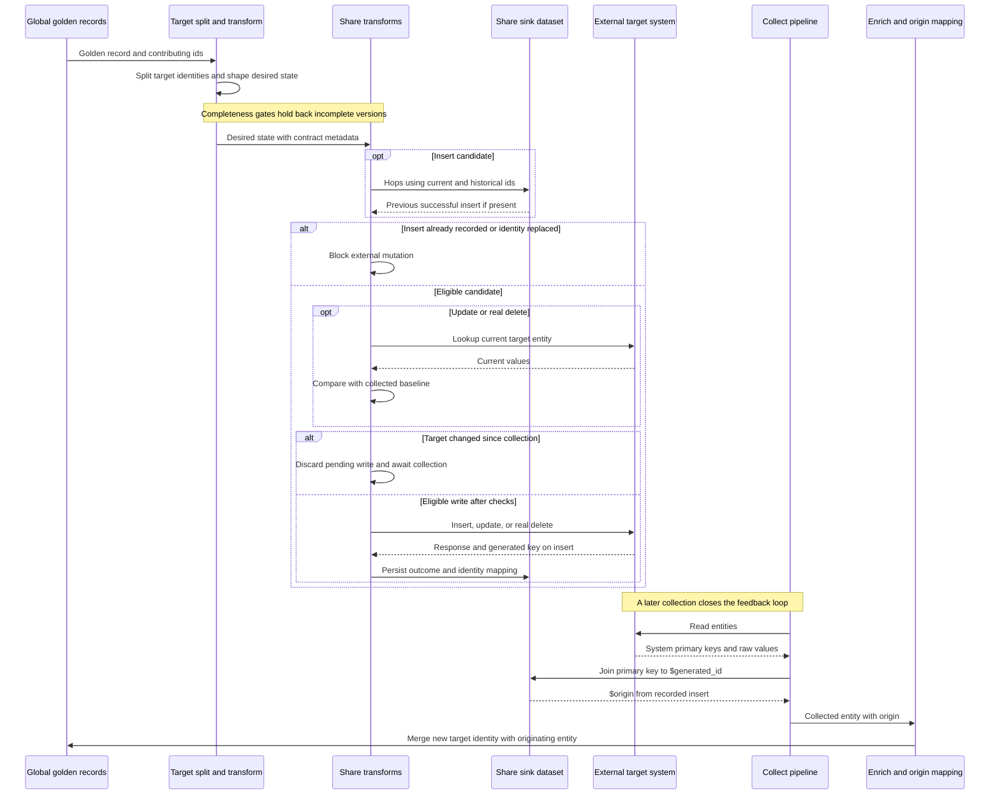

# Bidirectional synchronization without duplicates or lost writes

Bidirectional synchronization makes global golden records both the result of collecting source data and the master data sent back to contributing systems. That creates a feedback loop: a write becomes a collected entity, which contributes to the next golden record and potentially the next write. Safety depends on **identity, recorded outcomes, comparison with collected state, and processing order**, not merely on suppressing unchanged data.

The patterns below reduce duplicates and lost writes; they do **not** establish an exactly-once transaction spanning Sesam and an external system. In particular, a lookup followed by a write is best-effort protection, and response capture is explicitly non-transactional.

## Responsibilities and the round trip

- **Model mapping and global merging** determine sameness and the best values. They retain the identities that contributed to a golden record and manage the opaque `$origin` value.
- **Target-specific transformation** produces `SYSTEM-DATATYPE-transform`, the connector's desired-state input. A `-transform-split` stage before `-transform` restores target identities when the global entity contains target-system members.
- **The connector** collects `SYSTEM-DATATYPE-collect` and makes the target reflect desired state through `-share` operations. When later logic needs the write response, mutation happens in a transform and the sink is a dataset containing the outcome, rather than an external sink that does not capture that response.

*The sequence composes the documented split, duplicate-block, optimistic-check, response-capture, and origin-reconciliation patterns; it is not one atomic target transaction.*

An insert has no imported target baseline, so it does not take the update comparison path. Identity replacement also needs to propagate internally as dataset state, even though it must not delete an external record. Sources: [bidirectional overview](../../hub/bidirectional-synchronization.rst), [connector contract](../../hub/documentation/connectors/connector-contract.rst), and [response capture](../../hub/documentation/data-synchronization/capture-response-with-transform-pattern.rst).

## Identity: prevent both internal and external duplicates

**Internal duplicates** include reinserting a system's own entity into itself and propagating pre-existing duplicates within that system. **External duplicates** include sending a record to another system where a counterpart already exists, or failing to connect a Sesam-created target record with its origin.

### Split before deciding to insert

Global merging produces `$ids` containing contributing identities. A global `_id` is not necessarily the appropriate identity for every target. The namespace split pattern emits one entity for **each** member whose namespace belongs to the target, using that member's enriched, namespaced `_id`. Thus two pre-existing target duplicates can share golden values without being mistaken for two new insert candidates. If there are no target members, emit one candidate with the source `_id` unchanged; that identity represents the origin of the future insert.

Splitting does not discover business sameness. Pre-existing duplicates, whether inside one system or across systems, must first be identified and merged using a suitable, preferably unique merge criterion in the global flow. See [Master data management](master-data-management.md) and the [namespace split pattern](../../hub/documentation/data-synchronization/namespace-split-pattern.rst).

### Block the old identity as well as the new one

After an insert has been recollected and merged, the global identity can change. The old identity may still flow downstream as `_deleted: true` with `$replaced: true`. A namespace check alone is therefore insufficient.

The duplicate hops block checks the share pipe's own sink dataset for a **previous successful insert**. Its example joins `_S.$ids` to `["ni", "st._id"]`, returns `st.<previous-insert-response>`, disables `track-dependencies`, and adds `$discard: "already-inserted"` if a non-null result exists. `$ids` must cover the current `_id` and every other identity previously emitted for that object, not only its latest global identity. Do not treat an arbitrary error response as proof of successful insertion.

Self-hops have two essential prerequisites:

- Set pipe `batch_size` to `1`: entities in an unflushed batch are invisible to hops, so the next entity must be able to see the previous recorded outcome.
- Set dataset sink `set_initial_offset` to `"onload"`: the sink is considered populated when configured, even when empty, avoiding a pipe waiting for its own sink to become populated.

Change tracking drops identical versions **at the dataset sink**, not before a mutation transform has necessarily run. Dependency tracking can independently cause source entities to be reprocessed after hopped-to data changes. Keep those useful mechanisms in the modeling flow, but do not mix dependency tracking into the non-transactional mutation pipe. The duplicate-block and origin-lookup examples explicitly use `"track-dependencies": false`.

Sources: [duplicate hops block](../../hub/documentation/data-synchronization/duplicate-hops-block-pattern.rst), [hops sink warning](../../hub/dtl/dtl-functions-hops.rst), [insert safeguards](../../hub/documentation/data-synchronization/insert-pattern.rst), [change tracking](../../hub/features/change-tracking.rst), and [dependency tracking](../../hub/features/dependency-tracking.rst).

### Reconcile target-generated ids through origin

The establish-origin pattern requires the target's insert response to contain the newly generated system primary key. Capture it in the share sink as `$generated_id`, together with the originating identity information and `$origin`. On recollection, join the collected primary key to the share sink's `$generated_id` and copy `$origin` onto the collected entity. Model mapping can then connect the new target identity to the original entity instead of letting it travel back as an unrelated insert candidate.

`$origin` is **opaque and managed by model mapping**; the share pipe passes it through to its sink. Do not interpret it as necessarily one plain id because an example shows one namespaced identifier. The older insert example records generated `_id` plus `original_ids`, adds `sesam-id` in enrich, and includes it in connect `equality_sets`; this is a different illustrated mapping layout, not a license to rename the connector contract's `$origin` or `$generated_id` fields.

The capture-response example stores body and status, treats `200`, `201`, and `204` as successful, sets `$error: "error-insert"` otherwise, and uses `trip!` if the generated key is incomplete or missing. The accepted success codes and key extraction still need to match the actual API: a nominal success with no usable generated id cannot close this origin loop.

Sources: [establish origin](../../hub/documentation/data-synchronization/establish-origin-pattern.rst), [connector output contract](../../hub/documentation/connectors/connector-contract.rst), and [capture response](../../hub/documentation/data-synchronization/capture-response-with-transform-pattern.rst).

## Desired-state contract and operation safety

Collected data should stay close to the API's original structure; connector-added API properties use the `sesam_` prefix. Desired state uses the same property names, data types, and structure as collect output, removing property namespaces but **retaining the namespace in `_id`**. The collected output may also contain optional `$last-modified` (Datetime), preferably obtained from or close to the system; that is distinct from dataset `_ts` used for completeness.

| Exact field | Contract meaning and requirements |
|---|---|
| `$ids` — `List<NI>` | Includes `_id` and all other ids previously emitted for the object. Required during insert; optional for updates and deletes. |
| `$based_on` — `Dict<String,Any>` | Collected values for all raw system properties to be written back, from the particular imported version. Required for updates and deletes; disallowed for insert. Supports lost-write checks and avoiding unnecessary updates. |
| `$based_on_properties` — `List<String>` | Properties considered in `$based_on` comparison; names can be dotted paths. Required for updates and deletes; disallowed for insert. |
| `$replaced` — Boolean | When true, deletion represents a new `_id`, not a real delete. Produced by merge source. Optional for deletes; disallowed for updates and inserts. |
| `$origin` — Opaque | Passed through by share into its sink. Missing on insert is an error according to the contract prose. Optional if the entity originated in this particular system. |

The contract's simple insert example has no target primary key (`id`), so it denotes an insert. For natural-key APIs, do not infer operation solely from key presence: `transform-share-rest` exposes `is_natural_key` and `primary_key_insert` to describe keys not generated by the server or different insert key fields.

### Inserts

Before allowing an external insert, establish that the entity is neither deleted nor an identity-replacement tombstone, has no existing target member after splitting, and has no successful prior insert under any historical id. Pass the original mapping information through transformation. Mutate through a response-capturing transform, keep its response in a durable dataset, and protect preview as described below.

### Updates: read before write, but do not claim atomicity

An update can first compare desired values with current values to avoid an unnecessary write. To protect unseen external edits, the optimistic locking pattern looks up the current target entity and compares it with the last imported version. Its example removes underscore-prefixed fields, serializes via `json-transit`, and compares `hash128` values using `"murmur3"`. If the versions differ, discard the update, wait for a new import, and try again with newly derived desired state. The contract expresses the baseline as `$based_on` and the comparison scope as `$based_on_properties`.

This **narrows the race window**; another writer can still change the target after the lookup and before the write. A guaranteed atomic compare-and-write would require target-side transactional or conditional-write support beyond the separate lookup/write shown here. Likewise, dataset sink `enable_optimistic_locking` is a different mechanism: it compares entity `_updated` values against the previous dataset version and rejects the dataset write if any comparison fails. It does not make an external REST write atomic.

### Real deletes versus identity replacement

Merge source emits deletes for ids no longer applicable after identity changes and marks them `$replaced: true`. A source entity actually deleted upstream is instead output standalone with `_deleted: true`. Never translate the first case into a target DELETE. A separate delete pipeline should discard non-deleted entities and replacements; if deletion is performed in a transform and logged in a dataset, keep `_deleted: true` on the logged entity. The connector contract still requires `$based_on` and `$based_on_properties` for real deletes.

Unreliable source scans can falsely report deletion and spread it to other systems. Verify a purported source delete through a per-entity lookup. The documented example accepts `200,404` and rewrites `_deleted` to `false` when lookup returns `200`; `404` leaves the deletion intact. Circuit breakers help but do not cover every such scenario. The collect template offers this through `operation_lookup_delete` with `rest_system`; it takes precedence over `operation_lookup`, and the documentation says the two cannot be used together.

Finally, a disappearing entity in an outbound subset is not automatically evidence of a real source deletion. The delete pattern explicitly leaves subset handling as an open question; define and test the integration's policy rather than assuming one is supplied.

Sources: [contract](../../hub/documentation/connectors/connector-contract.rst), [optimistic locking](../../hub/documentation/data-synchronization/optimistic-locking-pattern.rst), [update pattern](../../hub/documentation/data-synchronization/update-pattern.rst), [merge source](../../hub/documentation/service-configuration/pipes/configuration-sources-merge.rst), [delete pattern](../../hub/documentation/data-synchronization/delete-pattern.rst), [verify deletes](../../hub/documentation/data-synchronization/verify-deletes-pattern.rst), and [dataset sink locking](../../hub/documentation/service-configuration/pipes/configuration-sinks-dataset.rst).

## Completeness and ordering are separate from identity

Completeness prevents a target write from consuming an intermediate golden record or transform result while contributing flows are still catching up. It does not discover duplicates or lock a target record.

| Gate | What it actually checks |
|---|---|
| Dataset source `initial_completeness: [dataset ids]` | Every listed dataset has a completeness value. **Presence only**: the value need not be recent and is not compared to the entity timestamp. |
| `require_populated_input: true` | The input dataset is populated. For merge sources, checks the configured datasets or `initial_datasets`. This is an initial-offset/populated-state gate, not a completeness timestamp check. Default is `false`; service metadata can set `global_defaults.require_populated_input`. |
| Dataset source `completeness: true` | Only emits entities with `_ts` older than or equal to the source dataset's completeness timestamp. |
| Dataset source `completeness: [dataset ids]` | Uses the smallest completeness timestamp of those specific upstream datasets. |
| Dataset source `completeness: {"expression": ...}` | Evaluates DTL before each run; the returned datetime is the cutoff. A non-datetime result falls back to `"~t1970-01-01T00:00:00Z"`, normally holding back all entities. |

On a successful run, the sink inherits the smallest completeness timestamp of source and related datasets. Inbound pipes use current time, with an optional HTTP endpoint request-header override. `include_completeness` and `exclude_completeness` control contributors; exclusion wins if both list the same dataset. Excluding every dataset generates a new completeness timestamp in that pipe, so exclusions must reflect actual independence, not merely remove an inconvenient gate.

The DTL call `["completeness", "VIA_DATASET_ID", "DATASET_ID"]` reads a dataset's propagated watermark **as known via another dataset**. It can differ across paths and returns `null` if either dataset is missing or the via-dataset has no record of it. The [bidirectional example](../../hub/bidirectional-synchronization.rst) compares the `A-company-collect` watermark via `global-location` with that via `A-company-transform-split`. It releases up to `["now"]` only when both are positive and the global path is at least as far along as the split path; otherwise it uses a minimum/fallback watermark. That is path-ordering logic, not just a check that the pipes have run once.

**Full-rescan warning:** completeness filtering may hide recent entities. Dataset sink deletion tracking, enabled by default, deletes entities not seen during a full run. Together they can create false sink deletes. Set sink `deletion_tracking` to `false` if those inferred deletes are not wanted, and evaluate how genuine deletions will then be handled. This matters especially before a downstream share/delete flow.

Sources: [completeness feature](../../hub/features/completeness-feature.rst), [dataset source gates](../../hub/documentation/service-configuration/pipes/configuration-sources-dataset.rst), [merge population gate](../../hub/documentation/service-configuration/pipes/configuration-sources-merge.rst), and [DTL completeness](../../hub/dtl/dtl-functions-misc.rst). See [Synchronization and state](../configuration/synchronization-and-state.md) for wider state configuration.

## Asymmetric APIs and extension boundaries

The connector is responsible for hiding differences between collected and writable models, keeping its public collect/desired-state boundary symmetric. Prefer adapting share behavior to the collect model so collect can be built first without a later compatibility break.

A datatype may be readable through its own API but writable through a parent's API, or insertable only as part of another datatype. This can require additional share or `-preshare` pipes and parent-before-child creation. Move insert responsibility to the appropriate flow and remove the competing insert capability; point the affected collect flow at the share dataset that actually contains its `$generated_id`. Hierarchies may require multiple target writes even when the hierarchy is irrelevant to the central model.

Connector hops may reach **other datasets within that connector**, not datasets outside it, to restore symmetry or fulfill required relationships. Treat them cautiously: they can introduce loops and dependencies. Keep relationship preparation and completeness ordering outside the non-idempotent write stage where possible; disabling dependency tracking on outcome lookups does not remove the need to make parent ids available before a dependent write.

`transform-share-rest` is the documented CRUD/optimistic-check entrypoint. Prefer its extension points over extra transforms when adapting API shapes:

- `rewrite_rules_payload`: `rewrite_update_payload`, `rewrite_insert_payload`, and `rewrite_update_payload_after_patch` for request shaping.
- `rewrite_rules_lookup`: `rewrite_lookup` for lookup response shaping.
- `rewrite_rules_mutation`: `rewrite_update`, `rewrite_insert`, and `rewrite_delete` for mutation response shaping, including key formats.
- `client_side_patching: true` builds an update from the lookup result patched with actual payload when an API requires a complete replacement payload. This is not an atomic target patch.

The reference separately documents legacy `rules` hooks for lookup/baseline rewriting and `$payload` customization. Its `payload_property` table defaults to `payload`, while special-entity customization is named `$payload`; preserve that distinction and verify the expanded connector rather than normalizing the names by guesswork. See [Connectors and contracts](../integrations/connectors-and-contracts.md), [asymmetry](../../hub/documentation/data-synchronization/handling-asymmetry-pattern.rst), and [template extensions](../../hub/documentation/service-configuration/pipes/configuration-transforms-template.rst).

## External writes, resets, and restore: prerequisites and impact

| Action | Prerequisites before allowing it | Impact and residual risk |
|---|---|---|
| Enable mutation transforms | Validate API semantics, identity mapping, successful-response detection, completeness and delete policy. Use `batch_size: 1`, durable outcome storage, and no dependency tracking in the mutation pipe. | The external operation happens before its response reaches the dataset sink. Smaller batches reduce duplicate replay exposure but do not create a transaction across target and sink. |
| Preview a mutation pipe | Keep `side_effects: true` on transforms that write. REST transforms default to `true`; mark read-only lookup `false` only when genuinely safe. | Preview executes transforms even though it does not write the normal sink. An unprotected insert can create an untraceable target record. |
| Skip optimistic checking for repair | Explicitly authorize and scope the repair, accepting that collected state may be stale. | `$unsafe_skip_optimistic_locking: true` lets `transform-share-rest` update even when comparison says `modified-in-system`; it can overwrite unseen edits. Not a normal synchronization setting. |
| Reset or rewind last seen | Review the full set of external side effects, preserve the successful-insert journal, and verify replay behavior in an isolated environment before enabling writers. | Reset/full run reprocesses all source entities and performs deletion tracking. Use `disable_set_last_seen: true` to protect a pipe from accidental reset/last-seen changes. |
| Enable automatic reprocessing | Audit `reprocessing_policy` and downstream mutation safety, including after configuration or input-state changes. | Default `continue` does not reset automatically. `automatic` can reset/full-rescan or sometimes rewind, including when state is restored from backup. |
| Resume after disaster recovery | Reconcile actual target records with surviving origin/outcome records before unguarded non-idempotent replay. Enable `metadata.durable: true` on relevant write-state pipes; pushed inbound and paired endpoint/share pipes also need durability. | Durability reduces data-loss risk, not an exactly-once guarantee. Restoring older state can forget successful external operations and send them again. |

The durability documentation's concrete failure is a 10:00 backup, an invoice written at 12:00, and recovery after a 12:30 failure: Sesam rebuilds from 10:00 and can send that invoice twice. Cloud backups are documented as occurring every 24 hours, so normal recoverable source recollection and non-idempotent output replay have very different consequences. Know the actual target's behavior on repeated requests; HTTP method labels alone are not an integration-specific replay proof.

Sources: [insert replay risks](../../hub/documentation/data-synchronization/insert-pattern.rst), [durable data](../../hub/features/durable-data.rst), [non-idempotency](../../hub/idempotency.rst), [reset/full run](../../hub/documentation/service-configuration/pipes/configuration-pump.rst), [reset protection](../../hub/documentation/service-configuration/pipes/configuration-pipes.rst), [automatic reprocessing](../../hub/features/automatic-reprocessing.rst), and [unsafe repair override](../../hub/documentation/service-configuration/pipes/configuration-transforms-template.rst). See [Deployment and durability](../operations/deployment-and-durability.md) for recovery planning and [Monitoring and troubleshooting](../operations/monitoring-and-troubleshooting.md) for investigation.

## Source inconsistencies to resolve before copying examples

These documents describe safety patterns, but some examples are not runnable contract-conformant configurations. Do not silently repair them or treat their omissions as relaxed requirements:

- The connector contract requires `$origin` for insert, but its insert example omits it. Its update example writes `$based_on` with square brackets around property/value pairs despite specifying `Dict<String,Any>`; the update and delete examples omit required `$based_on_properties`, and the delete example also omits `$based_on`.
- The contract's replacement prose says `_delete`; its example uses `_deleted`. Its split prose includes both `foo-person:123` and `foo:person:124`. Preserve the actual target namespace rather than deriving one from this inconsistent illustration.
- The capture-response example sets `$operation` to `"inserts"` but triggers on `"insert"`, and lacks a comma after `["add", "$payload", "_S."]`. Its missing-key check is important even though the surrounding example needs validation.
- The older insert example's comment describes discarding already-processed entities, but the predicate uses `is-empty` on the sink hops. It joins `si.$original_id` while later storing `original_ids`. The dedicated duplicate-block pattern instead checks for a non-empty successful result.
- The optimistic locking example lacks a comma between its success-path comment and payload addition. Its lookup/hash/discard control flow should not be mistaken for a ready-to-paste configuration.
- The `transform-share-rest` section's prototype names `"transform-collect-rest"`. The namespace-split text describes keeping the first merged id as default, while the merge-source reference documents `identity: "composite"` as default and `"first"` as an explicit strategy. Inspect actual merge configuration.

## Focused validation before enabling two-way writes

The repository documents configuration testing. The cases below are **acceptance cases to add to the integration**, not a claim of existing automated coverage for this round trip. Use a controlled API stub or isolated target for actual mutation behavior:

| Case | Expected safety observation |
|---|---|
| One target member, then two pre-existing target duplicates | Split emits the correct target `_id` per member; neither becomes a new insert merely because the global `_id` uses another namespace. |
| Insert, reprocess, then recollect and merge | One successful insertion is recorded; generated id joins to origin; later candidates under old/current ids are blocked; `$replaced` does not delete the target. |
| Target lookup differs from `$based_on` | Pending mutation is discarded; after recollection desired state is recomputed. Also test an edit between lookup and write to expose the remaining race window. |
| True delete, false scan delete, and subset exit | Replacement never calls delete; lookup `200` cancels false deletion; missing entity follows the real-delete policy; subset behavior is explicit. |
| Uninitialized dependency, old watermark, and invalid expression result | Test populated-state gating separately from completeness presence and timestamp filtering. Check divergent via-path watermarks and full-rescan deletion tracking. |
| API success without key, error response, retry, and failure after an external write | Missing generated key fails visibly; error is not a success marker; test batch visibility and the external-write/local-recording gap. |
| Parent/child insertion and asymmetric response shape | Required target ids exist before dependent writes; response rewriting preserves the key used by recollection. |
| Preview, reset, automatic rewind, and restored journal | Preview is protected; reset/recovery tests check actual target call counts as well as sink contents. Losing a success marker must be treated as a replay hazard. |

The documented local procedure runs pipes until queues drain, with external output disabled or unable to send, and compares endpoint output to `expected/<pipe>.json` using `<pipe>.test.json`. It supports selecting `source`, `before-transform`, `after-transform`, or `sink` stage and is invoked with `sesam -vv test`. CI must serialize tests because the client overwrites the node configuration, and the CI node should lack credentials needed to write to normal target systems. Do not use real integration credentials in examples or fixtures.

There is also an inconsistency in the local-test reference: its internal-properties section says entities with `_deleted: false` are removed from output. Do not assume that documented wording gives complete coverage of live-versus-deleted results; validate the installed client's comparison behavior and inspect raw outcomes/call counts for these safety tests.

See [Configuration change lifecycle](../testing/configuration-change-lifecycle.md), [Build an integration](build-an-integration.md), [local testing](../../hub/documentation/operations/testing-locally.rst), and [CI isolation](../../hub/documentation/operations/continuous-integration.rst).
