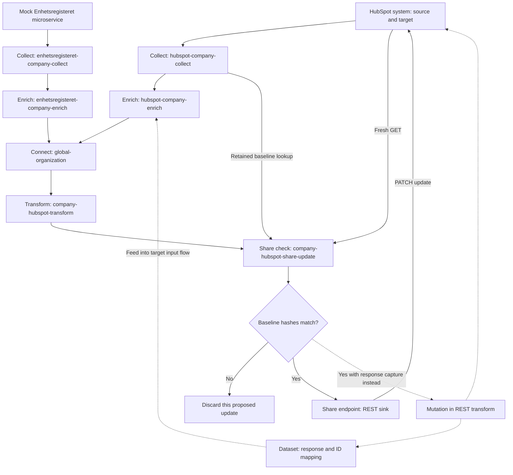

# Build an integration: Collect, Enrich, Connect, Transform, Share

An integration is a **dataflow with retained boundaries**, not just an API request. The authored workflow is **Collect → Enrich → Connect → Transform → Share**. Collect and Share handle movement across the Hub boundary; Enrich, Connect, and Transform handle data management inside it. The first-synchronization guide groups the tutorials this way, but the dependency order still follows all five phases.

This page traces the representative flow: collect company records from HubSpot and a registry-shaped source, connect matching companies, prefer selected registry values, then prepare guarded updates to existing HubSpot companies. It is an architectural walkthrough and safe test plan, not instructions to execute against a live CRM.

## Safety and scope before configuration

- **Enhetsregisteret is mocked.** The tutorial's `enhetsregisteret` system uses `system:microservice`, image `sesamcommunity/learn-sesam-crm:v1.1.2`, and port `5000`. Its `/enhetsregisteret` endpoint serves generated tutorial data, not a connection to the Norwegian registry. Do not treat it as a production connector or proof of real registry access.
- **The HubSpot prerequisites and examples are legacy material.** The guide asks for an API key and links to legacy test-account instructions; Collect labels a secret `hubspot-api-key` but sends it in an `Authorization: Bearer ...` header. The connector authentication reference instead identifies HubSpot as an OAuth2 example. Do not infer a current authentication recipe from the old tutorial. Confirm the supported authentication, scopes, token lifecycle, and API contract for the connector/version you actually use.
- Use only synthetic fixtures and credential/identifier placeholders. Require an **isolated test account** for any separately authorized provider contract tests, never an existing business account. Keep external writes disabled or unreachable during local configuration tests. **Do not run the live tutorials, CSV imports, webhook registration, or mutation previews as part of this walkthrough.**
- The tutorial covers updates to existing companies, not a complete insert/delete or bidirectional lifecycle. Before adding those, use [Bidirectional synchronization](bidirectional-synchronization.md) and [Connectors and contracts](../integrations/connectors-and-contracts.md).

Sources: [guide and prerequisites](../../hub/guide-create-first-synchronization.rst), [Collect and mock notice](../../hub/tutorial-getting-started-collect.rst), [authentication schemes](../../hub/documentation/data-synchronization/authentication-schemes-pattern.rst).

## The five-stage route

“Inbound,” “outbound,” “global,” and suffixes such as `-collect`, `-enrich`, `-transform`, and `-share` describe **roles and naming conventions**. They are not distinct pipe implementation types. Each example is `"type": "pipe"`; behavior comes from its source, ordered transforms, sink, and pump. A missing sink defaults to a dataset sink with the dataset named after the pipe's `_id`. That default explains the retained datasets between tutorial stages.

| Phase | Task and representative entrypoint | What to inspect before moving on | Task-to-source route |
| --- | --- | --- | --- |
| **Collect** | Define `hubspot` and mocked `enhetsregisteret` systems; create `hubspot-company-collect` and `enhetsregisteret-company-collect` | Authentication boundary, source response extraction, stable `_id`, raw retained output, complete page traversal | [Collect tutorial](../../hub/tutorial-getting-started-collect.rst), then [Collect patterns](../../hub/documentation/data-synchronization/collect-patterns.rst) |
| **Enrich** | Read each Collect dataset in its corresponding `-company-enrich` pipe | Source namespaces, `rdf:type`, and same-source relationship NIs | [Enrich tutorial](../../hub/tutorial-getting-started-enrich.rst), [semantic modelling](../../hub/sesam-dataflow.rst#enrich) |
| **Connect** | Merge both Enrich datasets into `global-organization` | Equality evidence, merged identity, preserved lineage, authority order for global properties | [Connect tutorial](../../hub/tutorial-getting-started-connect.rst), [Merge source](../../hub/documentation/service-configuration/pipes/configuration-sources-merge.rst) |
| **Transform** | Read the global in `company-hubspot-transform` | Target ID and a target-shaped, inspectable payload, not a dump of the global | [Transform tutorial](../../hub/tutorial-getting-started-transform.rst), [data-management guide](../../hub/guide-create-first-synchronization-data-management.rst) |
| **Share** | Check in `company-hubspot-share-update`, then deliver through `company-hubspot-share-update-endpoint` | Conflict outcome, API status, replay safety, and whether responses must be retained | [Share tutorial](../../hub/tutorial-getting-started-share.rst), then [Share patterns](../../hub/documentation/data-synchronization/share-patterns.rst) |


*The five tutorials supply the solid company-update path; dashed edges show the response-capture alternative from the Share patterns, not an extra response dataset created by the tutorial's REST sink. Collect, Enrich, Connect, Transform, and the Share check retain dataset outputs by default.*

For component ownership and the boundary model, continue to [Hub model and boundaries](../architecture/hub-model-and-boundaries.md) and [Pipes and systems](../configuration/pipes-and-systems.md). For initial environment setup, use [Quickstart](../quickstart.md).

## 1. Collect: authenticate, map identity, retain the source

### Keep connection configuration in systems

A system represents the external database/API and centralizes shared connection configuration; it can also provide connection pooling and rate limiting. In the tutorial, `hubspot` is a `system:rest` with shared headers, a `url_pattern`, and named operations:

- `get` performs collection GETs using `properties.url`.
- `get_company` performs an individual company GET for the later conflict check.
- `update` performs a JSON PATCH at `companies/{{ properties.id }}`.

The historical header references `$SECRET(hubspot-api-key)`, rather than embedding a credential. Retain that separation of secret from configuration, **not the obsolete credential instructions**. Reuse operation definitions on the system where several pipes need them; REST source/transform/sink operation overrides exist, but secrets in those operation definitions are allowed only at the system level. See [REST system configuration](../../hub/documentation/service-configuration/systems/configuration-systems-rest.rst) and [connector contracts](../integrations/connectors-and-contracts.md).

### Extract records, not the response envelope

`hubspot-company-collect` uses a `rest` source bound to system `hubspot`, operation `get`, `payload_property: "results"`, and `id_expression: "{{ id }}"`. `payload_property` selects the record-bearing response property; `id_expression` supplies each emitted entity's `_id`. The mocked registry Collect pipe instead uses a `json` source at `/enhetsregisteret` and DTL that copies the record and adds `_id` from `orgnr`. Both Collect examples disable automatic namespaces and namespaced identifiers.

Choose a stable, unique `_id` for each logical entity within the flow. A new version must keep that identity. Keep the original provider fields and nesting so later comparison and remodelling do not depend on another source fetch. “Raw” here means retained source records with necessary Sesam identity/metadata handling; extracting `results` is not retention of the whole HTTP response envelope.

The two-step pattern separates **external collection/raw retention** from **semantic enrichment reading that dataset**. This lets downstream logic be rerun against already received data, especially when a push-only provider cannot replay it. Dataset change tracking appends only new or changed content; stored versions receive dataset-local `_updated` counters. Those internal counters are not the provider's business modification timestamps. Retention is also not an unlimited archive: the compaction reference defaults to keeping two versions per entity. Choose a retention policy intentionally.

Sources: [raw retention and two-step approach](../../hub/sesam-dataflow.rst#collect-raw-data), [REST source mapping](../../hub/documentation/service-configuration/pipes/configuration-sources-rest.rst), [change tracking](../../hub/features/change-tracking.rst), [compaction](../../hub/features/compaction-feature.rst).

### Choose the ingress and state strategy

| Decision | Mechanism and consequence | Follow-up source |
| --- | --- | --- |
| **Can Sesam pull?** | Prefer pull where available: Sesam controls scheduling and can request data again. Use an appropriate built-in source or a JSON Pull adapter. | [Push or pull](../../hub/sesam-dataflow.rst#collect-push-or-pull), [custom sources](../../hub/custom-data-source.rst) |
| **Does a scan exceed one response?** | Configure REST operation `next_page_link`, request parameters, and termination for the API's body/header cursor or offset contract. `page_size` alone does not enable pagination; `not-full-page` termination requires it. The simple Collect example does not configure page traversal, so its expected ten tutorial records do not establish completeness for larger accounts. | [Pagination pattern](../../hub/documentation/data-synchronization/pagination-pattern.rst), [REST operation properties](../../hub/documentation/service-configuration/systems/configuration-systems-rest.rst) |
| **Can the provider resume between runs?** | Map its change marker into `_updated`, relay `since` to the API, and set `supports_since` only when true. Chronological output selects chronological tracking; otherwise comparable markers select max tracking. If neither property is valid, tracking is disabled. The pump owns the saved `pipe_offset`. Pagination within a scan and continuation across scans are separate decisions. | [Continuation pattern](../../hub/documentation/data-synchronization/continuation-pattern.rst), [continuation contract](../../hub/documentation/service-configuration/pipes/configuration-sources.rst#continuation-support) |
| **Must the provider push?** | A pipe with `source.type: "http_endpoint"` receives JSON Push at `/api/receivers/<pipe_id>/entities`. Treat it as a change stream: a record missing from the next push is not automatically a deletion. Retain the received data and consider durable storage. | [Pushing data into the Hub](../../hub/custom-data-source.rst#pushing-data-into-the-hub), [JSON Push](../../hub/json-push.rst), [durable data](../../hub/features/durable-data.rst) |
| **Are there webhooks?** | Register them separately, authenticate incoming payloads with provider-appropriate signature validation, then combine full scans and events in Collect. For partial events, receive quickly in `-event` and fetch the complete entity downstream in `-event2`; do not block the receiver with that lookup. Shared event feeds need datatype routing, for example with subsets. | [Register webhooks](../../hub/documentation/data-synchronization/register-webhook-pattern.rst), [receive and combine events](../../hub/documentation/data-synchronization/receive-webhook-events-pattern.rst) |
| **Are deletes or empty scans unreliable?** | A delta stream cannot infer deletion merely from absence. Plan full reconciliation or explicit delete events. REST `if_source_empty: "fail"` can prevent an empty scan from deleting prior output; verify suspected deletes with an entity lookup before propagating them. | [Continuation contract](../../hub/documentation/service-configuration/pipes/configuration-sources.rst), [REST source](../../hub/documentation/service-configuration/pipes/configuration-sources-rest.rst), [verify deletes](../../hub/documentation/data-synchronization/verify-deletes-pattern.rst) |

The webhook pattern's `use_webhook_secrets: true` grants anonymous write access to event pipes as well as creating the webhook secret. **Signature validation is therefore a security boundary**, not optional decoration. Do not copy the pattern's development suggestion of inlining a client secret into a tracked configuration; use placeholders and secret references.

A custom pull service exposes a JSON array of entities with `_id`; `_deleted` is optional and defaults to false, and `_updated` supports continuation. JSON Pull uses GET, `since`, and `limit`. If native connectors cannot express the transport, format, or security requirements, the extension boundary is an external endpoint through a URL system or a Docker-hosted microservice through a Microservice system. These can supply custom sources, transforms, or sinks. See [Extensions and JSON protocols](../integrations/extensions-and-json-protocols.md).

## 2. Enrich: add semantics without guessing cross-source matches

Each Enrich pipe uses its Collect dataset as a `dataset` source and copies the source properties. It then adds:

- **A source/business type:** NIs such as `rdf:type = ~:hubspot:company` and `~:enhetsregisteret:company`.
- **Identity and property namespaces:** `hubspot-company` or `enhetsregisteret-company`, preserving lineage and preventing same-named properties from colliding after connection.
- **Same-source references:** the HubSpot rules turn contact associations into properties ending in `-ni`, with values built using `ni("hubspot-contact", id)`. The registry example needs only namespaces and type.

An NI is a semantic foreign-key-like reference, not an enforced database constraint. It should point to an actual entity identifier in the related source dataset. This company example constructs contact references; it does not by itself collect a contact dataset or prove every reference resolves. Test reference resolution if downstream logic needs it.

**Do not connect HubSpot identities to registry identities in Enrich.** Enrich preserves source semantics; Connect owns assumptions about equivalence across sources. See the [Enrich tutorial](../../hub/tutorial-getting-started-enrich.rst) and [namespaced-identifier modelling guidance](../../hub/sesam-dataflow.rst#semantic-enrichment-namespaced-identifiers).

## 3. Connect: make equality and authority explicit

`global-organization` reads a version-2 `merge` source with aliases `hc` and `ec`. The equality set is:

```json
["hc.properties.about_us", "ec.orgnr"]
```

The tutorial deliberately stores the registry organization number in HubSpot's `about_us` field. That is an **example mapping choice**, not a general assertion about what `about_us` means. Before using any equivalent rule, normalize and test the business key, including null, blank, duplicate, and mismatching cases.

Merge resolves equality transitively. Null and empty-list equality results do not merge; other unsuitable join values should be filtered explicitly. `identity: "first"` chooses the resulting `_id` according to input dataset order and then entity ID order. It does **not** select the most trustworthy property values. Namespaced source properties remain available in the merged result.

Authority is a separate DTL decision. The tutorial copies all merged properties and adds organization number, name, address, zipcode, and city in the `global-organization` namespace. Each `coalesce` lists the registry value before the HubSpot value. By default `coalesce` picks the first **non-null** value, not the first valid or nonblank value; add validation/normalization if that distinction matters. `metadata.global: true` marks the pipe as global; the merge source and rules implement its behavior.

Global datasets group a concept across sources. They need not merge every included entity: grouping related concepts is not proof that those records are the same object. For richer authority, classification, and feedback-loop choices, use [Master data management](master-data-management.md).

**Configuration changes have state consequences.** Adding equality rules after records have already been processed requires reset/rescan to apply those rules to old records. Removing an input dataset requires a full run to clear its entities from merge state. Plan downstream availability and output/identity changes before resetting, especially while any Share path can write externally. Sources: [Connect example](../../hub/tutorial-getting-started-connect.rst), [Merge source lifecycle](../../hub/documentation/service-configuration/pipes/configuration-sources-merge.rst), [global modelling](../../hub/sesam-dataflow.rst#connect).

## 4. Transform: bind the target schema late

`company-hubspot-transform` reads `global-organization`. It obtains the existing HubSpot `id` from `hubspot-company:id`, and constructs `payload.properties` from the chosen global values: `address`, `city`, `name`, `about_us`, and `zip`. The registry organization number improves a HubSpot record, but it is **not** the HubSpot API identifier.

The two `properties` objects at delivery serve different purposes. Top-level `properties.id` supplies the operation's URL parameter; `payload.properties` is the CRM request body. This illustrative **post-check delivery envelope** uses only synthetic data and placeholders and is not a runnable pipe configuration:

```json
{
  "_id": "synthetic-update-1",
  "properties": {
    "id": "<test-company-id>"
  },
  "payload": {
    "properties": {
      "address": "1 Example Street",
      "city": "Example City",
      "name": "Synthetic Company",
      "about_us": "<synthetic-organization-number>",
      "zip": "0000"
    }
  }
}
```

The Share check uses `::payload` and `::properties` when adding the unnamespaced REST envelope fields; the DTL `::` escape prevents automatic prefixing. Keep reshaping in a preparation dataset so its result is inspectable and reusable, rather than hiding all logic in a terminal outbound sink.

Validate this contract before delivery: accepted fields, null/blank semantics, required IDs, types, and business rules. The older dataflow overview says Sesam does not offer automatic schema/business-rule validation; the more specific configuration reference documents an explicit **`json_schema` transform**. It annotates validity and error fields—it does not automatically discard invalid entities. Configure validation and an explicit gate/error route; do not assume schemaless storage validates the provider contract.

Sources: [Transform example](../../hub/tutorial-getting-started-transform.rst), [REST entity shape](../../hub/documentation/service-configuration/pipes/configuration-sinks-rest.rst#expected-entity-shape), [DTL escapes](../../hub/dtl/dtl-functions-transforms.rst), [preparation/outbound separation](../../hub/documentation/data-management/data-management.rst), [JSON Schema validation](../../hub/documentation/service-configuration/pipes/configuration-transforms-json-schema-validation.rst).

## 5. Share: guard the update and decide what to retain

### The tutorial's read–compare–write path

The tutorial splits Share into two pipes:

1. `company-hubspot-share-update` selects transformed records with a non-null target `id` and retains non-deleted proposals. It calls `get_company` through a REST transform with `replace_entity: false`, keeping the proposal and attaching the current response.
2. It hops to `hubspot-company-collect` by `id` for the last imported baseline. The rules remove underscore-prefixed properties, serialize using `json-transit`, and hash the baseline and lookup result with `hash128`/`murmur3`.
3. Equal hashes emit the payload and URL properties. A mismatch unconditionally discards that proposed update; the optimistic-locking pattern says to wait for a fresh import and try again.
4. `company-hubspot-share-update-endpoint` reads that dataset and uses the system's `update` operation in a REST sink to PATCH the existing company.

This is a **client-side conflict-risk reduction**, not an atomic provider-side lock. GET/check and PATCH are separate operations, even separate pipes in this example; an intervening target edit remains possible. The example configures no conditional write token. Require stronger provider concurrency controls where the contract supports them and the use case requires them.

Two subtleties matter for safe adaptation:

- Compare equivalent record shapes, not a list-response envelope against a lookup envelope or unstable synthetic metadata. Test list/lookup normalization before treating a mismatch as a business conflict.
- DTL `discard` has an **unless condition**: `['discard', condition]` emits nothing when the condition is false. Unconditional `discard` also does not delete a previously stored entity with the same `_id` in the sink. A discarded proposal is not a target delete or guaranteed removal of older retained output. Do not requeue/reset the Share endpoint casually.

Sources: [Share tutorial](../../hub/tutorial-getting-started-share.rst), [optimistic-locking pattern](../../hub/documentation/data-synchronization/optimistic-locking-pattern.rst), [discard semantics](../../hub/dtl/dtl-functions-transforms.rst#discard).

### When delivery responses are part of the integration

The tutorial's REST sink does **not** retain the target response as a dataset for further logic. If you need error bodies, mutation outcomes, generated IDs, or bidirectional mapping, move the external operation into a REST transform and keep a dataset sink. With `replace_entity: false`, choose `response_property` and `response_status_property` so the source identity, request, response body, and status can be retained together.

Classify outcomes explicitly. REST transforms default to accepting `200-299`; expanding `allowed_status_codes` makes those other responses data that downstream rules must handle, not successful mutations. `ignored_status_codes` omits matching responses and loses audit evidence. Generated target IDs and original source identifiers must be connected back through the target input/global flow before dependent target objects can use them.

For non-idempotent operations, response capture is **not a transaction spanning Sesam and the provider**. The pattern prescribes `metadata.durable: true`, pipe `batch_size: 1`, and no dependency tracking mixed into the mutation pipe, to reduce duplicate/replay exposure. Durable data reduces data-loss risk; it is not an exactly-once guarantee. Keep `side_effects: true` on mutating REST transforms to protect preview, and use false only for genuinely read-only calls. An insert extension also needs checks against already processed source identities, handling for deleted entities, and target-specific duplicate safeguards.

Sources: [capture response with transform](../../hub/documentation/data-synchronization/capture-response-with-transform-pattern.rst), [REST transform status and side effects](../../hub/documentation/service-configuration/pipes/configuration-transforms-rest.rst), [insert safeguards and mapping](../../hub/documentation/data-synchronization/insert-pattern.rst), [durable storage](../../hub/features/durable-data.rst).

### Delivery alternatives and extension points

- **Push or publish:** push lets Sesam control delivery; publish lets consumers pull on their own schedule. The dataflow reference limits publication to HTTPS and supported formats, with predefined subsets/query properties rather than ad hoc querying. Select this at the Share boundary, not by changing global semantics.
- **Completeness:** enable dataset-source completeness when delivery must wait for upstream and related datasets to finish. It is not enabled merely by adopting the five-phase names. Review completeness with full rescans/deletion tracking: filtering incomplete entities during a full scan can otherwise make uncovered output appear deleted. Feedback datasets may need exclusion from the completeness chain.
- **Share templates:** `transform-share-rest` implements CRUD and an optimistic-locking check. Prefer its documented hooks for targeted changes: `rewrite_rules_payload` with `rewrite_update_payload`/`rewrite_insert_payload`; `rewrite_rules_mutation` with `rewrite_update`/`rewrite_insert`/`rewrite_delete`; and `rewrite_rules_lookup` with `rewrite_lookup`. These address payload or response adaptation without introducing another opaque transformation layer.

Sources: [Share transport and IDs](../../hub/sesam-dataflow.rst#share), [completeness](../../hub/features/completeness-feature.rst), [template extension pattern](../../hub/documentation/data-synchronization/share-template-extension-points-pattern.rst), [template reference](../../hub/documentation/service-configuration/pipes/configuration-transforms-template.rst). Follow [Synchronization and state](../configuration/synchronization-and-state.md) for scheduling, retries, reprocessing, and checkpoint decisions.

## Verification: prove the boundaries before enabling delivery

The following are **recommended fixture tests**, not results of executing the tutorials. Build a small synthetic set with the fields required for joining, and grow it as failure cases appear. Embedded/conditional inbound sources can select offline fixtures using an environment variable while preserving the production-shaped configuration.

| Boundary to test | Focused fixture or fault | Expected observation |
| --- | --- | --- |
| Collection identity and payload | Nested `results`, repeated record ID, more than one page, empty final page | Correct records and stable IDs; all intended pages reached; unchanged content does not add another dataset version |
| Continuation and deletes | Interrupted chronological feed, unordered comparable markers, explicit deletion, suspect empty full scan | Offset behavior matches declared capabilities; no silent skip; delta absence is not a delete; configured empty/deletion protection works |
| Webhook ingress | Valid/invalid signatures, partial event, shared event types | Invalid payload rejected; receiver does not perform slow lookup; correct datatype routed and full entity fetched downstream |
| Semantic enrichment | Same property names from two sources; resolvable and missing contact references | Namespaces retain lineage; expected type NIs appear; missing reference handling is explicit |
| Global equality and authority | Matched/unmatched keys, blank keys, duplicate candidates, null/blank authoritative values | Only intended companies connect; transitive/duplicate merges are visible; `coalesce` fallback is tested rather than assumed |
| Payload preparation | Registry-only company, invalid field type, null target ID | Existing HubSpot ID remains distinct from organization number; target shape is correct; invalid or non-updateable proposals are gated |
| Conflict guard | Baseline equals lookup, target edited after collection, different list/lookup shapes | Only equivalent unchanged records pass; mismatch emits no new update; old retained Share output is accounted for |
| Mutation and recovery | Success/error body, generated ID absent, simulated retry or replay against a mock | Status/error classification is retained; mapping is complete; duplicate safeguards and preview protection work |

Use the local test workflow in [Configuration change lifecycle](../testing/configuration-change-lifecycle.md): drain internal queues while output pipes remain disabled/unable to send, and compare endpoint-stage output with expected fixtures. The documented layout uses `expected/<pipe>.json` plus `expected/<pipe>.test.json`; tests can select a pipe stage or a published endpoint. The documented local command is `sesam -vv test`, **only against the isolated, non-delivering test setup**, not a live tutorial node. Sources: [local testing](../../hub/documentation/operations/testing-locally.rst), [embedded test data](../../hub/documentation/data-management/data-management.rst#embedded-data-for-testing), [test-data guidance](../../hub/sesam-dataflow.rst#collect-test-data).

Before any separately approved test-account delivery, check:

1. **Input/output:** retained raw, enriched, global, and prepared records are inspectable; counts alone are insufficient. The tutorial's ten entities are fixture expectations, not a runtime invariant.
2. **Execution/state:** inspect pump execution history, succeeded/failed counts, retry state, and saved offsets. The execution dataset is an operational log, not a stable application API. Token expiry information can help diagnose OAuth/custom-auth failures.
3. **Delivery/outcomes:** distinguish conflict discards, invalid records, per-entity target errors, and system outages. Monitor dead-letter datasets rather than merely configuring them; verify the target result using an authorized isolated-account check.
4. **Observability/security:** enable monitoring at inbound/outbound boundaries. REST tracing can log headers and body excerpts; secret redaction is best-effort, so restrict trace detail and inspect logs for leakage.
5. **Change safety:** review equality/ID changes, retention, completeness, durability, and the external effects of reset/rescan before deployment. A local test pass is not proof of provider-side replay safety.

Sources: [pump execution history](../../hub/documentation/operations/pump-execution.rst), [monitoring guidance](../../hub/sesam-dataflow.rst#collect-monitoring), [troubleshooting and error ownership](../../hub/documentation/operations/troubleshooting.rst), [REST trace controls](../../hub/documentation/service-configuration/pipes/configuration-sources-rest.rst).
