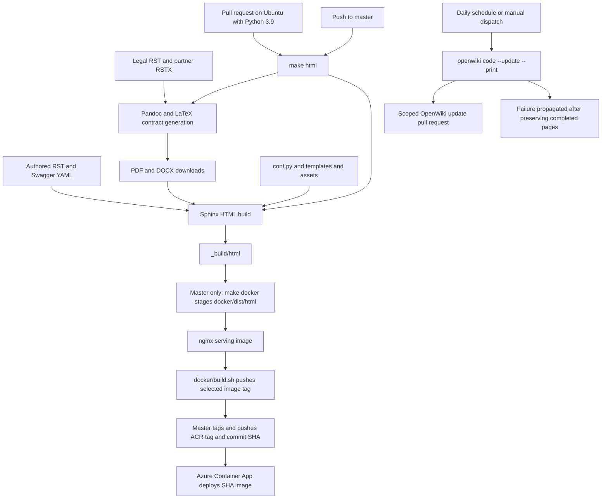

# Maintain, preview, validate, and publish the Sphinx reference

This guide covers **documented product behavior and the documentation toolchain**; it does not verify processing-runtime or portal/UI implementations. Change the authored reference first; do not repair rendered HTML or exported contracts. The Sphinx site and this Markdown evidence wiki have separate generation paths.

**Research boundary:** this guide was derived from source inspection. No dependencies were installed, builds or checks run, servers or containers started, images published, or external services contacted. Follow [.openwikiignore](../../.openwikiignore): authored RST/RSTX, specifications, configuration examples, tooling, templates, and meaningful assets are evidence; build output, environments, exports, caches, and secrets are not. During OpenWiki generation, preserve original sources and contributor instructions and change only the assigned wiki documentation/metadata and permitted managed navigation blocks.

## 1. Understand the authored document graph

### The home page is `hub/index`, not root `index`

[conf.py](../../conf.py) sets `source_suffix = '.rst'` and `master_doc = 'hub/index'`. Installing CommonMark-related packages does not make Markdown an enabled Sphinx source here. The `.rstx` partner form is an explicit Pandoc input, not an additional Sphinx source suffix.

[hub/index.rst](../../hub/index.rst) combines visible `panels` and `link-button` cards with a **hidden toctree**, whose entries lead to What is Sesam Hub, Features, Documentation, Learn, pricing, SLA, roadmap, and changelog. Hidden means the tree is not displayed inline; it remains the authored hierarchy used by navigation. [hub/index-developer.rst](../../hub/index-developer.rst) then routes readers into building blocks, configuration, DTL, APIs, operations, and other reference topics. Building-block and learning landing pages similarly combine cards with hidden trees.

The root [index.rst](../../index.rst) is marked `:orphan:` and has its own older feature panels and hidden link to `hub/index`. It is not the configured master. The redirect map sends `index.html` to `hub/index.html` and maintains legacy URLs such as `DTLReferenceGuide.html`, `api.html`, `quick-reference.html`, and `changelog.html`. Review that map when moving or renaming pages; it contains literal target strings, not a promise that arbitrary renamed files will redirect correctly.

### Preserve references, shared text, and builder-sensitive markup

- **Labels and references:** explicit targets such as `.. _DTL:`, `.. _data-transformation-language:`, `.. _pipe_section:`, and operator labels are consumed by `:ref:` links and `link-button` directives with `:type: ref`. [quick-reference.rst](../../hub/quick-reference.rst) is a dense consumer of configuration and DTL labels. Keep stable labels when headings change; search consumers before deleting or renaming one.
- **Document links:** `:doc:` addresses a document rather than a section target. The [DTL transform configuration](../../hub/documentation/service-configuration/pipes/configuration-transforms-dtl.rst) uses a relative `:doc:` path to the DTL guide. Learning cards also use `:type: url` with literal `.html` filenames. A successful label-resolution check is not enough to review those literal URLs or alternative-builder navigation.
- **Includes:** [partner-agreement.rst](../../partner-agreement.rst) includes both partner-agreement parts for the website; [partner-agreement-form.rstx](../../partner-agreement-form.rstx) includes the same parts around the printable form. The legacy [databrowser authentication guide](../../hub/databrowser-auth.rst) and [GDPR platform configuration](../../hub/gdpr-platform-configuration.rst) both include [the shared authentication-provider text](../../hub/databrowser-authentication_providers_examples_and_docs-for_include.rst). Edit shared text once and review both consumers. Preserve the included end-of-life warning rather than presenting this material as a new service contract.
- **Substitutions:** [time-based masterdata management](../../hub/documentation/data-management/time-based-masterdata-management.rst) and [parameterized datatype patterns](../../hub/documentation/data-synchronization/parameterized-datatypes-pattern.rst) define and use `|start-h3|` / `|end-h3|` as raw HTML substitutions. These are presentation markup, not product properties, and warrant review for non-HTML builders. Global `|version|` and `|release|` values are configured as `x.y` and `2024`; do not infer a runtime version from them.
- **Swagger composition:** [hub/api.rst](../../hub/api.rst) renders the local Swagger 2.0 files [swagger_public.yaml](../../hub/swagger_public.yaml) and [swagger_portal.yaml](../../hub/swagger_portal.yaml) through `.. openapi::`. The [databrowser guide](../../hub/databrowser-guide.rst) renders [swagger_databrowser.yaml](../../hub/swagger_databrowser.yaml). These are local copies, not specifications fetched at build time by those directives. The databrowser specification explicitly describes internal endpoints that may change or disappear; retain that scope.
- **Root orphan pages remain relevant:** [community.rst](../../community.rst) is reached by the custom navbar. [legal.rst](../../legal.rst) has a policy toctree and contract downloads; `legal-service.rst`, `legal-dap.rst`, and the partner parts are also marked orphan. `:orphan:` is not content exclusion. Follow template links and includes as well as the master toctree before deciding that a file is unused.

## 2. Choose the right source for a change

| Task | Primary authored source | Coupled review |
| --- | --- | --- |
| Change a configuration contract | [Service configuration entry](../../hub/index-service-configuration.rst), then [general configuration](../../hub/documentation/service-configuration/general/configuration-general.rst), [pipe configuration](../../hub/documentation/service-configuration/pipes/configuration-pipes.rst), or [system configuration](../../hub/documentation/service-configuration/systems/configuration-systems.rst) | Common property tables belong in the shared guides; type-specific properties belong in the corresponding `configuration-sources-*`, `configuration-sinks-*`, `configuration-transforms-*`, or `configuration-systems-*` page. Preserve Type, Default, Req, prototypes, warnings, and cross-references. Review [quick reference](../../hub/quick-reference.rst), linked feature explanations, and examples. |
| Change DTL semantics or an operator example | [DTL landing page](../../hub/data-transformation-language.rst) and the appropriate `hub/dtl/dtl-functions-*.rst` page, for example [strings](../../hub/dtl/dtl-functions-strings.rst) | Keep operator labels and argument notation. Review [annotated example](../../hub/dtl/annotated-example.rst), [DTL transform configuration](../../hub/documentation/service-configuration/pipes/configuration-transforms-dtl.rst), and quick-reference links. |
| Change an API contract | [Service API narrative](../../hub/api.rst) plus the matching Node or Portal Swagger YAML; [databrowser guide](../../hub/databrowser-guide.rst) plus its separate YAML for legacy endpoints | Keep endpoint paths, parameter types/defaults, responses, and narrative consistent. Rendering a specification does not prove a backend implements the change; use the [API and repository handoffs](../integrations/apis-and-repository-handoffs.md). |
| Change connector inputs/outputs or packaging guidance | [Connector entry](../../hub/index-connectors.rst), [connector contract](../../hub/documentation/connectors/connector-contract.rst), and [config file](../../hub/documentation/connectors/connector-config-file.rst) | Review manifest/templates and type-specific configuration references through the connector guide. See [Connectors and contracts](../integrations/connectors-and-contracts.md). |
| Change a tutorial | [Getting-started guide](../../hub/guide-getting-started.rst), [Learn navigation](../../hub/index-learn.rst), and the relevant `hub/tutorial-*.rst` or `hub/guide-*.rst` | Review steps, cards, screenshots, and `:download:` paths together. [Collect data](../../hub/tutorial-getting-started-collect.rst) links CSV inputs in `hub/files/`; [baseline upload](../../hub/tutorial-upload-baseline-config.rst) links JSON and warns that upload overwrites configuration. Do not expose real credentials or personal data while revising examples. |
| Change legal or contract inputs | [Legal landing page](../../legal.rst), `terms.rst`, `legal-service.rst`, `pricing.rst`, `legal-dap.rst`, and the shared partner parts/form | Review website text **and** PDF/DOCX composition in [Makefile](../../Makefile). Privacy policy is in the legal tree but is not an input to the assembled SaaS contract recipe. See [History and policies](../references/history-and-policies.md). |
| Change styling or chrome | [conf.py](../../conf.py), [_static/css/custom.css](../../_static/css/custom.css), and [_templates/layout.html](../../_templates/layout.html) | Review navbar/footer templates, cards, code blocks, breadcrumbs, narrow screens, and nested-page paths. Keep styling separate from product semantics. |
| Change navigation or move a page | The owning toctree, often [hub/index.rst](../../hub/index.rst), [index-developer.rst](../../hub/index-developer.rst), or [index-learn.rst](../../hub/index-learn.rst) | Update visible panels and hidden trees together; review labels, `:doc:` consumers, literal HTML links, redirects, and custom navbar/footer links. |

For product-configuration testing rather than documentation rendering, use [Configuration change lifecycle](../testing/configuration-change-lifecycle.md). This repository's HTML build is not a runtime acceptance test.

## 3. Preview with the actual build contract

### Prerequisites and the environment trap

The [README](../../README.md) documents a Python 3 virtual environment and says `pydata-sphinx-theme` needs at least Python 3.7. [requirements.txt](../../requirements.txt) pins an older toolchain, notably `Sphinx==4.5.0`, `pydata-sphinx-theme==0.8.0`, `docutils==0.16`, `sphinxcontrib-openapi==0.7.0`, and `sphinx-panels==0.6.0`. CI selects **Python 3.9 on Ubuntu 22.04**; the root build image instead selects **Python 3.8.12 on Debian Bullseye**. The README's lower bound is not evidence that every newer Python/dependency combination has been tested.

For a contributor doing a local preview, the documented setup is:

```sh
python3 -m venv .python_env
. .python_env/bin/activate
pip install --upgrade pip
pip install wheel
pip install -r requirements.txt
make html
```

These are instructions, not commands run during this wiki's research. `sphinx-build` must be on `PATH` or supplied through `SPHINXBUILD`. **Keep `VIRTUAL_ENV` defined:** `conf.py` directly evaluates `os.environ['VIRTUAL_ENV']` when forming `exclude_patterns`, so an absent key fails configuration loading. Activation supplies it locally; CI explicitly sets it to `venv`; the root Dockerfile defines it as an empty string. The CI value is configuration input, not evidence that CI created a virtual environment.

Normal Unix `make html` also needs **Pandoc and a LaTeX toolchain**, because it generates legal downloads before Sphinx. The README lists Pandoc and base/recommended LaTeX packages for Ubuntu, and `brew install pandoc mactex` for macOS. The workflows install a larger TeX/font/Ghostscript set plus Pandoc 2.13; consult those recipes when matching CI rather than relying on the README's reference to an old `.travis.yml`.

After a contributor builds successfully, the README points to `_build/html/index.html`, or documents serving `_build/html` with `python3 -m http.server` for search summaries. Also inspect `_build/html/hub/index.html`, the configured home-page output. No preview server was started for this page.

### `html` generates downloads before rendering

[Makefile](../../Makefile) defaults `SPHINXOPTS ?= -W`, builds from `.` with a shared `_build/doctrees` cache, and writes HTML to `_build/html`. Its dependency chain is:

1. `saasdoc` converts `terms.rst`, `legal-service.rst`, `pricing.rst`, and `legal-dap.rst` to Pandoc JSON intermediates. It generates numbered appendix headings and shifts the appended source headings.
2. `saaspdf` and `saasdocx` assemble `files/sesam-cloud-service-contract.pdf` and `.docx`; `partnerdocx` reads `partner-agreement-form.rstx` explicitly as RST and writes `files/partner-agreement.docx`.
3. `html: saas partnerdocx` invokes `sphinx-build -b html` only after those downloads exist. [legal.rst](../../legal.rst) references all three downloads.

[pagebreak.lua](../../pagebreak.lua) translates raw LaTeX `\newpage` / `\pagebreak` blocks and standalone form-feed paragraphs to output-specific page breaks, including DOCX OpenXML. TeX output is left unchanged. The generated contract files are ignored by [files/.gitignore](../../files/.gitignore); `_build` is ignored by the root [.gitignore](../../.gitignore). They are outputs, not the place to edit wording.

### `html_no_saas` is a download-generation shortcut, not verified content exclusion

The README describes `SPHINXOPTS= make html_no_saas` as building without SaaS content. **The recipe does not implement a Sphinx content filter.** It runs `touch` on the three download paths, then invokes the same HTML builder with the same source/configuration options. A missing download becomes an empty placeholder; an existing file is not replaced with fresh contract content. The target itself invokes no Pandoc conversion. Neither this recipe nor `conf.py` adds a SaaS exclusion or tag.

Use this only as a deliberate preview shortcut and do not publish its placeholder/stale downloads. Also note that `SPHINXOPTS=` clears the Makefile's default `-W`; it weakens warning enforcement rather than merely selecting a flavor.

### Alternative builders and Windows are not equivalent publishing paths

The Makefile provides `dirhtml`, `singlehtml`, `text`, `pickle`, `json`, XML/pseudo-XML, EPUB, HTML/Qt/Apple/Devhelp help formats, gettext, changes, LaTeX/PDF, man, and Texinfo/Info targets. Most invoke the selected Sphinx builder directly and **do not depend on the legal-download generation used by `html`**. `latexpdf` adds a nested `all-pdf` make step; `info` invokes `makeinfo`; gettext deliberately does not share the doctree environment. LaTeX, man-page, and Texinfo document lists are commented out in `conf.py`, so target availability is not a verified release artifact configuration. Raw HTML substitutions, literal `.html` links, and download dependencies require focused review outside the normal HTML path.

[make.bat](../../make.bat) is a separate Windows wrapper: it uses supplied `SPHINXOPTS` without defaulting to `-W`, attempts a Python-module fallback when `sphinx-build` is missing, and its `html` branch directly invokes Sphinx. It has no Unix `saas`, `partnerdocx`, `html_no_saas`, or Docker dependency chain. Define `SPHINXOPTS=-W` explicitly for comparable warning treatment, keep `VIRTUAL_ENV` defined, and ensure referenced downloads exist. Windows `html` is not proof that Unix contract generation will pass.

## 4. Validate the change without overstating the checks

| Check | What is actually available | What it does not establish |
| --- | --- | --- |
| Warning-sensitive HTML build | Unix `make html` uses `-W` by default; PR CI runs that target, including contract generation | A successful build is not a product-runtime test, exhaustive browser review, or external-link check. |
| External links | `make linkcheck` invokes Sphinx's linkcheck builder and reports to `_build/linkcheck/output.txt` | It is available but not invoked by the inspected PR/master workflows. It contacts external URLs; do not run it during restricted source-only wiki research. |
| Doctest and coverage | Makefile and `make.bat` advertise targets with “if enabled” qualifications | `conf.py` enables neither `sphinx.ext.doctest` nor `sphinx.ext.coverage`. Do not describe these targets as an enabled test suite. |
| Specification/example review | The HTML build renders OpenAPI directives and RST examples | The inspected workflows contain no separate JSON/YAML schema validation, lint, or example execution step. |
| Focused visual review | A contributor can inspect home and nested pages, reference tables, downloads, and responsive styling after a build | No visual or browser check was performed for this guide. |

A safe review sequence is: locate the owning source and consumers; preserve exact keys/defaults/units and warnings; review changed labels, toctrees, includes, substitutions and download paths; run the appropriate warning-sensitive build in an authorized development environment; inspect affected pages and contracts; then, when external access is permitted, use linkcheck and retain complete failure output. Distinguish missing tools, missing `VIRTUAL_ENV`, Pandoc/TeX conversion failures, unresolved references, and visual regressions rather than suppressing all warnings to make CI green.

## 5. Presentation assets and overrides

`conf.py` enables `sphinxarg.ext`, OpenAPI, panels, not-found pages, copy buttons, redirects, and Jinja. It selects `pydata_sphinx_theme`, `_templates`, `_static`, `css/custom.css`, `sesamlogo.svg`, and `favicon.svg`. Sidebar configuration uses `search-field` and `sidebar-nav-bs`; theme options select the custom right menu, footer items, navigation depth 5, and TOC display level 1.

The [layout override](../../_templates/layout.html) extends `!layout.html`, customizes footer/body blocks, defines analytics and marketing script embeds, and inserts [breadcrumb.html](../../_templates/breadcrumb.html) with a condition comparing **bare page names** such as `index` and `index-developer`. With `master_doc = 'hub/index'`, do not assume those comparisons also match names prefixed with `hub/`. Breadcrumbs use `pathto(master_doc)` and parent links.

[right-menu.html](../../_templates/right-menu.html) adds Community through a root-relative `/community.html` link and external Support/Sign up links. [left-sidebar-bottom.html](../../_templates/left-sidebar-bottom.html) links Legal and Terms to the public docs host; [iso.html](../../_templates/iso.html) supplies footer text. Those authored links may leave a local preview or assume deployment at a host root. Review that behavior when changing deployment paths.

[custom.css](../../_static/css/custom.css) imports web fonts and overrides breadcrumbs, sidebar/content widths, navigation, cards/buttons, code tables, footers, and responsive layouts. [_static/custom.js](../../_static/custom.js) contains an older jQuery/Clipboard copy-button implementation, but `conf.py` does not register it through `html_js_files`; the configured copy-button mechanism is the `sphinx_copybutton` extension. Do not assume the presence of an asset means it is activated. RST figures and downloads also live outside `_static`, for example in `hub/images`, `hub/databrowser-guide-images`, and `hub/files`; keep their paths relative to the consuming source.

## 6. Build, publish, and managed-wiki flow


*The authored-site build feeds container publishing only on the master workflow; managed OpenWiki updates produce a separate scoped pull request.*

### PR checks and master deployment

[.github/workflows/pull_request.yml](../../.github/workflows/pull_request.yml) runs on `pull_request`: checkout, Python 3.9, contract tools, Pandoc 2.13, pinned pip requirements, then `VIRTUAL_ENV=venv make html`. It does not publish an image or deploy the site.

[.github/workflows/merge.yml](../../.github/workflows/merge.yml) runs on **any push to `master`**, despite its PR-merge-oriented name. It prepares the same Python/contract toolchain, logs into the image registry, sets `DOCKER_BUILD_PUSH=1` and `VIRTUAL_ENV=venv`, defaults `TAG` to `latest`, and runs `make html` followed by `make docker`. Since `docker` itself depends on `html`, the dependency is traversed again; do not treat the second command as packaging-only.

`make docker` stages `_build/html` under `docker/dist/html`, calls [docker/build.sh](../../docker/build.sh), then removes the staging directory after the script returns successfully. The script uses `set -e`, defaults `DOCKER_BUILD=1`, `DOCKER_BUILD_PUSH=0`, and `TAG=latest`, and accepts `IMAGE_NAME` and `DOCKER_BUILD_OPTIONS`. Master overrides push behavior. A failed build/push can leave staging behind. Unix `make clean` removes `_build/*` and `docker/dist`, but does not remove the generated downloads under `files/`. Publishing additionally requires Docker availability and registry authentication.

The master workflow retags the serving image for Azure Container Registry using both the selected tag and `github.sha`, pushes both, authenticates to Azure, and deploys the **SHA-tagged image** with `azure/container-apps-deploy-action@v1`. Required credential inputs are `DOCKER_PASSWORD`, `ACR_PASSWORD`, and `AZURE_CREDENTIALS`; deployment inputs are `acrName`, `containerAppName`, `resourceGroup`, and `imageToDeploy`. Keep credential values and account identifiers out of documentation examples. This source establishes the deployment request, not that a particular image push or live deployment succeeded.

### Build image versus serving image

The root [Dockerfile](../../Dockerfile) is a **build environment**: Python 3.8.12, `/docs`, Pandoc, Make, TeX/fonts and supporting graphics tools, pip requirements, `VIRTUAL_ENV=""`, and `CMD ["make", "html"]`. It copies requirements, not the full authored source tree; sources must be supplied to that work directory when using it. The inspected CI builds on the runner rather than using this image as its documented build step.

[docker/Dockerfile](../../docker/Dockerfile) is instead the **published serving image**, based on `nginx:stable`. It adds staged `dist/*` and [default.conf](../../docker/default.conf). Nginx listens on port 80, serves `/usr/share/nginx/html`, and routes 404 and 50x errors to internal error pages. Not-found generation is configured through `notfound.extension` and `notfound_no_urls_prefix = True`; the Sphinx redirect map is separate from these nginx error-page rules.

### Managed OpenWiki updates are separate automation

[.github/workflows/openwiki-update.yml](../../.github/workflows/openwiki-update.yml) runs daily at `0 8 * * *` or via `workflow_dispatch`, with content/PR write permissions. It checks out full history so `openwiki code --update` can compare against the last documented commit, sets up Node.js 22, and installs `openwiki@0.7.2` with optional Mermaid/jsdom validation dependencies. Provider/model, authentication, and optional tracing are environment inputs; never copy their secret values.

The update command uses `continue-on-error: true`. Unless cancelled, later steps remove `openwiki/.run.json` and create/update a PR on `openwiki/update`, staging only `openwiki`, `AGENTS.md`, the managed workflow, and `CLAUDE.md` if present. The PR body explicitly permits completed-page progress to survive a failed run, and a final step still propagates failure. This is a recoverable documentation-update workflow, not Sphinx publishing or permission to rewrite original RST/tooling.

[AGENTS.md](../../AGENTS.md) treats the wiki as optional just-in-time context and asks normal contributors to change source docs rather than hand-edit generated pages unless explicitly requested. This assigned page is such an explicit wiki-generation task. See [Quickstart](../quickstart.md) for the short contributor path and [Legacy data access](../references/legacy-data-access.md) for the historical scope of databrowser/GDPR material.
