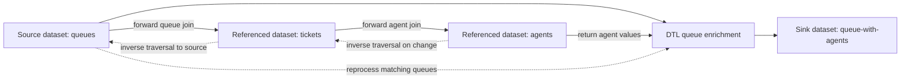

# DTL joins, dependency-safe enrichment, and child entities

A transformation change has two correctness questions: **does it produce the right output now, and will later changes reprocess or delete the right output?** A successful preview answers only the first. Join-key rewrites, nested rules, discarded parents, and direct child emission can all hide problems that appear only during incremental runs.

This guide describes the repository's **documented invariants**, not an inspected runtime implementation. For expression evaluation basics, see [DTL evaluation and operators](../concepts/dtl-evaluation-and-operators.md); for identity and special fields, see [Entities, datasets, and identifiers](../concepts/entities-datasets-and-identifiers.md).

## 1. Establish the transformation boundary

A pipe's optional `transform` is either one configuration object or a list forming a chain between source and sink. A DTL transform requires `rules.default`, which runs on each source entity; other named rules are invoked through `apply` or `apply-hops`. `_S` denotes the source of the current rule and `_T` its target. In an applied rule, `_P._S` refers to the parent's source, not the nested value now bound to `_S`.

Keep these responsibilities separate:

- **DTL:** join, project, filter, and construct target or child entities.
- **Dataset source:** the stored source entities against which inverse dependency traversal must work.
- **Dataset indexes:** lookup structures declared through joins, subsets, or explicit sink indexes.
- **Dataset sink:** persist output and perform the configured deletion and child-delta tracking.
- **Separate `emit_children` pipe:** expand persisted `$children` into standalone entities.

References: [transform chain](../../hub/documentation/service-configuration/pipes/configuration-transforms.rst#L6-L14), [DTL configuration](../../hub/documentation/service-configuration/pipes/configuration-transforms-dtl.rst#L23-L33), [variable contexts](../../hub/dtl/variables.rst#L9-L55), [dataset indexes](../../hub/documentation/building-blocks/datasets.rst#L17-L37).

## 2. Build a navigable, indexable join

### Join equality is overlap, not exact list equality

Within a recognized join, `eq` succeeds if **any values overlap**. With aliases `q` and `t`, all four shapes use that rule:

| Shape | Synthetic predicate | Matching example |
| --- | --- | --- |
| Scalar–scalar | `["eq", "q.key", "t.key"]` | `7` and `7` |
| Scalar–list | `["eq", "q.key", "t.keys"]` | `7` and `[7, 9]` |
| List–scalar | `["eq", "q.keys", "t.key"]` | `[5, 7]` and `7` |
| List–list | `["eq", "q.keys", "t.keys"]` | `[5, 7]` and `[7, 9]` |

Functional join arguments follow the same overlap rule. **Outside a join**, ordinary `eq` coerces arguments to lists and compares them exactly. `in` is different again: all values in its first argument must exist in the second, and a null or empty first argument returns false. Use `intersects` for an ordinary overlap predicate; do not substitute `in` for an indexable join edge.

`null` values and deleted entities are not indexed and are therefore not traversed by joins. Do not extend that protection to every kind of “blank”: the troubleshooting guide specifically identifies blank-property joins as a cause of excessive equality-set cardinality.

References: [join semantics and exclusions](../../hub/dtl/joins.rst#L25-L56), [ordinary `eq`](../../hub/dtl/dtl-functions-comparisons.rst#L16-L39), [`in`](../../hub/dtl/dtl-functions-lists.rst#L333-L383), [blank-key failures](../../hub/documentation/operations/troubleshooting.rst#L61-L95).

### Distinguish traversal edges from result predicates

An `eq` is considered a join function only when **each argument references exactly one unique dataset alias**. An expression may reference several properties of that one alias, but mixing aliases inside one argument violates this requirement. Alias-to-literal comparisons are filters, not edges connecting datasets.

A `hops` specification declares `datasets` as strings such as `"tickets t"`. Every declared alias must be joined and reachable from the source entity; otherwise compilation fails. A list in `where` is implicitly combined with `and`.

This synthetic enrichment starts with a queue entity such as `{"_id":"q7"}`. It finds agents through open tickets:

```json
["hops", {
  "datasets": ["tickets t", "agents a"],
  "where": [
    ["eq", "_S._id", "t.queue_id"],
    ["eq", "t.agent_id", "a._id"],
    ["eq", "t.state", "open"]
  ],
  "return": "a",
  "trace": "queue-agents"
}]
```

The first two predicates establish the traversal. The third is an ordinary equality filter; this example assumes `t.state` is a scalar string. Do not assume that adding a predicate also narrows the indexed equality set used to find candidates.

The documentation's compiler warning explains a particularly important case: when two or more join expressions connect the **same two aliases**, only the first is treated as a join; the others are ordinary equality comparisons. This is a documented warning, not a query-planner guarantee that every `eq` gets an index.

References: [alias requirement](../../hub/dtl/joins.rst#L52-L56), [`hops` input and reachability](../../hub/dtl/dtl-functions-hops.rst#L21-L31), [compile-time validation](../../hub/dtl/dtl-functions-hops.rst#L88-L108), [compiler warning and multiple predicates](../../hub/changelog.rst#L1764-L1791).

### Use composite tuples for a composite lookup

Instead of assuming separate predicates on email and region will both become traversal indexes, express the composite key in one join:

```json
["eq",
  ["tuples", "_S.email", "_S.region"],
  ["tuples", "a.email", "a.region"]
]
```

Each side still references only one alias. `tuples` constructs the **product** of its arguments' values, with tuple length equal to argument count and null values ignored. For scalar inputs `"sam@example.test"` and `"EU"`, the key list is `[["sam@example.test", "EU"]]`.

With multivalued inputs this is a Cartesian product, not a zip of corresponding list positions. Test that the combinations express the intended identity and that their number is bounded. Composite joins improve precision, but they do not make dirty, widely shared keys unique.

Secondary-index maintenance is automated. Joins and subset definitions implicitly declare indexes; a dataset sink's `indexes` array can explicitly declare index expressions. The dataset documentation warns that orphaned indexes currently require removal through the UI or API, so a join-expression change also merits an index cleanup review.

References: [`tuples`](../../hub/dtl/dtl-functions-misc.rst#L128-L165), [composite-join guidance](../../hub/dtl/joins.rst#L46-L50), [index lifecycle](../../hub/documentation/building-blocks/datasets.rst#L17-L37), [explicit sink indexes](../../hub/documentation/service-configuration/pipes/configuration-sinks-dataset.rst#L65-L75).

## 3. Preserve the inverse dependency path

Forward enrichment follows the source's relationships. Dependency tracking takes `hops` and `apply-hops` expressions and traverses them in reverse when a referenced entity changes, finding source entities to reprocess.


*Forward joins enrich queues with agents; inverse joins identify stored queue entities that must be reprocessed after referenced data changes.*

The diagram is grounded in [inverse-traversal caveats](../../hub/dtl/caveats.rst#L9-L17) and the [dependency-tracking feature](../../hub/features/dependency-tracking.rst#L8-L14). It illustrates reprocessing, not a promise that the current implementation rewrites the source log or adds `_tracked`: the entity model says that marker belongs to an older implementation.

### Changes that can break incremental enrichment

| Change | Documented constraint | Safe change approach |
| --- | --- | --- |
| Use a non-`dataset` source, including `merge` | Dependency tracking works only with the `dataset` source. | Materialize the source into a dataset, then enrich in a second dataset-source pipe. |
| Move a hopping DTL transform later in a chain | Join criteria must evaluate to the same values as on the pipe's stored source entity. Earlier transforms must not change properties involved in those criteria. | Keep join inputs invariant, or persist the normalized entity in an intermediate dataset and use that as the enrichment source. |
| Enable `add_namespaces` | Namespaces are added before the first transform. Inverse traversal matches stored source entities, not those rewritten transform inputs. | Verify equivalent key values in both directions; the caveat calls for effectively stripping namespaces again when necessary. Prefer a stored boundary for intentional normalization. |
| Rely on `_S.$ids` being synthesized | With namespaced identifiers enabled, absent `$ids` dynamically includes `_id` as an NI prefixed by the pipe's identity namespace. | Test entities both with and without explicit `$ids`; do not assume the dynamic value matches a stored inverse index key. |
| Disable `track-dependencies` in a HOP_SPEC | It defaults to `true`, but can be disabled for that specification. | Treat disabling it as an explicit freshness trade-off, not a cardinality fix. Define how output will be refreshed. |
| Replace hopping with `lookup-entity` | Lookup returns an entity by `_id`, or null if absent; its dataset must be populated. It does **not** support dependency tracking. | Use it only when automatic refresh on referenced changes is unnecessary, or plan a reset/reprocessing policy. |

References: [source and chain limitations](../../hub/dtl/caveats.rst#L9-L17), [namespace timing](../../hub/features/namespaces.rst#L79-L89), [tracking switch](../../hub/dtl/dtl-functions-hops.rst#L65-L78), [`lookup-entity`](../../hub/dtl/dtl-functions-hops.rst#L173-L200), [old `_tracked` marker](../../hub/documentation/data-management/entity-data-model.rst#L124-L134).

**Nested enrichment:** `apply` transforms supplied values using a named rule. `apply-hops` first evaluates hops, then passes the results through the named rule. If that rule contains `hops` or `apply-hops`, use `apply-hops`: calling `apply` on such a rule is not allowed, because dependency tracking needs the combined traversal structure. An `apply` over local sub-objects with no nested hops remains appropriate.

Reference: [`apply` and `apply-hops`](../../hub/dtl/dtl-functions-dictionaries.rst#L405-L469).

## 4. Control scope, ordering, and recursion

### Subset lookup

A subset exposes indexed values as a dataset-like slice. Within `hops`, `subsets` maps a declared alias to an `eq` expression whose left side is the index expression and whose right side selects the subset. It replaces the deprecated `prefilters` property. For the ticket example, add this member to restrict lookup to one site:

```json
"subsets": {
  "t": ["eq", "_S.site", "east"]
}
```

Here `_S.site` is the subset index expression over ticket entities, not a new queue-to-ticket join edge. Keep the navigable joins in `where`.

A dataset **source** uses the singular `subset` property. Its right-hand value must be a literal, not an expression; subset `eq` uses overlap semantics. The source documentation requires indexes version 2 for subset deletion support because version 1 does not support deletes. Functional subset indexes support almost all expression functions, but exclude non-deterministic functions and functions referencing other datasets.

References: [`hops.subsets`](../../hub/dtl/dtl-functions-hops.rst#L80-L86), [dataset source subsets](../../hub/documentation/service-configuration/pipes/configuration-sources-dataset.rst#L41-L49), [functional subset indexes](../../hub/documentation/building-blocks/datasets.rst#L28-L37).

### Projection is not business ordering

`hops` forms a table with one column per alias, then projects it to a list through `return`. With no `return`, it returns the last declared alias. A string can select comma-separated aliases; an expression can project a template. `return` may appear only on the last HOP_SPEC and cannot be used with `recurse`.

The hops reference guarantees deterministic order based on entity `_id` values when the same entities are processed again. It does **not** guarantee ordering by a returned name, priority, or date. Apply `sorted` or `sorted-descending` explicitly for that order. `sorted` can use a per-value key expression and does not remove duplicates.

For example, use `["sorted", "_.priority", <hops-result>]` conceptually when priority is the selection key. If ties matter, define and test a further deterministic selection policy. `first` merely takes the first value, returning null for empty input: it neither proves uniqueness nor repairs an ambiguous join. The troubleshooting guide flags using `first` to obtain a “unique” hops result; the more precise hops reference documents repeatability for identical inputs, not business uniqueness.

References: [projection and ordering](../../hub/dtl/dtl-functions-hops.rst#L53-L63), [determinism](../../hub/dtl/dtl-functions-hops.rst#L99-L108), [sorting](../../hub/dtl/dtl-functions-lists.rst#L845-L945), [`first`](../../hub/dtl/dtl-functions-lists.rst#L176-L204), [selection warning](../../hub/documentation/operations/troubleshooting.rst#L76-L84).

### Recursive hierarchy traversal

For category entities with `_id` and `parent_id`, this synthetic expression retrieves ancestors with a bounded traversal:

```json
["hops", {
  "datasets": ["categories c"],
  "where": ["eq", "_S.parent_id", "c._id"],
  "recurse": true,
  "exclude_root": true,
  "max_depth": 4
}]
```

`recurse` defaults to false. When enabled, output feeds the next evaluation until output is exhausted or `max_depth` stops it. The default depth is `10`; `null` requests traversal until exhaustion. `exclude_root` defaults to false and controls inclusion of the original recursion input. Both depth and root exclusion are meaningful only for recursive specifications. Multiple HOP_SPEC arguments pass each output to the next specification, useful for a recursive phase followed by another lookup.

Set an explicit finite depth appropriate to the model. The hierarchy pattern recommends it as protection against never-ending recursion; do not infer undocumented cycle-detection guarantees. Test root inclusion, a chain longer than the bound, branching, and cyclic input. Sort the final result if the consumer needs a particular order.

References: [recursion options](../../hub/dtl/dtl-functions-hops.rst#L33-L63), [chaining](../../hub/dtl/dtl-functions-hops.rst#L88-L91), [hierarchy safety](../../hub/documentation/data-management/recursion-hierarchy-pattern.rst#L1-L7).

## 5. Choose filtering and one-to-many output by deletion behavior

The names below are not interchangeable. In particular, the **list expression** `filter` returns selected values, whereas the **transform operator** `filter` controls target emission and dataset deletion signaling.

| Mechanism | Output behavior | Deletion and orphan risk |
| --- | --- | --- |
| List `filter` | Returns values whose predicate is true, with `_` bound to each value. | Removing a value from a local list is not itself a sink deletion instruction. |
| Transform `filter` | On false or omitted condition, stops further transformations. For a dataset sink it emits the target with `_filtered: true`. | The dataset sink deletes an existing, not-already-deleted entity with that ID, including during incremental sync. Handle `_filtered` carefully in later transforms. Other sinks discard the filtered entity. |
| `discard` | On false or omitted condition, stops transformations and drops the target without emitting it. | Does not delete a previously emitted entity in the sink. Use only when that ID has never been sent, or when you intentionally accept that behavior. |
| `create` | Emits additional entities directly to the DTL output stream. | No parent-child delta mechanism is established by direct emission. The troubleshooting guide warns of orphaned children when `create` is used without rescans. |
| `create-child` | Adds entities to the target's `$children`, rather than emitting standalone output. | Intended for dataset sinks, where previous and current child values can be compared to detect removals. |
| Sink `track_children` | Compares `$children` with the previous parent version and updates it with a delta before persistence. | Enables removed-child detection during incremental sync. Inferred true if any transform uses `create-child`, but explicitly setting false overrides it. |
| Separate `emit_children` transform | Emits `$children` entities having `_id`; does not emit the parent. | Must run in a separate pipe. In a chain that removes the parent before storage, deletion tracking of emitted children cannot work as documented. |

References: [list filtering](../../hub/dtl/dtl-functions-lists.rst#L149-L174), [`filter` and `discard`](../../hub/dtl/dtl-functions-transforms.rst#L514-L607), [non-dataset filtered output](../../hub/documentation/data-management/entity-data-model.rst#L113-L121), [`create` and `create-child`](../../hub/dtl/dtl-functions-transforms.rst#L365-L417), [`track_children`](../../hub/documentation/service-configuration/pipes/configuration-sinks-dataset.rst#L78-L93), [`emit_children` boundary](../../hub/documentation/service-configuration/pipes/configuration-transforms-emit-children.rst#L7-L17), [orphan warning](../../hub/documentation/operations/troubleshooting.rst#L82-L95).

### Filter before direct emission when rejection must cancel everything

```json
"default": [
  ["copy", "_id"],
  ["filter", ["eq", "_S.active", true]],
  ["add", "label", "_S.label"]
]
```

This synthetic rule assumes an unchanged source/target ID and a dataset sink. An entity that later becomes inactive can be removed from the sink instead of silently left behind. Neither `filter` nor `discard` cancels entities **already emitted by `create`**: put the gate before direct creation if rejection must prevent those outputs.

For deliberate control of deletion, the transform reference recommends setting `_deleted` instead of using `filter`. The documented pattern for stopping further work on deleted input, `["filter", ["neq", "_S._deleted", true]]`, is limited to dataset sinks where `_id` is not rewritten.

A full-run cleanup is a separate mechanism: dataset sink `deletion_tracking` defaults to true and deletes entities that existed before the full run but were not seen during it. It does not make `discard` an incremental deletion signal. Likewise, `suppress_filtered` is an optimization, not a replacement deletion design: it should be used only when output contains exactly one version per `_id`.

References: [operator ordering and deletion](../../hub/dtl/dtl-functions-transforms.rst#L529-L607), [deleted-input guard](../../hub/documentation/service-configuration/pipes/configuration-transforms.rst#L62-L64), [full-run deletion](../../hub/documentation/service-configuration/pipes/configuration-sinks-dataset.rst#L140-L154), [filtered-output suppression](../../hub/documentation/service-configuration/pipes/configuration-sinks-dataset.rst#L170-L174).

### Persist the parent before emitting tracked children

The following two synthetic pipe configurations assume string parent and line IDs and explicitly disable namespaced identifiers to keep the example's IDs simple. The parent uses an empty current child list on deleted input rather than rebuilding live children.

```json
{
  "_id": "orders-with-lines",
  "type": "pipe",
  "namespaced_identifiers": false,
  "source": {"type": "dataset", "dataset": "orders"},
  "transform": {
    "type": "dtl",
    "rules": {
      "default": [
        ["copy", ["_id", "_deleted"]],
        ["add", "$children", ["list"]],
        ["if", ["neq", "_S._deleted", true],
          ["create-child", ["apply", "line", "_S.lines"]]]
      ],
      "line": [
        ["add", "_id", ["concat", "_P._S._id", "/", "_S.line_id"]],
        ["add", "order_id", "_P._S._id"],
        ["add", "quantity", "_S.quantity"]
      ]
    }
  },
  "sink": {"type": "dataset", "track_children": true}
}
```

```json
{
  "_id": "order-lines",
  "type": "pipe",
  "namespaced_identifiers": false,
  "source": {"type": "dataset", "dataset": "orders-with-lines"},
  "transform": {"type": "emit_children"},
  "sink": {"type": "dataset"}
}
```

For parent `o7` and local line `l2`, the child ID is `o7/l2`. Include the parent identity in a child ID when local sub-object IDs can repeat under different parents; the splitting pattern explicitly recommends this. Use an unambiguous encoding if real identifiers can contain the chosen delimiter. Test that two parents cannot unintentionally produce the same child ID.

On a later removal, the tracked parent sink compares the previous and current `$children` and includes deleted-child information before the separate emitter consumes it. Check the **persisted parent**, not just the DTL preview, because the sink updates `$children` immediately before writing.

`id_required` defaults to true: the DTL transform fails for missing or non-string target `_id`, and for invalid `create`/`create-child` values such as non-dicts or missing/non-string IDs. With false, invalid values are ignored instead. Do not disable this merely to hide malformed output.

References: [child delta contract](../../hub/dtl/dtl-functions-transforms.rst#L395-L417), [sink-side delta update](../../hub/documentation/service-configuration/pipes/configuration-sinks-dataset.rst#L78-L93), [child identity pattern](../../hub/documentation/data-management/splitting-out-lists-of-sub-objects-pattern.rst#L1-L3), [ID validation](../../hub/documentation/service-configuration/pipes/configuration-transforms-dtl.rst#L29-L33).

## 6. Diagnose cardinality before raising limits

A small final projection can hide a large candidate equality set. Blank or widely shared keys, independent predicates mistaken for composite indexes, and multivalued joins deserve inspection in **both** directions.

1. Give each expensive hops expression a unique `trace` string, on its **last HOP_SPEC only**. The documented trace records maximum cardinality of join statements and is available in pipe execution log `pump-completed` and `pump-failed` entities.
2. Inspect `system:pump_execution:<pump_id>`. Its metrics include `hops.max-cardinality`, `hops.max-cardinality-last-run`, and `hops.total-rows-last-run`; rows can contain one entity per bound alias. This diagnostic dataset is not a stable public application API.
3. Inspect actual key values, including empty strings, missing/null values, list widths, tuple products, and whether each predicate became a traversal edge or only a comparison. Improve source quality and key precision rather than masking the problem with `first`.
4. Check pipe `dependency_tracking` warning/error thresholds for entity counts and total bytes. Warnings go to the log; exceeding error thresholds fails the pump. Defaults are inherited from service metadata. Raising error thresholds too far risks excessive memory use.
5. Enable `dependency_tracking.enable_hops_thresholds` in development so the same thresholds also apply to ordinary hops, not only inverse dependency processing. Add rescans where residual dependency-limit failures remain possible, as the troubleshooting guide recommends; a rescan does not repair an invalid inverse join.

If hopping to the pipe's own sink dataset is unavoidable, the hops reference requires `batch_size: 1` for visibility of entities being written: unflushed batch entities are invisible. It also requires sink `set_initial_offset: "onload"` to avoid waiting for its own sink to become populated. Treat this as a special-case dependency and visibility hazard, not the normal enrichment pattern.

References: [trace contract](../../hub/dtl/dtl-functions-hops.rst#L70-L78), [execution dataset boundary](../../hub/documentation/operations/pump-execution.rst#L1-L13), [hops metrics](../../hub/documentation/operations/pump-execution.rst#L711-L721), [threshold controls](../../hub/documentation/service-configuration/pipes/configuration-pipes.rst#L206-L233), [troubleshooting remedies](../../hub/documentation/operations/troubleshooting.rst#L89-L105), [self-sink hops warning](../../hub/dtl/dtl-functions-hops.rst#L110-L114).

## 7. Verify configuration output and incremental transitions

Use configuration-output tests, not just expression examples. The documented local workflow runs pipes until queues are empty while output pipes are disabled or unable to contact external systems, then compares endpoint output with expected results. Each endpoint test has `expected/<pipe>.json` and `expected/<pipe>.test.json`; `pipe`, `file`, and `stage` select the comparison target. Available stages are `source`, `before-transform`, `after-transform`, and `sink`, with `sink` the default.

A minimal synthetic test descriptor is:

```json
{
  "pipe": "queue-with-agents",
  "file": "queue-with-agents.json",
  "stage": "sink"
}
```

Run `sesam -vv test` against your test node. For incremental checks, establish the initial output, mutate only the relevant source or referenced dataset, and run the affected flow again **without resetting it between transitions**. A full reset can conceal a broken inverse path or missing removal signal. These are recommended test scenarios, not claims that this repository contains executable runtime tests for them.

| Change pattern | Focused fixture and transition | Configuration-output checks | Contract to recheck |
| --- | --- | --- | --- |
| Scalar/list or composite join | Overlap and non-overlap; null, blank, deleted entity; second key differs; multivalued tuple inputs. | Exact sink values and expected result count, not merely a selected `first`; inspect trace cardinality separately. | [Joins](../../hub/dtl/joins.rst), [tuple construction](../../hub/dtl/dtl-functions-misc.rst#L128-L165). |
| Chain, namespace, or source change | Keep the source queue unchanged; change a referenced agent. Repeat with rewritten join inputs and explicit versus synthesized `$ids`. | Compare stored source and `before-transform` keys; verify the queue's sink enrichment updates incrementally. | [Inverse traversal caveats](../../hub/dtl/caveats.rst). |
| Nested enrichment | Change a dataset used inside the named rule, leaving the outer source unchanged. | Check the nested output refreshes; reject an `apply` rule containing hops. | [`apply-hops`](../../hub/dtl/dtl-functions-dictionaries.rst#L430-L469). |
| Subset lookup | Move an entity into and out of the indexed site/category; delete one in the subset. | Only intended members are read; downstream removals work; confirm version-2 subset indexes where required. | [Source subsets](../../hub/documentation/service-configuration/pipes/configuration-sources-dataset.rst#L41-L49). |
| Ordering or recursion | Multiple matches, equal sort keys, empty result, root, deep chain, branch, cycle. | Check explicit business order, empty selection behavior, root inclusion, and depth-bound membership. | [Hops options](../../hub/dtl/dtl-functions-hops.rst#L33-L108), [list operators](../../hub/dtl/dtl-functions-lists.rst). |
| Filter/discard or direct create | Emit once, then make the predicate false; test creation before versus after the gate; remove a directly created child. | Existing target deletion for `filter`; persistence risk for `discard`; already-created output survives later rejection. Check full/rescan cleanup separately. | [Transform deletion semantics](../../hub/dtl/dtl-functions-transforms.rst#L514-L607), [orphan risk](../../hub/documentation/operations/troubleshooting.rst#L82-L95). |
| Tracked child split or identity change | Parent with two children, remove one, remove all, delete parent, and use two parents with the same local child key. | Check parent `after-transform` current children, persisted-parent sink deltas, and emitted-child sink tombstones and IDs. Check ID validation failure cases. | [`track_children`](../../hub/documentation/service-configuration/pipes/configuration-sinks-dataset.rst#L78-L93), [separate emitter](../../hub/documentation/service-configuration/pipes/configuration-transforms-emit-children.rst#L7-L12), [`id_required`](../../hub/documentation/service-configuration/pipes/configuration-transforms-dtl.rst#L29-L33). |

The local-test documentation says internal properties other than `_id` and `_deleted` are removed from comparison output. Inspect raw stage/entity output when checking `_filtered` or other internal diagnostics; a normalized expected-output comparison is not enough for every lifecycle assertion. Do not blanket-ignore identity, child membership, ordering, or deletion differences when updating expected files.

CI requires a designated test node, serialized runs because the client overwrites configuration, and isolation from external writes. See [Configuration change lifecycle](../testing/configuration-change-lifecycle.md) for broader rollout practices, [Synchronization and state](../configuration/synchronization-and-state.md) for offsets and rescans, [Monitoring and troubleshooting](../operations/monitoring-and-troubleshooting.md) for operational follow-up, and [Master data management](master-data-management.md) for enrichment in global models.

References: [local test lifecycle and descriptors](../../hub/documentation/operations/testing-locally.rst#L7-L91), [internal comparison properties](../../hub/documentation/operations/testing-locally.rst#L141-L150), [test command and result comparison](../../hub/documentation/operations/testing-locally.rst#L178-L186), [CI safety and serialization](../../hub/documentation/operations/continuous-integration.rst#L7-L24).
