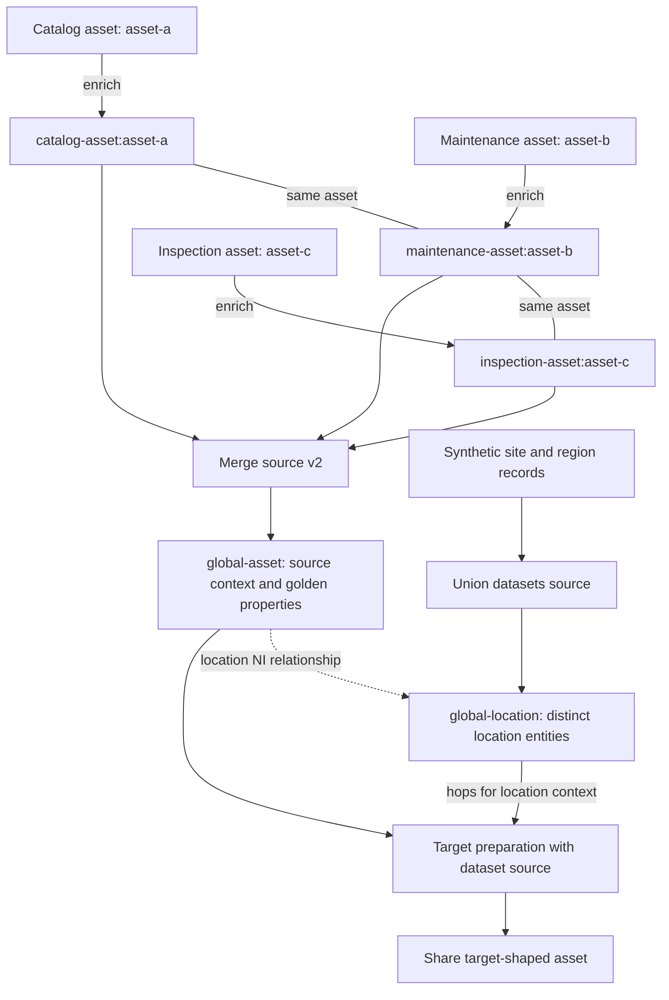

# Global models, merging, golden properties, and lineage

A **global dataset** groups data about a business concept across sources. A **golden property** is a value chosen or composed for that concept under an explicit business policy. A **schema model** groups entity types and documents their properties. These are related, but none automatically supplies the others: marking a pipe global does not decide which records are the same, select the most trustworthy values, or enforce a target schema.

The practical objective is to preserve source facts and identities while adding reusable domain meaning. Bind that domain view to a particular target's shape and identifiers late in the flow, rather than making every inbound connector serve one target.

This page uses the repository's configuration references for runtime contracts and its documented patterns for modeling guidance. Recommendations such as keeping imports raw, routing data through globals, and putting most target logic in preparation pipes are **business-pattern guidance**, not universal runtime restrictions.

## Responsibilities and the recommended flow

| Stage | Responsibility | What to preserve or add |
| --- | --- | --- |
| Collect | Import source data faithfully and comprehensively. | Original structure and values, independent of current consumers. |
| Enrich | Add semantic information needed to connect and navigate data. | Source namespaces, typed NI references, `rdf:type` or `$type`, and optionally property metadata. |
| Connect | Group data by concept, and merge only records that represent the same thing. | Source properties and identities alongside reusable global properties. |
| Transform / prepare | Map globals to a target schema and enrich the target view through domain relationships. | Target-system identifiers and any original target object needed for sharing. |
| Share | Deliver the prepared data to the target. | Keep business transformations upstream so their result can be inspected and reused. |

The documented workflow recommends that imported data appear in at least one global dataset. It does **not** prescribe a fixed number of globals or require every record within a global to be merged. Global membership is a semantic decision requiring knowledge of the business and source cardinalities. For example, sites and regions can share a location global without being declared the same entity. Collapsing a many-to-one relationship into a single sink identity can overwrite information; aggregation and sameness are different decisions.

Use `metadata.global: true` to mark a global pipe in the management graph. A pipe with an omitted sink writes to a dataset whose id is the pipe's `_id`; the global marker is not a special merge source or a replacement for source/transform configuration. See [Hub model and boundaries](../architecture/hub-model-and-boundaries.md) and [Build an integration](build-an-integration.md) for the surrounding integration structure.

## Preserve source context before connecting identities

Namespaces distinguish properties that happen to have the same name. Keeping `catalog-asset:label` and `maintenance-asset:label` avoids silently treating them as interchangeable. A selected `global-asset:label` can then coexist with both source values.

The relevant pipe controls are:

- `namespaced_identifiers` enables source/sink namespace defaults; its default is `false` when not set in service metadata.
- `namespaces.identity` and `namespaces.property` choose the identifier and property namespaces; each defaults to the pipe id. Enrich pipes can explicitly use the source datatype's namespace rather than their `-enrich` pipe name.
- `add_namespaces: true` adds namespaces **before the first transform**. This is normally an inbound/enrich concern.
- `remove_namespaces: true` removes namespaces from `_id`, properties, and NI values **after the last transform**. This is normally an outbound concern; external sink defaults depend on `namespaced_identifiers` being enabled.

Some DTL functions are namespace-aware. Unqualified property references generally match across namespaces, so use qualified names when source-specific selection matters. Namespace prefixes on property names and **namespaced identifier values** are also distinct: `"catalog-asset:asset-a"` is an identity string, while `"~:catalog-asset:asset-a"` is the JSON encoding of a typed NI. `ni` constructs NI values; `make-ni` supports adding reference properties.

Semantic enrichment commonly adds:

- **Type information** (`rdf:type` or `$type`) to select relevant subsets later.
- **NI references** for relationships and matching against identities, rather than relying on ambiguous bare strings.
- **Separate reference/classification entities** where a source provides only a code. The enrichment pattern recommends local, source-controlled namespaces and extracting objects that can later be connected to the equivalent concept from other sources.
- **Independent child objects** where a list item has its own domain meaning. The splitting pattern uses `create-child` and `emit_children`, with the parent id included in the child id.

These are modeling choices, not automatic consequences of enabling namespaces. See [Entities, datasets, and identifiers](../concepts/entities-datasets-and-identifiers.md) and the [enrich patterns](../../hub/documentation/data-management/enrich-patterns.rst).

## Choose union or merge deliberately

| Source | Observable behavior | Appropriate use |
| --- | --- | --- |
| `union_datasets` | Reads datasets in configured order, exhausting each before moving to the next; its `since` handling tracks each dataset. By default, prefixes each `_id` with the dataset id and `:` to avoid collisions. | Put related types or independent records in one domain dataset without resolving sameness. `prefix_ids: false` disables that protection. |
| `merge` | Uses equality rules to resolve sameness transitively, then combines each connected group into an output entity. | Connect different source identities for the same domain object. |
| `merge_datasets` | Leaves ids unchanged and reads across datasets ordered by `_ts`. Its default `latest` strategy selects the newest entity version for an identity; `all` keeps the latest per-dataset entities keyed by dataset id. | Combine versions of already-shared identities. This is not equality-based identity resolution or property-level time-based MDM. |

For `union_datasets`, `include_previous_versions` defaults to `false`: the source returns only the latest version per unique input `_id`. Do not use a union as if it had deduplicated domain objects, or use `merge_datasets`' ingestion timestamps as if they described when each business property changed.

### Sameness is transitive, not a lookup relationship

`merge` applies the same matching rules as DTL joins: if **any values overlap**, the match succeeds. A scalar can match an element of a list, and two lists can match through an overlapping value. Equality expressions returning `null` or empty lists do not cause merging. Filter unsuitable matching values before they enter the equality expressions.

`equality` specifies individual `eq` rules. The preferred `equality_sets` groups related value expressions and expands into equality rules. It is syntactic sugar, not a separate matching engine. Both properties can coexist, but that makes the rules harder to reason about. Overlapping equality sets do not produce a configuration warning and can effectively connect one larger set.

Consequently, if A matches B and B matches C, all three become one merged entity, even without a direct A-to-C match. A shared placeholder or a wrongly modeled relationship can therefore join a much larger group than intended. If matching needs several fields together, the join reference recommends composite keys using `tuples` rather than separate broad matches.

### Synthetic asset relationship example

The following diagram uses invented asset and location tokens, not source sample records. Assume enrichment has produced three records: maintenance references the catalog asset, and inspection references the maintenance asset. Those are sameness links. The asset's location reference is a relationship to another concept, **not** another equality rule.


*Two sameness links form one asset group; a separate location relationship enriches its target view without merging locations into the asset.*

A representative global pipe for the asset side is:

```json
{
  "_id": "global-asset",
  "type": "pipe",
  "namespaced_identifiers": true,
  "add_namespaces": false,
  "remove_namespaces": false,
  "namespaces": {
    "identity": "global-asset",
    "property": "global-asset"
  },
  "source": {
    "type": "merge",
    "version": 2,
    "datasets": [
      "catalog-asset-enrich a",
      "maintenance-asset-enrich b",
      "inspection-asset-enrich c"
    ],
    "equality_sets": [
      ["a.$ids", "b.catalog-asset-ni"],
      ["b.$ids", "c.maintenance-asset-ni"]
    ],
    "identity": "first",
    "strategy": "compact"
  },
  "transform": {
    "type": "dtl",
    "rules": {
      "default": [
        ["copy", "*"],
        ["add", "label",
          ["coalesce",
            ["list", "_S.catalog-asset:label", "_S.maintenance-asset:label"]
          ]
        ]
      ]
    }
  },
  "metadata": {
    "global": true,
    "models": ["asset-domain"]
  }
}
```

This assumes input ids `catalog-asset:asset-a`, `maintenance-asset:asset-b`, and `inspection-asset:asset-c`; the two foreign-reference NI values are `~:catalog-asset:asset-a` and `~:maintenance-asset:asset-b`. Dataset aliases use unqualified property expressions as in the documented merge patterns. The transform keeps source properties and adds `global-asset:label` with catalog-first priority. `compact` affects value representation, **not** source trust.

## Identity and property combination are separate policies

### Output identity and identity history

Merge identity ordering is by the dataset's position in `datasets`, then by the input entity's `_id`:

- `identity: "composite"` is the default. It combines dataset offsets and all participating ids into a deterministic id.
- `identity: "first"` uses the first input id under that same ordering. It is not “the first record to arrive,” nor a permanent canonical id independent of dataset order or group membership.
- `$ids` carries the participating original identities. When an input already has `$ids`, its merge-entity `_id` is not added as another original identity; downstream merges combine its existing identity list instead. This preserves original identities through multiple merge layers.
- If later merging makes an old output id inapplicable, the source emits a delete for that id and sets `$replaced: true`. A source entity that is deleted is not merged; it is output as a standalone entity with `_deleted: true`.

`_S.$ids` is also dynamic: when namespaced identifiers are enabled and the source has no explicit `$ids`, it wraps `_S._id` as an NI using the identity-namespace rules. That convenience matters for joins, but it can also interfere with inverse dependency tracking if the join no longer matches the stored source entity.

**Version caveat:** merge version 2 with `identity: "first"` supports overlapping entity ids across input datasets only if equality on `_id` or `$ids` covers **all** datasets with those overlaps. Namespacing is valuable collision protection, but it does not waive this requirement.

See the [merge source contract](../../hub/documentation/service-configuration/pipes/configuration-sources-merge.rst) and [entity data model](../../hub/documentation/data-management/entity-data-model.rst).

### Combining values

Merge's `strategy` determines the output structure:

| Strategy | Result |
| --- | --- |
| `default` | Unions all property values; duplicates are not removed. |
| `compact` | Removes duplicate values, drops empty-list properties, and turns singleton lists into scalar values. |
| `list` | Places the contributing entities in `$merged`, enabling a custom combination transform. Internal fields such as `_ts` are excluded unless `include_internal_properties: true`. |

None of these selects a business master value automatically. In particular, compact output can change scalar/list shape without improving the semantic quality of the selected data.

## Select golden properties explicitly

A global is useful even before it has golden properties: it is a reusable domain grouping with source context. Golden properties add the business policy for a shared consumer-facing value. The documented golden-record approach adds these properties alongside source-specific ones rather than discarding competing source facts.

| Policy | Documented mechanism | Business decisions still needed |
| --- | --- | --- |
| Priority | Use `coalesce` with candidates in trust order. It returns the first non-null value, or the first value satisfying its optional predicate. | Define priority per property and distinguish missing values from valid empty values or intentional clears. |
| Quality | Normalize quality scores across candidate sources and choose the value with the most relevant score. | Define comparable scores, eligibility, and tie-breaking. This is a pattern to implement, not a built-in merge ranking algorithm. |
| Last updated | Preserve reliable source timestamps and choose the newest candidate property. | Define timestamp reliability, history, ties, and behavior when data returns through a feedback loop. |

Source priority for a property is not the same thing as the dataset ordering used for `identity: "first"`. A domain record can use one source's identity and another source's preferred label.

### Time-based MDM and property claims

The [time-based MDM guidance](../../hub/documentation/data-management/time-based-masterdata-management.rst) describes per-property **claims**: value-plus-metadata dictionaries created in enrich pipes and kept in addition to raw source data. Here “claim” means a data representation, not a schema-validation result or an automatically enforced runtime assertion.

A property claim can carry its value, `$last-modified`, and `end-time`, which records when a newer claim replaced it. The recommended timestamp preference is:

1. Use the source's property-level last-modified time when available.
2. Otherwise, use an entity-level source timestamp initially and maintain the property's timestamp when its value changes.
3. If the source supplies neither, initialize from the collect dataset's `_ts` and maintain timestamps as values change.

`_ts` is a dataset-registration timestamp, not a source-business-change timestamp. Its use in the third case is an approximation in the business pattern, not proof of the real change time. The selection recipe filters current claims with no `end-time`, sorts by `$last-modified`, and selects the newest value. The fuller history example also checks that incoming data is not older than retained history.

The [last-updated golden-property pattern](../../hub/documentation/data-management/golden-property-last-updated-pattern.rst) offers another approach using a per-property `$updated` dictionary. It stresses reliable propagated timestamps and feedback-loop awareness. Do not confuse such dictionaries, `$last-modified`, or suggested `$last_updated` fields with the source's opaque incremental `_updated` token.

**Stateful enrichment caveat:** the last-updated example looks up previous output in its own sink. For sink-targeting `hops`, the DTL contract requires `batch_size: 1` for visibility of prior writes and `sink.set_initial_offset: "onload"` to avoid waiting on the sink's initial population. The example disables dependency tracking for that self-lookup. These are specific self-history concerns, not general settings to copy to every global.

Before sharing time-selected values back into contributing systems, design how returned writes retain origin and timestamps. See [Bidirectional synchronization](bidirectional-synchronization.md); re-imported writes must not accidentally become a fresh business edit merely because they arrived later.

## Evolve target models through late schema binding

The [late schema binding pattern](../../hub/documentation/data-management/late-schema-binding-pattern.rst) recommends mapping with **global properties or the target system's own namespace**, and performing hops on global properties. Referencing unrelated source namespaces in target transforms recreates source-to-source coupling. Use identifiers understood by the target rather than treating the global merge id as the target primary key.

Bidirectional sharing may require the original target object when patching is unavailable. Keep that context rather than assuming the golden subset is always a complete replacement payload. When namespace removal changes how an id will be rendered, explicitly map or rewrite `_id` for the target; do not assume a composite or namespaced global id survives unchanged.

If rewriting `_id` is necessary, the identity pattern recommends preserving `$original_id` for tracing and doing the rewrite **before filtering**. Filters before a rewrite act on the old identity, potentially leaving the new sink identity undeleted. Avoid deriving stable ids from mutable properties, especially values fetched through joins: a change can create a new entity rather than update the old one.

For reusable connectors, the documented extension principle favors adding datatypes and properties over removing existing parts of the model. This is compatibility guidance, not an automatic migration guarantee. See [DTL joins and transformation patterns](dtl-joins-and-transformation-patterns.md) for mapping mechanisms.

## Inference, models, search, and lineage serve different purposes

| Capability | What it tells you | What it does not establish |
| --- | --- | --- |
| Schema inference | Observed structure of source and sink entities as data changes. | A mandatory schema contract or complete proof of all future data shapes. |
| Schema models | Grouped entity types and descriptions of their properties. | Automatic golden-value selection or validation of pipe traffic. |
| Integrated Search | Free-text search and navigation of indexed globals. | Identity matching or permission to read otherwise inaccessible data. |
| Property lineage | A best-effort graph connecting upstream/downstream namespaced properties and pipes. | An exhaustive provenance audit of each value or a runtime reprocessing guarantee. |
| Dependency tracking | Runtime invalidation/reprocessing of affected source entities after changes in joined datasets. | The same thing as the property-lineage graph. |

### Schema inference and explicit models

Sesam data is dynamically typed: properties and types can change over time, and schema validation is optional. Automatic schema inference generates source and sink entity types. `infer_pipe_entity_types: false` disables it for a pipe; although generally enabled by default, the pipe reference specifies a default of `false` for **developer subscriptions**.

A schema model groups JSON-schema entity types and can add property descriptions aggregated to property landing pages. Inferred sink types are mapped to implicit models, visible in **Browse → Models** and filterable in **Browse → Entity types**:

- `Global`: sink types of global pipes.
- `Input`: sink types of inbound pipes.
- `Output`: sink types of outbound pipes.
- A model for each unique pipe-id prefix before the first `-`.

`metadata.models` customizes a pipe's implicit model membership. Explicit models can be uploaded through `/api/models` to provide curated grouping and documentation.

**Experimental API caveat:** the repository's public API specification labels the model endpoints **EXPERIMENTAL**. It documents list/add operations at `/api/models`, model retrieval/deletion at `/api/models/{model_id}`, and entity-type retrieval at `/api/models/{model_id}/{entity_type_id}`. Retrieval supports `effective: true` to merge implicit and explicit models in the response. Check the instance's `/api/reference` before building automation around these APIs; the general schema-model feature description does not remove that API caveat.

If target-shape validation is needed, configure it separately. The `json_schema` transform annotates validity using `key_valid` (default `valid`) and validation messages using `key_errors` (default `errors`). It does not by itself discard invalid entities; add the desired filtering/error-handling policy. Its optional `trigger_on` selector is also documented as experimental and can bypass validation for nonmatching entities.

### Search and best-effort property lineage

Integrated Search indexes globals for free-text browsing and relationship navigation. The feature reference warns of a **2× increase in data size needed for global pipes**. Results are limited to data the user has permission to read.

Search and property lineage require **clustered architecture**. The payment method owner enables **Integrated search and property lineage** in the subscription's **Products** tab at [portal.sesam.io](https://portal.sesam.io). The feature documentation directs non-clustered subscriptions to support for migration; do not assume availability from the subscription name alone.

Property lineage combines **static pipe-configuration analysis** with **schema-inference observations** to build a best-effort dependency graph. Namespaced properties have landing pages showing upstream dependencies and downstream dependents. Navigate to them by:

- `Ctrl/Cmd+Click` on a namespaced property in the Integrated Search entity view.
- `Ctrl/Cmd+Click` on a namespaced property in a pipe's Input/Output view.
- Selecting a property from the pipe's Inferred Schema tab or the pipe entity-type view under Browse.

Namespaces, inference, and curated descriptions make this graph easier to understand. They do not turn it into value-by-value historical provenance.

### Runtime dependency tracking is a separate boundary

Dependency tracking follows DTL joins backward to find source entities affected by changes in referenced datasets and reprocesses them. It is supported only for pipes using a **`dataset` source**. A transform on a `merge` source does **not** get dependency tracking for its `hops` or `apply-hops`; split the flow into a merge pipe and a downstream dataset-source pipe when joined-data changes must trigger reprocessing. This is why the diagram puts location enrichment in target preparation.

Even with a dataset source, inverse traversal must match the stored source values. Changing join properties in an earlier transform, adding namespaces to those values, or relying on dynamically synthesized `$ids` can break that correspondence. `track-dependencies: false` disables tracking for a particular hops specification. A visible lineage edge is not evidence that any of these runtime requirements are satisfied.

## Operate merge changes as state changes

New pipes should explicitly set `version: 2`. The documented default is still `1` for compatibility, and version 1 is deprecated. Existing examples that omit `version` must not be treated as version-2 configurations.

| Change or condition | Documented consequence / safe plan |
| --- | --- |
| Add equality after inputs have already been processed | Existing processed entities do not merge retroactively under the added rule. Reset/rescan if they must be reconsidered. |
| Reorder datasets in version 1 | Requires resetting the pipe and may require deleting the downstream dataset. |
| Reorder datasets with an order-based identity policy | Both identity strategies depend on dataset positions. Review downstream identity changes; absence of the version-1 reset warning is not a promise that version-2 ids stay unchanged. |
| Remove input datasets in version 1 or 2 | Requires a full run to clear removed inputs from merge state. Background incremental processing can still use state containing datasets marked for removal. |
| Add inputs, alter transforms, or recreate/truncate datasets | Review out-of-sync and reprocessing requirements. `reprocessing_policy` defaults to `continue`, not automatic reset; config-triggered reprocessing additionally involves `rescan_when_config_changes`. |
| Background rescan during merge-source reconfiguration | Incremental runs may use the old merge-source version and temporarily emit erroneous entities. Rescan completion catches up and deletion tracking removes those outputs. |

An incremental run processes input after stored `last_seen`. Reset/full runs process all source entities and perform deletion tracking at completion. Background rescans also reprocess all inputs, but support concurrent incremental progress and require a dataset sink. They are disabled by default. Their output order and version coverage can differ from a normal reset run; completion, not merely starting the rescan, is the relevant consistency checkpoint.

Additional operational controls:

- `max_merged` limits the number of entities in one merge group in version 2 (unsupported in version 1). Exceeding it fails the pipe. The documented default is `50000`, inherited from service metadata unless overridden; the reference recommends lowering it to limit excessive RAM use.
- For merge and union, `require_populated_input: true` gates execution until required inputs are populated; the default is `false`. `initial_datasets` can restrict the population prerequisite. `ignore_non_existent_datasets` defaults to `true`, so missing entries in that prerequisite list do not block population unless configured otherwise.
- `if_source_empty: "accept"` is the documented merge/union default and allows previously synchronized entities to be deleted when the source is empty. `"fail"` fails the pipe instead and preserves those prior entities.
- `supports_signalling` schedules a run when input datasets change; it does not interrupt an active run or retroactively rebuild merge state. Defaults and schedule interactions also depend on service metadata.

Large globals can take substantial time to reprocess after logic changes. The global-dataset guidance suggests separating current and historical data where that helps manage scale. Inspect input/output and execution status before restoring normal downstream delivery. See [Synchronization and state](../configuration/synchronization-and-state.md) and [Monitoring and troubleshooting](../operations/monitoring-and-troubleshooting.md).

## Extension patterns and focused verification

Two useful extensions have additional lifecycle responsibilities:

- **External merge links:** the external-merge pattern describes manually maintained linking datasets or externally generated link objects. Equality-based merging still needs those links represented in the dataflow; it does not automatically perform fuzzy or AI matching.
- **Feedback enrichment:** move expensive hops or external transforms into a separate flow so the primary flow need not wait. The feedback pattern keys results from the merge-source identity and may process an entity twice when enrichment returns. Delete feedback when its originating data disappears, or the feedback entity itself can keep the merged object alive.

Use synthetic fixtures and inspect both the domain dataset and the final target view. The documented local test workflow runs pipes until their queues are drained, with real output delivery disabled or unable to reach systems, then compares endpoint output with expected files. Configure `expected/<pipe>.json` and `expected/<pipe>.test.json`; the test settings support selecting a pipe stage. Run:

```sh
sesam -vv test
```

A useful verification set for this workflow is:

1. **Identity connectivity:** A–B and B–C produce one group; unmatched records remain separate; null/empty matching keys do not connect anything. Verify the intended overlap behavior for list-valued keys.
2. **Identity lifecycle:** after a group acquires a higher-precedence identity, inspect the old id's delete and `$replaced`, plus retained `$ids`. Test overlap-id configurations against the version-2 requirement.
3. **Source context and golden values:** retain all source namespaces, change one candidate at a time, and verify priority, score, or timestamp selection independently of merge identity order.
4. **Time history:** test unchanged values, genuinely newer edits, delayed older data, tied timestamps, and returned writes. Assert your chosen policy rather than assuming the pattern defines every tie or clear-value case.
5. **Safe model changes:** compare a fresh/full run with the planned reset/rescan route after equality or input changes. Wait for background rescans to finish before judging final membership.
6. **Joined-data invalidation:** change only the related location and verify reprocessing through the downstream dataset-source pipe. Do not substitute a lineage screenshot for this test.
7. **Target binding:** verify target ids, namespace removal, required original-object context, and behavior of invalid target-shaped records before enabling delivery.

These are recommended checks derived from the documented contracts, not a claim that the repository includes a runtime test suite for this synthetic example.

## Complete pattern and configuration references

Use the full catalogs for recipes not repeated here:

- [Data management patterns](../../hub/documentation/data-management/data-management-patterns.rst): enrich, connect, transform, and generic patterns.
- [Connect patterns](../../hub/documentation/data-management/connect-patterns.rst): cleaning, external merge, golden-value selection, feedback, and reference conventions.
- [Data management guidance](../../hub/documentation/data-management/data-management.rst) and [global datasets](../../hub/features/global-datasets.rst).
- [Merge](../../hub/documentation/service-configuration/pipes/configuration-sources-merge.rst), [union datasets](../../hub/documentation/service-configuration/pipes/configuration-sources-union-datasets.rst), and [merge datasets](../../hub/documentation/service-configuration/pipes/configuration-sources-merge-datasets.rst) source contracts.
- [Schema inference](../../hub/features/schema-inference.rst), [schema models](../../hub/features/schema-models.rst), [model API specification](../../hub/swagger_public.yaml), [Integrated Search](../../hub/features/integrated-search.rst), and [property lineage](../../hub/features/property-lineage.rst).
